# sub_006FAB60

- RVA: `0x006FAB60`–`0x006FAF67` (길이 `1,031` bytes)
- VA: `0x00000001406FAB60`
- 실행 섹션: `.text`
- PDB 이름 있음: `아니요`; PDB Function 태그: `아니요`
- unwind 정보 RVA: `0x000B8654`
- 디코드: `246`개 명령, `1,031/1,031` bytes 표시
- 미해석 바이트: `0` (있으면 어셈블리에 `.byte`로 보존)

> 이 문서는 커널 이미지의 기계어와 PDB 기호를 분석해 생성했습니다. 4번과 5번은 함수 원형과 자료형을 바이너리 사용 방식에서 추정한 C 해석이며 원본 소스 복구 결과는 아닙니다.

## 1. Dependencies

- 직접 호출 지점: **16**; 고유 호출 대상: **4**
- 직접 호출자로 확인된 함수: **0**
- RIP 상대 이미지 참조: **5**

### Outgoing calls
- `0x006FAB9E` → [PpmParkDistributeUtility](../41/PpmParkDistributeUtility_function_00412DE0.md) (function, `0x00412DE0`)
- `0x006FAC55` → [PpmParkDistributeUtility](../41/PpmParkDistributeUtility_function_00412DE0.md) (function, `0x00412DE0`)
- `0x006FACB4` → [PpmParkDistributeUtility](../41/PpmParkDistributeUtility_function_00412DE0.md) (function, `0x00412DE0`)
- `0x006FAD05` → [PpmParkDistributeUtility](../41/PpmParkDistributeUtility_function_00412DE0.md) (function, `0x00412DE0`)
- `0x006FAD3D` → [PpmParkDistributeUtility](../41/PpmParkDistributeUtility_function_00412DE0.md) (function, `0x00412DE0`)
- `0x006FADB4` → [KeEnumerateNextProcessor](../41/KeEnumerateNextProcessor_function_00415480.md) (function, `0x00415480`)
- `0x006FADC8` → [KeGetPrcb](../2D/KeGetPrcb_function_002D85D0.md) (function, `0x002D85D0`)
- `0x006FADF0` → [KeEnumerateNextProcessor](../41/KeEnumerateNextProcessor_function_00415480.md) (function, `0x00415480`)
- `0x006FAE29` → [KeGetPrcb](../2D/KeGetPrcb_function_002D85D0.md) (function, `0x002D85D0`)
- `0x006FAE49` → [KeEnumerateNextProcessor](../41/KeEnumerateNextProcessor_function_00415480.md) (function, `0x00415480`)
- `0x006FAEA6` → [KeEnumerateNextProcessor](../41/KeEnumerateNextProcessor_function_00415480.md) (function, `0x00415480`)
- `0x006FAEBA` → [KeGetPrcb](../2D/KeGetPrcb_function_002D85D0.md) (function, `0x002D85D0`)
- `0x006FAEE2` → [KeEnumerateNextProcessor](../41/KeEnumerateNextProcessor_function_00415480.md) (function, `0x00415480`)
- `0x006FAF11` → [KeGetPrcb](../2D/KeGetPrcb_function_002D85D0.md) (function, `0x002D85D0`)
- `0x006FAF31` → [KeEnumerateNextProcessor](../41/KeEnumerateNextProcessor_function_00415480.md) (function, `0x00415480`)
- `0x006FAF43` → [PpmEventTraceHeteroDistributeUtility](../4D/PpmEventTraceHeteroDistributeUtility_function_004DF094.md) (function, `0x004DF094`)

### Direct callers
- 이 함수 시작 RVA로 연결되는 직접 call은 확인되지 않았습니다. 간접 호출은 완전히 역산할 수 없습니다.

### Static image references
- `0x006FAB67` → RVA `0x00F083D8` (`.data`; read)
- `0x006FAB6E` → RVA `0x00FC5038` (`ALMOSTRO`; read)
- `0x006FABEB` → RVA `0x00FC6DAC` (`ALMOSTRO`; read)
- `0x006FAE6F` → RVA `0x00FC6AA6` (`ALMOSTRO`; read)
- `0x006FAF51` → RVA `0x00F083E0` (`.data`; read)

## 2. Other-region calls and transfers

- 다른 실행 섹션으로 향하는 call: **0**
- call이 아닌 외부 분기/꼬리 이동: **1**
  - `0x006FAF62` → [PpmHeteroDistributeUtility + 0x37](../4A/PpmHeteroDistributeUtility_function_004AE7B0.md) (`tail-transfer`)

## 3. Assembly (complete function range)

```asm
006FAB60  48 69 D8 10 05 00 00            imul rbx, rax, 0x510
006FAB67  48 03 1D 6A D8 80 00            add rbx, qword ptr [rip + 0x80d86a]
006FAB6E  83 3D C3 A4 8C 00 04            cmp dword ptr [rip + 0x8ca4c3], 4
006FAB75  48 89 5D EF                     mov qword ptr [rbp - 0x11], rbx
006FAB79  74 2D                           je 0x1406faba8
006FAB7B  44 8A 8B 9C 04 00 00            mov r9b, byte ptr [rbx + 0x49c]
006FAB82  44 0F B7 43 04                  movzx r8d, word ptr [rbx + 4]
006FAB87  48 8B 53 18                     mov rdx, qword ptr [rbx + 0x18]
006FAB8B  48 8B 4B 10                     mov rcx, qword ptr [rbx + 0x10]
006FAB8F  4C 89 7C 24 30                  mov qword ptr [rsp + 0x30], r15
006FAB94  44 89 7C 24 28                  mov dword ptr [rsp + 0x28], r15d
006FAB99  44 88 54 24 20                  mov byte ptr [rsp + 0x20], r10b
006FAB9E  E8 3D 82 D1 FF                  call 0x140412de0
006FABA3  E9 A0 03 00 00                  jmp 0x1406faf48
006FABA8  0F B6 7B 0C                     movzx edi, byte ptr [rbx + 0xc]
006FABAC  45 8B C7                        mov r8d, r15d
006FABAF  40 84 FF                        test dil, dil
006FABB2  0F 84 62 01 00 00               je 0x1406fad1a
006FABB8  48 8B 93 08 05 00 00            mov rdx, qword ptr [rbx + 0x508]
006FABBF  44 8B CF                        mov r9d, edi
006FABC2  48 83 C2 0A                     add rdx, 0xa
006FABC6  66 83 3A 00                     cmp word ptr [rdx], 0
006FABCA  41 8D 48 01                     lea ecx, [r8 + 1]
006FABCE  48 8D 92 80 02 00 00            lea rdx, [rdx + 0x280]
006FABD5  41 0F 44 C8                     cmove ecx, r8d
006FABD9  44 8B C1                        mov r8d, ecx
006FABDC  49 83 E9 01                     sub r9, 1
006FABE0  75 E4                           jne 0x1406fabc6
006FABE2  83 F9 01                        cmp ecx, 1
006FABE5  0F 86 2F 01 00 00               jbe 0x1406fad1a
006FABEB  8B 0D BB C1 8C 00               mov ecx, dword ptr [rip + 0x8cc1bb]
006FABF1  85 C9                           test ecx, ecx
006FABF3  0F 84 D2 00 00 00               je 0x1406faccb
006FABF9  83 E9 01                        sub ecx, 1
006FABFC  0F 84 18 01 00 00               je 0x1406fad1a
006FAC02  83 E9 01                        sub ecx, 1
006FAC05  74 6B                           je 0x1406fac72
006FAC07  83 F9 01                        cmp ecx, 1
006FAC0A  0F 85 0A 01 00 00               jne 0x1406fad1a
006FAC10  45 8B C7                        mov r8d, r15d
006FAC13  44 89 7D 6F                     mov dword ptr [rbp + 0x6f], r15d
006FAC17  41 8B FF                        mov edi, r15d
006FAC1A  48 8B 53 18                     mov rdx, qword ptr [rbx + 0x18]
006FAC1E  8B C7                           mov eax, edi
006FAC20  4C 8D 0C 80                     lea r9, [rax + rax*4]
006FAC24  49 C1 E1 07                     shl r9, 7
006FAC28  48 8D 45 6F                     lea rax, [rbp + 0x6f]
006FAC2C  4C 03 8B 08 05 00 00            add r9, qword ptr [rbx + 0x508]
006FAC33  48 89 44 24 30                  mov qword ptr [rsp + 0x30], rax
006FAC38  44 89 44 24 28                  mov dword ptr [rsp + 0x28], r8d
006FAC3D  44 0F B7 43 04                  movzx r8d, word ptr [rbx + 4]
006FAC42  49 8B 49 18                     mov rcx, qword ptr [r9 + 0x18]
006FAC46  45 8A 89 78 02 00 00            mov r9b, byte ptr [r9 + 0x278]
006FAC4D  48 23 D1                        and rdx, rcx
006FAC50  44 88 54 24 20                  mov byte ptr [rsp + 0x20], r10b
006FAC55  E8 86 81 D1 FF                  call 0x140412de0
006FAC5A  0F B6 43 0C                     movzx eax, byte ptr [rbx + 0xc]
006FAC5E  FF C7                           inc edi
006FAC60  3B F8                           cmp edi, eax
006FAC62  0F 83 DA 00 00 00               jae 0x1406fad42
006FAC68  44 8B 45 6F                     mov r8d, dword ptr [rbp + 0x6f]
006FAC6C  44 8A 55 67                     mov r10b, byte ptr [rbp + 0x67]
006FAC70  EB A8                           jmp 0x1406fac1a
006FAC72  45 8B C7                        mov r8d, r15d
006FAC75  44 89 7D 6F                     mov dword ptr [rbp + 0x6f], r15d
006FAC79  48 8B 53 18                     mov rdx, qword ptr [rbx + 0x18]
006FAC7D  48 8D 45 6F                     lea rax, [rbp + 0x6f]
006FAC81  48 89 44 24 30                  mov qword ptr [rsp + 0x30], rax
006FAC86  FF CF                           dec edi
006FAC88  44 89 44 24 28                  mov dword ptr [rsp + 0x28], r8d
006FAC8D  44 0F B7 43 04                  movzx r8d, word ptr [rbx + 4]
006FAC92  44 88 54 24 20                  mov byte ptr [rsp + 0x20], r10b
006FAC97  4C 8D 0C BF                     lea r9, [rdi + rdi*4]
006FAC9B  49 C1 E1 07                     shl r9, 7
006FAC9F  4C 03 8B 08 05 00 00            add r9, qword ptr [rbx + 0x508]
006FACA6  49 8B 49 18                     mov rcx, qword ptr [r9 + 0x18]
006FACAA  45 8A 89 78 02 00 00            mov r9b, byte ptr [r9 + 0x278]
006FACB1  48 23 D1                        and rdx, rcx
006FACB4  E8 27 81 D1 FF                  call 0x140412de0
006FACB9  85 FF                           test edi, edi
006FACBB  0F 84 81 00 00 00               je 0x1406fad42
006FACC1  44 8B 45 6F                     mov r8d, dword ptr [rbp + 0x6f]
006FACC5  44 8A 55 67                     mov r10b, byte ptr [rbp + 0x67]
006FACC9  EB AE                           jmp 0x1406fac79
006FACCB  41 8B FF                        mov edi, r15d
006FACCE  48 8B 53 18                     mov rdx, qword ptr [rbx + 0x18]
006FACD2  44 0F B7 43 04                  movzx r8d, word ptr [rbx + 4]
006FACD7  8B C7                           mov eax, edi
006FACD9  4C 89 7C 24 30                  mov qword ptr [rsp + 0x30], r15
006FACDE  44 89 7C 24 28                  mov dword ptr [rsp + 0x28], r15d
006FACE3  44 88 54 24 20                  mov byte ptr [rsp + 0x20], r10b
006FACE8  4C 8D 0C 80                     lea r9, [rax + rax*4]
006FACEC  49 C1 E1 07                     shl r9, 7
006FACF0  4C 03 8B 08 05 00 00            add r9, qword ptr [rbx + 0x508]
006FACF7  49 8B 49 18                     mov rcx, qword ptr [r9 + 0x18]
006FACFB  45 8A 89 78 02 00 00            mov r9b, byte ptr [r9 + 0x278]
006FAD02  48 23 D1                        and rdx, rcx
006FAD05  E8 D6 80 D1 FF                  call 0x140412de0
006FAD0A  0F B6 43 0C                     movzx eax, byte ptr [rbx + 0xc]
006FAD0E  FF C7                           inc edi
006FAD10  44 8A 55 67                     mov r10b, byte ptr [rbp + 0x67]
006FAD14  3B F8                           cmp edi, eax
006FAD16  72 B6                           jb 0x1406facce
006FAD18  EB 28                           jmp 0x1406fad42
006FAD1A  44 8A 8B 9C 04 00 00            mov r9b, byte ptr [rbx + 0x49c]
006FAD21  44 0F B7 43 04                  movzx r8d, word ptr [rbx + 4]
006FAD26  48 8B 53 18                     mov rdx, qword ptr [rbx + 0x18]
006FAD2A  48 8B 4B 10                     mov rcx, qword ptr [rbx + 0x10]
006FAD2E  4C 89 7C 24 30                  mov qword ptr [rsp + 0x30], r15
006FAD33  44 89 7C 24 28                  mov dword ptr [rsp + 0x28], r15d
006FAD38  44 88 54 24 20                  mov byte ptr [rsp + 0x20], r10b
006FAD3D  E8 9E 80 D1 FF                  call 0x140412de0
006FAD42  4C 8B 73 18                     mov r14, qword ptr [rbx + 0x18]
006FAD46  BE 01 00 00 00                  mov esi, 1
006FAD4B  45 8A E7                        mov r12b, r15b
006FAD4E  44 0F B7 6B 04                  movzx r13d, word ptr [rbx + 4]
006FAD53  49 F7 D6                        not r14
006FAD56  66 44 89 6D 77                  mov word ptr [rbp + 0x77], r13w
006FAD5B  44 88 7D 6F                     mov byte ptr [rbp + 0x6f], r15b
006FAD5F  40 38 73 0C                     cmp byte ptr [rbx + 0xc], sil
006FAD63  0F 86 DF 01 00 00               jbe 0x1406faf48
006FAD69  48 8B 83 08 05 00 00            mov rax, qword ptr [rbx + 0x508]
006FAD70  44 8B FE                        mov r15d, esi
006FAD73  4B 8D 0C BF                     lea rcx, [r15 + r15*4]
006FAD77  48 C1 E1 07                     shl rcx, 7
006FAD7B  48 8B 54 01 18                  mov rdx, qword ptr [rcx + rax + 0x18]
006FAD80  49 85 D6                        test r14, rdx
006FAD83  0F 84 CB 00 00 00               je 0x1406fae54
006FAD89  48 8B 7B 20                     mov rdi, qword ptr [rbx + 0x20]
006FAD8D  48 8D 4D 7F                     lea rcx, [rbp + 0x7f]
006FAD91  83 65 7F 00                     and dword ptr [rbp + 0x7f], 0
006FAD95  48 23 FA                        and rdi, rdx
006FAD98  48 83 65 F7 00                  and qword ptr [rbp - 9], 0
006FAD9D  48 8D 55 F7                     lea rdx, [rbp - 9]
006FADA1  49 23 FE                        and rdi, r14
006FADA4  C6 45 6F 01                     mov byte ptr [rbp + 0x6f], 1
006FADA8  48 89 7D FF                     mov qword ptr [rbp - 1], rdi
006FADAC  45 32 E4                        xor r12b, r12b
006FADAF  66 44 89 6D 07                  mov word ptr [rbp + 7], r13w
006FADB4  E8 C7 A6 D1 FF                  call 0x140415480
006FADB9  85 C0                           test eax, eax
006FADBB  75 43                           jne 0x1406fae00
006FADBD  4C 8B 7D DF                     mov r15, qword ptr [rbp - 0x21]
006FADC1  48 8B 5D E7                     mov rbx, qword ptr [rbp - 0x19]
006FADC5  8B 4D 7F                        mov ecx, dword ptr [rbp + 0x7f]
006FADC8  E8 03 D8 BD FF                  call 0x1402d85d0
006FADCD  48 8B 88 C0 89 00 00            mov rcx, qword ptr [rax + 0x89c0]
006FADD4  48 85 C9                        test rcx, rcx
006FADD7  74 0F                           je 0x1406fade8
006FADD9  46 8A A4 3B DC 01 00 00         mov r12b, byte ptr [rbx + r15 + 0x1dc]
006FADE1  44 88 A1 EF 00 00 00            mov byte ptr [rcx + 0xef], r12b
006FADE8  48 8D 55 F7                     lea rdx, [rbp - 9]
006FADEC  48 8D 4D 7F                     lea rcx, [rbp + 0x7f]
006FADF0  E8 8B A6 D1 FF                  call 0x140415480
006FADF5  85 C0                           test eax, eax
006FADF7  74 CC                           je 0x1406fadc5
006FADF9  48 8B 5D EF                     mov rbx, qword ptr [rbp - 0x11]
006FADFD  44 8B FE                        mov r15d, esi
006FAE00  48 8B 83 08 05 00 00            mov rax, qword ptr [rbx + 0x508]
006FAE07  4B 8D 0C BF                     lea rcx, [r15 + r15*4]
006FAE0B  48 C1 E1 07                     shl rcx, 7
006FAE0F  66 44 89 6D 07                  mov word ptr [rbp + 7], r13w
006FAE14  48 33 7C 01 18                  xor rdi, qword ptr [rcx + rax + 0x18]
006FAE19  45 33 FF                        xor r15d, r15d
006FAE1C  48 89 7D FF                     mov qword ptr [rbp - 1], rdi
006FAE20  4C 89 7D F7                     mov qword ptr [rbp - 9], r15
006FAE24  EB 1B                           jmp 0x1406fae41
006FAE26  8B 4D 7F                        mov ecx, dword ptr [rbp + 0x7f]
006FAE29  E8 A2 D7 BD FF                  call 0x1402d85d0
006FAE2E  48 8B 88 C0 89 00 00            mov rcx, qword ptr [rax + 0x89c0]
006FAE35  48 85 C9                        test rcx, rcx
006FAE38  74 07                           je 0x1406fae41
006FAE3A  44 88 B9 EF 00 00 00            mov byte ptr [rcx + 0xef], r15b
006FAE41  48 8D 55 F7                     lea rdx, [rbp - 9]
006FAE45  48 8D 4D 7F                     lea rcx, [rbp + 0x7f]
006FAE49  E8 32 A6 D1 FF                  call 0x140415480
006FAE4E  85 C0                           test eax, eax
006FAE50  74 D4                           je 0x1406fae26
006FAE52  EB 03                           jmp 0x1406fae57
006FAE54  45 33 FF                        xor r15d, r15d
006FAE57  0F B6 43 0C                     movzx eax, byte ptr [rbx + 0xc]
006FAE5B  FF C6                           inc esi
006FAE5D  3B F0                           cmp esi, eax
006FAE5F  0F 82 04 FF FF FF               jb 0x1406fad69
006FAE65  44 38 7D 6F                     cmp byte ptr [rbp + 0x6f], r15b
006FAE69  0F 84 D9 00 00 00               je 0x1406faf48
006FAE6F  44 38 3D 30 BC 8C 00            cmp byte ptr [rip + 0x8cbc30], r15b
006FAE76  41 8A F7                        mov sil, r15b
006FAE79  0F 85 BB 00 00 00               jne 0x1406faf3a
006FAE7F  48 8B 83 08 05 00 00            mov rax, qword ptr [rbx + 0x508]
006FAE86  48 8D 55 F7                     lea rdx, [rbp - 9]
006FAE8A  48 8D 4D 7F                     lea rcx, [rbp + 0x7f]
006FAE8E  44 89 7D 7F                     mov dword ptr [rbp + 0x7f], r15d
006FAE92  66 44 89 6D 07                  mov word ptr [rbp + 7], r13w
006FAE97  4C 89 7D F7                     mov qword ptr [rbp - 9], r15
006FAE9B  48 8B 78 18                     mov rdi, qword ptr [rax + 0x18]
006FAE9F  49 23 FE                        and rdi, r14
006FAEA2  48 89 7D FF                     mov qword ptr [rbp - 1], rdi
006FAEA6  E8 D5 A5 D1 FF                  call 0x140415480
006FAEAB  85 C0                           test eax, eax
006FAEAD  75 45                           jne 0x1406faef4
006FAEAF  48 8B 5D DF                     mov rbx, qword ptr [rbp - 0x21]
006FAEB3  4C 8B 6D E7                     mov r13, qword ptr [rbp - 0x19]
006FAEB7  8B 4D 7F                        mov ecx, dword ptr [rbp + 0x7f]
006FAEBA  E8 11 D7 BD FF                  call 0x1402d85d0
006FAEBF  48 8B 88 C0 89 00 00            mov rcx, qword ptr [rax + 0x89c0]
006FAEC6  48 85 C9                        test rcx, rcx
006FAEC9  74 0F                           je 0x1406faeda
006FAECB  42 8A B4 2B DB 01 00 00         mov sil, byte ptr [rbx + r13 + 0x1db]
006FAED3  40 88 B1 EE 00 00 00            mov byte ptr [rcx + 0xee], sil
006FAEDA  48 8D 55 F7                     lea rdx, [rbp - 9]
006FAEDE  48 8D 4D 7F                     lea rcx, [rbp + 0x7f]
006FAEE2  E8 99 A5 D1 FF                  call 0x140415480
006FAEE7  85 C0                           test eax, eax
006FAEE9  74 CC                           je 0x1406faeb7
006FAEEB  48 8B 5D EF                     mov rbx, qword ptr [rbp - 0x11]
006FAEEF  44 0F B7 6D 77                  movzx r13d, word ptr [rbp + 0x77]
006FAEF4  48 8B 83 08 05 00 00            mov rax, qword ptr [rbx + 0x508]
006FAEFB  66 44 89 6D 07                  mov word ptr [rbp + 7], r13w
006FAF00  4C 89 7D F7                     mov qword ptr [rbp - 9], r15
006FAF04  48 33 78 18                     xor rdi, qword ptr [rax + 0x18]
006FAF08  48 89 7D FF                     mov qword ptr [rbp - 1], rdi
006FAF0C  EB 1B                           jmp 0x1406faf29
006FAF0E  8B 4D 7F                        mov ecx, dword ptr [rbp + 0x7f]
006FAF11  E8 BA D6 BD FF                  call 0x1402d85d0
006FAF16  48 8B 88 C0 89 00 00            mov rcx, qword ptr [rax + 0x89c0]
006FAF1D  48 85 C9                        test rcx, rcx
006FAF20  74 07                           je 0x1406faf29
006FAF22  44 88 B9 EE 00 00 00            mov byte ptr [rcx + 0xee], r15b
006FAF29  48 8D 55 F7                     lea rdx, [rbp - 9]
006FAF2D  48 8D 4D 7F                     lea rcx, [rbp + 0x7f]
006FAF31  E8 4A A5 D1 FF                  call 0x140415480
006FAF36  85 C0                           test eax, eax
006FAF38  74 D4                           je 0x1406faf0e
006FAF3A  45 8A C4                        mov r8b, r12b
006FAF3D  40 8A D6                        mov dl, sil
006FAF40  48 8B CB                        mov rcx, rbx
006FAF43  E8 4C 41 DE FF                  call 0x1404df094
006FAF48  8B 45 D7                        mov eax, dword ptr [rbp - 0x29]
006FAF4B  44 8A 55 67                     mov r10b, byte ptr [rbp + 0x67]
006FAF4F  FF C0                           inc eax
006FAF51  3B 05 89 D4 80 00               cmp eax, dword ptr [rip + 0x80d489]
006FAF57  89 45 D7                        mov dword ptr [rbp - 0x29], eax
006FAF5A  0F 82 00 FC FF FF               jb 0x1406fab60
006FAF60  B0 01                           mov al, 1
006FAF62  E9 80 38 DB FF                  jmp 0x1404ae7e7
```

## 4. C-style interpretation (structured pseudocode)

```c
__int64 __fastcall sub_006FAB60(void)
{
    __int64 result;
    __int64 v_r12;
    __int64 v_r14;
    __int64 v_r15;
    __int64 v_rbx;
    __int64 v_rdi;
    __int64 v_rsi;
    unsigned __int8 v_stack_p20;
    unsigned int v_stack_p28;
    unsigned __int64 v_stack_p30;

    v_rbx = (v_rbx) * (result);
    v_rbx = (v_rbx) + (*(unsigned __int64 *)(v_rip + 8444010));
    *(unsigned __int64 *)(v_rbp - 17) = v_rbx;
    if ((*(unsigned int *)(v_rip + 9217219)) == 4) goto loc_006FABA8;
    v_stack_p30 = v_r15;
    v_stack_p28 = (unsigned int)(v_r15);
    v_stack_p20 = (unsigned __int8)(v_r10);
    result = PpmParkDistributeUtility(*(unsigned __int64 *)(v_rbx + 16), *(unsigned __int64 *)(v_rbx + 24), *(unsigned __int16 *)(v_rbx + 4), *(unsigned __int8 *)(v_rbx + 1180));
    goto loc_006FAF48;
loc_006FABA8:
    if ((unsigned __int8)(*(unsigned __int8 *)(v_rbx + 12)) == 0) goto loc_006FAD1A;
    a2 = (*(unsigned __int64 *)(v_rbx + 1288)) + (10);
loc_006FABC6:
    a1 = (unsigned int)((unsigned int)(v_r15)) + 1;
    if ((*(unsigned __int16 *)(a2)) == 0) { a1 = (unsigned int)((unsigned int)((unsigned int)(v_r15))); }
    a4 = ((unsigned int)((unsigned int)(*(unsigned __int8 *)(v_rbx + 12)))) - (1);
    if (condition_is_not_equal) goto loc_006FABC6;
    if (((unsigned int)(a1)) <= 1) goto loc_006FAD1A;
    if ((unsigned int)((unsigned int)(*(unsigned int *)(v_rip + 9224635))) == 0) goto loc_006FACCB;
    a1 = (unsigned int)(((unsigned int)(*(unsigned int *)(v_rip + 9224635))) - (1));
    if (condition_is_equal) goto loc_006FAD1A;
    a1 = (unsigned int)((a1) - (1));
    if (condition_is_equal) goto loc_006FAC72;
    if (((unsigned int)(a1)) != 1) goto loc_006FAD1A;
    *(unsigned int *)(v_rbp + 111) = (unsigned int)(v_r15);
loc_006FAC1A:
    a4 = ((unsigned int)((unsigned int)((unsigned int)((unsigned int)(v_r15)))) + (unsigned int)((unsigned int)((unsigned int)((unsigned int)(v_r15)))) * 4) << (7);
    a4 = (a4) + (*(unsigned __int64 *)(v_rbx + 1288));
    v_stack_p30 = v_rbp + 111;
    v_stack_p28 = (unsigned int)((unsigned int)((unsigned int)(v_r15)));
    a2 = (*(unsigned __int64 *)(v_rbx + 24)) & (*(unsigned __int64 *)(a4 + 24));
    v_stack_p20 = (unsigned __int8)(v_r10);
    result = PpmParkDistributeUtility(*(unsigned __int64 *)(a4 + 24), a2, *(unsigned __int16 *)(v_rbx + 4), *(unsigned __int8 *)(a4 + 632));
    v_rdi = (unsigned int)(((unsigned int)((unsigned int)(v_r15))) + 1);
    if (((unsigned int)(v_rdi)) >= ((unsigned int)(*(unsigned __int8 *)(v_rbx + 12)))) goto loc_006FAD42;
    goto loc_006FAC1A;
loc_006FAC72:
    *(unsigned int *)(v_rbp + 111) = (unsigned int)(v_r15);
loc_006FAC79:
    v_stack_p30 = v_rbp + 111;
    v_rdi = (unsigned int)((v_rdi) - 1);
    v_stack_p28 = (unsigned int)((unsigned int)((unsigned int)(v_r15)));
    v_stack_p20 = (unsigned __int8)(*(unsigned __int8 *)(v_rbp + 103));
    a4 = (v_rdi + v_rdi * 4) << (7);
    a4 = (a4) + (*(unsigned __int64 *)(v_rbx + 1288));
    a2 = (*(unsigned __int64 *)(v_rbx + 24)) & (*(unsigned __int64 *)(a4 + 24));
    result = PpmParkDistributeUtility(*(unsigned __int64 *)(a4 + 24), a2, *(unsigned __int16 *)(v_rbx + 4), *(unsigned __int8 *)(a4 + 632));
    if ((unsigned int)(v_rdi) == 0) goto loc_006FAD42;
    goto loc_006FAC79;
loc_006FACCB:
loc_006FACCE:
    v_stack_p30 = v_r15;
    v_stack_p28 = (unsigned int)(v_r15);
    v_stack_p20 = (unsigned __int8)(*(unsigned __int8 *)(v_rbp + 103));
    a4 = ((unsigned int)((unsigned int)((unsigned int)((unsigned int)(v_r15)))) + (unsigned int)((unsigned int)((unsigned int)((unsigned int)(v_r15)))) * 4) << (7);
    a4 = (a4) + (*(unsigned __int64 *)(v_rbx + 1288));
    a2 = (*(unsigned __int64 *)(v_rbx + 24)) & (*(unsigned __int64 *)(a4 + 24));
    result = PpmParkDistributeUtility(*(unsigned __int64 *)(a4 + 24), a2, *(unsigned __int16 *)(v_rbx + 4), *(unsigned __int8 *)(a4 + 632));
    v_rdi = (unsigned int)(((unsigned int)((unsigned int)(v_r15))) + 1);
    if (((unsigned int)(v_rdi)) < ((unsigned int)(*(unsigned __int8 *)(v_rbx + 12)))) goto loc_006FACCE;
    goto loc_006FAD42;
loc_006FAD1A:
    v_stack_p30 = v_r15;
    v_stack_p28 = (unsigned int)(v_r15);
    v_stack_p20 = (unsigned __int8)(*(unsigned __int8 *)(v_rbp + 103));
    result = PpmParkDistributeUtility(*(unsigned __int64 *)(v_rbx + 16), *(unsigned __int64 *)(v_rbx + 24), *(unsigned __int16 *)(v_rbx + 4), *(unsigned __int8 *)(v_rbx + 1180));
loc_006FAD42:
    v_r14 = ~(*(unsigned __int64 *)(v_rbx + 24));
    *(unsigned __int16 *)(v_rbp + 119) = (unsigned __int16)(*(unsigned __int16 *)(v_rbx + 4));
    *(unsigned __int8 *)(v_rbp + 111) = (unsigned __int8)(v_r15);
    if ((*(unsigned __int8 *)(v_rbx + 12)) <= 1) goto loc_006FAF48;
loc_006FAD69:
    a1 = (1 + 1 * 4) << (7);
    if (((v_r14) & (*(unsigned __int64 *)(a1 + *(unsigned __int64 *)(v_rbx + 1288) * 1 + 24))) == 0) goto loc_006FAE54;
    v_rdi = (*(unsigned __int64 *)(v_rbx + 32)) & (*(unsigned __int64 *)(a1 + *(unsigned __int64 *)(v_rbx + 1288) * 1 + 24));
    v_rdi = (v_rdi) & (v_r14);
    *(unsigned __int8 *)(v_rbp + 111) = 1;
    *(unsigned __int64 *)(v_rbp - 1) = v_rdi;
    v_r12 = 0;
    *(unsigned __int16 *)(v_rbp + 7) = (unsigned __int16)(*(unsigned __int16 *)(v_rbx + 4));
    result = KeEnumerateNextProcessor(v_rbp + 127, v_rbp - 9, *(unsigned __int16 *)(v_rbx + 4), *(unsigned __int8 *)(v_rbx + 1180));
    if ((unsigned int)(result) != 0) goto loc_006FAE00;
loc_006FADC5:
    result = KeGetPrcb((unsigned int)(*(unsigned int *)(v_rbp + 127)), v_rbp - 9, *(unsigned __int16 *)(v_rbx + 4), *(unsigned __int8 *)(v_rbx + 1180));
    if (*(unsigned __int64 *)(result + 35264) != 0) {
        v_r12 = *(unsigned __int8 *)(*(unsigned __int64 *)(v_rbp - 25) + *(unsigned __int64 *)(v_rbp - 33) * 1 + 476);
        *(unsigned __int8 *)(*(unsigned __int64 *)(result + 35264) + 239) = (unsigned __int8)(v_r12);
    }
    result = KeEnumerateNextProcessor(v_rbp + 127, v_rbp - 9, *(unsigned __int16 *)(v_rbx + 4), *(unsigned __int8 *)(v_rbx + 1180));
    if ((unsigned int)(result) == 0) goto loc_006FADC5;
loc_006FAE00:
    a1 = (1 + 1 * 4) << (7);
    *(unsigned __int16 *)(v_rbp + 7) = (unsigned __int16)(*(unsigned __int16 *)(v_rbx + 4));
    v_rdi = (v_rdi) ^ (*(unsigned __int64 *)(a1 + *(unsigned __int64 *)(*(unsigned __int64 *)(v_rbp - 17) + 1288) * 1 + 24));
    v_r15 = 0;
    *(unsigned __int64 *)(v_rbp - 1) = v_rdi;
    *(unsigned __int64 *)(v_rbp - 9) = 0;
    goto loc_006FAE41;
loc_006FAE26:
    result = KeGetPrcb((unsigned int)(*(unsigned int *)(v_rbp + 127)), v_rbp - 9, *(unsigned __int16 *)(v_rbx + 4), *(unsigned __int8 *)(v_rbx + 1180));
    if (*(unsigned __int64 *)(result + 35264) != 0) {
        *(unsigned __int8 *)(*(unsigned __int64 *)(result + 35264) + 239) = 0;
    }
    result = KeEnumerateNextProcessor(v_rbp + 127, v_rbp - 9, *(unsigned __int16 *)(v_rbx + 4), *(unsigned __int8 *)(v_rbx + 1180));
    if ((unsigned int)(result) == 0) goto loc_006FAE26;
    goto loc_006FAE57;
loc_006FAE54:
    v_r15 = 0;
loc_006FAE57:
    v_rsi = (unsigned int)((1) + 1);
    if (((unsigned int)(v_rsi)) < ((unsigned int)(*(unsigned __int8 *)(*(unsigned __int64 *)(v_rbp - 17) + 12)))) goto loc_006FAD69;
    if ((*(unsigned __int8 *)(v_rbp + 111)) == 0) goto loc_006FAF48;
    if ((*(unsigned __int8 *)(v_rip + 9223216)) != 0) goto loc_006FAF3A;
    *(unsigned int *)(v_rbp + 127) = 0;
    *(unsigned __int16 *)(v_rbp + 7) = (unsigned __int16)(*(unsigned __int16 *)(v_rbx + 4));
    *(unsigned __int64 *)(v_rbp - 9) = 0;
    v_rdi = (*(unsigned __int64 *)(*(unsigned __int64 *)(*(unsigned __int64 *)(v_rbp - 17) + 1288) + 24)) & (v_r14);
    *(unsigned __int64 *)(v_rbp - 1) = v_rdi;
    result = KeEnumerateNextProcessor(v_rbp + 127, v_rbp - 9, *(unsigned __int16 *)(v_rbx + 4), *(unsigned __int8 *)(v_rbx + 1180));
    if ((unsigned int)(result) != 0) goto loc_006FAEF4;
loc_006FAEB7:
    result = KeGetPrcb((unsigned int)(*(unsigned int *)(v_rbp + 127)), v_rbp - 9, *(unsigned __int16 *)(v_rbx + 4), *(unsigned __int8 *)(v_rbx + 1180));
    v_rsi = 0;
    if (*(unsigned __int64 *)(result + 35264) != 0) {
        v_rsi = *(unsigned __int8 *)(*(unsigned __int64 *)(v_rbp - 33) + *(unsigned __int64 *)(v_rbp - 25) * 1 + 475);
        *(unsigned __int8 *)(*(unsigned __int64 *)(result + 35264) + 238) = (unsigned __int8)(v_rsi);
    }
    result = KeEnumerateNextProcessor(v_rbp + 127, v_rbp - 9, *(unsigned __int16 *)(v_rbx + 4), *(unsigned __int8 *)(v_rbx + 1180));
    if ((unsigned int)(result) == 0) goto loc_006FAEB7;
loc_006FAEF4:
    *(unsigned __int16 *)(v_rbp + 7) = (unsigned __int16)(*(unsigned __int16 *)(v_rbp + 119));
    *(unsigned __int64 *)(v_rbp - 9) = 0;
    v_rdi = (v_rdi) ^ (*(unsigned __int64 *)(*(unsigned __int64 *)(*(unsigned __int64 *)(v_rbp - 17) + 1288) + 24));
    *(unsigned __int64 *)(v_rbp - 1) = v_rdi;
    goto loc_006FAF29;
loc_006FAF0E:
    result = KeGetPrcb((unsigned int)(*(unsigned int *)(v_rbp + 127)), v_rbp - 9, *(unsigned __int16 *)(v_rbx + 4), *(unsigned __int8 *)(v_rbx + 1180));
    if (*(unsigned __int64 *)(result + 35264) != 0) {
        *(unsigned __int8 *)(*(unsigned __int64 *)(result + 35264) + 238) = 0;
    }
    result = KeEnumerateNextProcessor(v_rbp + 127, v_rbp - 9, *(unsigned __int16 *)(v_rbx + 4), *(unsigned __int8 *)(v_rbx + 1180));
    if ((unsigned int)(result) == 0) goto loc_006FAF0E;
loc_006FAF3A:
    result = PpmEventTraceHeteroDistributeUtility(*(unsigned __int64 *)(v_rbp - 17), (unsigned __int8)(v_rsi), (unsigned __int8)(v_r12), *(unsigned __int8 *)(v_rbx + 1180));
loc_006FAF48:
    result = (unsigned int)(((unsigned int)(*(unsigned int *)(v_rbp - 41))) + 1);
    *(unsigned int *)(v_rbp - 41) = (unsigned int)(result);
    if (((unsigned int)(result)) < (*(unsigned int *)(v_rip + 8443017))) goto loc_006FAB60;
}
```

## 5. (Beta) C Style

```c
void sub_006FAB60(void)
{
    int64_t result;
    int64_t local_r12;
    int64_t local_r14;
    int64_t local_r15;
    int64_t local_rbx;
    int64_t local_rdi;
    int64_t local_rsi;
    uint8_t v_stack_p20;
    uint32_t v_stack_p28;
    uint64_t v_stack_p30;

    local_rbx = (local_rbx) * (result);
    local_rbx = (local_rbx) + (*(uint64_t *)(v_rip + 0x80D86A));
    *(uint64_t *)(local_rbp - 0x11) = local_rbx;
    if ((*(uint32_t *)(v_rip + 0x8CA4C3)) == 4) goto loc_006FABA8;
    v_stack_p30 = local_r15;
    v_stack_p28 = (uint32_t)(local_r15);
    v_stack_p20 = (uint8_t)(local_r10);
    result = PpmParkDistributeUtility(*(uint64_t *)(local_rbx + 0x10), *(uint64_t *)(local_rbx + 0x18), *(uint16_t *)(local_rbx + 0x4), *(uint8_t *)(local_rbx + 0x49C));
    goto loc_006FAF48;
loc_006FABA8:
    if ((uint8_t)(*(uint8_t *)(local_rbx + 0xC)) == 0) goto loc_006FAD1A;
    a2 = (*(uint64_t *)(local_rbx + 0x508)) + (10);
loc_006FABC6:
    a1 = (uint32_t)((uint32_t)(local_r15)) + 1;
    if ((*(uint16_t *)(a2)) == 0) { a1 = (uint32_t)((uint32_t)((uint32_t)(local_r15))); }
    a4 = ((uint32_t)((uint32_t)(*(uint8_t *)(local_rbx + 0xC)))) - (1);
    if (condition_is_not_equal) goto loc_006FABC6;
    if (((uint32_t)(a1)) <= 1) goto loc_006FAD1A;
    if ((uint32_t)((uint32_t)(*(uint32_t *)(v_rip + 0x8CC1BB))) == 0) goto loc_006FACCB;
    a1 = (uint32_t)(((uint32_t)(*(uint32_t *)(v_rip + 0x8CC1BB))) - (1));
    if (condition_is_equal) goto loc_006FAD1A;
    a1 = (uint32_t)((a1) - (1));
    if (condition_is_equal) goto loc_006FAC72;
    if (((uint32_t)(a1)) != 1) goto loc_006FAD1A;
    *(uint32_t *)(local_rbp + 0x6F) = (uint32_t)(local_r15);
loc_006FAC1A:
    a4 = ((uint32_t)((uint32_t)((uint32_t)((uint32_t)(local_r15)))) + (uint32_t)((uint32_t)((uint32_t)((uint32_t)(local_r15)))) * 4) << (7);
    a4 = (a4) + (*(uint64_t *)(local_rbx + 0x508));
    v_stack_p30 = local_rbp + 111;
    v_stack_p28 = (uint32_t)((uint32_t)((uint32_t)(local_r15)));
    a2 = (*(uint64_t *)(local_rbx + 0x18)) & (*(uint64_t *)(a4 + 0x18));
    v_stack_p20 = (uint8_t)(local_r10);
    result = PpmParkDistributeUtility(*(uint64_t *)(a4 + 0x18), a2, *(uint16_t *)(local_rbx + 0x4), *(uint8_t *)(a4 + 0x278));
    local_rdi = (uint32_t)(((uint32_t)((uint32_t)(local_r15))) + 1);
    if (((uint32_t)(local_rdi)) >= ((uint32_t)(*(uint8_t *)(local_rbx + 0xC)))) goto loc_006FAD42;
    goto loc_006FAC1A;
loc_006FAC72:
    *(uint32_t *)(local_rbp + 0x6F) = (uint32_t)(local_r15);
loc_006FAC79:
    v_stack_p30 = local_rbp + 111;
    local_rdi = (uint32_t)((local_rdi) - 1);
    v_stack_p28 = (uint32_t)((uint32_t)((uint32_t)(local_r15)));
    v_stack_p20 = (uint8_t)(*(uint8_t *)(local_rbp + 0x67));
    a4 = (local_rdi + local_rdi * 4) << (7);
    a4 = (a4) + (*(uint64_t *)(local_rbx + 0x508));
    a2 = (*(uint64_t *)(local_rbx + 0x18)) & (*(uint64_t *)(a4 + 0x18));
    result = PpmParkDistributeUtility(*(uint64_t *)(a4 + 0x18), a2, *(uint16_t *)(local_rbx + 0x4), *(uint8_t *)(a4 + 0x278));
    if ((uint32_t)(local_rdi) == 0) goto loc_006FAD42;
    goto loc_006FAC79;
loc_006FACCB:
loc_006FACCE:
    v_stack_p30 = local_r15;
    v_stack_p28 = (uint32_t)(local_r15);
    v_stack_p20 = (uint8_t)(*(uint8_t *)(local_rbp + 0x67));
    a4 = ((uint32_t)((uint32_t)((uint32_t)((uint32_t)(local_r15)))) + (uint32_t)((uint32_t)((uint32_t)((uint32_t)(local_r15)))) * 4) << (7);
    a4 = (a4) + (*(uint64_t *)(local_rbx + 0x508));
    a2 = (*(uint64_t *)(local_rbx + 0x18)) & (*(uint64_t *)(a4 + 0x18));
    result = PpmParkDistributeUtility(*(uint64_t *)(a4 + 0x18), a2, *(uint16_t *)(local_rbx + 0x4), *(uint8_t *)(a4 + 0x278));
    local_rdi = (uint32_t)(((uint32_t)((uint32_t)(local_r15))) + 1);
    if (((uint32_t)(local_rdi)) < ((uint32_t)(*(uint8_t *)(local_rbx + 0xC)))) goto loc_006FACCE;
    goto loc_006FAD42;
loc_006FAD1A:
    v_stack_p30 = local_r15;
    v_stack_p28 = (uint32_t)(local_r15);
    v_stack_p20 = (uint8_t)(*(uint8_t *)(local_rbp + 0x67));
    result = PpmParkDistributeUtility(*(uint64_t *)(local_rbx + 0x10), *(uint64_t *)(local_rbx + 0x18), *(uint16_t *)(local_rbx + 0x4), *(uint8_t *)(local_rbx + 0x49C));
loc_006FAD42:
    local_r14 = ~(*(uint64_t *)(local_rbx + 0x18));
    *(uint16_t *)(local_rbp + 0x77) = (uint16_t)(*(uint16_t *)(local_rbx + 0x4));
    *(uint8_t *)(local_rbp + 0x6F) = (uint8_t)(local_r15);
    if ((*(uint8_t *)(local_rbx + 0xC)) <= 1) goto loc_006FAF48;
loc_006FAD69:
    a1 = (1 + 1 * 4) << (7);
    if (((local_r14) & (*(uint64_t *)(a1 + *(uint64_t *)(local_rbx + 0x508) * 1 + 0x18))) == 0) goto loc_006FAE54;
    local_rdi = (*(uint64_t *)(local_rbx + 0x20)) & (*(uint64_t *)(a1 + *(uint64_t *)(local_rbx + 0x508) * 1 + 0x18));
    local_rdi = (local_rdi) & (local_r14);
    *(uint8_t *)(local_rbp + 0x6F) = 1;
    *(uint64_t *)(local_rbp - 0x1) = local_rdi;
    local_r12 = 0;
    *(uint16_t *)(local_rbp + 0x7) = (uint16_t)(*(uint16_t *)(local_rbx + 0x4));
    result = KeEnumerateNextProcessor(local_rbp + 127, local_rbp - 9, *(uint16_t *)(local_rbx + 0x4), *(uint8_t *)(local_rbx + 0x49C));
    if ((uint32_t)(result) != 0) goto loc_006FAE00;
loc_006FADC5:
    result = KeGetPrcb((uint32_t)(*(uint32_t *)(local_rbp + 0x7F)), local_rbp - 9, *(uint16_t *)(local_rbx + 0x4), *(uint8_t *)(local_rbx + 0x49C));
    if (*(uint64_t *)(result + 0x89C0) != 0) {
        local_r12 = *(uint8_t *)(*(uint64_t *)(local_rbp - 0x19) + *(uint64_t *)(local_rbp - 0x21) * 1 + 0x1DC);
        *(uint8_t *)(*(uint64_t *)(result + 0x89C0) + 0xEF) = (uint8_t)(local_r12);
    }
    result = KeEnumerateNextProcessor(local_rbp + 127, local_rbp - 9, *(uint16_t *)(local_rbx + 0x4), *(uint8_t *)(local_rbx + 0x49C));
    if ((uint32_t)(result) == 0) goto loc_006FADC5;
loc_006FAE00:
    a1 = (1 + 1 * 4) << (7);
    *(uint16_t *)(local_rbp + 0x7) = (uint16_t)(*(uint16_t *)(local_rbx + 0x4));
    local_rdi = (local_rdi) ^ (*(uint64_t *)(a1 + *(uint64_t *)(*(uint64_t *)(local_rbp - 0x11) + 0x508) * 1 + 0x18));
    local_r15 = 0;
    *(uint64_t *)(local_rbp - 0x1) = local_rdi;
    *(uint64_t *)(local_rbp - 0x9) = 0;
    goto loc_006FAE41;
loc_006FAE26:
    result = KeGetPrcb((uint32_t)(*(uint32_t *)(local_rbp + 0x7F)), local_rbp - 9, *(uint16_t *)(local_rbx + 0x4), *(uint8_t *)(local_rbx + 0x49C));
    if (*(uint64_t *)(result + 0x89C0) != 0) {
        *(uint8_t *)(*(uint64_t *)(result + 0x89C0) + 0xEF) = 0;
    }
    result = KeEnumerateNextProcessor(local_rbp + 127, local_rbp - 9, *(uint16_t *)(local_rbx + 0x4), *(uint8_t *)(local_rbx + 0x49C));
    if ((uint32_t)(result) == 0) goto loc_006FAE26;
    goto loc_006FAE57;
loc_006FAE54:
    local_r15 = 0;
loc_006FAE57:
    local_rsi = (uint32_t)((1) + 1);
    if (((uint32_t)(local_rsi)) < ((uint32_t)(*(uint8_t *)(*(uint64_t *)(local_rbp - 0x11) + 0xC)))) goto loc_006FAD69;
    if ((*(uint8_t *)(local_rbp + 0x6F)) == 0) goto loc_006FAF48;
    if ((*(uint8_t *)(v_rip + 0x8CBC30)) != 0) goto loc_006FAF3A;
    *(uint32_t *)(local_rbp + 0x7F) = 0;
    *(uint16_t *)(local_rbp + 0x7) = (uint16_t)(*(uint16_t *)(local_rbx + 0x4));
    *(uint64_t *)(local_rbp - 0x9) = 0;
    local_rdi = (*(uint64_t *)(*(uint64_t *)(*(uint64_t *)(local_rbp - 0x11) + 0x508) + 0x18)) & (local_r14);
    *(uint64_t *)(local_rbp - 0x1) = local_rdi;
    result = KeEnumerateNextProcessor(local_rbp + 127, local_rbp - 9, *(uint16_t *)(local_rbx + 0x4), *(uint8_t *)(local_rbx + 0x49C));
    if ((uint32_t)(result) != 0) goto loc_006FAEF4;
loc_006FAEB7:
    result = KeGetPrcb((uint32_t)(*(uint32_t *)(local_rbp + 0x7F)), local_rbp - 9, *(uint16_t *)(local_rbx + 0x4), *(uint8_t *)(local_rbx + 0x49C));
    local_rsi = 0;
    if (*(uint64_t *)(result + 0x89C0) != 0) {
        local_rsi = *(uint8_t *)(*(uint64_t *)(local_rbp - 0x21) + *(uint64_t *)(local_rbp - 0x19) * 1 + 0x1DB);
        *(uint8_t *)(*(uint64_t *)(result + 0x89C0) + 0xEE) = (uint8_t)(local_rsi);
    }
    result = KeEnumerateNextProcessor(local_rbp + 127, local_rbp - 9, *(uint16_t *)(local_rbx + 0x4), *(uint8_t *)(local_rbx + 0x49C));
    if ((uint32_t)(result) == 0) goto loc_006FAEB7;
loc_006FAEF4:
    *(uint16_t *)(local_rbp + 0x7) = (uint16_t)(*(uint16_t *)(local_rbp + 0x77));
    *(uint64_t *)(local_rbp - 0x9) = 0;
    local_rdi = (local_rdi) ^ (*(uint64_t *)(*(uint64_t *)(*(uint64_t *)(local_rbp - 0x11) + 0x508) + 0x18));
    *(uint64_t *)(local_rbp - 0x1) = local_rdi;
    goto loc_006FAF29;
loc_006FAF0E:
    result = KeGetPrcb((uint32_t)(*(uint32_t *)(local_rbp + 0x7F)), local_rbp - 9, *(uint16_t *)(local_rbx + 0x4), *(uint8_t *)(local_rbx + 0x49C));
    if (*(uint64_t *)(result + 0x89C0) != 0) {
        *(uint8_t *)(*(uint64_t *)(result + 0x89C0) + 0xEE) = 0;
    }
    result = KeEnumerateNextProcessor(local_rbp + 127, local_rbp - 9, *(uint16_t *)(local_rbx + 0x4), *(uint8_t *)(local_rbx + 0x49C));
    if ((uint32_t)(result) == 0) goto loc_006FAF0E;
loc_006FAF3A:
    result = PpmEventTraceHeteroDistributeUtility(*(uint64_t *)(local_rbp - 0x11), (uint8_t)(local_rsi), (uint8_t)(local_r12), *(uint8_t *)(local_rbx + 0x49C));
loc_006FAF48:
    result = (uint32_t)(((uint32_t)(*(uint32_t *)(local_rbp - 0x29))) + 1);
    *(uint32_t *)(local_rbp - 0x29) = (uint32_t)(result);
    if (((uint32_t)(result)) < (*(uint32_t *)(v_rip + 0x80D489))) goto loc_006FAB60;
}
```

## 6. Execution-region graph

[열기: 2D/3D 그래프와 함수 탐색 컨트롤 패널](../../../control-panel.html?section=text&rva=0x006FAB60&view=graph)

- 2D 그래프는 위에서 아래로 흐르고, 3D 그래프는 빈 공간을 드래그해 회전합니다. Shift+드래그는 이동, 휠은 확대·축소, 함수 노드 선택은 대상 보고서 이동입니다.

### Static fallback

```mermaid
flowchart TD
  bb_006FAB60[BB_006FAB60]
  bb_006FAB7B[BB_006FAB7B]
  bb_006FABA8[BB_006FABA8]
  bb_006FABB8[BB_006FABB8]
  bb_006FABC6[BB_006FABC6]
  bb_006FABE2[BB_006FABE2]
  bb_006FABEB[BB_006FABEB]
  bb_006FABF9[BB_006FABF9]
  bb_006FAC02[BB_006FAC02]
  bb_006FAC07[BB_006FAC07]
  bb_006FAC10[BB_006FAC10]
  bb_006FAC1A[BB_006FAC1A]
  bb_006FAC68[BB_006FAC68]
  bb_006FAC72[BB_006FAC72]
  bb_006FAC79[BB_006FAC79]
  bb_006FACC1[BB_006FACC1]
  bb_006FACCB[BB_006FACCB]
  bb_006FACCE[BB_006FACCE]
  bb_006FAD18[BB_006FAD18]
  bb_006FAD1A[BB_006FAD1A]
  bb_006FAD42[BB_006FAD42]
  bb_006FAD69[BB_006FAD69]
  bb_006FAD89[BB_006FAD89]
  bb_006FADBD[BB_006FADBD]
  bb_006FADC5[BB_006FADC5]
  bb_006FADD9[BB_006FADD9]
  bb_006FADE8[BB_006FADE8]
  bb_006FADF9[BB_006FADF9]
  bb_006FAE00[BB_006FAE00]
  bb_006FAE26[BB_006FAE26]
  bb_006FAE3A[BB_006FAE3A]
  bb_006FAE41[BB_006FAE41]
  bb_006FAE52[BB_006FAE52]
  bb_006FAE54[BB_006FAE54]
  bb_006FAE57[BB_006FAE57]
  bb_006FAE65[BB_006FAE65]
  bb_006FAE6F[BB_006FAE6F]
  bb_006FAE7F[BB_006FAE7F]
  bb_006FAEAF[BB_006FAEAF]
  bb_006FAEB7[BB_006FAEB7]
  bb_006FAECB[BB_006FAECB]
  bb_006FAEDA[BB_006FAEDA]
  bb_006FAEEB[BB_006FAEEB]
  bb_006FAEF4[BB_006FAEF4]
  bb_006FAF0E[BB_006FAF0E]
  bb_006FAF22[BB_006FAF22]
  bb_006FAF29[BB_006FAF29]
  bb_006FAF3A[BB_006FAF3A]
  bb_006FAF48[BB_006FAF48]
  bb_006FAF60[BB_006FAF60]
  bb_006FAB60 -->|branch| bb_006FABA8
  bb_006FAB60 -->|fallthrough| bb_006FAB7B
  bb_006FAB7B -->|branch| bb_006FAF48
  bb_006FABA8 -->|branch| bb_006FAD1A
  bb_006FABA8 -->|fallthrough| bb_006FABB8
  bb_006FABB8 -->|flow| bb_006FABC6
  bb_006FABC6 -->|branch| bb_006FABC6
  bb_006FABC6 -->|fallthrough| bb_006FABE2
  bb_006FABE2 -->|branch| bb_006FAD1A
  bb_006FABE2 -->|fallthrough| bb_006FABEB
  bb_006FABEB -->|branch| bb_006FACCB
  bb_006FABEB -->|fallthrough| bb_006FABF9
  bb_006FABF9 -->|branch| bb_006FAD1A
  bb_006FABF9 -->|fallthrough| bb_006FAC02
  bb_006FAC02 -->|branch| bb_006FAC72
  bb_006FAC02 -->|fallthrough| bb_006FAC07
  bb_006FAC07 -->|branch| bb_006FAD1A
  bb_006FAC07 -->|fallthrough| bb_006FAC10
  bb_006FAC10 -->|flow| bb_006FAC1A
  bb_006FAC1A -->|branch| bb_006FAD42
  bb_006FAC1A -->|fallthrough| bb_006FAC68
  bb_006FAC68 -->|branch| bb_006FAC1A
  bb_006FAC72 -->|flow| bb_006FAC79
  bb_006FAC79 -->|branch| bb_006FAD42
  bb_006FAC79 -->|fallthrough| bb_006FACC1
  bb_006FACC1 -->|branch| bb_006FAC79
  bb_006FACCB -->|flow| bb_006FACCE
  bb_006FACCE -->|branch| bb_006FACCE
  bb_006FACCE -->|fallthrough| bb_006FAD18
  bb_006FAD18 -->|branch| bb_006FAD42
  bb_006FAD1A -->|flow| bb_006FAD42
  bb_006FAD42 -->|branch| bb_006FAF48
  bb_006FAD42 -->|fallthrough| bb_006FAD69
  bb_006FAD69 -->|branch| bb_006FAE54
  bb_006FAD69 -->|fallthrough| bb_006FAD89
  bb_006FAD89 -->|branch| bb_006FAE00
  bb_006FAD89 -->|fallthrough| bb_006FADBD
  bb_006FADBD -->|flow| bb_006FADC5
  bb_006FADC5 -->|branch| bb_006FADE8
  bb_006FADC5 -->|fallthrough| bb_006FADD9
  bb_006FADD9 -->|flow| bb_006FADE8
  bb_006FADE8 -->|branch| bb_006FADC5
  bb_006FADE8 -->|fallthrough| bb_006FADF9
  bb_006FADF9 -->|flow| bb_006FAE00
  bb_006FAE00 -->|branch| bb_006FAE41
  bb_006FAE26 -->|branch| bb_006FAE41
  bb_006FAE26 -->|fallthrough| bb_006FAE3A
  bb_006FAE3A -->|flow| bb_006FAE41
  bb_006FAE41 -->|branch| bb_006FAE26
  bb_006FAE41 -->|fallthrough| bb_006FAE52
  bb_006FAE52 -->|branch| bb_006FAE57
  bb_006FAE54 -->|flow| bb_006FAE57
  bb_006FAE57 -->|branch| bb_006FAD69
  bb_006FAE57 -->|fallthrough| bb_006FAE65
  bb_006FAE65 -->|branch| bb_006FAF48
  bb_006FAE65 -->|fallthrough| bb_006FAE6F
  bb_006FAE6F -->|branch| bb_006FAF3A
  bb_006FAE6F -->|fallthrough| bb_006FAE7F
  bb_006FAE7F -->|branch| bb_006FAEF4
  bb_006FAE7F -->|fallthrough| bb_006FAEAF
  bb_006FAEAF -->|flow| bb_006FAEB7
  bb_006FAEB7 -->|branch| bb_006FAEDA
  bb_006FAEB7 -->|fallthrough| bb_006FAECB
  bb_006FAECB -->|flow| bb_006FAEDA
  bb_006FAEDA -->|branch| bb_006FAEB7
  bb_006FAEDA -->|fallthrough| bb_006FAEEB
  bb_006FAEEB -->|flow| bb_006FAEF4
  bb_006FAEF4 -->|branch| bb_006FAF29
  bb_006FAF0E -->|branch| bb_006FAF29
  bb_006FAF0E -->|fallthrough| bb_006FAF22
  bb_006FAF22 -->|flow| bb_006FAF29
  bb_006FAF29 -->|branch| bb_006FAF0E
  bb_006FAF29 -->|fallthrough| bb_006FAF3A
  bb_006FAF3A -->|flow| bb_006FAF48
  bb_006FAF48 -->|branch| bb_006FAB60
  bb_006FAF48 -->|fallthrough| bb_006FAF60
```


