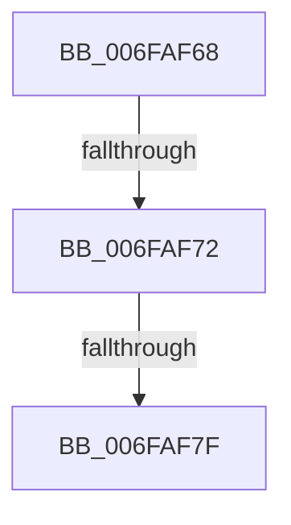

# sub_006FAF68

- RVA: `0x006FAF68`–`0x006FAFD9` (길이 `113` bytes)
- VA: `0x00000001406FAF68`
- 실행 섹션: `.text`
- PDB 이름 있음: `아니요`; PDB Function 태그: `아니요`
- unwind 정보 RVA: `0x000B86B4`
- 디코드: `24`개 명령, `113/113` bytes 표시
- 미해석 바이트: `0` (있으면 어셈블리에 `.byte`로 보존)

> 이 문서는 커널 이미지의 기계어와 PDB 기호를 분석해 생성했습니다. 4번과 5번은 함수 원형과 자료형을 바이너리 사용 방식에서 추정한 C 해석이며 원본 소스 복구 결과는 아닙니다.

## 1. Dependencies

- 직접 호출 지점: **1**; 고유 호출 대상: **1**
- 직접 호출자로 확인된 함수: **0**
- RIP 상대 이미지 참조: **1**

### Outgoing calls
- `0x006FAFCE` → [EtwWriteEx](../25/EtwWriteEx_function_0025F0D0.md) (function, `0x0025F0D0`)

### Direct callers
- 이 함수 시작 RVA로 연결되는 직접 call은 확인되지 않았습니다. 간접 호출은 완전히 역산할 수 없습니다.

### Static image references
- `0x006FAF83` → RVA `0x000220F8` (`.rdata`; read)

## 2. Other-region calls and transfers

- 다른 실행 섹션으로 향하는 call: **0**
- call이 아닌 외부 분기/꼬리 이동: **3**
  - `0x006FAF6C` → [BapdWriteEtwEvents + 0x1B1](../4A/BapdWriteEtwEvents_function_004AE884.md) (`tail-transfer`)
  - `0x006FAF79` → [BapdWriteEtwEvents + 0x1B1](../4A/BapdWriteEtwEvents_function_004AE884.md) (`tail-transfer`)
  - `0x006FAFD4` → [BapdWriteEtwEvents + 0x1B1](../4A/BapdWriteEtwEvents_function_004AE884.md) (`tail-transfer`)

## 3. Assembly (complete function range)

```asm
006FAF68  83 7B 04 24                     cmp dword ptr [rbx + 4], 0x24
006FAF6C  0F 82 C3 3A DB FF               jb 0x1404aea35
006FAF72  48 8D 43 20                     lea rax, [rbx + 0x20]
006FAF76  83 38 00                        cmp dword ptr [rax], 0
006FAF79  0F 86 B6 3A DB FF               jbe 0x1404aea35
006FAF7F  48 8B 4D EF                     mov rcx, qword ptr [rbp - 0x11]
006FAF83  48 8D 15 6E 71 92 FF            lea rdx, [rip - 0x6d8e92]
006FAF8A  83 65 03 00                     and dword ptr [rbp + 3], 0
006FAF8E  45 33 C9                        xor r9d, r9d
006FAF91  83 65 13 00                     and dword ptr [rbp + 0x13], 0
006FAF95  45 33 C0                        xor r8d, r8d
006FAF98  48 89 45 07                     mov qword ptr [rbp + 7], rax
006FAF9C  48 8D 45 F7                     lea rax, [rbp - 9]
006FAFA0  48 89 44 24 38                  mov qword ptr [rsp + 0x38], rax
006FAFA5  C7 44 24 30 02 00 00 00         mov dword ptr [rsp + 0x30], 2
006FAFAD  48 83 64 24 28 00               and qword ptr [rsp + 0x28], 0
006FAFB3  48 83 64 24 20 00               and qword ptr [rsp + 0x20], 0
006FAFB9  48 89 4D F7                     mov qword ptr [rbp - 9], rcx
006FAFBD  49 8B CD                        mov rcx, r13
006FAFC0  C7 45 FF 10 00 00 00            mov dword ptr [rbp - 1], 0x10
006FAFC7  C7 45 0F 04 00 00 00            mov dword ptr [rbp + 0xf], 4
006FAFCE  E8 FD 40 B6 FF                  call 0x14025f0d0
006FAFD3  90                              nop
006FAFD4  E9 5C 3A DB FF                  jmp 0x1404aea35
```

## 4. C-style interpretation (structured pseudocode)

```c
__int64 __fastcall sub_006FAF68(__int64 a1, __int64 a2, int a3, int a4, __int64 a5)
{
    __int64 result;
    unsigned __int64 v_stack_p20;
    unsigned int v_stack_p30;
    unsigned __int64 v_stack_p38;

    a4 = 0;
    a3 = 0;
    *(unsigned __int64 *)(v_rbp + 7) = v_rbx + 32;
    v_stack_p38 = v_rbp - 9;
    v_stack_p30 = 2;
    *(unsigned __int64 *)(v_rbp - 9) = *(unsigned __int64 *)(v_rbp - 17);
    *(unsigned int *)(v_rbp - 1) = 16;
    *(unsigned int *)(v_rbp + 15) = 4;
    result = EtwWriteEx(v_r13, v_rip - 7179922, a3, a4);
}
```

## 5. (Beta) C Style

```c
int64_t sub_006FAF68(int64_t Arg1, int64_t Arg2, int32_t Arg3, int32_t Arg4, int64_t Arg5)
{
    int64_t result;
    uint64_t v_stack_p20;
    uint32_t v_stack_p30;
    uint64_t v_stack_p38;

    Arg4 = 0;
    Arg3 = 0;
    *(uint64_t *)(local_rbp + 0x7) = local_rbx + 32;
    v_stack_p38 = local_rbp - 9;
    v_stack_p30 = 2;
    *(uint64_t *)(local_rbp - 0x9) = *(uint64_t *)(local_rbp - 0x11);
    *(uint32_t *)(local_rbp - 0x1) = 16;
    *(uint32_t *)(local_rbp + 0xF) = 4;
    result = EtwWriteEx(local_r13, v_rip - 7179922, Arg3, Arg4);
}
```

## 6. Execution-region graph

[열기: 2D/3D 그래프와 함수 탐색 컨트롤 패널](../../../control-panel.html?section=text&rva=0x006FAF68&view=graph)

- 2D 그래프는 위에서 아래로 흐르고, 3D 그래프는 빈 공간을 드래그해 회전합니다. Shift+드래그는 이동, 휠은 확대·축소, 함수 노드 선택은 대상 보고서 이동입니다.

### Static fallback


