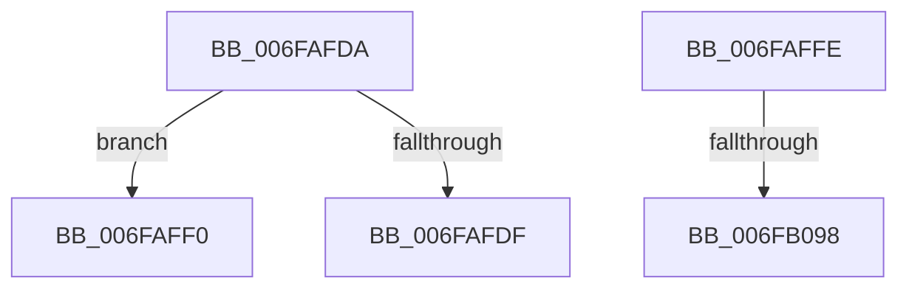

# sub_006FAFDA

- RVA: `0x006FAFDA`–`0x006FB0B1` (길이 `215` bytes)
- VA: `0x00000001406FAFDA`
- 실행 섹션: `.text`
- PDB 이름 있음: `아니요`; PDB Function 태그: `아니요`
- unwind 정보 RVA: `0x000B8798`
- 디코드: `46`개 명령, `215/215` bytes 표시
- 미해석 바이트: `0` (있으면 어셈블리에 `.byte`로 보존)

> 이 문서는 커널 이미지의 기계어와 PDB 기호를 분석해 생성했습니다. 4번과 5번은 함수 원형과 자료형을 바이너리 사용 방식에서 추정한 C 해석이며 원본 소스 복구 결과는 아닙니다.

## 1. Dependencies

- 직접 호출 지점: **3**; 고유 호출 대상: **3**
- 직접 호출자로 확인된 함수: **0**
- RIP 상대 이미지 참조: **2**

### Outgoing calls
- `0x006FB02C` → [KeSelectIdealProcessor](../2C/KeSelectIdealProcessor_function_002CE8CC.md) (function, `0x002CE8CC`)
- `0x006FB044` → [KiSetIdealProcessorThread](../2D/KiSetIdealProcessorThread_function_002DCFE0.md) (function, `0x002DCFE0`)
- `0x006FB0A6` → [EtwTraceIdealProcessor](../3C/EtwTraceIdealProcessor_function_003C0808.md) (function, `0x003C0808`)

### Direct callers
- 이 함수 시작 RVA로 연결되는 직접 call은 확인되지 않았습니다. 간접 호출은 완전히 역산할 수 없습니다.

### Static image references
- `0x006FB051` → RVA `0x00FC8C40` (`ALMOSTRO`; read)
- `0x006FB084` → RVA `0x00FC6B10` (`ALMOSTRO`; read)

## 2. Other-region calls and transfers

- 다른 실행 섹션으로 향하는 call: **0**
- call이 아닌 외부 분기/꼬리 이동: **4**
  - `0x006FAFEB` → [KiAdaptThreadIdealProcessorForProcessIdealSetChange + 0x10B](../4A/KiAdaptThreadIdealProcessorForProcessIdealSetChange_function_004AF434.md) (`tail-transfer`)
  - `0x006FAFF9` → [KiAdaptThreadIdealProcessorForProcessIdealSetChange + 0x10B](../4A/KiAdaptThreadIdealProcessorForProcessIdealSetChange_function_004AF434.md) (`tail-transfer`)
  - `0x006FB092` → [KiAdaptThreadIdealProcessorForProcessIdealSetChange + 0x135](../4A/KiAdaptThreadIdealProcessorForProcessIdealSetChange_function_004AF434.md) (`tail-transfer`)
  - `0x006FB0AC` → [KiAdaptThreadIdealProcessorForProcessIdealSetChange + 0x135](../4A/KiAdaptThreadIdealProcessorForProcessIdealSetChange_function_004AF434.md) (`tail-transfer`)

## 3. Assembly (complete function range)

```asm
006FAFDA  49 3B C1                        cmp rax, r9
006FAFDD  75 11                           jne 0x1406faff0
006FAFDF  4C 8B D1                        mov r10, rcx
006FAFE2  41 BB 02 00 00 00               mov r11d, 2
006FAFE8  4D 33 D1                        xor r10, r9
006FAFEB  E9 4F 45 DB FF                  jmp 0x1404af53f
006FAFF0  41 BB 03 00 00 00               mov r11d, 3
006FAFF6  4C 8B D1                        mov r10, rcx
006FAFF9  E9 41 45 DB FF                  jmp 0x1404af53f
006FAFFE  48 8B 8C 24 80 00 00 00         mov rcx, qword ptr [rsp + 0x80]
006FB006  41 B9 01 00 00 00               mov r9d, 1
006FB00C  41 0F B7 C0                     movzx eax, r8w
006FB010  4C 8D 84 24 88 00 00 00         lea r8, [rsp + 0x88]
006FB018  48 8B 89 B8 00 00 00            mov rcx, qword ptr [rcx + 0xb8]
006FB01F  48 83 C1 10                     add rcx, 0x10
006FB023  48 8D 14 41                     lea rdx, [rcx + rax*2]
006FB027  48 8D 4C 24 30                  lea rcx, [rsp + 0x30]
006FB02C  E8 9B 38 BD FF                  call 0x1402ce8cc
006FB031  0F B7 F0                        movzx esi, ax
006FB034  45 33 C9                        xor r9d, r9d
006FB037  8B D6                           mov edx, esi
006FB039  C6 44 24 20 02                  mov byte ptr [rsp + 0x20], 2
006FB03E  45 33 C0                        xor r8d, r8d
006FB041  48 8B CB                        mov rcx, rbx
006FB044  E8 97 1F BE FF                  call 0x1402dcfe0
006FB049  48 C7 43 40 00 00 00 00         mov qword ptr [rbx + 0x40], 0
006FB051  48 8D 15 E8 DB 8C 00            lea rdx, [rip + 0x8cdbe8]
006FB058  48 8B 14 F2                     mov rdx, qword ptr [rdx + rsi*8]
006FB05C  3B F7                           cmp esi, edi
006FB05E  0F 95 C0                        setne al
006FB061  41 88 04 24                     mov byte ptr [r12], al
006FB065  48 8B 85 C0 00 00 00            mov rax, qword ptr [rbp + 0xc0]
006FB06C  48 8B 92 C0 00 00 00            mov rdx, qword ptr [rdx + 0xc0]
006FB073  0F B7 88 8A 00 00 00            movzx ecx, word ptr [rax + 0x8a]
006FB07A  66 39 8A 8A 00 00 00            cmp word ptr [rdx + 0x8a], cx
006FB081  0F 95 C0                        setne al
006FB084  F7 05 82 BA 8C 00 00 00 00 08   test dword ptr [rip + 0x8cba82], 0x8000000
006FB08E  41 88 45 00                     mov byte ptr [r13], al
006FB092  0F 84 D1 44 DB FF               je 0x1404af569
006FB098  BA 47 05 00 00                  mov edx, 0x547
006FB09D  44 8B CE                        mov r9d, esi
006FB0A0  44 8B C7                        mov r8d, edi
006FB0A3  48 8B CB                        mov rcx, rbx
006FB0A6  E8 5D 57 CC FF                  call 0x1403c0808
006FB0AB  90                              nop
006FB0AC  E9 B8 44 DB FF                  jmp 0x1404af569
```

## 4. C-style interpretation (structured pseudocode)

```c
__int64 __fastcall sub_006FAFDA(__int64 a1, __int64 a2, unsigned __int16 a3, __int64 a4)
{
    __int64 v_r10;
    unsigned __int8 v_stack_p20;
    unsigned __int64 v_stack_p30;
    unsigned __int64 v_stack_p80;
    unsigned __int64 v_stack_p88;

    if (result != a4) goto loc_006FAFF0;
    v_r10 = (a1) ^ (a4);
loc_006FAFF0:
}
```

## 5. (Beta) C Style

```c
int64_t sub_006FAFDA(int64_t Arg1, int64_t Arg2, uint16_t Arg3, int64_t Arg4)
{
    int64_t local_r10;
    uint8_t v_stack_p20;
    uint64_t v_stack_p30;
    uint64_t v_stack_p80;
    uint64_t v_stack_p88;

    if (result != Arg4) goto loc_006FAFF0;
    local_r10 = (Arg1) ^ (Arg4);
loc_006FAFF0:
}
```

## 6. Execution-region graph

[열기: 2D/3D 그래프와 함수 탐색 컨트롤 패널](../../../control-panel.html?section=text&rva=0x006FAFDA&view=graph)

- 2D 그래프는 위에서 아래로 흐르고, 3D 그래프는 빈 공간을 드래그해 회전합니다. Shift+드래그는 이동, 휠은 확대·축소, 함수 노드 선택은 대상 보고서 이동입니다.

### Static fallback


