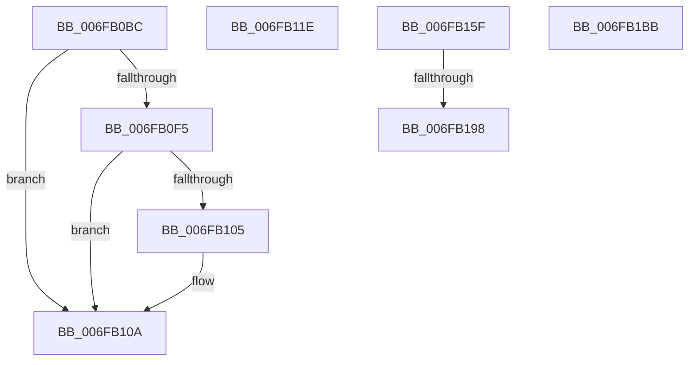

# sub_006FB0BC

- RVA: `0x006FB0BC`–`0x006FB1C6` (길이 `266` bytes)
- VA: `0x00000001406FB0BC`
- 실행 섹션: `.text`
- PDB 이름 있음: `아니요`; PDB Function 태그: `아니요`
- unwind 정보 RVA: `0x000B88A8`
- 디코드: `68`개 명령, `266/266` bytes 표시
- 미해석 바이트: `0` (있으면 어셈블리에 `.byte`로 보존)

> 이 문서는 커널 이미지의 기계어와 PDB 기호를 분석해 생성했습니다. 4번과 5번은 함수 원형과 자료형을 바이너리 사용 방식에서 추정한 C 해석이며 원본 소스 복구 결과는 아닙니다.

## 1. Dependencies

- 직접 호출 지점: **5**; 고유 호출 대상: **5**
- 직접 호출자로 확인된 함수: **0**
- RIP 상대 이미지 참조: **1**

### Outgoing calls
- `0x006FB105` → [KiRaiseIrqlProcessIrqlFlags](../4F/KiRaiseIrqlProcessIrqlFlags_function_004F56FC.md) (function, `0x004F56FC`)
- `0x006FB10D` → [MmGetPhysicalAddress](../23/MmGetPhysicalAddress_function_0023A500.md) (function, `0x0023A500`)
- `0x006FB163` → [HvlpReleaseHypercallPage](../31/HvlpReleaseHypercallPage_function_00313480.md) (function, `0x00313480`)
- `0x006FB17A` → [HvlpAcquireHypercallPage](../47/HvlpAcquireHypercallPage_function_00471410.md) (function, `0x00471410`)
- `0x006FB1BB` → [VslFlushSecureAddressSpace](../4B/VslFlushSecureAddressSpace_function_004BC6FC.md) (function, `0x004BC6FC`)

### Direct callers
- 이 함수 시작 RVA로 연결되는 직접 call은 확인되지 않았습니다. 간접 호출은 완전히 역산할 수 없습니다.

### Static image references
- `0x006FB0FD` → RVA `0x00FC6D20` (`ALMOSTRO`; read)

## 2. Other-region calls and transfers

- 다른 실행 섹션으로 향하는 call: **0**
- call이 아닌 외부 분기/꼬리 이동: **5**
  - `0x006FB119` → [HvlpSlowFlushListTbEx + 0xB4](../4A/HvlpSlowFlushListTbEx_function_004AFCF8.md) (`tail-transfer`)
  - `0x006FB15A` → [HvlpSlowFlushListTbEx + 0x113](../4A/HvlpSlowFlushListTbEx_function_004AFCF8.md) (`tail-transfer`)
  - `0x006FB192` → [HvlpSlowFlushListTbEx + 0x1A8](../4A/HvlpSlowFlushListTbEx_function_004AFCF8.md) (`tail-transfer`)
  - `0x006FB1B6` → [HvlpSlowFlushListTbEx + 0x1A8](../4A/HvlpSlowFlushListTbEx_function_004AFCF8.md) (`tail-transfer`)
  - `0x006FB1C1` → [HvlpSlowFlushListTbEx + 0x198](../4A/HvlpSlowFlushListTbEx_function_004AFCF8.md) (`tail-transfer`)

## 3. Assembly (complete function range)

```asm
006FB0BC  48 C7 C2 00 F0 FF FF            mov rdx, 0xfffffffffffff000
006FB0C3  48 8D 4D D6                     lea rcx, [rbp - 0x2a]
006FB0C7  48 83 E1 F8                     and rcx, 0xfffffffffffffff8
006FB0CB  48 8D 71 1F                     lea rsi, [rcx + 0x1f]
006FB0CF  48 8B C6                        mov rax, rsi
006FB0D2  48 23 F2                        and rsi, rdx
006FB0D5  48 33 C1                        xor rax, rcx
006FB0D8  48 85 C2                        test rdx, rax
006FB0DB  BA 02 00 00 00                  mov edx, 2
006FB0E0  44 8B F2                        mov r14d, edx
006FB0E3  89 55 A7                        mov dword ptr [rbp - 0x59], edx
006FB0E6  48 0F 44 F1                     cmove rsi, rcx
006FB0EA  44 0F 20 C0                     mov rax, cr8
006FB0EE  88 45 AF                        mov byte ptr [rbp - 0x51], al
006FB0F1  3A C2                           cmp al, dl
006FB0F3  73 15                           jae 0x1406fb10a
006FB0F5  44 0F 20 C1                     mov rcx, cr8
006FB0F9  44 0F 22 C2                     mov cr8, rdx
006FB0FD  39 3D 1D BC 8C 00               cmp dword ptr [rip + 0x8cbc1d], edi
006FB103  74 05                           je 0x1406fb10a
006FB105  E8 F2 A5 DF FF                  call 0x1404f56fc
006FB10A  48 8B CE                        mov rcx, rsi
006FB10D  E8 EE F3 B3 FF                  call 0x14023a500
006FB112  48 8B D8                        mov rbx, rax
006FB115  48 89 45 BF                     mov qword ptr [rbp - 0x41], rax
006FB119  E9 8E 4C DB FF                  jmp 0x1404afdac
006FB11E  8B 45 93                        mov eax, dword ptr [rbp - 0x6d]
006FB121  8B 4D 7F                        mov ecx, dword ptr [rbp + 0x7f]
006FB124  83 C0 07                        add eax, 7
006FB127  C1 E0 0E                        shl eax, 0xe
006FB12A  25 00 00 FE 03                  and eax, 0x3fe0000
006FB12F  48 C7 45 97 14 00 00 00         mov qword ptr [rbp - 0x69], 0x14
006FB137  83 C8 14                        or eax, 0x14
006FB13A  89 45 97                        mov dword ptr [rbp - 0x69], eax
006FB13D  48 8B 45 97                     mov rax, qword ptr [rbp - 0x69]
006FB141  48 89 45 97                     mov qword ptr [rbp - 0x69], rax
006FB145  48 C1 E8 20                     shr rax, 0x20
006FB149  33 C8                           xor ecx, eax
006FB14B  81 E1 FF 0F 00 00               and ecx, 0xfff
006FB151  33 C8                           xor ecx, eax
006FB153  89 4D 9B                        mov dword ptr [rbp - 0x65], ecx
006FB156  48 8B 7D 97                     mov rdi, qword ptr [rbp - 0x69]
006FB15A  E9 AC 4C DB FF                  jmp 0x1404afe0b
006FB15F  48 8D 4D A7                     lea rcx, [rbp - 0x59]
006FB163  E8 18 83 C1 FF                  call 0x140313480
006FB168  41 B9 20 00 00 00               mov r9d, 0x20
006FB16E  4C 8D 45 CF                     lea r8, [rbp - 0x31]
006FB172  48 8D 4D A7                     lea rcx, [rbp - 0x59]
006FB176  41 8D 51 E9                     lea edx, [r9 - 0x17]
006FB17A  E8 91 62 D7 FF                  call 0x140471410
006FB17F  44 8B 4D 93                     mov r9d, dword ptr [rbp - 0x6d]
006FB183  48 8B F0                        mov rsi, rax
006FB186  48 8B 5D BF                     mov rbx, qword ptr [rbp - 0x41]
006FB18A  B9 02 00 00 00                  mov ecx, 2
006FB18F  45 84 E4                        test r12b, r12b
006FB192  0F 84 08 4D DB FF               je 0x1404afea0
006FB198  BF 13 00 00 00                  mov edi, 0x13
006FB19D  41 8D 41 07                     lea eax, [r9 + 7]
006FB1A1  C1 E0 0E                        shl eax, 0xe
006FB1A4  48 89 7D 97                     mov qword ptr [rbp - 0x69], rdi
006FB1A8  25 00 00 FE 03                  and eax, 0x3fe0000
006FB1AD  0B C7                           or eax, edi
006FB1AF  89 45 97                        mov dword ptr [rbp - 0x69], eax
006FB1B2  48 8B 7D 97                     mov rdi, qword ptr [rbp - 0x69]
006FB1B6  E9 E5 4C DB FF                  jmp 0x1404afea0
006FB1BB  E8 3C 15 DC FF                  call 0x1404bc6fc
006FB1C0  90                              nop
006FB1C1  E9 CA 4C DB FF                  jmp 0x1404afe90
```

## 4. C-style interpretation (structured pseudocode)

```c
__int64 __fastcall sub_006FB0BC(void)
{
    __int64 result;
    __int64 v_rsi;

    a1 = (v_rbp - 42) & (-8);
    v_rsi = (a1 + 31) & (0xFFFFFFFFFFFFF000ULL);
    result = (a1 + 31) ^ (a1);
    *(unsigned int *)(v_rbp - 89) = 2;
    if (((0xFFFFFFFFFFFFF000ULL) & (result)) == 0) { v_rsi = a1; }
    *(unsigned __int8 *)(v_rbp - 81) = (unsigned __int8)(v_cr8);
    if (((unsigned __int8)(v_cr8)) >= 2) goto loc_006FB10A;
    result = v_cr8;
    if ((*(unsigned int *)(v_rip + 9223197)) != ((unsigned int)(v_rdi))) {
        result = KiRaiseIrqlProcessIrqlFlags(v_cr8, 2, a3, a4);
    }
    result = MmGetPhysicalAddress(v_rsi, 2, a3, a4);
    *(unsigned __int64 *)(v_rbp - 65) = result;
}
```

## 5. (Beta) C Style

```c
void sub_006FB0BC(void)
{
    int64_t result;
    int64_t local_rsi;

    a1 = (local_rbp - 42) & (-8);
    local_rsi = (a1 + 31) & (0xFFFFFFFFFFFFF000ULL);
    result = (a1 + 31) ^ (a1);
    *(uint32_t *)(local_rbp - 0x59) = 2;
    if (((0xFFFFFFFFFFFFF000ULL) & (result)) == 0) { local_rsi = a1; }
    *(uint8_t *)(local_rbp - 0x51) = (uint8_t)(v_cr8);
    if (((uint8_t)(v_cr8)) >= 2) goto loc_006FB10A;
    result = v_cr8;
    if ((*(uint32_t *)(v_rip + 0x8CBC1D)) != ((uint32_t)(local_rdi))) {
        result = KiRaiseIrqlProcessIrqlFlags(v_cr8, 2, a3, a4);
    }
    result = MmGetPhysicalAddress(local_rsi, 2, a3, a4);
    *(uint64_t *)(local_rbp - 0x41) = result;
}
```

## 6. Execution-region graph

[열기: 2D/3D 그래프와 함수 탐색 컨트롤 패널](../../../control-panel.html?section=text&rva=0x006FB0BC&view=graph)

- 2D 그래프는 위에서 아래로 흐르고, 3D 그래프는 빈 공간을 드래그해 회전합니다. Shift+드래그는 이동, 휠은 확대·축소, 함수 노드 선택은 대상 보고서 이동입니다.

### Static fallback


