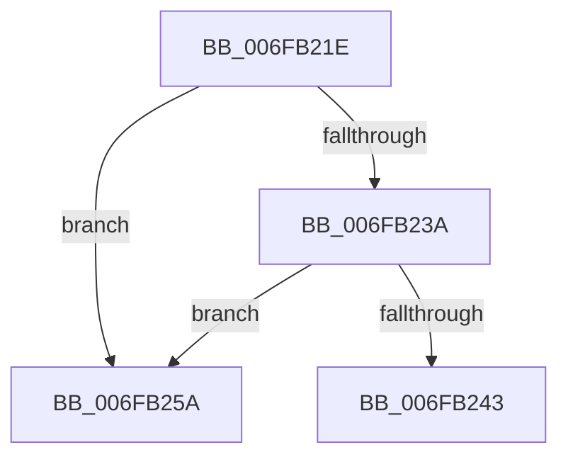

# sub_006FB21E

- RVA: `0x006FB21E`–`0x006FB261` (길이 `67` bytes)
- VA: `0x00000001406FB21E`
- 실행 섹션: `.text`
- PDB 이름 있음: `아니요`; PDB Function 태그: `아니요`
- unwind 정보 RVA: `0x000B8958`
- 디코드: `19`개 명령, `67/67` bytes 표시
- 미해석 바이트: `0` (있으면 어셈블리에 `.byte`로 보존)

> 이 문서는 커널 이미지의 기계어와 PDB 기호를 분석해 생성했습니다. 4번과 5번은 함수 원형과 자료형을 바이너리 사용 방식에서 추정한 C 해석이며 원본 소스 복구 결과는 아닙니다.

## 1. Dependencies

- 직접 호출 지점: **3**; 고유 호출 대상: **3**
- 직접 호출자로 확인된 함수: **0**
- RIP 상대 이미지 참조: **0**

### Outgoing calls
- `0x006FB223` → [ObfDereferenceObjectWithTag](../2F/ObfDereferenceObjectWithTag_function_002F78E0.md) (function, `0x002F78E0`)
- `0x006FB22C` → [ExUnregisterCallback](../4B/ExUnregisterCallback_function_004B7F80.md) (function, `0x004B7F80`)
- `0x006FB24F` → [ExFreePoolWithTag](../../poolcode/B8/ExFreePoolWithTag_function_00B82870.md) (function, `0x00B82870`)

### Direct callers
- 이 함수 시작 RVA로 연결되는 직접 call은 확인되지 않았습니다. 간접 호출은 완전히 역산할 수 없습니다.

### Static image references
- 디코드된 RIP-relative 메모리 참조가 없습니다.

## 2. Other-region calls and transfers

- 다른 실행 섹션으로 향하는 call: **1**
  - `0x006FB24F` → [ExFreePoolWithTag](../../poolcode/B8/ExFreePoolWithTag_function_00B82870.md) (`.text` → `POOLCODE`)
- call이 아닌 외부 분기/꼬리 이동: **1**
  - `0x006FB255` → [IopCleanupNotifications + 0x7B](../4B/IopCleanupNotifications_function_004B044C.md) (`tail-transfer`)

## 3. Assembly (complete function range)

```asm
006FB21E  BA 44 66 6C 74                  mov edx, 0x746c6644
006FB223  E8 B8 C6 BF FF                  call 0x1402f78e0
006FB228  48 8B 4B 20                     mov rcx, qword ptr [rbx + 0x20]
006FB22C  E8 4F CD DB FF                  call 0x1404b7f80
006FB231  48 8B 0B                        mov rcx, qword ptr [rbx]
006FB234  48 39 59 08                     cmp qword ptr [rcx + 8], rbx
006FB238  75 20                           jne 0x1406fb25a
006FB23A  48 8B 43 08                     mov rax, qword ptr [rbx + 8]
006FB23E  48 39 18                        cmp qword ptr [rax], rbx
006FB241  75 17                           jne 0x1406fb25a
006FB243  48 89 08                        mov qword ptr [rax], rcx
006FB246  33 D2                           xor edx, edx
006FB248  48 89 41 08                     mov qword ptr [rcx + 8], rax
006FB24C  48 8B CB                        mov rcx, rbx
006FB24F  E8 1C 76 48 00                  call 0x140b82870
006FB254  90                              nop
006FB255  E9 6D 52 DB FF                  jmp 0x1404b04c7
006FB25A  B9 03 00 00 00                  mov ecx, 3
006FB25F  CD 29                           int 0x29
```

## 4. C-style interpretation (structured pseudocode)

```c
__int64 __fastcall sub_006FB21E(void)
{
    __int64 result;

    result = ObfDereferenceObjectWithTag(a1, (unsigned int)(0x746C6644ULL), a3, a4);
    result = ExUnregisterCallback(*(unsigned __int64 *)(v_rbx + 32), (unsigned int)(0x746C6644ULL), a3, a4);
    if ((*(unsigned __int64 *)(*(unsigned __int64 *)(v_rbx) + 8)) != v_rbx) goto loc_006FB25A;
    if ((*(unsigned __int64 *)(*(unsigned __int64 *)(v_rbx + 8))) != v_rbx) goto loc_006FB25A;
    *(unsigned __int64 *)(*(unsigned __int64 *)(v_rbx + 8)) = *(unsigned __int64 *)(v_rbx);
    a2 = 0;
    *(unsigned __int64 *)(*(unsigned __int64 *)(v_rbx) + 8) = *(unsigned __int64 *)(v_rbx + 8);
    result = ExFreePoolWithTag(v_rbx, a2, a3, a4);
loc_006FB25A:
    return result;
}
```

## 5. (Beta) C Style

```c
void sub_006FB21E(void)
{
    int64_t result;

    result = ObfDereferenceObjectWithTag(a1, (uint32_t)(0x746C6644ULL), a3, a4);
    result = ExUnregisterCallback(*(uint64_t *)(local_rbx + 0x20), (uint32_t)(0x746C6644ULL), a3, a4);
    if ((*(uint64_t *)(*(uint64_t *)(local_rbx) + 0x8)) != local_rbx) goto loc_006FB25A;
    if ((*(uint64_t *)(*(uint64_t *)(local_rbx + 0x8))) != local_rbx) goto loc_006FB25A;
    *(uint64_t *)(*(uint64_t *)(local_rbx + 0x8)) = *(uint64_t *)(local_rbx);
    a2 = 0;
    *(uint64_t *)(*(uint64_t *)(local_rbx) + 0x8) = *(uint64_t *)(local_rbx + 0x8);
    result = ExFreePoolWithTag(local_rbx, a2, a3, a4);
loc_006FB25A:
    return result;
}
```

## 6. Execution-region graph

[열기: 2D/3D 그래프와 함수 탐색 컨트롤 패널](../../../control-panel.html?section=text&rva=0x006FB21E&view=graph)

- 2D 그래프는 위에서 아래로 흐르고, 3D 그래프는 빈 공간을 드래그해 회전합니다. Shift+드래그는 이동, 휠은 확대·축소, 함수 노드 선택은 대상 보고서 이동입니다.

### Static fallback


