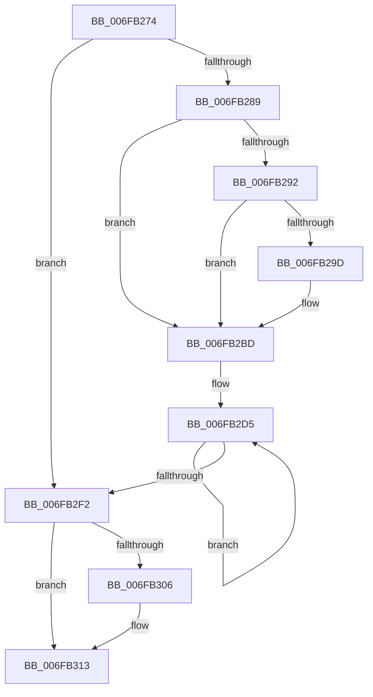

# sub_006FB274

- RVA: `0x006FB274`–`0x006FB323` (길이 `175` bytes)
- VA: `0x00000001406FB274`
- 실행 섹션: `.text`
- PDB 이름 있음: `아니요`; PDB Function 태그: `아니요`
- unwind 정보 RVA: `0x000B8BF8`
- 디코드: `36`개 명령, `175/175` bytes 표시
- 미해석 바이트: `0` (있으면 어셈블리에 `.byte`로 보존)

> 이 문서는 커널 이미지의 기계어와 PDB 기호를 분석해 생성했습니다. 4번과 5번은 함수 원형과 자료형을 바이너리 사용 방식에서 추정한 C 해석이며 원본 소스 복구 결과는 아닙니다.

## 1. Dependencies

- 직접 호출 지점: **0**; 고유 호출 대상: **0**
- 직접 호출자로 확인된 함수: **0**
- RIP 상대 이미지 참조: **0**

### Outgoing calls
- 직접 디코드된 call 명령이 없습니다.

### Direct callers
- 이 함수 시작 RVA로 연결되는 직접 call은 확인되지 않았습니다. 간접 호출은 완전히 역산할 수 없습니다.

### Static image references
- 디코드된 RIP-relative 메모리 참조가 없습니다.

## 2. Other-region calls and transfers

- 다른 실행 섹션으로 향하는 call: **0**
- call이 아닌 외부 분기/꼬리 이동: **1**
  - `0x006FB31E` → [KeIdleSpecCtrl + 0x2B](../4B/KeIdleSpecCtrl_function_004B0D40.md) (`tail-transfer`)

## 3. Assembly (complete function range)

```asm
006FB274  0F 0D 89 E0 06 00 00            prefetchw byte ptr [rcx + 0x6e0]
006FB27B  44 0F B7 81 E0 06 00 00         movzx r8d, word ptr [rcx + 0x6e0]
006FB283  41 F6 C0 04                     test r8b, 4
006FB287  74 69                           je 0x1406fb2f2
006FB289  F6 81 D8 06 00 00 01            test byte ptr [rcx + 0x6d8], 1
006FB290  74 2B                           je 0x1406fb2bd
006FB292  0F B7 81 E6 06 00 00            movzx eax, word ptr [rcx + 0x6e6]
006FB299  A8 03                           test al, 3
006FB29B  75 20                           jne 0x1406fb2bd
006FB29D  66 83 C8 02                     or ax, 2
006FB2A1  66 41 83 C9 02                  or r9w, 2
006FB2A6  0F B7 D0                        movzx edx, ax
006FB2A9  66 89 91 E6 06 00 00            mov word ptr [rcx + 0x6e6], dx
006FB2B0  8B C2                           mov eax, edx
006FB2B2  48 C1 EA 20                     shr rdx, 0x20
006FB2B6  B9 48 00 00 00                  mov ecx, 0x48
006FB2BB  0F 30                           wrmsr
006FB2BD  66 F0 41 83 8A E0 06 00 00 02   lock or word ptr [r10 + 0x6e0], 2
006FB2C7  49 8B 92 B0 2D 00 00            mov rdx, qword ptr [r10 + 0x2db0]
006FB2CE  0F 0D 8A E0 06 00 00            prefetchw byte ptr [rdx + 0x6e0]
006FB2D5  0F B7 82 E0 06 00 00            movzx eax, word ptr [rdx + 0x6e0]
006FB2DC  0F B7 C8                        movzx ecx, ax
006FB2DF  66 83 E1 EE                     and cx, 0xffee
006FB2E3  66 83 C9 0A                     or cx, 0xa
006FB2E7  66 F0 0F B1 8A E0 06 00 00      lock cmpxchg word ptr [rdx + 0x6e0], cx
006FB2F0  75 E3                           jne 0x1406fb2d5
006FB2F2  41 F6 82 DC 06 00 00 40         test byte ptr [r10 + 0x6dc], 0x40
006FB2FA  89 5C 24 10                     mov dword ptr [rsp + 0x10], ebx
006FB2FE  66 44 89 4C 24 10               mov word ptr [rsp + 0x10], r9w
006FB304  74 0D                           je 0x1406fb313
006FB306  41 0F B7 8A AA AE 00 00         movzx ecx, word ptr [r10 + 0xaeaa]
006FB30E  66 89 4C 24 12                  mov word ptr [rsp + 0x12], cx
006FB313  8B 4C 24 10                     mov ecx, dword ptr [rsp + 0x10]
006FB317  41 0F B7 C0                     movzx eax, r8w
006FB31B  41 89 0B                        mov dword ptr [r11], ecx
006FB31E  E9 48 5A DB FF                  jmp 0x1404b0d6b
```

## 4. C-style interpretation (structured pseudocode)

```c
__int64 __fastcall sub_006FB274(__int64 a1, __int64 a2, __int64 a3, unsigned __int16 a4)
{
    __int64 result;
    unsigned int v_stack_p10;
    unsigned __int16 v_stack_p12;

    if ((((unsigned __int8)(*(unsigned __int16 *)(a1 + 1760))) & (4)) == 0) goto loc_006FB2F2;
    if (((*(unsigned __int8 *)(a1 + 1752)) & (1)) == 0) goto loc_006FB2BD;
    result = *(unsigned __int16 *)(a1 + 1766);
    if ((((unsigned __int8)(*(unsigned __int16 *)(a1 + 1766))) & (3)) == 0) {
        result = (unsigned __int16)((*(unsigned __int16 *)(a1 + 1766)) | (2));
        a4 = (unsigned __int16)((a4) | (2));
        a2 = (unsigned __int16)(result);
        *(unsigned __int16 *)(a1 + 1766) = (unsigned __int16)(a2);
        result = (unsigned int)(a2);
        a2 = (a2) >> (32);
        a1 = 72;
    }
loc_006FB2D5:
    a1 = (unsigned __int16)(((unsigned __int16)(*(unsigned __int16 *)(*(unsigned __int64 *)(v_r10 + 11696) + 1760))) & (0xFFEEULL));
    a1 = (unsigned __int16)((a1) | (10));
    if (condition_is_not_equal) goto loc_006FB2D5;
loc_006FB2F2:
    v_stack_p10 = (unsigned int)(v_rbx);
    v_stack_p10 = a4;
    if (((*(unsigned __int8 *)(v_r10 + 1756)) & (64)) != 0) {
        a1 = *(unsigned __int16 *)(v_r10 + 44714);
        v_stack_p12 = (unsigned __int16)(a1);
    }
    *(unsigned int *)(v_r11) = (unsigned int)((unsigned int)(v_stack_p10));
}
```

## 5. (Beta) C Style

```c
int64_t sub_006FB274(void *Arg1, int64_t Arg2, int64_t Arg3, uint16_t Arg4)
{
    uint8_t *arg1 = (uint8_t *)Arg1;

    int64_t result;
    uint32_t v_stack_p10;
    uint16_t v_stack_p12;

    if ((((uint8_t)(*(uint16_t *)(arg1 + 0x6E0))) & (4)) == 0) goto loc_006FB2F2;
    if (((*(uint8_t *)(arg1 + 0x6D8)) & (1)) == 0) goto loc_006FB2BD;
    result = *(uint16_t *)(arg1 + 0x6E6);
    if ((((uint8_t)(*(uint16_t *)(arg1 + 0x6E6))) & (3)) == 0) {
        result = (uint16_t)((*(uint16_t *)(arg1 + 0x6E6)) | (2));
        Arg4 = (uint16_t)((Arg4) | (2));
        Arg2 = (uint16_t)(result);
        *(uint16_t *)(arg1 + 0x6E6) = (uint16_t)(Arg2);
        result = (uint32_t)(Arg2);
        Arg2 = (Arg2) >> (32);
        Arg1 = 72;
    }
loc_006FB2D5:
    Arg1 = (uint16_t)(((uint16_t)(*(uint16_t *)(*(uint64_t *)(local_r10 + 0x2DB0) + 0x6E0))) & (0xFFEEULL));
    Arg1 = (uint16_t)((Arg1) | (10));
    if (condition_is_not_equal) goto loc_006FB2D5;
loc_006FB2F2:
    v_stack_p10 = (uint32_t)(local_rbx);
    v_stack_p10 = Arg4;
    if (((*(uint8_t *)(local_r10 + 0x6DC)) & (64)) != 0) {
        Arg1 = *(uint16_t *)(local_r10 + 0xAEAA);
        v_stack_p12 = (uint16_t)(Arg1);
    }
    *(uint32_t *)(local_r11) = (uint32_t)((uint32_t)(v_stack_p10));
}
```

### 관측된 메모리 오프셋

구조체 형식이 확인되지 않은 접근은 인자 기준의 오프셋으로만 기록했습니다.

| 기준 인자 | 오프셋 표현 | 폭 (bit) | 접근 |
|---|---:|---:|---|
| `Arg1` | `+ 0x6D8` | `8` | `R` |
| `Arg1` | `+ 0x6E0` | `8` | `R` |
| `Arg1` | `+ 0x6E0` | `16` | `R` |
| `Arg1` | `+ 0x6E6` | `16` | `R` |
| `Arg1` | `+ 0x6E6` | `16` | `W` |

## 6. Execution-region graph

[열기: 2D/3D 그래프와 함수 탐색 컨트롤 패널](../../../control-panel.html?section=text&rva=0x006FB274&view=graph)

- 2D 그래프는 위에서 아래로 흐르고, 3D 그래프는 빈 공간을 드래그해 회전합니다. Shift+드래그는 이동, 휠은 확대·축소, 함수 노드 선택은 대상 보고서 이동입니다.

### Static fallback


