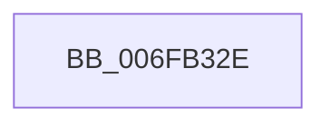

# sub_006FB32E

- RVA: `0x006FB32E`–`0x006FB340` (길이 `18` bytes)
- VA: `0x00000001406FB32E`
- 실행 섹션: `.text`
- PDB 이름 있음: `아니요`; PDB Function 태그: `아니요`
- unwind 정보 RVA: `0x000B8EE0`
- 디코드: `4`개 명령, `18/18` bytes 표시
- 미해석 바이트: `0` (있으면 어셈블리에 `.byte`로 보존)

> 이 문서는 커널 이미지의 기계어와 PDB 기호를 분석해 생성했습니다. 4번과 5번은 함수 원형과 자료형을 바이너리 사용 방식에서 추정한 C 해석이며 원본 소스 복구 결과는 아닙니다.

## 1. Dependencies

- 직접 호출 지점: **0**; 고유 호출 대상: **0**
- 직접 호출자로 확인된 함수: **0**
- RIP 상대 이미지 참조: **1**

### Outgoing calls
- 직접 디코드된 call 명령이 없습니다.

### Direct callers
- 이 함수 시작 RVA로 연결되는 직접 call은 확인되지 않았습니다. 간접 호출은 완전히 역산할 수 없습니다.

### Static image references
- `0x006FB32E` → RVA `0x00FC4048` (`.data`; read)

## 2. Other-region calls and transfers

- 다른 실행 섹션으로 향하는 call: **0**
- call이 아닌 외부 분기/꼬리 이동: **1**
  - `0x006FB33B` → [HalpTimerQueryWakeTime + 0x2E](../4B/HalpTimerQueryWakeTime_function_004B14D0.md) (`tail-transfer`)

## 3. Assembly (complete function range)

```asm
006FB32E  48 8B 0D 13 8D 8C 00            mov rcx, qword ptr [rip + 0x8c8d13]
006FB335  49 2B C9                        sub rcx, r9
006FB338  49 89 0A                        mov qword ptr [r10], rcx
006FB33B  E9 BE 61 DB FF                  jmp 0x1404b14fe
```

## 4. C-style interpretation (structured pseudocode)

```c
void __fastcall sub_006FB32E(__int64 a1, __int64 a2, __int64 a3, __int64 a4)
{
    a1 = (*(unsigned __int64 *)(v_rip + 9211155)) - (a4);
    *(unsigned __int64 *)(v_r10) = a1;
}
```

## 5. (Beta) C Style

```c
void sub_006FB32E(int64_t Arg1, int64_t Arg2, int64_t Arg3, int64_t Arg4)
{
    Arg1 = (*(uint64_t *)(v_rip + 0x8C8D13)) - (Arg4);
    *(uint64_t *)(local_r10) = Arg1;
}
```

## 6. Execution-region graph

[열기: 2D/3D 그래프와 함수 탐색 컨트롤 패널](../../../control-panel.html?section=text&rva=0x006FB32E&view=graph)

- 2D 그래프는 위에서 아래로 흐르고, 3D 그래프는 빈 공간을 드래그해 회전합니다. Shift+드래그는 이동, 휠은 확대·축소, 함수 노드 선택은 대상 보고서 이동입니다.

### Static fallback


