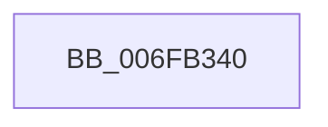

# sub_006FB340

- RVA: `0x006FB340`–`0x006FB35D` (길이 `29` bytes)
- VA: `0x00000001406FB340`
- 실행 섹션: `.text`
- PDB 이름 있음: `아니요`; PDB Function 태그: `아니요`
- unwind 정보 RVA: `0x000B8F58`
- 디코드: `7`개 명령, `29/29` bytes 표시
- 미해석 바이트: `0` (있으면 어셈블리에 `.byte`로 보존)

> 이 문서는 커널 이미지의 기계어와 PDB 기호를 분석해 생성했습니다. 4번과 5번은 함수 원형과 자료형을 바이너리 사용 방식에서 추정한 C 해석이며 원본 소스 복구 결과는 아닙니다.

## 1. Dependencies

- 직접 호출 지점: **1**; 고유 호출 대상: **1**
- 직접 호출자로 확인된 함수: **0**
- RIP 상대 이미지 참조: **1**

### Outgoing calls
- `0x006FB349` → [ExFreePoolWithTag](../../poolcode/B8/ExFreePoolWithTag_function_00B82870.md) (function, `0x00B82870`)

### Direct callers
- 이 함수 시작 RVA로 연결되는 직접 call은 확인되지 않았습니다. 간접 호출은 완전히 역산할 수 없습니다.

### Static image references
- `0x006FB34E` → RVA `0x00FC6C08` (`ALMOSTRO`; read)

## 2. Other-region calls and transfers

- 다른 실행 섹션으로 향하는 call: **1**
  - `0x006FB349` → [ExFreePoolWithTag](../../poolcode/B8/ExFreePoolWithTag_function_00B82870.md) (`.text` → `POOLCODE`)
- call이 아닌 외부 분기/꼬리 이동: **1**
  - `0x006FB358` → [IoReleaseRemoveLockAndWaitEx + 0x39](../4B/IoReleaseRemoveLockAndWaitEx_function_004B17B0.md) (`tail-transfer`)

## 3. Assembly (complete function range)

```asm
006FB340  F0 FF 43 50                     lock inc dword ptr [rbx + 0x50]
006FB344  48 8B 0E                        mov rcx, qword ptr [rsi]
006FB347  33 D2                           xor edx, edx
006FB349  E8 22 75 48 00                  call 0x140b82870
006FB34E  48 8B 05 B3 B8 8C 00            mov rax, qword ptr [rip + 0x8cb8b3]
006FB355  48 89 07                        mov qword ptr [rdi], rax
006FB358  E9 8C 64 DB FF                  jmp 0x1404b17e9
```

## 4. C-style interpretation (structured pseudocode)

```c
__int64 __fastcall sub_006FB340(__int64 a1, int a2)
{
    __int64 result;

    a2 = 0;
    result = ExFreePoolWithTag(*(unsigned __int64 *)(v_rsi), a2, a3, a4);
    *(unsigned __int64 *)(v_rdi) = *(unsigned __int64 *)(v_rip + 9222323);
}
```

## 5. (Beta) C Style

```c
int64_t sub_006FB340(int64_t Arg1, int32_t Arg2)
{
    int64_t result;

    Arg2 = 0;
    result = ExFreePoolWithTag(*(uint64_t *)(local_rsi), Arg2, a3, a4);
    *(uint64_t *)(local_rdi) = *(uint64_t *)(v_rip + 0x8CB8B3);
}
```

## 6. Execution-region graph

[열기: 2D/3D 그래프와 함수 탐색 컨트롤 패널](../../../control-panel.html?section=text&rva=0x006FB340&view=graph)

- 2D 그래프는 위에서 아래로 흐르고, 3D 그래프는 빈 공간을 드래그해 회전합니다. Shift+드래그는 이동, 휠은 확대·축소, 함수 노드 선택은 대상 보고서 이동입니다.

### Static fallback


