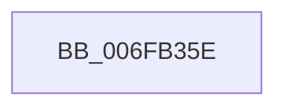

# sub_006FB35E

- RVA: `0x006FB35E`–`0x006FB37C` (길이 `30` bytes)
- VA: `0x00000001406FB35E`
- 실행 섹션: `.text`
- PDB 이름 있음: `아니요`; PDB Function 태그: `아니요`
- unwind 정보 RVA: `0x000B91D4`
- 디코드: `7`개 명령, `30/30` bytes 표시
- 미해석 바이트: `0` (있으면 어셈블리에 `.byte`로 보존)

> 이 문서는 커널 이미지의 기계어와 PDB 기호를 분석해 생성했습니다. 4번과 5번은 함수 원형과 자료형을 바이너리 사용 방식에서 추정한 C 해석이며 원본 소스 복구 결과는 아닙니다.

## 1. Dependencies

- 직접 호출 지점: **1**; 고유 호출 대상: **1**
- 직접 호출자로 확인된 함수: **0**
- RIP 상대 이미지 참조: **0**

### Outgoing calls
- `0x006FB371` → [guard_dispatch_icall](../6B/guard_dispatch_icall_function_006BAAD0.md) (function, `0x006BAAD0`)

### Direct callers
- 이 함수 시작 RVA로 연결되는 직접 call은 확인되지 않았습니다. 간접 호출은 완전히 역산할 수 없습니다.

### Static image references
- 디코드된 RIP-relative 메모리 참조가 없습니다.

## 2. Other-region calls and transfers

- 다른 실행 섹션으로 향하는 call: **0**
- call이 아닌 외부 분기/꼬리 이동: **1**
  - `0x006FB377` → [PopFxNotifySystemStateTransition + 0x10](../4B/PopFxNotifySystemStateTransition_function_004B230C.md) (`tail-transfer`)

## 3. Assembly (complete function range)

```asm
006FB35E  44 89 44 24 48                  mov dword ptr [rsp + 0x48], r8d
006FB363  BA 28 00 00 00                  mov edx, 0x28
006FB368  4C 8D 44 24 48                  lea r8, [rsp + 0x48]
006FB36D  48 8B 40 68                     mov rax, qword ptr [rax + 0x68]
006FB371  E8 5A F7 FB FF                  call 0x1406baad0
006FB376  90                              nop
006FB377  E9 A0 6F DB FF                  jmp 0x1404b231c
```

## 4. C-style interpretation (structured pseudocode)

```c
__int64 __fastcall sub_006FB35E(__int64 a1, __int64 a2, int a3, __int64 a4, __int64 a5, __int64 a6, __int64 a7, __int64 a8, __int64 a9)
{
    __int64 result;
    unsigned int v_stack_p48;

    v_stack_p48 = a3;
    result = guard_dispatch_icall(a1, 40, a9, a4);
}
```

## 5. (Beta) C Style

```c
int64_t sub_006FB35E(int64_t Arg1, int64_t Arg2, int32_t Arg3, int64_t Arg4, uint64_t Arg5, uint64_t Arg6, uint64_t Arg7, uint64_t Arg8, int64_t Arg9)
{
    int64_t result;
    uint32_t v_stack_p48;

    v_stack_p48 = Arg3;
    result = guard_dispatch_icall(Arg1, 40, Arg9, Arg4);
}
```

## 6. Execution-region graph

[열기: 2D/3D 그래프와 함수 탐색 컨트롤 패널](../../../control-panel.html?section=text&rva=0x006FB35E&view=graph)

- 2D 그래프는 위에서 아래로 흐르고, 3D 그래프는 빈 공간을 드래그해 회전합니다. Shift+드래그는 이동, 휠은 확대·축소, 함수 노드 선택은 대상 보고서 이동입니다.

### Static fallback


