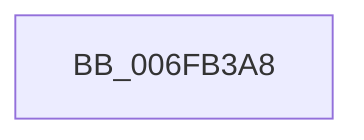

# sub_006FB3A8

- RVA: `0x006FB3A8`–`0x006FB428` (길이 `128` bytes)
- VA: `0x00000001406FB3A8`
- 실행 섹션: `.text`
- PDB 이름 있음: `아니요`; PDB Function 태그: `아니요`
- unwind 정보 RVA: `0x000B968C`
- 디코드: `32`개 명령, `128/128` bytes 표시
- 미해석 바이트: `0` (있으면 어셈블리에 `.byte`로 보존)

> 이 문서는 커널 이미지의 기계어와 PDB 기호를 분석해 생성했습니다. 4번과 5번은 함수 원형과 자료형을 바이너리 사용 방식에서 추정한 C 해석이며 원본 소스 복구 결과는 아닙니다.

## 1. Dependencies

- 직접 호출 지점: **6**; 고유 호출 대상: **6**
- 직접 호출자로 확인된 함수: **0**
- RIP 상대 이미지 참조: **0**

### Outgoing calls
- `0x006FB3BB` → [MiMakeValidPte](../2C/MiMakeValidPte_function_002C5590.md) (function, `0x002C5590`)
- `0x006FB3CD` → [KiStackAttachProcess](../21/KiStackAttachProcess_function_00216820.md) (function, `0x00216820`)
- `0x006FB3DD` → [MiLockWorkingSetOptimal](../23/MiLockWorkingSetOptimal_function_00238FC0.md) (function, `0x00238FC0`)
- `0x006FB401` → [MiAllocateWsle](../33/MiAllocateWsle_function_003332C0.md) (function, `0x003332C0`)
- `0x006FB411` → [MiUnlockWorkingSetOptimal](../23/MiUnlockWorkingSetOptimal_function_00238DFC.md) (function, `0x00238DFC`)
- `0x006FB41D` → [KiUnstackDetachProcess](../21/KiUnstackDetachProcess_function_00217D30.md) (function, `0x00217D30`)

### Direct callers
- 이 함수 시작 RVA로 연결되는 직접 call은 확인되지 않았습니다. 간접 호출은 완전히 역산할 수 없습니다.

### Static image references
- 디코드된 RIP-relative 메모리 참조가 없습니다.

## 2. Other-region calls and transfers

- 다른 실행 섹션으로 향하는 call: **0**
- call이 아닌 외부 분기/꼬리 이동: **1**
  - `0x006FB423` → [MiFinishLastForkPageTable + 0xCB](../4B/MiFinishLastForkPageTable_function_004B2AD4.md) (`tail-transfer`)

## 3. Assembly (complete function range)

```asm
006FB3A8  41 B8 04 00 00 80               mov r8d, 0x80000004
006FB3AE  49 8D B5 00 04 00 00            lea rsi, [r13 + 0x400]
006FB3B5  49 8B D7                        mov rdx, r15
006FB3B8  49 8B CE                        mov rcx, r14
006FB3BB  E8 D0 A1 BC FF                  call 0x1402c5590
006FB3C0  4C 8D 44 24 50                  lea r8, [rsp + 0x50]
006FB3C5  33 D2                           xor edx, edx
006FB3C7  49 8B CD                        mov rcx, r13
006FB3CA  48 8B D8                        mov rbx, rax
006FB3CD  E8 4E B4 B1 FF                  call 0x140216820
006FB3D2  4C 8D 44 24 40                  lea r8, [rsp + 0x40]
006FB3D7  49 8B D6                        mov rdx, r14
006FB3DA  48 8B CE                        mov rcx, rsi
006FB3DD  E8 DE DB B3 FF                  call 0x140238fc0
006FB3E2  48 83 64 24 30 00               and qword ptr [rsp + 0x30], 0
006FB3E8  45 33 C9                        xor r9d, r9d
006FB3EB  83 64 24 28 00                  and dword ptr [rsp + 0x28], 0
006FB3F0  4C 8B C5                        mov r8, rbp
006FB3F3  49 8B D6                        mov rdx, r14
006FB3F6  48 89 5C 24 20                  mov qword ptr [rsp + 0x20], rbx
006FB3FB  48 8B CE                        mov rcx, rsi
006FB3FE  48 8B F8                        mov rdi, rax
006FB401  E8 BA 7E C3 FF                  call 0x1403332c0
006FB406  44 8A 44 24 40                  mov r8b, byte ptr [rsp + 0x40]
006FB40B  48 8B D7                        mov rdx, rdi
006FB40E  48 8B CE                        mov rcx, rsi
006FB411  E8 E6 D9 B3 FF                  call 0x140238dfc
006FB416  33 D2                           xor edx, edx
006FB418  48 8D 4C 24 50                  lea rcx, [rsp + 0x50]
006FB41D  E8 0E C9 B1 FF                  call 0x140217d30
006FB422  90                              nop
006FB423  E9 77 77 DB FF                  jmp 0x1404b2b9f
```

## 4. C-style interpretation (structured pseudocode)

```c
__int64 __fastcall sub_006FB3A8(__int64 a1, __int64 a2, __int64 a3, int a4, unsigned int a5, __int64 a6, __int64 a7, unsigned __int8 a8, __int64 a9, __int64 a10)
{
    __int64 result;
    unsigned __int64 v_stack_p20;

    result = MiMakeValidPte(v_r14, v_r15, (unsigned int)(0x80000004ULL), a4);
    a2 = 0;
    result = KiStackAttachProcess(v_r13, a2, a10, a4);
    result = MiLockWorkingSetOptimal(v_r13 + 1024, v_r14, a8, a4);
    a4 = 0;
    v_stack_p20 = result;
    result = MiAllocateWsle(v_r13 + 1024, v_r14, v_rbp, a4);
    result = MiUnlockWorkingSetOptimal(v_r13 + 1024, result, a8, a4);
    a2 = 0;
    result = KiUnstackDetachProcess(a10, a2, a8, a4);
}
```

## 5. (Beta) C Style

```c
int64_t sub_006FB3A8(int64_t Arg1, int64_t Arg2, int64_t Arg3, int32_t Arg4, uint32_t Arg5, int64_t Arg6, uint64_t Arg7, uint8_t Arg8, uint64_t Arg9, int64_t Arg10)
{
    int64_t result;
    uint64_t v_stack_p20;

    result = MiMakeValidPte(local_r14, local_r15, (uint32_t)(0x80000004ULL), Arg4);
    Arg2 = 0;
    result = KiStackAttachProcess(local_r13, Arg2, Arg10, Arg4);
    result = MiLockWorkingSetOptimal(local_r13 + 1024, local_r14, Arg8, Arg4);
    Arg4 = 0;
    v_stack_p20 = result;
    result = MiAllocateWsle(local_r13 + 1024, local_r14, local_rbp, Arg4);
    result = MiUnlockWorkingSetOptimal(local_r13 + 1024, result, Arg8, Arg4);
    Arg2 = 0;
    result = KiUnstackDetachProcess(Arg10, Arg2, Arg8, Arg4);
}
```

## 6. Execution-region graph

[열기: 2D/3D 그래프와 함수 탐색 컨트롤 패널](../../../control-panel.html?section=text&rva=0x006FB3A8&view=graph)

- 2D 그래프는 위에서 아래로 흐르고, 3D 그래프는 빈 공간을 드래그해 회전합니다. Shift+드래그는 이동, 휠은 확대·축소, 함수 노드 선택은 대상 보고서 이동입니다.

### Static fallback


