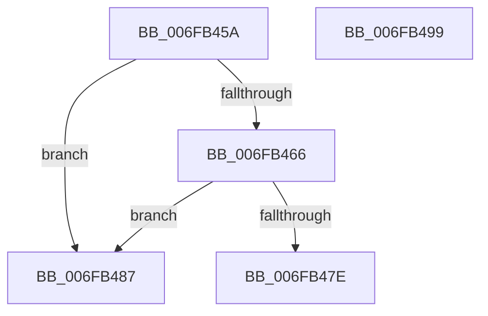

# sub_006FB45A

- RVA: `0x006FB45A`–`0x006FB4B7` (길이 `93` bytes)
- VA: `0x00000001406FB45A`
- 실행 섹션: `.text`
- PDB 이름 있음: `아니요`; PDB Function 태그: `아니요`
- unwind 정보 RVA: `0x000B99B0`
- 디코드: `22`개 명령, `93/93` bytes 표시
- 미해석 바이트: `0` (있으면 어셈블리에 `.byte`로 보존)

> 이 문서는 커널 이미지의 기계어와 PDB 기호를 분석해 생성했습니다. 4번과 5번은 함수 원형과 자료형을 바이너리 사용 방식에서 추정한 C 해석이며 원본 소스 복구 결과는 아닙니다.

## 1. Dependencies

- 직접 호출 지점: **1**; 고유 호출 대상: **1**
- 직접 호출자로 확인된 함수: **0**
- RIP 상대 이미지 참조: **0**

### Outgoing calls
- `0x006FB48C` → [PpmIdleTransitionStall](../5D/PpmIdleTransitionStall_function_005D039C.md) (function, `0x005D039C`)

### Direct callers
- 이 함수 시작 RVA로 연결되는 직접 call은 확인되지 않았습니다. 간접 호출은 완전히 역산할 수 없습니다.

### Static image references
- 디코드된 RIP-relative 메모리 참조가 없습니다.

## 2. Other-region calls and transfers

- 다른 실행 섹션으로 향하는 call: **0**
- call이 아닌 외부 분기/꼬리 이동: **3**
  - `0x006FB482` → [PpmExitCoordinatedIdleState + 0x41](../4B/PpmExitCoordinatedIdleState_function_004B3690.md) (`tail-transfer`)
  - `0x006FB494` → [PpmExitCoordinatedIdleState + 0x3C](../4B/PpmExitCoordinatedIdleState_function_004B3690.md) (`tail-transfer`)
  - `0x006FB4B2` → [PpmExitCoordinatedIdleState + 0x41](../4B/PpmExitCoordinatedIdleState_function_004B3690.md) (`tail-transfer`)

## 3. Assembly (complete function range)

```asm
006FB45A  25 00 00 00 03                  and eax, 0x3000000
006FB45F  3D 00 00 00 02                  cmp eax, 0x2000000
006FB464  75 21                           jne 0x1406fb487
006FB466  65 8B 04 25 A4 01 00 00         mov eax, dword ptr gs:[0x1a4]
006FB46E  41 C1 E8 0C                     shr r8d, 0xc
006FB472  41 81 E0 FF 0F 00 00            and r8d, 0xfff
006FB479  44 3B C0                        cmp r8d, eax
006FB47C  75 09                           jne 0x1406fb487
006FB47E  B3 01                           mov bl, 1
006FB480  88 1F                           mov byte ptr [rdi], bl
006FB482  E9 4A 82 DB FF                  jmp 0x1404b36d1
006FB487  48 8D 4C 24 20                  lea rcx, [rsp + 0x20]
006FB48C  E8 0B 4F ED FF                  call 0x1405d039c
006FB491  44 8B 06                        mov r8d, dword ptr [rsi]
006FB494  E9 33 82 DB FF                  jmp 0x1404b36cc
006FB499  65 8B 04 25 A4 01 00 00         mov eax, dword ptr gs:[0x1a4]
006FB4A1  41 81 E0 FF 0F 00 00            and r8d, 0xfff
006FB4A8  44 3B C0                        cmp r8d, eax
006FB4AB  B3 01                           mov bl, 1
006FB4AD  0F 94 C0                        sete al
006FB4B0  88 07                           mov byte ptr [rdi], al
006FB4B2  E9 1A 82 DB FF                  jmp 0x1404b36d1
```

## 4. C-style interpretation (structured pseudocode)

```c
__int64 __fastcall sub_006FB45A(__int64 a1, __int64 a2, int a3)
{
    __int64 result;
    unsigned __int64 v_stack_p20;

    result = (unsigned int)((result) & (0x3000000ULL));
    if (((unsigned int)(result)) != 0x2000000ULL) goto loc_006FB487;
    a3 = (unsigned int)((a3) >> (12));
    a3 = (unsigned int)((a3) & (0xFFFULL));
    if (a3 != ((unsigned int)((unsigned int)(*(unsigned int *)(gs_base + (0 + 420)))))) goto loc_006FB487;
    *(unsigned __int8 *)(v_rdi) = 1;
loc_006FB487:
    result = PpmIdleTransitionStall(v_stack_p20, a2, a3, a4);
}
```

## 5. (Beta) C Style

```c
int64_t sub_006FB45A(int64_t Arg1, int64_t Arg2, int32_t Arg3)
{
    int64_t result;
    uint64_t v_stack_p20;

    result = (uint32_t)((result) & (0x3000000ULL));
    if (((uint32_t)(result)) != 0x2000000ULL) goto loc_006FB487;
    Arg3 = (uint32_t)((Arg3) >> (12));
    Arg3 = (uint32_t)((Arg3) & (0xFFFULL));
    if (Arg3 != ((uint32_t)((uint32_t)(*(uint32_t *)(gs_base + (0 + 0x1A4)))))) goto loc_006FB487;
    *(uint8_t *)(local_rdi) = 1;
loc_006FB487:
    result = PpmIdleTransitionStall(v_stack_p20, Arg2, Arg3, a4);
}
```

## 6. Execution-region graph

[열기: 2D/3D 그래프와 함수 탐색 컨트롤 패널](../../../control-panel.html?section=text&rva=0x006FB45A&view=graph)

- 2D 그래프는 위에서 아래로 흐르고, 3D 그래프는 빈 공간을 드래그해 회전합니다. Shift+드래그는 이동, 휠은 확대·축소, 함수 노드 선택은 대상 보고서 이동입니다.

### Static fallback


