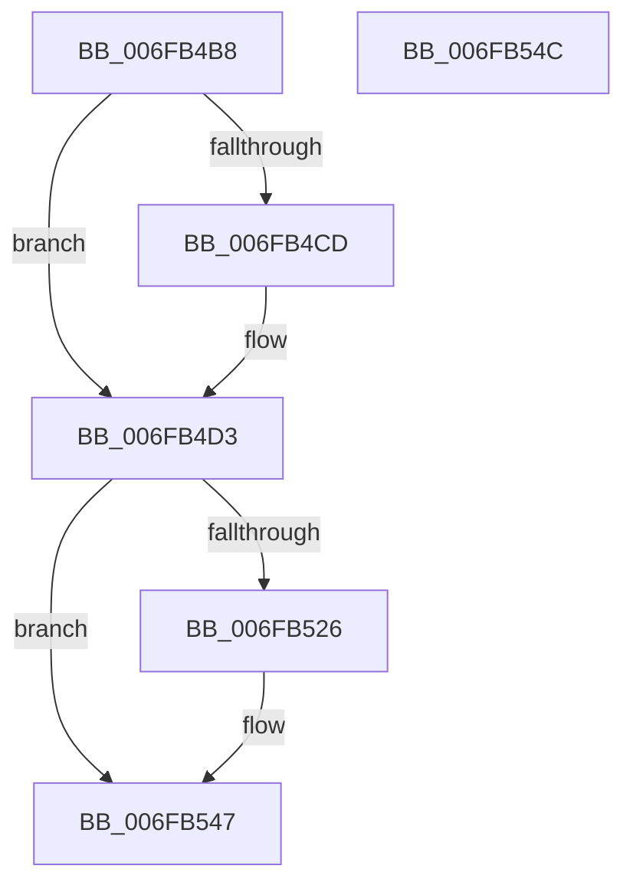

# sub_006FB4B8

- RVA: `0x006FB4B8`–`0x006FB551` (길이 `153` bytes)
- VA: `0x00000001406FB4B8`
- 실행 섹션: `.text`
- PDB 이름 있음: `아니요`; PDB Function 태그: `아니요`
- unwind 정보 RVA: `0x000B99F8`
- 디코드: `36`개 명령, `153/153` bytes 표시
- 미해석 바이트: `0` (있으면 어셈블리에 `.byte`로 보존)

> 이 문서는 커널 이미지의 기계어와 PDB 기호를 분석해 생성했습니다. 4번과 5번은 함수 원형과 자료형을 바이너리 사용 방식에서 추정한 C 해석이며 원본 소스 복구 결과는 아닙니다.

## 1. Dependencies

- 직접 호출 지점: **1**; 고유 호출 대상: **1**
- 직접 호출자로 확인된 함수: **0**
- RIP 상대 이미지 참조: **0**

### Outgoing calls
- `0x006FB4CD` → [ExRaiseDatatypeMisalignment](../../page/89/ExRaiseDatatypeMisalignment_function_00899FD0.md) (function, `0x00899FD0`)

### Direct callers
- 이 함수 시작 RVA로 연결되는 직접 call은 확인되지 않았습니다. 간접 호출은 완전히 역산할 수 없습니다.

### Static image references
- 디코드된 RIP-relative 메모리 참조가 없습니다.

## 2. Other-region calls and transfers

- 다른 실행 섹션으로 향하는 call: **1**
  - `0x006FB4CD` → [ExRaiseDatatypeMisalignment](../../page/89/ExRaiseDatatypeMisalignment_function_00899FD0.md) (`.text` → `PAGE`)
- call이 아닌 외부 분기/꼬리 이동: **2**
  - `0x006FB547` → [RtlCreateEnclaveReturnFrame + 0x3C](../4B/RtlCreateEnclaveReturnFrame_function_004B3728.md) (`tail-transfer`)
  - `0x006FB54C` → [RtlCreateEnclaveReturnFrame + 0x75](../4B/RtlCreateEnclaveReturnFrame_function_004B3728.md) (`tail-transfer`)

## 3. Assembly (complete function range)

```asm
006FB4B8  48 8B 89 80 01 00 00            mov rcx, qword ptr [rcx + 0x180]
006FB4BF  48 83 E9 50                     sub rcx, 0x50
006FB4C3  48 89 4C 24 30                  mov qword ptr [rsp + 0x30], rcx
006FB4C8  F6 C1 03                        test cl, 3
006FB4CB  74 06                           je 0x1406fb4d3
006FB4CD  E8 FE EA 19 00                  call 0x140899fd0
006FB4D2  CC                              int3
006FB4D3  49 B8 00 00 FF FF FF 7F 00 00   movabs r8, 0x7fffffff0000
006FB4DD  49 3B C8                        cmp rcx, r8
006FB4E0  49 0F 43 C8                     cmovae rcx, r8
006FB4E4  8A 01                           mov al, byte ptr [rcx]
006FB4E6  88 01                           mov byte ptr [rcx], al
006FB4E8  8A 41 4F                        mov al, byte ptr [rcx + 0x4f]
006FB4EB  88 41 4F                        mov byte ptr [rcx + 0x4f], al
006FB4EE  49 8B 42 50                     mov rax, qword ptr [r10 + 0x50]
006FB4F2  48 8B 4C 24 30                  mov rcx, qword ptr [rsp + 0x30]
006FB4F7  48 89 41 28                     mov qword ptr [rcx + 0x28], rax
006FB4FB  49 8B 82 68 01 00 00            mov rax, qword ptr [r10 + 0x168]
006FB502  48 89 41 38                     mov qword ptr [rcx + 0x38], rax
006FB506  49 8B 82 58 01 00 00            mov rax, qword ptr [r10 + 0x158]
006FB50D  48 89 41 40                     mov qword ptr [rcx + 0x40], rax
006FB511  49 89 8A 80 01 00 00            mov qword ptr [r10 + 0x180], rcx
006FB518  4D 8B 8A 68 01 00 00            mov r9, qword ptr [r10 + 0x168]
006FB51F  80 7C 24 78 00                  cmp byte ptr [rsp + 0x78], 0
006FB524  74 21                           je 0x1406fb547
006FB526  B9 A7 06 00 00                  mov ecx, 0x6a7
006FB52B  0F 32                           rdmsr
006FB52D  48 C1 E2 20                     shl rdx, 0x20
006FB531  48 0B C2                        or rax, rdx
006FB534  48 83 E8 08                     sub rax, 8
006FB538  66 4C 0F 38 F5 08               wrussq qword ptr [rax], r9
006FB53E  48 8B D0                        mov rdx, rax
006FB541  48 C1 EA 20                     shr rdx, 0x20
006FB545  0F 30                           wrmsr
006FB547  E9 18 82 DB FF                  jmp 0x1404b3764
006FB54C  E9 4C 82 DB FF                  jmp 0x1404b379d
```

## 4. C-style interpretation (structured pseudocode)

```c
__int64 __fastcall sub_006FB4B8(__int64 a1, __int64 a2, __int64 a3, __int64 a4, __int64 a5, __int64 a6, __int64 a7, __int64 a8, __int64 a9, __int64 a10, __int64 a11, __int64 a12, __int64 a13, __int64 a14, unsigned __int8 a15)
{
    __int64 result;
    unsigned __int64 v_stack_p30;

    a1 = (*(unsigned __int64 *)(a1 + 384)) - (80);
    v_stack_p30 = a1;
    if ((((unsigned __int8)(a1)) & (3)) != 0) {
        result = ExRaiseDatatypeMisalignment(a1, a2, a3, a4);
    }
    if (a1 >= a3) { a1 = a3; }
    *(unsigned __int8 *)(a1) = (unsigned __int8)(*(unsigned __int8 *)(a1));
    *(unsigned __int8 *)(a1 + 79) = (unsigned __int8)(*(unsigned __int8 *)(a1 + 79));
    *(unsigned __int64 *)(a6 + 40) = *(unsigned __int64 *)(v_r10 + 80);
    *(unsigned __int64 *)(a6 + 56) = *(unsigned __int64 *)(v_r10 + 360);
    *(unsigned __int64 *)(a6 + 64) = *(unsigned __int64 *)(v_r10 + 344);
    *(unsigned __int64 *)(v_r10 + 384) = a6;
    result = *(unsigned __int64 *)(v_r10 + 344);
    if (a15 != 0) {
        a1 = 0x6A7ULL;
        a2 = (a2) << (32);
        result = (*(unsigned __int64 *)(v_r10 + 344)) | (a2);
        result = (result) - (8);
        a2 = result;
        a2 = (a2) >> (32);
    }
}
```

## 5. (Beta) C Style

```c
int64_t sub_006FB4B8(void *Arg1, int64_t Arg2, int64_t Arg3, int64_t Arg4, uint64_t Arg5, void *Arg6, uint64_t Arg7, uint64_t Arg8, uint64_t Arg9, uint64_t Arg10, uint64_t Arg11, uint64_t Arg12, uint64_t Arg13, uint64_t Arg14, uint8_t Arg15)
{
    uint8_t *arg1 = (uint8_t *)Arg1;
    uint8_t *arg6 = (uint8_t *)Arg6;

    int64_t result;
    uint64_t v_stack_p30;

    Arg1 = (*(uint64_t *)(arg1 + 0x180)) - (80);
    v_stack_p30 = Arg1;
    if ((((uint8_t)(Arg1)) & (3)) != 0) {
        result = ExRaiseDatatypeMisalignment(Arg1, Arg2, Arg3, Arg4);
    }
    if (Arg1 >= Arg3) { Arg1 = Arg3; }
    *(uint8_t *)(arg1) = (uint8_t)(*(uint8_t *)(arg1));
    *(uint8_t *)(arg1 + 0x4F) = (uint8_t)(*(uint8_t *)(arg1 + 0x4F));
    *(uint64_t *)(arg6 + 0x28) = *(uint64_t *)(local_r10 + 0x50);
    *(uint64_t *)(arg6 + 0x38) = *(uint64_t *)(local_r10 + 0x168);
    *(uint64_t *)(arg6 + 0x40) = *(uint64_t *)(local_r10 + 0x158);
    *(void **)(local_r10 + 0x180) = Arg6;
    result = *(uint64_t *)(local_r10 + 0x158);
    if (Arg15 != 0) {
        Arg1 = 0x6A7ULL;
        Arg2 = (Arg2) << (32);
        result = (*(uint64_t *)(local_r10 + 0x158)) | (Arg2);
        result = (result) - (8);
        Arg2 = result;
        Arg2 = (Arg2) >> (32);
    }
}
```

### 관측된 메모리 오프셋

구조체 형식이 확인되지 않은 접근은 인자 기준의 오프셋으로만 기록했습니다.

| 기준 인자 | 오프셋 표현 | 폭 (bit) | 접근 |
|---|---:|---:|---|
| `Arg1` | `+ 0x180` | `64` | `R` |
| `Arg6` | `+ 0x28` | `64` | `W` |
| `Arg6` | `+ 0x38` | `64` | `W` |
| `Arg6` | `+ 0x40` | `64` | `W` |

## 6. Execution-region graph

[열기: 2D/3D 그래프와 함수 탐색 컨트롤 패널](../../../control-panel.html?section=text&rva=0x006FB4B8&view=graph)

- 2D 그래프는 위에서 아래로 흐르고, 3D 그래프는 빈 공간을 드래그해 회전합니다. Shift+드래그는 이동, 휠은 확대·축소, 함수 노드 선택은 대상 보고서 이동입니다.

### Static fallback


