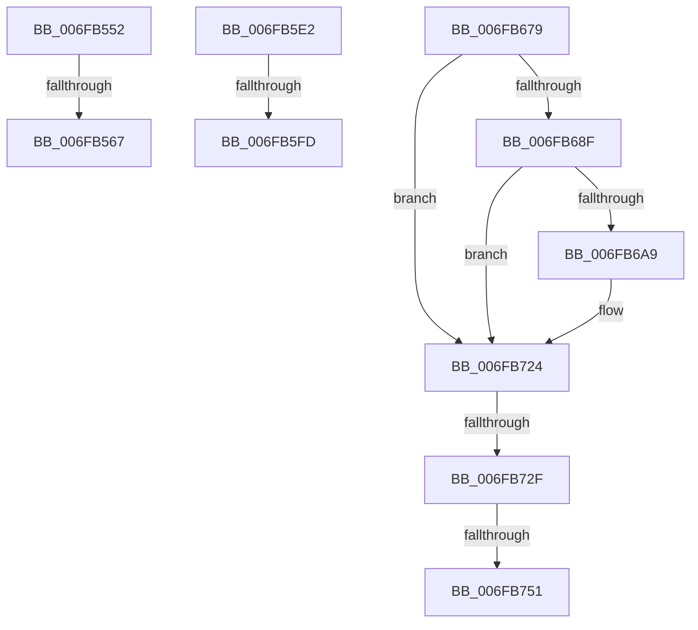

# sub_006FB552

- RVA: `0x006FB552`–`0x006FB7DC` (길이 `650` bytes)
- VA: `0x00000001406FB552`
- 실행 섹션: `.text`
- PDB 이름 있음: `아니요`; PDB Function 태그: `아니요`
- unwind 정보 RVA: `0x000B9BBC`
- 디코드: `138`개 명령, `650/650` bytes 표시
- 미해석 바이트: `0` (있으면 어셈블리에 `.byte`로 보존)

> 이 문서는 커널 이미지의 기계어와 PDB 기호를 분석해 생성했습니다. 4번과 5번은 함수 원형과 자료형을 바이너리 사용 방식에서 추정한 C 해석이며 원본 소스 복구 결과는 아닙니다.

## 1. Dependencies

- 직접 호출 지점: **8**; 고유 호출 대상: **2**
- 직접 호출자로 확인된 함수: **0**
- RIP 상대 이미지 참조: **0**

### Outgoing calls
- `0x006FB55A` → [EtwpLevelKeywordEnabled](../2F/EtwpLevelKeywordEnabled_function_002FD110.md) (function, `0x002FD110`)
- `0x006FB5CF` → [EtwpEventWriteFull](../22/EtwpEventWriteFull_function_00225C10.md) (function, `0x00225C10`)
- `0x006FB5F0` → [EtwpLevelKeywordEnabled](../2F/EtwpLevelKeywordEnabled_function_002FD110.md) (function, `0x002FD110`)
- `0x006FB66C` → [EtwpEventWriteFull](../22/EtwpEventWriteFull_function_00225C10.md) (function, `0x00225C10`)
- `0x006FB6A0` → [EtwpLevelKeywordEnabled](../2F/EtwpLevelKeywordEnabled_function_002FD110.md) (function, `0x002FD110`)
- `0x006FB71C` → [EtwpEventWriteFull](../22/EtwpEventWriteFull_function_00225C10.md) (function, `0x00225C10`)
- `0x006FB744` → [EtwpLevelKeywordEnabled](../2F/EtwpLevelKeywordEnabled_function_002FD110.md) (function, `0x002FD110`)
- `0x006FB7CF` → [EtwpEventWriteFull](../22/EtwpEventWriteFull_function_00225C10.md) (function, `0x00225C10`)

### Direct callers
- 이 함수 시작 RVA로 연결되는 직접 call은 확인되지 않았습니다. 간접 호출은 완전히 역산할 수 없습니다.

### Static image references
- 디코드된 RIP-relative 메모리 참조가 없습니다.

## 2. Other-region calls and transfers

- 다른 실행 섹션으로 향하는 call: **0**
- call이 아닌 외부 분기/꼬리 이동: **7**
  - `0x006FB561` → [EtwWriteString + 0xAD](../4B/EtwWriteString_function_004B3CA0.md) (`tail-transfer`)
  - `0x006FB5DD` → [EtwWriteString + 0xAD](../4B/EtwWriteString_function_004B3CA0.md) (`tail-transfer`)
  - `0x006FB5F7` → [EtwWriteString + 0xB8](../4B/EtwWriteString_function_004B3CA0.md) (`tail-transfer`)
  - `0x006FB674` → [EtwWriteString + 0xB8](../4B/EtwWriteString_function_004B3CA0.md) (`tail-transfer`)
  - `0x006FB729` → [EtwWriteString + 0xC9](../4B/EtwWriteString_function_004B3CA0.md) (`tail-transfer`)
  - `0x006FB74B` → [EtwWriteString + 0xC9](../4B/EtwWriteString_function_004B3CA0.md) (`tail-transfer`)
  - `0x006FB7D7` → [EtwWriteString + 0xC9](../4B/EtwWriteString_function_004B3CA0.md) (`tail-transfer`)

## 3. Assembly (complete function range)

```asm
006FB552  48 8B 4B 20                     mov rcx, qword ptr [rbx + 0x20]
006FB556  48 83 C1 60                     add rcx, 0x60
006FB55A  E8 B1 1B C0 FF                  call 0x1402fd110
006FB55F  84 C0                           test al, al
006FB561  0F 84 E6 87 DB FF               je 0x1404b3d4d
006FB567  0F B7 53 64                     movzx edx, word ptr [rbx + 0x64]
006FB56B  48 8D 45 DF                     lea rax, [rbp - 0x21]
006FB56F  48 8B 4B 20                     mov rcx, qword ptr [rbx + 0x20]
006FB573  45 33 C0                        xor r8d, r8d
006FB576  48 89 84 24 80 00 00 00         mov qword ptr [rsp + 0x80], rax
006FB57E  0F B7 43 62                     movzx eax, word ptr [rbx + 0x62]
006FB582  4C 89 74 24 78                  mov qword ptr [rsp + 0x78], r14
006FB587  66 89 44 24 70                  mov word ptr [rsp + 0x70], ax
006FB58C  48 8D 45 07                     lea rax, [rbp + 7]
006FB590  4C 89 64 24 68                  mov qword ptr [rsp + 0x68], r12
006FB595  48 89 44 24 60                  mov qword ptr [rsp + 0x60], rax
006FB59A  48 8D 45 E7                     lea rax, [rbp - 0x19]
006FB59E  4C 89 64 24 58                  mov qword ptr [rsp + 0x58], r12
006FB5A3  48 89 44 24 50                  mov qword ptr [rsp + 0x50], rax
006FB5A8  48 8D 45 F7                     lea rax, [rbp - 9]
006FB5AC  C7 44 24 48 01 00 00 00         mov dword ptr [rsp + 0x48], 1
006FB5B4  4C 89 64 24 40                  mov qword ptr [rsp + 0x40], r12
006FB5B9  4C 89 7C 24 38                  mov qword ptr [rsp + 0x38], r15
006FB5BE  66 44 89 64 24 30               mov word ptr [rsp + 0x30], r12w
006FB5C4  66 44 89 54 24 28               mov word ptr [rsp + 0x28], r10w
006FB5CA  48 89 44 24 20                  mov qword ptr [rsp + 0x20], rax
006FB5CF  E8 3C A6 B2 FF                  call 0x140225c10
006FB5D4  44 8B C8                        mov r9d, eax
006FB5D7  41 BA 04 00 00 00               mov r10d, 4
006FB5DD  E9 6B 87 DB FF                  jmp 0x1404b3d4d
006FB5E2  48 8B 4B 28                     mov rcx, qword ptr [rbx + 0x28]
006FB5E6  4C 8B C7                        mov r8, rdi
006FB5E9  48 83 C1 60                     add rcx, 0x60
006FB5ED  40 8A D6                        mov dl, sil
006FB5F0  E8 1B 1B C0 FF                  call 0x1402fd110
006FB5F5  84 C0                           test al, al
006FB5F7  0F 84 5B 87 DB FF               je 0x1404b3d58
006FB5FD  0F B7 53 66                     movzx edx, word ptr [rbx + 0x66]
006FB601  48 8D 45 DF                     lea rax, [rbp - 0x21]
006FB605  48 8B 4B 20                     mov rcx, qword ptr [rbx + 0x20]
006FB609  45 33 C9                        xor r9d, r9d
006FB60C  48 89 84 24 80 00 00 00         mov qword ptr [rsp + 0x80], rax
006FB614  45 33 C0                        xor r8d, r8d
006FB617  0F B7 43 62                     movzx eax, word ptr [rbx + 0x62]
006FB61B  4C 89 74 24 78                  mov qword ptr [rsp + 0x78], r14
006FB620  66 89 44 24 70                  mov word ptr [rsp + 0x70], ax
006FB625  48 8B 43 28                     mov rax, qword ptr [rbx + 0x28]
006FB629  48 89 44 24 68                  mov qword ptr [rsp + 0x68], rax
006FB62E  48 8D 45 07                     lea rax, [rbp + 7]
006FB632  48 89 44 24 60                  mov qword ptr [rsp + 0x60], rax
006FB637  48 8D 45 E7                     lea rax, [rbp - 0x19]
006FB63B  4C 89 64 24 58                  mov qword ptr [rsp + 0x58], r12
006FB640  48 89 44 24 50                  mov qword ptr [rsp + 0x50], rax
006FB645  48 8D 45 F7                     lea rax, [rbp - 9]
006FB649  C7 44 24 48 01 00 00 00         mov dword ptr [rsp + 0x48], 1
006FB651  4C 89 64 24 40                  mov qword ptr [rsp + 0x40], r12
006FB656  4C 89 7C 24 38                  mov qword ptr [rsp + 0x38], r15
006FB65B  66 44 89 64 24 30               mov word ptr [rsp + 0x30], r12w
006FB661  66 44 89 54 24 28               mov word ptr [rsp + 0x28], r10w
006FB667  48 89 44 24 20                  mov qword ptr [rsp + 0x20], rax
006FB66C  E8 9F A5 B2 FF                  call 0x140225c10
006FB671  44 8B C8                        mov r9d, eax
006FB674  E9 DF 86 DB FF                  jmp 0x1404b3d58
006FB679  0F 57 C0                        xorps xmm0, xmm0
006FB67C  0F 11 45 07                     movups xmmword ptr [rbp + 7], xmm0
006FB680  0F 11 45 17                     movups xmmword ptr [rbp + 0x17], xmm0
006FB684  66 44 39 63 68                  cmp word ptr [rbx + 0x68], r12w
006FB689  0F 84 95 00 00 00               je 0x1406fb724
006FB68F  48 8B 89 90 02 00 00            mov rcx, qword ptr [rcx + 0x290]
006FB696  4C 8B C7                        mov r8, rdi
006FB699  48 83 C1 60                     add rcx, 0x60
006FB69D  40 8A D6                        mov dl, sil
006FB6A0  E8 6B 1A C0 FF                  call 0x1402fd110
006FB6A5  84 C0                           test al, al
006FB6A7  74 7B                           je 0x1406fb724
006FB6A9  48 8B 4B 20                     mov rcx, qword ptr [rbx + 0x20]
006FB6AD  48 8D 45 DF                     lea rax, [rbp - 0x21]
006FB6B1  0F B7 53 68                     movzx edx, word ptr [rbx + 0x68]
006FB6B5  45 33 C9                        xor r9d, r9d
006FB6B8  48 89 84 24 80 00 00 00         mov qword ptr [rsp + 0x80], rax
006FB6C0  45 33 C0                        xor r8d, r8d
006FB6C3  0F B7 43 62                     movzx eax, word ptr [rbx + 0x62]
006FB6C7  48 8B 89 90 02 00 00            mov rcx, qword ptr [rcx + 0x290]
006FB6CE  4C 89 74 24 78                  mov qword ptr [rsp + 0x78], r14
006FB6D3  66 89 44 24 70                  mov word ptr [rsp + 0x70], ax
006FB6D8  48 8D 45 07                     lea rax, [rbp + 7]
006FB6DC  4C 89 64 24 68                  mov qword ptr [rsp + 0x68], r12
006FB6E1  48 89 44 24 60                  mov qword ptr [rsp + 0x60], rax
006FB6E6  48 8D 45 E7                     lea rax, [rbp - 0x19]
006FB6EA  4C 89 64 24 58                  mov qword ptr [rsp + 0x58], r12
006FB6EF  48 89 44 24 50                  mov qword ptr [rsp + 0x50], rax
006FB6F4  48 8D 45 F7                     lea rax, [rbp - 9]
006FB6F8  C7 44 24 48 01 00 00 00         mov dword ptr [rsp + 0x48], 1
006FB700  4C 89 64 24 40                  mov qword ptr [rsp + 0x40], r12
006FB705  4C 89 7C 24 38                  mov qword ptr [rsp + 0x38], r15
006FB70A  66 44 89 64 24 30               mov word ptr [rsp + 0x30], r12w
006FB710  66 C7 44 24 28 04 00            mov word ptr [rsp + 0x28], 4
006FB717  48 89 44 24 20                  mov qword ptr [rsp + 0x20], rax
006FB71C  E8 EF A4 B2 FF                  call 0x140225c10
006FB721  44 8B C8                        mov r9d, eax
006FB724  66 44 39 63 6A                  cmp word ptr [rbx + 0x6a], r12w
006FB729  0F 84 3A 86 DB FF               je 0x1404b3d69
006FB72F  48 8B 43 28                     mov rax, qword ptr [rbx + 0x28]
006FB733  4C 8B C7                        mov r8, rdi
006FB736  40 8A D6                        mov dl, sil
006FB739  48 8B 88 90 02 00 00            mov rcx, qword ptr [rax + 0x290]
006FB740  48 83 C1 60                     add rcx, 0x60
006FB744  E8 C7 19 C0 FF                  call 0x1402fd110
006FB749  84 C0                           test al, al
006FB74B  0F 84 18 86 DB FF               je 0x1404b3d69
006FB751  48 8B 4B 28                     mov rcx, qword ptr [rbx + 0x28]
006FB755  48 8D 45 DF                     lea rax, [rbp - 0x21]
006FB759  4C 8B 53 20                     mov r10, qword ptr [rbx + 0x20]
006FB75D  45 33 C9                        xor r9d, r9d
006FB760  0F B7 53 66                     movzx edx, word ptr [rbx + 0x66]
006FB764  45 33 C0                        xor r8d, r8d
006FB767  48 89 84 24 80 00 00 00         mov qword ptr [rsp + 0x80], rax
006FB76F  0F B7 43 62                     movzx eax, word ptr [rbx + 0x62]
006FB773  4C 89 74 24 78                  mov qword ptr [rsp + 0x78], r14
006FB778  66 89 44 24 70                  mov word ptr [rsp + 0x70], ax
006FB77D  48 8B 81 90 02 00 00            mov rax, qword ptr [rcx + 0x290]
006FB784  49 8B 8A 90 02 00 00            mov rcx, qword ptr [r10 + 0x290]
006FB78B  48 89 44 24 68                  mov qword ptr [rsp + 0x68], rax
006FB790  48 8D 45 07                     lea rax, [rbp + 7]
006FB794  48 89 44 24 60                  mov qword ptr [rsp + 0x60], rax
006FB799  48 8D 45 E7                     lea rax, [rbp - 0x19]
006FB79D  4C 89 64 24 58                  mov qword ptr [rsp + 0x58], r12
006FB7A2  48 89 44 24 50                  mov qword ptr [rsp + 0x50], rax
006FB7A7  48 8D 45 F7                     lea rax, [rbp - 9]
006FB7AB  C7 44 24 48 01 00 00 00         mov dword ptr [rsp + 0x48], 1
006FB7B3  4C 89 64 24 40                  mov qword ptr [rsp + 0x40], r12
006FB7B8  4C 89 7C 24 38                  mov qword ptr [rsp + 0x38], r15
006FB7BD  66 44 89 64 24 30               mov word ptr [rsp + 0x30], r12w
006FB7C3  66 C7 44 24 28 04 00            mov word ptr [rsp + 0x28], 4
006FB7CA  48 89 44 24 20                  mov qword ptr [rsp + 0x20], rax
006FB7CF  E8 3C A4 B2 FF                  call 0x140225c10
006FB7D4  44 8B C8                        mov r9d, eax
006FB7D7  E9 8D 85 DB FF                  jmp 0x1404b3d69
```

## 4. C-style interpretation (structured pseudocode)

```c
__int64 __fastcall sub_006FB552(__int64 a1, __int64 a2, int a3)
{
    __int64 result;
    unsigned __int64 v_stack_p20;
    unsigned __int16 v_stack_p28;
    unsigned __int16 v_stack_p30;
    unsigned __int64 v_stack_p38;
    unsigned __int64 v_stack_p40;
    unsigned int v_stack_p48;
    unsigned __int64 v_stack_p50;
    unsigned __int64 v_stack_p58;
    unsigned __int64 v_stack_p60;
    unsigned __int64 v_stack_p68;
    unsigned __int16 v_stack_p70;
    unsigned __int64 v_stack_p78;
    unsigned __int64 v_stack_p80;

    a1 = (*(unsigned __int64 *)(v_rbx + 32)) + (96);
    result = EtwpLevelKeywordEnabled(a1, a2, a3, a4);
    a3 = 0;
    v_stack_p80 = v_rbp - 33;
    v_stack_p78 = v_r14;
    v_stack_p70 = (unsigned __int16)(*(unsigned __int16 *)(v_rbx + 98));
    v_stack_p68 = v_r12;
    v_stack_p60 = v_rbp + 7;
    v_stack_p58 = v_r12;
    v_stack_p50 = v_rbp - 25;
    v_stack_p48 = 1;
    v_stack_p40 = v_r12;
    v_stack_p38 = v_r15;
    v_stack_p30 = (unsigned __int16)(v_r12);
    v_stack_p28 = (unsigned __int16)(v_r10);
    v_stack_p20 = v_rbp - 9;
    result = EtwpEventWriteFull(*(unsigned __int64 *)(v_rbx + 32), *(unsigned __int16 *)(v_rbx + 100), a3, a4);
}
```

## 5. (Beta) C Style

```c
int64_t sub_006FB552(int64_t Arg1, int64_t Arg2, int32_t Arg3)
{
    int64_t result;
    uint64_t v_stack_p20;
    uint16_t v_stack_p28;
    uint16_t v_stack_p30;
    uint64_t v_stack_p38;
    uint64_t v_stack_p40;
    uint32_t v_stack_p48;
    uint64_t v_stack_p50;
    uint64_t v_stack_p58;
    uint64_t v_stack_p60;
    uint64_t v_stack_p68;
    uint16_t v_stack_p70;
    uint64_t v_stack_p78;
    uint64_t v_stack_p80;

    Arg1 = (*(uint64_t *)(local_rbx + 0x20)) + (96);
    result = EtwpLevelKeywordEnabled(Arg1, Arg2, Arg3, a4);
    Arg3 = 0;
    v_stack_p80 = local_rbp - 33;
    v_stack_p78 = local_r14;
    v_stack_p70 = (uint16_t)(*(uint16_t *)(local_rbx + 0x62));
    v_stack_p68 = local_r12;
    v_stack_p60 = local_rbp + 7;
    v_stack_p58 = local_r12;
    v_stack_p50 = local_rbp - 25;
    v_stack_p48 = 1;
    v_stack_p40 = local_r12;
    v_stack_p38 = local_r15;
    v_stack_p30 = (uint16_t)(local_r12);
    v_stack_p28 = (uint16_t)(local_r10);
    v_stack_p20 = local_rbp - 9;
    result = EtwpEventWriteFull(*(uint64_t *)(local_rbx + 0x20), *(uint16_t *)(local_rbx + 0x64), Arg3, a4);
}
```

## 6. Execution-region graph

[열기: 2D/3D 그래프와 함수 탐색 컨트롤 패널](../../../control-panel.html?section=text&rva=0x006FB552&view=graph)

- 2D 그래프는 위에서 아래로 흐르고, 3D 그래프는 빈 공간을 드래그해 회전합니다. Shift+드래그는 이동, 휠은 확대·축소, 함수 노드 선택은 대상 보고서 이동입니다.

### Static fallback


