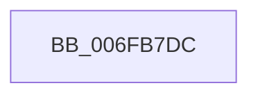

# sub_006FB7DC

- RVA: `0x006FB7DC`–`0x006FB83A` (길이 `94` bytes)
- VA: `0x00000001406FB7DC`
- 실행 섹션: `.text`
- PDB 이름 있음: `아니요`; PDB Function 태그: `아니요`
- unwind 정보 RVA: `0x000B9BE0`
- 디코드: `20`개 명령, `94/94` bytes 표시
- 미해석 바이트: `0` (있으면 어셈블리에 `.byte`로 보존)

> 이 문서는 커널 이미지의 기계어와 PDB 기호를 분석해 생성했습니다. 4번과 5번은 함수 원형과 자료형을 바이너리 사용 방식에서 추정한 C 해석이며 원본 소스 복구 결과는 아닙니다.

## 1. Dependencies

- 직접 호출 지점: **1**; 고유 호출 대상: **1**
- 직접 호출자로 확인된 함수: **0**
- RIP 상대 이미지 참조: **2**

### Outgoing calls
- `0x006FB82F` → [tlgWriteTransfer_EtwWriteTransfer](../42/tlgWriteTransfer_EtwWriteTransfer_function_004260E0.md) (function, `0x004260E0`)

### Direct callers
- 이 함수 시작 RVA로 연결되는 직접 call은 확인되지 않았습니다. 간접 호출은 완전히 역산할 수 없습니다.

### Static image references
- `0x006FB804` → RVA `0x00E070D8` (`.data`; read)
- `0x006FB828` → RVA `0x00048656` (`.rdata`; read)

## 2. Other-region calls and transfers

- 다른 실행 섹션으로 향하는 call: **0**
- call이 아닌 외부 분기/꼬리 이동: **1**
  - `0x006FB835` → [KiSetClockTimerDeadlineNoWake + 0x34](../4B/KiSetClockTimerDeadlineNoWake_function_004B3DA4.md) (`tail-transfer`)

## 3. Assembly (complete function range)

```asm
006FB7DC  89 54 24 34                     mov dword ptr [rsp + 0x34], edx
006FB7E0  48 8D 44 24 34                  lea rax, [rsp + 0x34]
006FB7E5  48 89 44 24 60                  mov qword ptr [rsp + 0x60], rax
006FB7EA  BA 04 00 00 00                  mov edx, 4
006FB7EF  33 C9                           xor ecx, ecx
006FB7F1  48 89 54 24 68                  mov qword ptr [rsp + 0x68], rdx
006FB7F6  48 8D 44 24 30                  lea rax, [rsp + 0x30]
006FB7FB  88 4C 24 30                     mov byte ptr [rsp + 0x30], cl
006FB7FF  48 89 44 24 70                  mov qword ptr [rsp + 0x70], rax
006FB804  48 8D 0D CD B8 70 00            lea rcx, [rip + 0x70b8cd]
006FB80B  48 8D 44 24 40                  lea rax, [rsp + 0x40]
006FB810  48 C7 44 24 78 01 00 00 00      mov qword ptr [rsp + 0x78], 1
006FB819  48 89 44 24 28                  mov qword ptr [rsp + 0x28], rax
006FB81E  45 33 C9                        xor r9d, r9d
006FB821  89 54 24 20                     mov dword ptr [rsp + 0x20], edx
006FB825  45 33 C0                        xor r8d, r8d
006FB828  48 8D 15 27 CE 94 FF            lea rdx, [rip - 0x6b31d9]
006FB82F  E8 AC A8 D2 FF                  call 0x1404260e0
006FB834  90                              nop
006FB835  E9 9E 85 DB FF                  jmp 0x1404b3dd8
```

## 4. C-style interpretation (structured pseudocode)

```c
__int64 __fastcall sub_006FB7DC(int a1, int a2, int a3, int a4, __int64 a5, __int64 a6, __int64 a7, __int64 a8)
{
    __int64 result;
    unsigned int v_stack_p20;
    unsigned __int64 v_stack_p28;
    unsigned __int8 v_stack_p30;
    unsigned int v_stack_p34;
    unsigned __int64 v_stack_p60;
    unsigned __int64 v_stack_p68;
    unsigned __int64 v_stack_p70;
    unsigned __int64 v_stack_p78;

    v_stack_p34 = a2;
    v_stack_p60 = v_stack_p34;
    a1 = 0;
    v_stack_p68 = 4;
    v_stack_p30 = 0;
    v_stack_p70 = a6;
    v_stack_p78 = 1;
    v_stack_p28 = a8;
    a4 = 0;
    v_stack_p20 = 4;
    a3 = 0;
    result = tlgWriteTransfer_EtwWriteTransfer(v_rip + 7387341, v_rip - 7025113, a3, a4);
}
```

## 5. (Beta) C Style

```c
int64_t sub_006FB7DC(int32_t Arg1, int32_t Arg2, int32_t Arg3, int32_t Arg4, uint64_t Arg5, int64_t Arg6, uint64_t Arg7, int64_t Arg8)
{
    int64_t result;
    uint32_t v_stack_p20;
    uint64_t v_stack_p28;
    uint8_t v_stack_p30;
    uint32_t v_stack_p34;
    uint64_t v_stack_p60;
    uint64_t v_stack_p68;
    uint64_t v_stack_p70;
    uint64_t v_stack_p78;

    v_stack_p34 = Arg2;
    v_stack_p60 = v_stack_p34;
    Arg1 = 0;
    v_stack_p68 = 4;
    v_stack_p30 = 0;
    v_stack_p70 = Arg6;
    v_stack_p78 = 1;
    v_stack_p28 = Arg8;
    Arg4 = 0;
    v_stack_p20 = 4;
    Arg3 = 0;
    result = tlgWriteTransfer_EtwWriteTransfer(v_rip + 7387341, v_rip - 7025113, Arg3, Arg4);
}
```

## 6. Execution-region graph

[열기: 2D/3D 그래프와 함수 탐색 컨트롤 패널](../../../control-panel.html?section=text&rva=0x006FB7DC&view=graph)

- 2D 그래프는 위에서 아래로 흐르고, 3D 그래프는 빈 공간을 드래그해 회전합니다. Shift+드래그는 이동, 휠은 확대·축소, 함수 노드 선택은 대상 보고서 이동입니다.

### Static fallback


