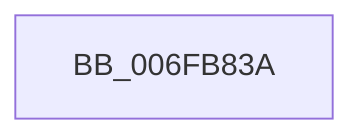

# sub_006FB83A

- RVA: `0x006FB83A`–`0x006FB85C` (길이 `34` bytes)
- VA: `0x00000001406FB83A`
- 실행 섹션: `.text`
- PDB 이름 있음: `아니요`; PDB Function 태그: `아니요`
- unwind 정보 RVA: `0x000B9D9C`
- 디코드: `9`개 명령, `34/34` bytes 표시
- 미해석 바이트: `0` (있으면 어셈블리에 `.byte`로 보존)

> 이 문서는 커널 이미지의 기계어와 PDB 기호를 분석해 생성했습니다. 4번과 5번은 함수 원형과 자료형을 바이너리 사용 방식에서 추정한 C 해석이며 원본 소스 복구 결과는 아닙니다.

## 1. Dependencies

- 직접 호출 지점: **0**; 고유 호출 대상: **0**
- 직접 호출자로 확인된 함수: **0**
- RIP 상대 이미지 참조: **0**

### Outgoing calls
- 직접 디코드된 call 명령이 없습니다.

### Direct callers
- 이 함수 시작 RVA로 연결되는 직접 call은 확인되지 않았습니다. 간접 호출은 완전히 역산할 수 없습니다.

### Static image references
- 디코드된 RIP-relative 메모리 참조가 없습니다.

## 2. Other-region calls and transfers

- 다른 실행 섹션으로 향하는 call: **0**
- call이 아닌 외부 분기/꼬리 이동: **1**
  - `0x006FB857` → [RtlLengthCurrentClearRunForwardEx + 0x83](../4B/RtlLengthCurrentClearRunForwardEx_function_004B3F4C.md) (`tail-transfer`)

## 3. Assembly (complete function range)

```asm
006FB83A  42 8B 04 92                     mov eax, dword ptr [rdx + r10*4]
006FB83E  41 B9 FF FF FF FF               mov r9d, 0xffffffff
006FB844  F7 D0                           not eax
006FB846  0B C1                           or eax, ecx
006FB848  48 0F BC C8                     bsf rcx, rax
006FB84C  0F B6 C1                        movzx eax, cl
006FB84F  44 0F 45 C8                     cmovne r9d, eax
006FB853  41 0F BE C9                     movsx ecx, r9b
006FB857  E9 73 87 DB FF                  jmp 0x1404b3fcf
```

## 4. C-style interpretation (structured pseudocode)

```c
__int64 __fastcall sub_006FB83A(int a1, __int64 a2)
{
    __int64 result;

    result = (unsigned int)(~((unsigned int)(*(unsigned int *)(a2 + v_r10 * 4))));
    result = (unsigned int)((result) | (a1));
    a4 = (unsigned int)(0xFFFFFFFFULL);
    if (condition_is_not_equal) { a4 = (unsigned int)((unsigned __int8)(a1)); }
}
```

## 5. (Beta) C Style

```c
int64_t sub_006FB83A(int32_t Arg1, void *Arg2)
{
    uint8_t *arg2 = (uint8_t *)Arg2;

    int64_t result;

    result = (uint32_t)(~((uint32_t)(*(uint32_t *)(arg2 + local_r10 * 4))));
    result = (uint32_t)((result) | (Arg1));
    a4 = (uint32_t)(0xFFFFFFFFULL);
    if (condition_is_not_equal) { a4 = (uint32_t)((uint8_t)(Arg1)); }
}
```

### 관측된 메모리 오프셋

구조체 형식이 확인되지 않은 접근은 인자 기준의 오프셋으로만 기록했습니다.

| 기준 인자 | 오프셋 표현 | 폭 (bit) | 접근 |
|---|---:|---:|---|
| `Arg2` | `+ 0x0 + r10*4` | `32` | `R` |

## 6. Execution-region graph

[열기: 2D/3D 그래프와 함수 탐색 컨트롤 패널](../../../control-panel.html?section=text&rva=0x006FB83A&view=graph)

- 2D 그래프는 위에서 아래로 흐르고, 3D 그래프는 빈 공간을 드래그해 회전합니다. Shift+드래그는 이동, 휠은 확대·축소, 함수 노드 선택은 대상 보고서 이동입니다.

### Static fallback


