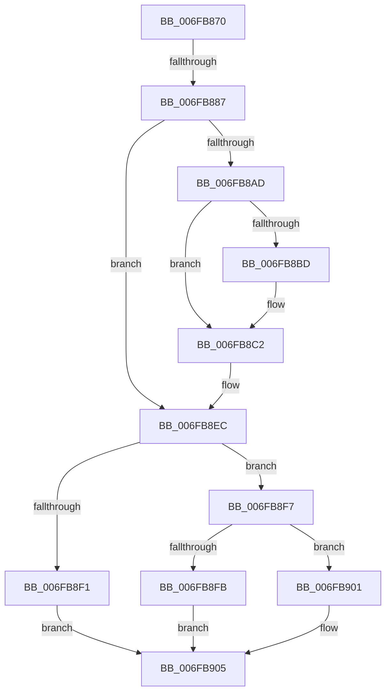

# sub_006FB870

- RVA: `0x006FB870`–`0x006FB90E` (길이 `158` bytes)
- VA: `0x00000001406FB870`
- 실행 섹션: `.text`
- PDB 이름 있음: `아니요`; PDB Function 태그: `아니요`
- unwind 정보 RVA: `0x000B9EBC`
- 디코드: `46`개 명령, `158/158` bytes 표시
- 미해석 바이트: `0` (있으면 어셈블리에 `.byte`로 보존)

> 이 문서는 커널 이미지의 기계어와 PDB 기호를 분석해 생성했습니다. 4번과 5번은 함수 원형과 자료형을 바이너리 사용 방식에서 추정한 C 해석이며 원본 소스 복구 결과는 아닙니다.

## 1. Dependencies

- 직접 호출 지점: **2**; 고유 호출 대상: **2**
- 직접 호출자로 확인된 함수: **0**
- RIP 상대 이미지 참조: **3**

### Outgoing calls
- `0x006FB896` → [RtlGetInterruptTimePrecise](../20/RtlGetInterruptTimePrecise_function_0020A4C0.md) (function, `0x0020A4C0`)
- `0x006FB8E2` → [PopIdleWakeInsertTimeInterval](../4B/PopIdleWakeInsertTimeInterval_function_004B42D0.md) (function, `0x004B42D0`)

### Direct callers
- 이 함수 시작 RVA로 연결되는 직접 call은 확인되지 않았습니다. 간접 호출은 완전히 역산할 수 없습니다.

### Static image references
- `0x006FB8B4` → RVA `0x00F08278` (`.data`; read)
- `0x006FB8C2` → RVA `0x00F08280` (`.data`; read)
- `0x006FB8C9` → RVA `0x00E0C2D0` (`.data`; read)

## 2. Other-region calls and transfers

- 다른 실행 섹션으로 향하는 call: **0**
- call이 아닌 외부 분기/꼬리 이동: **2**
  - `0x006FB881` → [PopIdleWakeNotifyIdleResiliencyState + 0x41](../4B/PopIdleWakeNotifyIdleResiliencyState_function_004B476C.md) (`tail-transfer`)
  - `0x006FB909` → [PopIdleWakeNotifyIdleResiliencyState + 0x41](../4B/PopIdleWakeNotifyIdleResiliencyState_function_004B476C.md) (`tail-transfer`)

## 3. Assembly (complete function range)

```asm
006FB870  33 C9                           xor ecx, ecx
006FB872  8B C2                           mov eax, edx
006FB874  40 84 F6                        test sil, sil
006FB877  0F 94 C1                        sete cl
006FB87A  D1 E8                           shr eax, 1
006FB87C  83 E0 01                        and eax, 1
006FB87F  3B C1                           cmp eax, ecx
006FB881  0F 84 26 8F DB FF               je 0x1404b47ad
006FB887  8D 04 09                        lea eax, [rcx + rcx]
006FB88A  83 E2 FD                        and edx, 0xfffffffd
006FB88D  0B C2                           or eax, edx
006FB88F  48 8D 4C 24 58                  lea rcx, [rsp + 0x58]
006FB894  89 03                           mov dword ptr [rbx], eax
006FB896  E8 25 EC B0 FF                  call 0x14020a4c0
006FB89B  48 8B 6C 24 58                  mov rbp, qword ptr [rsp + 0x58]
006FB8A0  8B 03                           mov eax, dword ptr [rbx]
006FB8A2  48 8B FD                        mov rdi, rbp
006FB8A5  48 2B 7B 08                     sub rdi, qword ptr [rbx + 8]
006FB8A9  A8 08                           test al, 8
006FB8AB  75 3F                           jne 0x1406fb8ec
006FB8AD  48 8B CD                        mov rcx, rbp
006FB8B0  48 2B 4B 30                     sub rcx, qword ptr [rbx + 0x30]
006FB8B4  48 3B 0D BD C9 80 00            cmp rcx, qword ptr [rip + 0x80c9bd]
006FB8BB  76 05                           jbe 0x1406fb8c2
006FB8BD  83 C8 04                        or eax, 4
006FB8C0  89 03                           mov dword ptr [rbx], eax
006FB8C2  4C 8B 05 B7 C9 80 00            mov r8, qword ptr [rip + 0x80c9b7]
006FB8C9  48 8D 05 00 0A 71 00            lea rax, [rip + 0x710a00]
006FB8D0  BA 06 00 00 00                  mov edx, 6
006FB8D5  48 89 44 24 20                  mov qword ptr [rsp + 0x20], rax
006FB8DA  4D 8D 48 60                     lea r9, [r8 + 0x60]
006FB8DE  49 83 C0 48                     add r8, 0x48
006FB8E2  E8 E9 89 DB FF                  call 0x1404b42d0
006FB8E7  83 0B 08                        or dword ptr [rbx], 8
006FB8EA  8B 03                           mov eax, dword ptr [rbx]
006FB8EC  40 84 F6                        test sil, sil
006FB8EF  74 06                           je 0x1406fb8f7
006FB8F1  48 01 7B 10                     add qword ptr [rbx + 0x10], rdi
006FB8F5  EB 0E                           jmp 0x1406fb905
006FB8F7  A8 01                           test al, 1
006FB8F9  75 06                           jne 0x1406fb901
006FB8FB  48 01 7B 20                     add qword ptr [rbx + 0x20], rdi
006FB8FF  EB 04                           jmp 0x1406fb905
006FB901  48 01 7B 18                     add qword ptr [rbx + 0x18], rdi
006FB905  48 89 6B 08                     mov qword ptr [rbx + 8], rbp
006FB909  E9 9F 8E DB FF                  jmp 0x1404b47ad
```

## 4. C-style interpretation (structured pseudocode)

```c
__int64 __fastcall sub_006FB870(int a1, int a2, __int64 a3, __int64 a4, __int64 a5, __int64 a6, __int64 a7, __int64 a8, __int64 a9, __int64 a10, __int64 a11)
{
    __int64 result;
    __int64 v_rdi;
    unsigned __int64 v_stack_p20;

    a1 = 0;
    a1 = ((unsigned __int8)(v_rsi) == 0) ? 1 : 0;
    result = (unsigned int)(((unsigned int)(a2)) >> (1));
    result = (unsigned int)((result) & (1));
    a2 = (unsigned int)((a2) & (0xFFFFFFFDULL));
    result = (unsigned int)((a1 + a1 * 1) | (a2));
    *(unsigned int *)(v_rbx) = (unsigned int)(result);
    result = RtlGetInterruptTimePrecise(a11, a2, a3, a4);
    v_rdi = (a11) - (*(unsigned __int64 *)(v_rbx + 8));
    if ((((unsigned __int8)((unsigned int)(*(unsigned int *)(v_rbx)))) & (8)) != 0) goto loc_006FB8EC;
    a1 = (a11) - (*(unsigned __int64 *)(v_rbx + 48));
    result = (unsigned int)(*(unsigned int *)(v_rbx));
    if (a1 >= = (*(unsigned __int64 *)(v_rip + 8440253))) {
        result = (unsigned int)(((unsigned int)(*(unsigned int *)(v_rbx))) | (4));
        *(unsigned int *)(v_rbx) = (unsigned int)(result);
    }
    v_stack_p20 = v_rip + 7408128;
    a3 = (*(unsigned __int64 *)(v_rip + 8440247)) + (72);
    result = PopIdleWakeInsertTimeInterval(a1, 6, a3, *(unsigned __int64 *)(v_rip + 8440247) + 96);
loc_006FB8EC:
    if ((unsigned __int8)(v_rsi) == 0) goto loc_006FB8F7;
    goto loc_006FB905;
loc_006FB8F7:
    if ((((unsigned __int8)((unsigned int)(*(unsigned int *)(v_rbx)))) & (1)) != 0) goto loc_006FB901;
    goto loc_006FB905;
loc_006FB901:
loc_006FB905:
    *(unsigned __int64 *)(v_rbx + 8) = a11;
}
```

## 5. (Beta) C Style

```c
int64_t sub_006FB870(int32_t Arg1, int32_t Arg2, int64_t Arg3, int64_t Arg4, uint64_t Arg5, uint64_t Arg6, uint64_t Arg7, uint64_t Arg8, uint64_t Arg9, uint64_t Arg10, int64_t Arg11)
{
    int64_t result;
    int64_t local_rdi;
    uint64_t v_stack_p20;

    Arg1 = 0;
    Arg1 = ((uint8_t)(local_rsi) == 0) ? 1 : 0;
    result = (uint32_t)(((uint32_t)(Arg2)) >> (1));
    result = (uint32_t)((result) & (1));
    Arg2 = (uint32_t)((Arg2) & (0xFFFFFFFDULL));
    result = (uint32_t)((Arg1 + Arg1 * 1) | (Arg2));
    *(uint32_t *)(local_rbx) = (uint32_t)(result);
    result = RtlGetInterruptTimePrecise(Arg11, Arg2, Arg3, Arg4);
    local_rdi = (Arg11) - (*(uint64_t *)(local_rbx + 0x8));
    if ((((uint8_t)((uint32_t)(*(uint32_t *)(local_rbx)))) & (8)) != 0) goto loc_006FB8EC;
    Arg1 = (Arg11) - (*(uint64_t *)(local_rbx + 0x30));
    result = (uint32_t)(*(uint32_t *)(local_rbx));
    if (Arg1 >= = (*(uint64_t *)(v_rip + 0x80C9BD))) {
        result = (uint32_t)(((uint32_t)(*(uint32_t *)(local_rbx))) | (4));
        *(uint32_t *)(local_rbx) = (uint32_t)(result);
    }
    v_stack_p20 = v_rip + 7408128;
    Arg3 = (*(uint64_t *)(v_rip + 0x80C9B7)) + (72);
    result = PopIdleWakeInsertTimeInterval(Arg1, 6, Arg3, *(uint64_t *)(v_rip + 0x80C9B7) + 96);
loc_006FB8EC:
    if ((uint8_t)(local_rsi) == 0) goto loc_006FB8F7;
    goto loc_006FB905;
loc_006FB8F7:
    if ((((uint8_t)((uint32_t)(*(uint32_t *)(local_rbx)))) & (1)) != 0) goto loc_006FB901;
    goto loc_006FB905;
loc_006FB901:
loc_006FB905:
    *(uint64_t *)(local_rbx + 0x8) = Arg11;
}
```

## 6. Execution-region graph

[열기: 2D/3D 그래프와 함수 탐색 컨트롤 패널](../../../control-panel.html?section=text&rva=0x006FB870&view=graph)

- 2D 그래프는 위에서 아래로 흐르고, 3D 그래프는 빈 공간을 드래그해 회전합니다. Shift+드래그는 이동, 휠은 확대·축소, 함수 노드 선택은 대상 보고서 이동입니다.

### Static fallback


