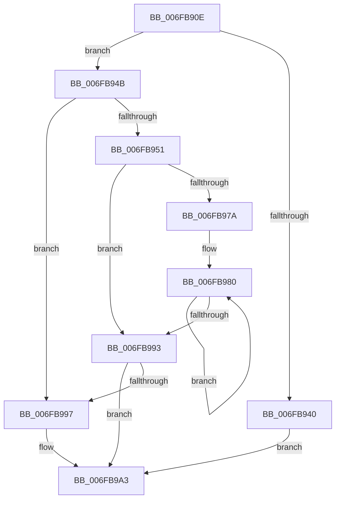

# sub_006FB90E

- RVA: `0x006FB90E`–`0x006FB9B3` (길이 `165` bytes)
- VA: `0x00000001406FB90E`
- 실행 섹션: `.text`
- PDB 이름 있음: `아니요`; PDB Function 태그: `아니요`
- unwind 정보 RVA: `0x000B9F78`
- 디코드: `47`개 명령, `165/165` bytes 표시
- 미해석 바이트: `0` (있으면 어셈블리에 `.byte`로 보존)

> 이 문서는 커널 이미지의 기계어와 PDB 기호를 분석해 생성했습니다. 4번과 5번은 함수 원형과 자료형을 바이너리 사용 방식에서 추정한 C 해석이며 원본 소스 복구 결과는 아닙니다.

## 1. Dependencies

- 직접 호출 지점: **0**; 고유 호출 대상: **0**
- 직접 호출자로 확인된 함수: **0**
- RIP 상대 이미지 참조: **0**

### Outgoing calls
- 직접 디코드된 call 명령이 없습니다.

### Direct callers
- 이 함수 시작 RVA로 연결되는 직접 call은 확인되지 않았습니다. 간접 호출은 완전히 역산할 수 없습니다.

### Static image references
- 디코드된 RIP-relative 메모리 참조가 없습니다.

## 2. Other-region calls and transfers

- 다른 실행 섹션으로 향하는 call: **0**
- call이 아닌 외부 분기/꼬리 이동: **1**
  - `0x006FB9AE` → [MiSlabEntryBecameEmpty + 0x24](../4B/MiSlabEntryBecameEmpty_function_004B48F4.md) (`tail-transfer`)

## 3. Assembly (complete function range)

```asm
006FB90E  41 B9 40 00 00 00               mov r9d, 0x40
006FB914  49 8B 83 B0 DE 00 00            mov rax, qword ptr [r11 + 0xdeb0]
006FB91B  41 8B CA                        mov ecx, r10d
006FB91E  41 8B F9                        mov edi, r9d
006FB921  83 E7 1F                        and edi, 0x1f
006FB924  45 8B C1                        mov r8d, r9d
006FB927  49 C1 E8 05                     shr r8, 5
006FB92B  48 8B 90 D8 CA 04 00            mov rdx, qword ptr [rax + 0x4cad8]
006FB932  48 8D 47 01                     lea rax, [rdi + 1]
006FB936  4E 8D 1C 82                     lea r11, [rdx + r8*4]
006FB93A  48 83 F8 20                     cmp rax, 0x20
006FB93E  77 0B                           ja 0x1406fb94b
006FB940  8B CF                           mov ecx, edi
006FB942  41 D3 E2                        shl r10d, cl
006FB945  F0 45 09 13                     lock or dword ptr [r11], r10d
006FB949  EB 58                           jmp 0x1406fb9a3
006FB94B  41 83 E1 1F                     and r9d, 0x1f
006FB94F  74 46                           je 0x1406fb997
006FB951  BA 20 00 00 00                  mov edx, 0x20
006FB956  41 8B C2                        mov eax, r10d
006FB959  41 2B D1                        sub edx, r9d
006FB95C  8B CA                           mov ecx, edx
006FB95E  D3 E0                           shl eax, cl
006FB960  48 8B CF                        mov rcx, rdi
006FB963  41 2B C2                        sub eax, r10d
006FB966  D3 E0                           shl eax, cl
006FB968  F0 41 09 03                     lock or dword ptr [r11], eax
006FB96C  41 8B CA                        mov ecx, r10d
006FB96F  49 83 C3 04                     add r11, 4
006FB973  2B CA                           sub ecx, edx
006FB975  83 F9 20                        cmp ecx, 0x20
006FB978  72 19                           jb 0x1406fb993
006FB97A  8B C1                           mov eax, ecx
006FB97C  48 C1 E8 05                     shr rax, 5
006FB980  41 C7 03 FF FF FF FF            mov dword ptr [r11], 0xffffffff
006FB987  83 C1 E0                        add ecx, -0x20
006FB98A  49 83 C3 04                     add r11, 4
006FB98E  49 2B C2                        sub rax, r10
006FB991  75 ED                           jne 0x1406fb980
006FB993  85 C9                           test ecx, ecx
006FB995  74 0C                           je 0x1406fb9a3
006FB997  41 8B C2                        mov eax, r10d
006FB99A  D3 E0                           shl eax, cl
006FB99C  41 2B C2                        sub eax, r10d
006FB99F  F0 41 09 03                     lock or dword ptr [r11], eax
006FB9A3  48 C7 83 B0 00 00 00 00 00 00 00  mov qword ptr [rbx + 0xb0], 0
006FB9AE  E9 65 8F DB FF                  jmp 0x1404b4918
```

## 4. C-style interpretation (structured pseudocode)

```c
__int64 __fastcall sub_006FB90E(void)
{
    __int64 result;
    __int64 v_r10;
    __int64 v_r11;
    __int64 v_rdi;

    v_rdi = (unsigned int)((64) & (31));
    a3 = (64) >> (5);
    if ((v_rdi + 1) > 32) goto loc_006FB94B;
    v_r10 = (unsigned int)((v_r10) << ((unsigned __int8)((unsigned int)((unsigned int)(v_rdi)))));
    goto loc_006FB9A3;
loc_006FB94B:
    a4 = (unsigned int)((64) & (31));
    if (condition_is_equal) goto loc_006FB997;
    a2 = (unsigned int)((32) - ((unsigned int)(a4)));
    result = (unsigned int)(((unsigned int)((unsigned int)(v_r10))) << ((unsigned __int8)((unsigned int)((unsigned int)(a2)))));
    result = (unsigned int)((result) - ((unsigned int)(v_r10)));
    result = (unsigned int)((result) << ((unsigned __int8)(v_rdi)));
    v_r11 = (*(unsigned __int64 *)(*(unsigned __int64 *)(v_r11 + 57008) + 314072) + a3 * 4) + (4);
    a1 = (unsigned int)(((unsigned int)((unsigned int)(v_r10))) - ((unsigned int)(a2)));
    if (((unsigned int)(a1)) < 32) goto loc_006FB993;
    result = ((unsigned int)((unsigned int)(a1))) >> (5);
loc_006FB980:
    *(unsigned int *)(v_r11) = 0xFFFFFFFFULL;
    a1 = (unsigned int)((a1) + (-32));
    v_r11 = (v_r11) + (4);
    result = (result) - (v_r10);
    if (condition_is_not_equal) goto loc_006FB980;
loc_006FB993:
    if ((unsigned int)(a1) != 0) {
        result = (unsigned int)(v_r10);
        result = (unsigned int)((result) << ((unsigned __int8)(a1)));
        result = (unsigned int)((result) - ((unsigned int)(v_r10)));
    }
    *(unsigned __int64 *)(v_rbx + 176) = 0;
}
```

## 5. (Beta) C Style

```c
void sub_006FB90E(void)
{
    int64_t result;
    int64_t local_r10;
    int64_t local_r11;
    int64_t local_rdi;

    local_rdi = (uint32_t)((64) & (31));
    a3 = (64) >> (5);
    if ((local_rdi + 1) > 32) goto loc_006FB94B;
    local_r10 = (uint32_t)((local_r10) << ((uint8_t)((uint32_t)((uint32_t)(local_rdi)))));
    goto loc_006FB9A3;
loc_006FB94B:
    a4 = (uint32_t)((64) & (31));
    if (condition_is_equal) goto loc_006FB997;
    a2 = (uint32_t)((32) - ((uint32_t)(a4)));
    result = (uint32_t)(((uint32_t)((uint32_t)(local_r10))) << ((uint8_t)((uint32_t)((uint32_t)(a2)))));
    result = (uint32_t)((result) - ((uint32_t)(local_r10)));
    result = (uint32_t)((result) << ((uint8_t)(local_rdi)));
    local_r11 = (*(uint64_t *)(*(uint64_t *)(local_r11 + 0xDEB0) + 0x4CAD8) + a3 * 4) + (4);
    a1 = (uint32_t)(((uint32_t)((uint32_t)(local_r10))) - ((uint32_t)(a2)));
    if (((uint32_t)(a1)) < 32) goto loc_006FB993;
    result = ((uint32_t)((uint32_t)(a1))) >> (5);
loc_006FB980:
    *(uint32_t *)(local_r11) = 0xFFFFFFFFULL;
    a1 = (uint32_t)((a1) + (-32));
    local_r11 = (local_r11) + (4);
    result = (result) - (local_r10);
    if (condition_is_not_equal) goto loc_006FB980;
loc_006FB993:
    if ((uint32_t)(a1) != 0) {
        result = (uint32_t)(local_r10);
        result = (uint32_t)((result) << ((uint8_t)(a1)));
        result = (uint32_t)((result) - ((uint32_t)(local_r10)));
    }
    *(uint64_t *)(local_rbx + 0xB0) = 0;
}
```

## 6. Execution-region graph

[열기: 2D/3D 그래프와 함수 탐색 컨트롤 패널](../../../control-panel.html?section=text&rva=0x006FB90E&view=graph)

- 2D 그래프는 위에서 아래로 흐르고, 3D 그래프는 빈 공간을 드래그해 회전합니다. Shift+드래그는 이동, 휠은 확대·축소, 함수 노드 선택은 대상 보고서 이동입니다.

### Static fallback


