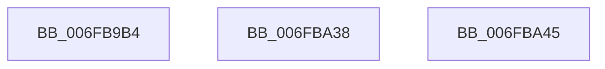

# sub_006FB9B4

- RVA: `0x006FB9B4`–`0x006FBAB6` (길이 `258` bytes)
- VA: `0x00000001406FB9B4`
- 실행 섹션: `.text`
- PDB 이름 있음: `아니요`; PDB Function 태그: `아니요`
- unwind 정보 RVA: `0x000B9FB4`
- 디코드: `53`개 명령, `258/258` bytes 표시
- 미해석 바이트: `0` (있으면 어셈블리에 `.byte`로 보존)

> 이 문서는 커널 이미지의 기계어와 PDB 기호를 분석해 생성했습니다. 4번과 5번은 함수 원형과 자료형을 바이너리 사용 방식에서 추정한 C 해석이며 원본 소스 복구 결과는 아닙니다.

## 1. Dependencies

- 직접 호출 지점: **2**; 고유 호출 대상: **1**
- 직접 호출자로 확인된 함수: **0**
- RIP 상대 이미지 참조: **3**

### Outgoing calls
- `0x006FBA2D` → [tlgWriteTransfer_EtwWriteTransfer](../42/tlgWriteTransfer_EtwWriteTransfer_function_004260E0.md) (function, `0x004260E0`)
- `0x006FBAAB` → [tlgWriteTransfer_EtwWriteTransfer](../42/tlgWriteTransfer_EtwWriteTransfer_function_004260E0.md) (function, `0x004260E0`)

### Direct callers
- 이 함수 시작 RVA로 연결되는 직접 call은 확인되지 않았습니다. 간접 호출은 완전히 역산할 수 없습니다.

### Static image references
- `0x006FB9BF` → RVA `0x00044C1D` (`.rdata`; read)
- `0x006FB9D6` → RVA `0x00E06C50` (`.data`; read)
- `0x006FBA50` → RVA `0x00044BB9` (`.rdata`; read)

## 2. Other-region calls and transfers

- 다른 실행 섹션으로 향하는 call: **0**
- call이 아닌 외부 분기/꼬리 이동: **3**
  - `0x006FBA33` → [FsRtlpRemoveAndCompleteReadOnlyIrp + 0x4C](../4B/FsRtlpRemoveAndCompleteReadOnlyIrp_function_004B495C.md) (`tail-transfer`)
  - `0x006FBA40` → [FsRtlpRemoveAndCompleteReadOnlyIrp + 0xCA](../4B/FsRtlpRemoveAndCompleteReadOnlyIrp_function_004B495C.md) (`tail-transfer`)
  - `0x006FBAB1` → [FsRtlpRemoveAndCompleteReadOnlyIrp + 0xF1](../4B/FsRtlpRemoveAndCompleteReadOnlyIrp_function_004B495C.md) (`tail-transfer`)

## 3. Assembly (complete function range)

```asm
006FB9B4  48 8D 45 AF                     lea rax, [rbp - 0x51]
006FB9B8  89 55 AF                        mov dword ptr [rbp - 0x51], edx
006FB9BB  48 89 45 E7                     mov qword ptr [rbp - 0x19], rax
006FB9BF  48 8D 15 57 92 94 FF            lea rdx, [rip - 0x6b6da9]
006FB9C6  48 8D 45 B7                     lea rax, [rbp - 0x49]
006FB9CA  48 C7 45 EF 04 00 00 00         mov qword ptr [rbp - 0x11], 4
006FB9D2  48 89 45 F7                     mov qword ptr [rbp - 9], rax
006FB9D6  48 8D 0D 73 B2 70 00            lea rcx, [rip + 0x70b273]
006FB9DD  41 8B 81 90 00 00 00            mov eax, dword ptr [r9 + 0x90]
006FB9E4  45 33 C0                        xor r8d, r8d
006FB9E7  89 45 A7                        mov dword ptr [rbp - 0x59], eax
006FB9EA  45 33 C9                        xor r9d, r9d
006FB9ED  48 8D 45 A7                     lea rax, [rbp - 0x59]
006FB9F1  4C 89 7D B7                     mov qword ptr [rbp - 0x49], r15
006FB9F5  48 89 45 07                     mov qword ptr [rbp + 7], rax
006FB9F9  48 8D 45 AB                     lea rax, [rbp - 0x55]
006FB9FD  48 89 45 17                     mov qword ptr [rbp + 0x17], rax
006FBA01  48 8D 45 C7                     lea rax, [rbp - 0x39]
006FBA05  48 89 44 24 28                  mov qword ptr [rsp + 0x28], rax
006FBA0A  C7 44 24 20 06 00 00 00         mov dword ptr [rsp + 0x20], 6
006FBA12  48 C7 45 FF 08 00 00 00         mov qword ptr [rbp - 1], 8
006FBA1A  48 C7 45 0F 04 00 00 00         mov qword ptr [rbp + 0xf], 4
006FBA22  89 75 AB                        mov dword ptr [rbp - 0x55], esi
006FBA25  48 C7 45 1F 04 00 00 00         mov qword ptr [rbp + 0x1f], 4
006FBA2D  E8 AE A6 D2 FF                  call 0x1404260e0
006FBA32  90                              nop
006FBA33  E9 70 8F DB FF                  jmp 0x1404b49a8
006FBA38  BB 20 01 00 C0                  mov ebx, 0xc0000120
006FBA3D  49 8B CE                        mov rcx, r14
006FBA40  E9 E1 8F DB FF                  jmp 0x1404b4a26
006FBA45  48 8D 45 AB                     lea rax, [rbp - 0x55]
006FBA49  89 5D AB                        mov dword ptr [rbp - 0x55], ebx
006FBA4C  48 89 45 E7                     mov qword ptr [rbp - 0x19], rax
006FBA50  48 8D 15 62 91 94 FF            lea rdx, [rip - 0x6b6e9e]
006FBA57  48 8D 45 B7                     lea rax, [rbp - 0x49]
006FBA5B  48 C7 45 EF 04 00 00 00         mov qword ptr [rbp - 0x11], 4
006FBA63  48 89 45 F7                     mov qword ptr [rbp - 9], rax
006FBA67  48 8D 0D E2 B1 70 00            lea rcx, [rip + 0x70b1e2]
006FBA6E  41 8B 87 90 00 00 00            mov eax, dword ptr [r15 + 0x90]
006FBA75  45 33 C9                        xor r9d, r9d
006FBA78  89 45 A7                        mov dword ptr [rbp - 0x59], eax
006FBA7B  45 33 C0                        xor r8d, r8d
006FBA7E  48 8D 45 A7                     lea rax, [rbp - 0x59]
006FBA82  4C 89 7D B7                     mov qword ptr [rbp - 0x49], r15
006FBA86  48 89 45 07                     mov qword ptr [rbp + 7], rax
006FBA8A  48 8D 45 C7                     lea rax, [rbp - 0x39]
006FBA8E  48 89 44 24 28                  mov qword ptr [rsp + 0x28], rax
006FBA93  C7 44 24 20 05 00 00 00         mov dword ptr [rsp + 0x20], 5
006FBA9B  48 C7 45 FF 08 00 00 00         mov qword ptr [rbp - 1], 8
006FBAA3  48 C7 45 0F 04 00 00 00         mov qword ptr [rbp + 0xf], 4
006FBAAB  E8 30 A6 D2 FF                  call 0x1404260e0
006FBAB0  90                              nop
006FBAB1  E9 97 8F DB FF                  jmp 0x1404b4a4d
```

## 4. C-style interpretation (structured pseudocode)

```c
__int64 __fastcall sub_006FB9B4(__int64 a1, int a2, int a3, __int64 a4)
{
    __int64 result;
    unsigned int v_stack_p20;
    unsigned __int64 v_stack_p28;

    *(unsigned int *)(v_rbp - 81) = a2;
    *(unsigned __int64 *)(v_rbp - 25) = v_rbp - 81;
    *(unsigned __int64 *)(v_rbp - 17) = 4;
    *(unsigned __int64 *)(v_rbp - 9) = v_rbp - 73;
    a3 = 0;
    *(unsigned int *)(v_rbp - 89) = (unsigned int)((unsigned int)(*(unsigned int *)(a4 + 144)));
    a4 = 0;
    *(unsigned __int64 *)(v_rbp - 73) = v_r15;
    *(unsigned __int64 *)(v_rbp + 7) = v_rbp - 89;
    *(unsigned __int64 *)(v_rbp + 23) = v_rbp - 85;
    v_stack_p28 = v_rbp - 57;
    v_stack_p20 = 6;
    *(unsigned __int64 *)(v_rbp - 1) = 8;
    *(unsigned __int64 *)(v_rbp + 15) = 4;
    *(unsigned int *)(v_rbp - 85) = (unsigned int)(v_rsi);
    *(unsigned __int64 *)(v_rbp + 31) = 4;
    result = tlgWriteTransfer_EtwWriteTransfer(v_rip + 7385715, v_rip - 7040425, a3, a4);
}
```

## 5. (Beta) C Style

```c
int64_t sub_006FB9B4(int64_t Arg1, int32_t Arg2, int32_t Arg3, void *Arg4)
{
    uint8_t *arg4 = (uint8_t *)Arg4;

    int64_t result;
    uint32_t v_stack_p20;
    uint64_t v_stack_p28;

    *(uint32_t *)(local_rbp - 0x51) = Arg2;
    *(uint64_t *)(local_rbp - 0x19) = local_rbp - 81;
    *(uint64_t *)(local_rbp - 0x11) = 4;
    *(uint64_t *)(local_rbp - 0x9) = local_rbp - 73;
    Arg3 = 0;
    *(uint32_t *)(local_rbp - 0x59) = (uint32_t)((uint32_t)(*(uint32_t *)(arg4 + 0x90)));
    Arg4 = 0;
    *(uint64_t *)(local_rbp - 0x49) = local_r15;
    *(uint64_t *)(local_rbp + 0x7) = local_rbp - 89;
    *(uint64_t *)(local_rbp + 0x17) = local_rbp - 85;
    v_stack_p28 = local_rbp - 57;
    v_stack_p20 = 6;
    *(uint64_t *)(local_rbp - 0x1) = 8;
    *(uint64_t *)(local_rbp + 0xF) = 4;
    *(uint32_t *)(local_rbp - 0x55) = (uint32_t)(local_rsi);
    *(uint64_t *)(local_rbp + 0x1F) = 4;
    result = tlgWriteTransfer_EtwWriteTransfer(v_rip + 7385715, v_rip - 7040425, Arg3, Arg4);
}
```

### 관측된 메모리 오프셋

구조체 형식이 확인되지 않은 접근은 인자 기준의 오프셋으로만 기록했습니다.

| 기준 인자 | 오프셋 표현 | 폭 (bit) | 접근 |
|---|---:|---:|---|
| `Arg4` | `+ 0x90` | `32` | `R` |

## 6. Execution-region graph

[열기: 2D/3D 그래프와 함수 탐색 컨트롤 패널](../../../control-panel.html?section=text&rva=0x006FB9B4&view=graph)

- 2D 그래프는 위에서 아래로 흐르고, 3D 그래프는 빈 공간을 드래그해 회전합니다. Shift+드래그는 이동, 휠은 확대·축소, 함수 노드 선택은 대상 보고서 이동입니다.

### Static fallback


