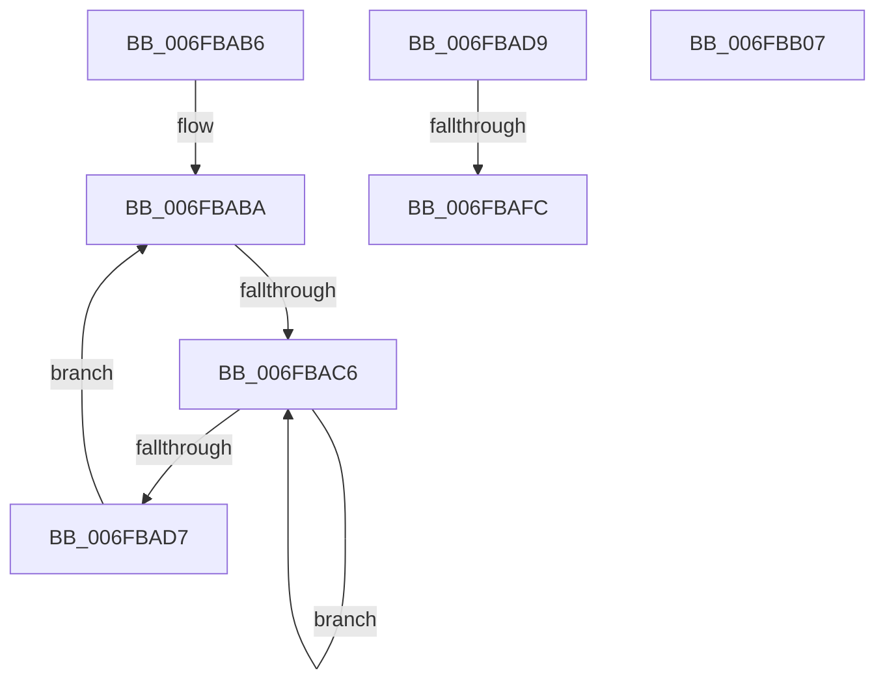

# sub_006FBAB6

- RVA: `0x006FBAB6`–`0x006FBB10` (길이 `90` bytes)
- VA: `0x00000001406FBAB6`
- 실행 섹션: `.text`
- PDB 이름 있음: `아니요`; PDB Function 태그: `아니요`
- unwind 정보 RVA: `0x000BA1BC`
- 디코드: `23`개 명령, `90/90` bytes 표시
- 미해석 바이트: `0` (있으면 어셈블리에 `.byte`로 보존)

> 이 문서는 커널 이미지의 기계어와 PDB 기호를 분석해 생성했습니다. 4번과 5번은 함수 원형과 자료형을 바이너리 사용 방식에서 추정한 C 해석이며 원본 소스 복구 결과는 아닙니다.

## 1. Dependencies

- 직접 호출 지점: **2**; 고유 호출 대상: **2**
- 직접 호출자로 확인된 함수: **0**
- RIP 상대 이미지 참조: **1**

### Outgoing calls
- `0x006FBACA` → [KeYieldProcessorEx](../3F/KeYieldProcessorEx_function_003FBD00.md) (function, `0x003FBD00`)
- `0x006FBAFC` → [KeWakeAddressAll](../21/KeWakeAddressAll_function_00217C20.md) (function, `0x00217C20`)

### Direct callers
- 이 함수 시작 RVA로 연결되는 직접 call은 확인되지 않았습니다. 간접 호출은 완전히 역산할 수 없습니다.

### Static image references
- `0x006FBAED` → RVA `0x00FC8C40` (`ALMOSTRO`; read)

## 2. Other-region calls and transfers

- 다른 실행 섹션으로 향하는 call: **0**
- call이 아닌 외부 분기/꼬리 이동: **4**
  - `0x006FBAC0` → [KeTryToFreezeThreadStack + 0x219](../4B/KeTryToFreezeThreadStack_function_004B5038.md) (`tail-transfer`)
  - `0x006FBAF6` → [KeTryToFreezeThreadStack + 0x84](../4B/KeTryToFreezeThreadStack_function_004B5038.md) (`tail-transfer`)
  - `0x006FBB02` → [KeTryToFreezeThreadStack + 0x7D](../4B/KeTryToFreezeThreadStack_function_004B5038.md) (`tail-transfer`)
  - `0x006FBB0B` → [KeTryToFreezeThreadStack + 0x7D](../4B/KeTryToFreezeThreadStack_function_004B5038.md) (`tail-transfer`)

## 3. Assembly (complete function range)

```asm
006FBAB6  44 89 6D 40                     mov dword ptr [rbp + 0x40], r13d
006FBABA  F0 48 0F BA 2F 00               lock bts qword ptr [rdi], 0
006FBAC0  0F 83 8B 97 DB FF               jae 0x1404b5251
006FBAC6  48 8D 4D 40                     lea rcx, [rbp + 0x40]
006FBACA  E8 31 02 D0 FF                  call 0x1403fbd00
006FBACF  48 8B 07                        mov rax, qword ptr [rdi]
006FBAD2  48 85 C0                        test rax, rax
006FBAD5  75 EF                           jne 0x1406fbac6
006FBAD7  EB E1                           jmp 0x1406fbaba
006FBAD9  48 8D 48 08                     lea rcx, [rax + 8]
006FBADD  4C 89 6D F0                     mov qword ptr [rbp - 0x10], r13
006FBAE1  48 8B 55 F8                     mov rdx, qword ptr [rbp - 8]
006FBAE5  48 8B C2                        mov rax, rdx
006FBAE8  48 87 01                        xchg qword ptr [rcx], rax
006FBAEB  32 C2                           xor al, dl
006FBAED  48 8D 15 4C D1 8C 00            lea rdx, [rip + 0x8cd14c]
006FBAF4  A8 04                           test al, 4
006FBAF6  0F 84 C0 95 DB FF               je 0x1404b50bc
006FBAFC  E8 1F C1 B1 FF                  call 0x140217c20
006FBB01  90                              nop
006FBB02  E9 AE 95 DB FF                  jmp 0x1404b50b5
006FBB07  F0 4C 21 2F                     lock and qword ptr [rdi], r13
006FBB0B  E9 A5 95 DB FF                  jmp 0x1404b50b5
```

## 4. C-style interpretation (structured pseudocode)

```c
__int64 __fastcall sub_006FBAB6(void)
{
    __int64 result;

    *(unsigned int *)(v_rbp + 64) = (unsigned int)(v_r13);
loc_006FBABA:
loc_006FBAC6:
    result = KeYieldProcessorEx(v_rbp + 64, a2, a3, a4);
    if (*(unsigned __int64 *)(v_rdi) != 0) goto loc_006FBAC6;
    goto loc_006FBABA;
}
```

## 5. (Beta) C Style

```c
void sub_006FBAB6(void)
{
    int64_t result;

    *(uint32_t *)(local_rbp + 0x40) = (uint32_t)(local_r13);
loc_006FBABA:
loc_006FBAC6:
    result = KeYieldProcessorEx(local_rbp + 64, a2, a3, a4);
    if (*(uint64_t *)(local_rdi) != 0) goto loc_006FBAC6;
    goto loc_006FBABA;
}
```

## 6. Execution-region graph

[열기: 2D/3D 그래프와 함수 탐색 컨트롤 패널](../../../control-panel.html?section=text&rva=0x006FBAB6&view=graph)

- 2D 그래프는 위에서 아래로 흐르고, 3D 그래프는 빈 공간을 드래그해 회전합니다. Shift+드래그는 이동, 휠은 확대·축소, 함수 노드 선택은 대상 보고서 이동입니다.

### Static fallback


