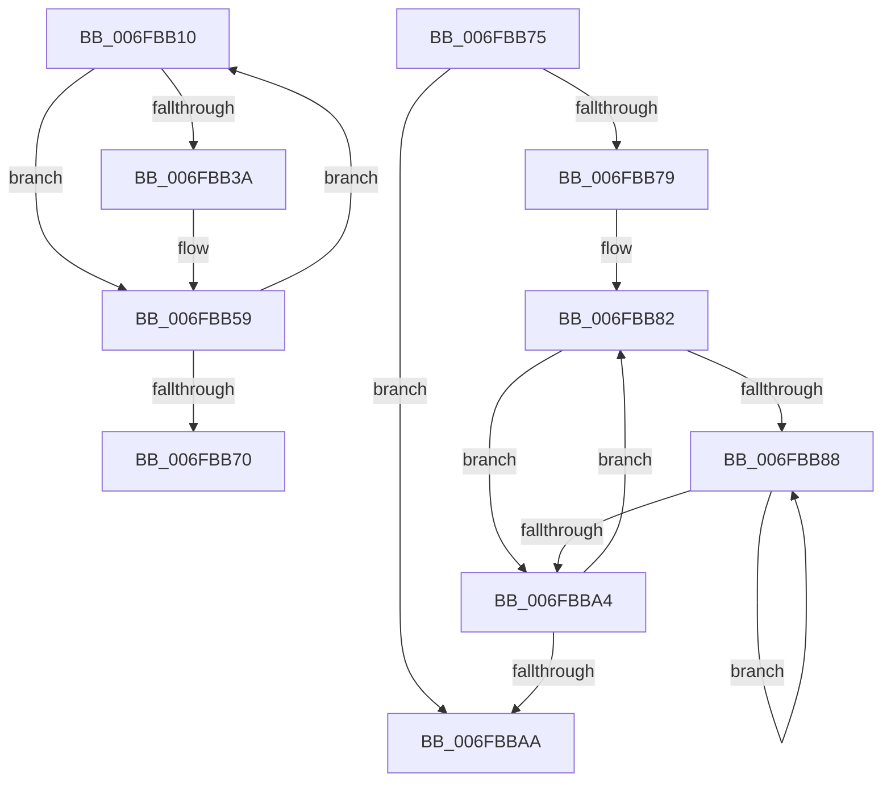

# sub_006FBB10

- RVA: `0x006FBB10`–`0x006FBBCC` (길이 `188` bytes)
- VA: `0x00000001406FBB10`
- 실행 섹션: `.text`
- PDB 이름 있음: `아니요`; PDB Function 태그: `아니요`
- unwind 정보 RVA: `0x000BA254`
- 디코드: `48`개 명령, `188/188` bytes 표시
- 미해석 바이트: `0` (있으면 어셈블리에 `.byte`로 보존)

> 이 문서는 커널 이미지의 기계어와 PDB 기호를 분석해 생성했습니다. 4번과 5번은 함수 원형과 자료형을 바이너리 사용 방식에서 추정한 C 해석이며 원본 소스 복구 결과는 아닙니다.

## 1. Dependencies

- 직접 호출 지점: **6**; 고유 호출 대상: **6**
- 직접 호출자로 확인된 함수: **0**
- RIP 상대 이미지 참조: **1**

### Outgoing calls
- `0x006FBB28` → [KeAcquireSpinLockRaiseToDpc](../20/KeAcquireSpinLockRaiseToDpc_function_00208470.md) (function, `0x00208470`)
- `0x006FBB42` → [PopFxReinitializeAccountingInstance](../4B/PopFxReinitializeAccountingInstance_function_004B0960.md) (function, `0x004B0960`)
- `0x006FBB5F` → [KeReleaseSpinLock](../39/KeReleaseSpinLock_function_00392BA0.md) (function, `0x00392BA0`)
- `0x006FBB93` → [PoFxActivateComponent](../2D/PoFxActivateComponent_function_002D9D30.md) (function, `0x002D9D30`)
- `0x006FBBB9` → [ExReleaseSpinLockExclusive](../2C/ExReleaseSpinLockExclusive_function_002C0EF0.md) (function, `0x002C0EF0`)
- `0x006FBBC1` → [PopDiagTraceFxDeviceStartPowerManagement](../../page/76/PopDiagTraceFxDeviceStartPowerManagement_function_00761610.md) (function, `0x00761610`)

### Direct callers
- 이 함수 시작 RVA로 연결되는 직접 call은 확인되지 않았습니다. 간접 호출은 완전히 역산할 수 없습니다.

### Static image references
- `0x006FBB2D` → RVA `0x00E676AC` (`.data`; read)

## 2. Other-region calls and transfers

- 다른 실행 섹션으로 향하는 call: **1**
  - `0x006FBBC1` → [PopDiagTraceFxDeviceStartPowerManagement](../../page/76/PopDiagTraceFxDeviceStartPowerManagement_function_00761610.md) (`.text` → `PAGE`)
- call이 아닌 외부 분기/꼬리 이동: **2**
  - `0x006FBB70` → [PoFxStartDevicePowerManagement + 0x2D](../4B/PoFxStartDevicePowerManagement_function_004B5740.md) (`tail-transfer`)
  - `0x006FBBC7` → [PoFxStartDevicePowerManagement + 0x4C](../4B/PoFxStartDevicePowerManagement_function_004B5740.md) (`tail-transfer`)

## 3. Assembly (complete function range)

```asm
006FBB10  48 8B 86 68 03 00 00            mov rax, qword ptr [rsi + 0x368]
006FBB17  41 8B CE                        mov ecx, r14d
006FBB1A  48 8B 2C C8                     mov rbp, qword ptr [rax + rcx*8]
006FBB1E  48 81 C5 C8 00 00 00            add rbp, 0xc8
006FBB25  48 8B CD                        mov rcx, rbp
006FBB28  E8 43 C9 B0 FF                  call 0x140208470
006FBB2D  8B 15 79 BB 76 00               mov edx, dword ptr [rip + 0x76bb79]
006FBB33  44 8A F8                        mov r15b, al
006FBB36  85 D2                           test edx, edx
006FBB38  75 1F                           jne 0x1406fbb59
006FBB3A  BA 01 00 00 00                  mov edx, 1
006FBB3F  48 8B CD                        mov rcx, rbp
006FBB42  E8 19 4E DB FF                  call 0x1404b0960
006FBB47  48 A1 08 00 00 00 80 F7 FF FF   movabs rax, qword ptr [0xfffff78000000008]
006FBB51  48 89 45 18                     mov qword ptr [rbp + 0x18], rax
006FBB55  C6 45 08 01                     mov byte ptr [rbp + 8], 1
006FBB59  41 8A D7                        mov dl, r15b
006FBB5C  48 8B CD                        mov rcx, rbp
006FBB5F  E8 3C 70 C9 FF                  call 0x140392ba0
006FBB64  41 FF C6                        inc r14d
006FBB67  44 3B B6 64 03 00 00            cmp r14d, dword ptr [rsi + 0x364]
006FBB6E  72 A0                           jb 0x1406fbb10
006FBB70  E9 F8 9B DB FF                  jmp 0x1404b576d
006FBB75  85 D2                           test edx, edx
006FBB77  74 31                           je 0x1406fbbaa
006FBB79  8B 86 64 03 00 00               mov eax, dword ptr [rsi + 0x364]
006FBB7F  4C 8B F2                        mov r14, rdx
006FBB82  8B EF                           mov ebp, edi
006FBB84  85 C0                           test eax, eax
006FBB86  74 1C                           je 0x1406fbba4
006FBB88  41 B8 02 00 00 00               mov r8d, 2
006FBB8E  8B D5                           mov edx, ebp
006FBB90  48 8B CE                        mov rcx, rsi
006FBB93  E8 98 E1 BD FF                  call 0x1402d9d30
006FBB98  8B 86 64 03 00 00               mov eax, dword ptr [rsi + 0x364]
006FBB9E  FF C5                           inc ebp
006FBBA0  3B E8                           cmp ebp, eax
006FBBA2  72 E4                           jb 0x1406fbb88
006FBBA4  49 83 EE 01                     sub r14, 1
006FBBA8  75 D8                           jne 0x1406fbb82
006FBBAA  F0 83 8B 28 01 00 00 04         lock or dword ptr [rbx + 0x128], 4
006FBBB2  41 8A D4                        mov dl, r12b
006FBBB5  48 8D 4B 58                     lea rcx, [rbx + 0x58]
006FBBB9  E8 32 53 BC FF                  call 0x1402c0ef0
006FBBBE  48 8B CB                        mov rcx, rbx
006FBBC1  E8 4A 5A 06 00                  call 0x140761610
006FBBC6  90                              nop
006FBBC7  E9 C0 9B DB FF                  jmp 0x1404b578c
```

## 4. C-style interpretation (structured pseudocode)

```c
__int64 __fastcall sub_006FBB10(void)
{
    __int64 result;
    __int64 v_r14;
    __int64 v_rbp;

    v_rbp = (*(unsigned __int64 *)(*(unsigned __int64 *)(v_rsi + 872) + (unsigned int)((unsigned int)(v_r14)) * 8)) + (200);
    result = KeAcquireSpinLockRaiseToDpc(v_rbp, a2, a3, a4);
    if ((unsigned int)((unsigned int)(*(unsigned int *)(v_rip + 7781241))) == 0) {
        a2 = 1;
        a1 = v_rbp;
        result = PopFxReinitializeAccountingInstance(a1, a2, a3, a4);
        *(unsigned __int64 *)(v_rbp + 24) = result;
        *(unsigned __int8 *)(v_rbp + 8) = 1;
    }
    result = KeReleaseSpinLock(v_rbp, (unsigned __int8)((unsigned __int8)(result)), a3, a4);
    v_r14 = (unsigned int)((v_r14) + 1);
    if (((unsigned int)(v_r14)) < (*(unsigned int *)(v_rsi + 868))) goto loc_006FBB10;
}
```

## 5. (Beta) C Style

```c
void sub_006FBB10(void)
{
    int64_t result;
    int64_t local_r14;
    int64_t local_rbp;

    local_rbp = (*(uint64_t *)(*(uint64_t *)(local_rsi + 0x368) + (uint32_t)((uint32_t)(local_r14)) * 8)) + (200);
    result = KeAcquireSpinLockRaiseToDpc(local_rbp, a2, a3, a4);
    if ((uint32_t)((uint32_t)(*(uint32_t *)(v_rip + 0x76BB79))) == 0) {
        a2 = 1;
        a1 = local_rbp;
        result = PopFxReinitializeAccountingInstance(a1, a2, a3, a4);
        *(uint64_t *)(local_rbp + 0x18) = result;
        *(uint8_t *)(local_rbp + 0x8) = 1;
    }
    result = KeReleaseSpinLock(local_rbp, (uint8_t)((uint8_t)(result)), a3, a4);
    local_r14 = (uint32_t)((local_r14) + 1);
    if (((uint32_t)(local_r14)) < (*(uint32_t *)(local_rsi + 0x364))) goto loc_006FBB10;
}
```

## 6. Execution-region graph

[열기: 2D/3D 그래프와 함수 탐색 컨트롤 패널](../../../control-panel.html?section=text&rva=0x006FBB10&view=graph)

- 2D 그래프는 위에서 아래로 흐르고, 3D 그래프는 빈 공간을 드래그해 회전합니다. Shift+드래그는 이동, 휠은 확대·축소, 함수 노드 선택은 대상 보고서 이동입니다.

### Static fallback


