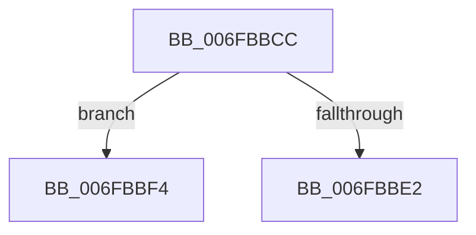

# sub_006FBBCC

- RVA: `0x006FBBCC`–`0x006FBBFD` (길이 `49` bytes)
- VA: `0x00000001406FBBCC`
- 실행 섹션: `.text`
- PDB 이름 있음: `아니요`; PDB Function 태그: `아니요`
- unwind 정보 RVA: `0x000BA344`
- 디코드: `14`개 명령, `49/49` bytes 표시
- 미해석 바이트: `0` (있으면 어셈블리에 `.byte`로 보존)

> 이 문서는 커널 이미지의 기계어와 PDB 기호를 분석해 생성했습니다. 4번과 5번은 함수 원형과 자료형을 바이너리 사용 방식에서 추정한 C 해석이며 원본 소스 복구 결과는 아닙니다.

## 1. Dependencies

- 직접 호출 지점: **2**; 고유 호출 대상: **2**
- 직접 호출자로 확인된 함수: **0**
- RIP 상대 이미지 참조: **0**

### Outgoing calls
- `0x006FBBD7` → [RtlAbsoluteToSelfRelativeSD](../../page/A1/RtlAbsoluteToSelfRelativeSD_function_00A119B0.md) (function, `0x00A119B0`)
- `0x006FBBE7` → [ExFreePoolWithTag](../../poolcode/B8/ExFreePoolWithTag_function_00B82870.md) (function, `0x00B82870`)

### Direct callers
- 이 함수 시작 RVA로 연결되는 직접 call은 확인되지 않았습니다. 간접 호출은 완전히 역산할 수 없습니다.

### Static image references
- 디코드된 RIP-relative 메모리 참조가 없습니다.

## 2. Other-region calls and transfers

- 다른 실행 섹션으로 향하는 call: **2**
  - `0x006FBBD7` → [RtlAbsoluteToSelfRelativeSD](../../page/A1/RtlAbsoluteToSelfRelativeSD_function_00A119B0.md) (`.text` → `PAGE`)
  - `0x006FBBE7` → [ExFreePoolWithTag](../../poolcode/B8/ExFreePoolWithTag_function_00B82870.md) (`.text` → `POOLCODE`)
- call이 아닌 외부 분기/꼬리 이동: **2**
  - `0x006FBBEF` → [SepCheckAndCopySelfRelativeSD + 0x42](../4B/SepCheckAndCopySelfRelativeSD_function_004B596C.md) (`tail-transfer`)
  - `0x006FBBF8` → [SepCheckAndCopySelfRelativeSD + 0x42](../4B/SepCheckAndCopySelfRelativeSD_function_004B596C.md) (`tail-transfer`)

## 3. Assembly (complete function range)

```asm
006FBBCC  48 8B 4C 24 40                  mov rcx, qword ptr [rsp + 0x40]
006FBBD1  4C 8B C6                        mov r8, rsi
006FBBD4  48 8B D0                        mov rdx, rax
006FBBD7  E8 D4 5D 31 00                  call 0x140a119b0
006FBBDC  8B D8                           mov ebx, eax
006FBBDE  85 C0                           test eax, eax
006FBBE0  79 12                           jns 0x1406fbbf4
006FBBE2  48 8B 0F                        mov rcx, qword ptr [rdi]
006FBBE5  33 D2                           xor edx, edx
006FBBE7  E8 84 6C 48 00                  call 0x140b82870
006FBBEC  48 89 2F                        mov qword ptr [rdi], rbp
006FBBEF  E9 BA 9D DB FF                  jmp 0x1404b59ae
006FBBF4  41 C6 06 01                     mov byte ptr [r14], 1
006FBBF8  E9 B1 9D DB FF                  jmp 0x1404b59ae
```

## 4. C-style interpretation (structured pseudocode)

```c
__int64 __fastcall sub_006FBBCC(__int64 a1, __int64 a2, __int64 a3, __int64 a4, __int64 a5, __int64 a6, __int64 a7, __int64 a8)
{
    __int64 result;

    result = RtlAbsoluteToSelfRelativeSD(a8, result, v_rsi, a4);
    if (!sign_flag) goto loc_006FBBF4;
    a2 = 0;
    result = ExFreePoolWithTag(*(unsigned __int64 *)(v_rdi), a2, v_rsi, a4);
    *(unsigned __int64 *)(v_rdi) = v_rbp;
loc_006FBBF4:
    *(unsigned __int8 *)(v_r14) = 1;
}
```

## 5. (Beta) C Style

```c
int64_t sub_006FBBCC(int64_t Arg1, int64_t Arg2, int64_t Arg3, int64_t Arg4, uint64_t Arg5, uint64_t Arg6, uint64_t Arg7, int64_t Arg8)
{
    int64_t result;

    result = RtlAbsoluteToSelfRelativeSD(Arg8, result, local_rsi, Arg4);
    if (!sign_flag) goto loc_006FBBF4;
    Arg2 = 0;
    result = ExFreePoolWithTag(*(uint64_t *)(local_rdi), Arg2, local_rsi, Arg4);
    *(uint64_t *)(local_rdi) = local_rbp;
loc_006FBBF4:
    *(uint8_t *)(local_r14) = 1;
}
```

## 6. Execution-region graph

[열기: 2D/3D 그래프와 함수 탐색 컨트롤 패널](../../../control-panel.html?section=text&rva=0x006FBBCC&view=graph)

- 2D 그래프는 위에서 아래로 흐르고, 3D 그래프는 빈 공간을 드래그해 회전합니다. Shift+드래그는 이동, 휠은 확대·축소, 함수 노드 선택은 대상 보고서 이동입니다.

### Static fallback


