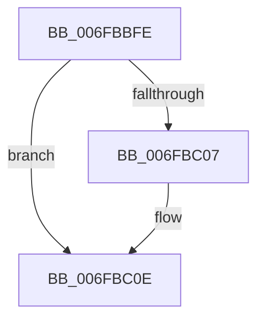

# sub_006FBBFE

- RVA: `0x006FBBFE`–`0x006FBC2B` (길이 `45` bytes)
- VA: `0x00000001406FBBFE`
- 실행 섹션: `.text`
- PDB 이름 있음: `아니요`; PDB Function 태그: `아니요`
- unwind 정보 RVA: `0x000BA3E0`
- 디코드: `13`개 명령, `45/45` bytes 표시
- 미해석 바이트: `0` (있으면 어셈블리에 `.byte`로 보존)

> 이 문서는 커널 이미지의 기계어와 PDB 기호를 분석해 생성했습니다. 4번과 5번은 함수 원형과 자료형을 바이너리 사용 방식에서 추정한 C 해석이며 원본 소스 복구 결과는 아닙니다.

## 1. Dependencies

- 직접 호출 지점: **2**; 고유 호출 대상: **2**
- 직접 호출자로 확인된 함수: **0**
- RIP 상대 이미지 참조: **1**

### Outgoing calls
- `0x006FBC09` → [ObfDereferenceObjectWithTag](../2F/ObfDereferenceObjectWithTag_function_002F78E0.md) (function, `0x002F78E0`)
- `0x006FBC20` → [ExFreePoolWithTag](../../poolcode/B8/ExFreePoolWithTag_function_00B82870.md) (function, `0x00B82870`)

### Direct callers
- 이 함수 시작 RVA로 연결되는 직접 call은 확인되지 않았습니다. 간접 호출은 완전히 역산할 수 없습니다.

### Static image references
- `0x006FBC14` → RVA `0x00F8D168` (`.data`; read/write)

## 2. Other-region calls and transfers

- 다른 실행 섹션으로 향하는 call: **1**
  - `0x006FBC20` → [ExFreePoolWithTag](../../poolcode/B8/ExFreePoolWithTag_function_00B82870.md) (`.text` → `POOLCODE`)
- call이 아닌 외부 분기/꼬리 이동: **1**
  - `0x006FBC26` → [IoWriteErrorLogEntry + 0x7F](../4B/IoWriteErrorLogEntry_function_004B5B30.md) (`tail-transfer`)

## 3. Assembly (complete function range)

```asm
006FBBFE  48 8B 4B 20                     mov rcx, qword ptr [rbx + 0x20]
006FBC02  48 85 C9                        test rcx, rcx
006FBC05  74 07                           je 0x1406fbc0e
006FBC07  8B D7                           mov edx, edi
006FBC09  E8 D2 BC BF FF                  call 0x1402f78e0
006FBC0E  0F B7 43 02                     movzx eax, word ptr [rbx + 2]
006FBC12  F7 D8                           neg eax
006FBC14  F0 01 05 4D 15 89 00            lock add dword ptr [rip + 0x89154d], eax
006FBC1B  33 D2                           xor edx, edx
006FBC1D  48 8B CB                        mov rcx, rbx
006FBC20  E8 4B 6C 48 00                  call 0x140b82870
006FBC25  90                              nop
006FBC26  E9 84 9F DB FF                  jmp 0x1404b5baf
```

## 4. C-style interpretation (structured pseudocode)

```c
__int64 __fastcall sub_006FBBFE(void)
{
    __int64 result;

    if (*(unsigned __int64 *)(v_rbx + 32) != 0) {
        a2 = (unsigned int)(v_rdi);
        result = ObfDereferenceObjectWithTag(*(unsigned __int64 *)(v_rbx + 32), a2, a3, a4);
    }
    result = (unsigned int)(-(*(unsigned __int16 *)(v_rbx + 2)));
    a2 = 0;
    result = ExFreePoolWithTag(v_rbx, a2, a3, a4);
}
```

## 5. (Beta) C Style

```c
void sub_006FBBFE(void)
{
    int64_t result;

    if (*(uint64_t *)(local_rbx + 0x20) != 0) {
        a2 = (uint32_t)(local_rdi);
        result = ObfDereferenceObjectWithTag(*(uint64_t *)(local_rbx + 0x20), a2, a3, a4);
    }
    result = (uint32_t)(-(*(uint16_t *)(local_rbx + 0x2)));
    a2 = 0;
    result = ExFreePoolWithTag(local_rbx, a2, a3, a4);
}
```

## 6. Execution-region graph

[열기: 2D/3D 그래프와 함수 탐색 컨트롤 패널](../../../control-panel.html?section=text&rva=0x006FBBFE&view=graph)

- 2D 그래프는 위에서 아래로 흐르고, 3D 그래프는 빈 공간을 드래그해 회전합니다. Shift+드래그는 이동, 휠은 확대·축소, 함수 노드 선택은 대상 보고서 이동입니다.

### Static fallback


