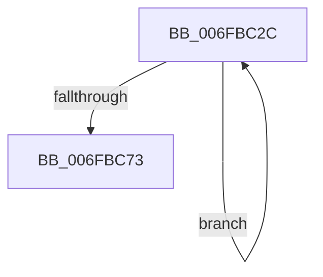

# sub_006FBC2C

- RVA: `0x006FBC2C`–`0x006FBC78` (길이 `76` bytes)
- VA: `0x00000001406FBC2C`
- 실행 섹션: `.text`
- PDB 이름 있음: `아니요`; PDB Function 태그: `아니요`
- unwind 정보 RVA: `0x000BA484`
- 디코드: `20`개 명령, `76/76` bytes 표시
- 미해석 바이트: `0` (있으면 어셈블리에 `.byte`로 보존)

> 이 문서는 커널 이미지의 기계어와 PDB 기호를 분석해 생성했습니다. 4번과 5번은 함수 원형과 자료형을 바이너리 사용 방식에서 추정한 C 해석이며 원본 소스 복구 결과는 아닙니다.

## 1. Dependencies

- 직접 호출 지점: **2**; 고유 호출 대상: **2**
- 직접 호출자로 확인된 함수: **0**
- RIP 상대 이미지 참조: **1**

### Outgoing calls
- `0x006FBC5A` → [ExpSaBinaryArrayRemove](../4F/ExpSaBinaryArrayRemove_function_004F77B4.md) (function, `0x004F77B4`)
- `0x006FBC64` → [ExFreePoolWithTag](../../poolcode/B8/ExFreePoolWithTag_function_00B82870.md) (function, `0x00B82870`)

### Direct callers
- 이 함수 시작 RVA로 연결되는 직접 call은 확인되지 않았습니다. 간접 호출은 완전히 역산할 수 없습니다.

### Static image references
- `0x006FBC2C` → RVA `0x00EFA278` (`.data`; read)

## 2. Other-region calls and transfers

- 다른 실행 섹션으로 향하는 call: **1**
  - `0x006FBC64` → [ExFreePoolWithTag](../../poolcode/B8/ExFreePoolWithTag_function_00B82870.md) (`.text` → `POOLCODE`)
- call이 아닌 외부 분기/꼬리 이동: **1**
  - `0x006FBC73` → [ExpSaPageGroupDescriptorFree + 0x5C](../4B/ExpSaPageGroupDescriptorFree_function_004B5EA8.md) (`tail-transfer`)

## 3. Assembly (complete function range)

```asm
006FBC2C  48 8B 05 45 E6 7F 00            mov rax, qword ptr [rip + 0x7fe645]
006FBC33  BB 01 00 00 00                  mov ebx, 1
006FBC38  8B 57 20                        mov edx, dword ptr [rdi + 0x20]
006FBC3B  0F BD CA                        bsr ecx, edx
006FBC3E  4D 8B 0C 06                     mov r9, qword ptr [r14 + rax]
006FBC42  D3 E3                           shl ebx, cl
006FBC44  48 33 DA                        xor rbx, rdx
006FBC47  89 4C 24 48                     mov dword ptr [rsp + 0x48], ecx
006FBC4B  8D 41 FE                        lea eax, [rcx - 2]
006FBC4E  49 8B C9                        mov rcx, r9
006FBC51  49 8B 04 C1                     mov rax, qword ptr [r9 + rax*8]
006FBC55  48 8B 5C D8 08                  mov rbx, qword ptr [rax + rbx*8 + 8]
006FBC5A  E8 55 BB DF FF                  call 0x1404f77b4
006FBC5F  33 D2                           xor edx, edx
006FBC61  48 8B CB                        mov rcx, rbx
006FBC64  E8 07 6C 48 00                  call 0x140b82870
006FBC69  4D 8D 76 08                     lea r14, [r14 + 8]
006FBC6D  48 83 EE 01                     sub rsi, 1
006FBC71  75 B9                           jne 0x1406fbc2c
006FBC73  E9 8C A2 DB FF                  jmp 0x1404b5f04
```

## 4. C-style interpretation (structured pseudocode)

```c
__int64 __fastcall sub_006FBC2C(void)
{
    __int64 result;
    __int64 v_rbx;
    __int64 v_rsi;
    unsigned int v_stack_p48;

    v_rbx = (unsigned int)((1) << ((unsigned __int8)(a1)));
    v_rbx = (v_rbx) ^ ((unsigned int)(*(unsigned int *)(v_rdi + 32)));
    v_stack_p48 = (unsigned int)(a1);
    result = ExpSaBinaryArrayRemove(*(unsigned __int64 *)(v_r14 + *(unsigned __int64 *)(v_rip + 8382021) * 1), (unsigned int)(*(unsigned int *)(v_rdi + 32)), a3, *(unsigned __int64 *)(v_r14 + *(unsigned __int64 *)(v_rip + 8382021) * 1));
    a2 = 0;
    result = ExFreePoolWithTag(*(unsigned __int64 *)(*(unsigned __int64 *)(*(unsigned __int64 *)(v_r14 + *(unsigned __int64 *)(v_rip + 8382021) * 1) + a1 - 2 * 8) + v_rbx * 8 + 8), a2, a3, *(unsigned __int64 *)(v_r14 + *(unsigned __int64 *)(v_rip + 8382021) * 1));
    v_rsi = (v_rsi) - (1);
    if (condition_is_not_equal) goto loc_006FBC2C;
}
```

## 5. (Beta) C Style

```c
void sub_006FBC2C(void)
{
    int64_t result;
    int64_t local_rbx;
    int64_t local_rsi;
    uint32_t v_stack_p48;

    local_rbx = (uint32_t)((1) << ((uint8_t)(a1)));
    local_rbx = (local_rbx) ^ ((uint32_t)(*(uint32_t *)(local_rdi + 0x20)));
    v_stack_p48 = (uint32_t)(a1);
    result = ExpSaBinaryArrayRemove(*(uint64_t *)(local_r14 + *(uint64_t *)(v_rip + 0x7FE645) * 1), (uint32_t)(*(uint32_t *)(local_rdi + 0x20)), a3, *(uint64_t *)(local_r14 + *(uint64_t *)(v_rip + 0x7FE645) * 1));
    a2 = 0;
    result = ExFreePoolWithTag(*(uint64_t *)(*(uint64_t *)(*(uint64_t *)(local_r14 + *(uint64_t *)(v_rip + 0x7FE645) * 1) + a1 - 0x2 * 8) + local_rbx * 8 + 0x8), a2, a3, *(uint64_t *)(local_r14 + *(uint64_t *)(v_rip + 0x7FE645) * 1));
    local_rsi = (local_rsi) - (1);
    if (condition_is_not_equal) goto loc_006FBC2C;
}
```

## 6. Execution-region graph

[열기: 2D/3D 그래프와 함수 탐색 컨트롤 패널](../../../control-panel.html?section=text&rva=0x006FBC2C&view=graph)

- 2D 그래프는 위에서 아래로 흐르고, 3D 그래프는 빈 공간을 드래그해 회전합니다. Shift+드래그는 이동, 휠은 확대·축소, 함수 노드 선택은 대상 보고서 이동입니다.

### Static fallback


