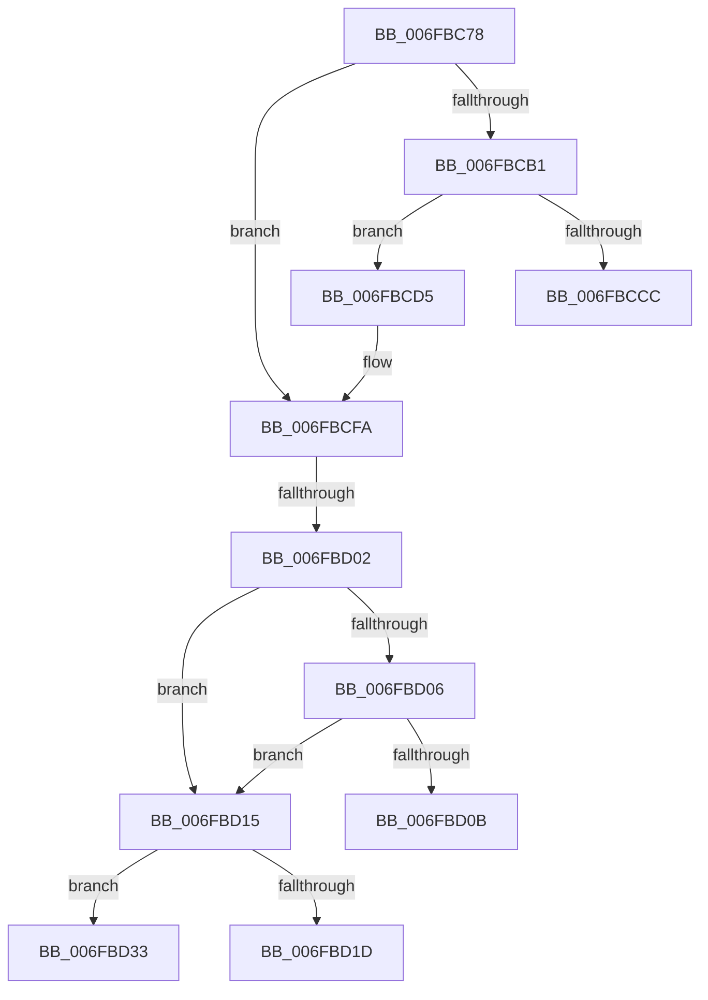

# sub_006FBC78

- RVA: `0x006FBC78`–`0x006FBD3B` (길이 `195` bytes)
- VA: `0x00000001406FBC78`
- 실행 섹션: `.text`
- PDB 이름 있음: `아니요`; PDB Function 태그: `아니요`
- unwind 정보 RVA: `0x000BA514`
- 디코드: `53`개 명령, `195/195` bytes 표시
- 미해석 바이트: `0` (있으면 어셈블리에 `.byte`로 보존)

> 이 문서는 커널 이미지의 기계어와 PDB 기호를 분석해 생성했습니다. 4번과 5번은 함수 원형과 자료형을 바이너리 사용 방식에서 추정한 C 해석이며 원본 소스 복구 결과는 아닙니다.

## 1. Dependencies

- 직접 호출 지점: **5**; 고유 호출 대상: **4**
- 직접 호출자로 확인된 함수: **0**
- RIP 상대 이미지 참조: **0**

### Outgoing calls
- `0x006FBC7F` → [RtlInitUnicodeString](../42/RtlInitUnicodeString_function_0042A780.md) (function, `0x0042A780`)
- `0x006FBC9F` → [ZwQueryValueKey](../6A/ZwQueryValueKey_function_006AD3B0.md) (function, `0x006AD3B0`)
- `0x006FBCBF` → [ExAllocatePool2](../../poolcode/B8/ExAllocatePool2_function_00B820F0.md) (function, `0x00B820F0`)
- `0x006FBCF3` → [ZwQueryValueKey](../6A/ZwQueryValueKey_function_006AD3B0.md) (function, `0x006AD3B0`)
- `0x006FBD28` → [memcpy](../6C/memcpy_function_006C6840.md) (function, `0x006C6840`)

### Direct callers
- 이 함수 시작 RVA로 연결되는 직접 call은 확인되지 않았습니다. 간접 호출은 완전히 역산할 수 없습니다.

### Static image references
- 디코드된 RIP-relative 메모리 참조가 없습니다.

## 2. Other-region calls and transfers

- 다른 실행 섹션으로 향하는 call: **1**
  - `0x006FBCBF` → [ExAllocatePool2](../../poolcode/B8/ExAllocatePool2_function_00B820F0.md) (`.text` → `POOLCODE`)
- call이 아닌 외부 분기/꼬리 이동: **5**
  - `0x006FBCD0` → [PopReadRegKeyValue + 0xAB](../4B/PopReadRegKeyValue_function_004B5F64.md) (`tail-transfer`)
  - `0x006FBCFC` → [PopReadRegKeyValue + 0xAB](../4B/PopReadRegKeyValue_function_004B5F64.md) (`tail-transfer`)
  - `0x006FBD10` → [PopReadRegKeyValue + 0xAB](../4B/PopReadRegKeyValue_function_004B5F64.md) (`tail-transfer`)
  - `0x006FBD2E` → [PopReadRegKeyValue + 0xAB](../4B/PopReadRegKeyValue_function_004B5F64.md) (`tail-transfer`)
  - `0x006FBD36` → [PopReadRegKeyValue + 0xAB](../4B/PopReadRegKeyValue_function_004B5F64.md) (`tail-transfer`)

## 3. Assembly (complete function range)

```asm
006FBC78  49 8B D7                        mov rdx, r15
006FBC7B  48 8D 4D B8                     lea rcx, [rbp - 0x48]
006FBC7F  E8 FC EA D2 FF                  call 0x14042a780
006FBC84  48 8B 4D B0                     mov rcx, qword ptr [rbp - 0x50]
006FBC88  48 8D 45 30                     lea rax, [rbp + 0x30]
006FBC8C  48 89 44 24 28                  mov qword ptr [rsp + 0x28], rax
006FBC91  48 8D 55 B8                     lea rdx, [rbp - 0x48]
006FBC95  21 7C 24 20                     and dword ptr [rsp + 0x20], edi
006FBC99  45 33 C9                        xor r9d, r9d
006FBC9C  45 8B C5                        mov r8d, r13d
006FBC9F  E8 0C 17 FB FF                  call 0x1406ad3b0
006FBCA4  41 BF 23 00 00 C0               mov r15d, 0xc0000023
006FBCAA  8B D8                           mov ebx, eax
006FBCAC  41 3B C7                        cmp eax, r15d
006FBCAF  75 49                           jne 0x1406fbcfa
006FBCB1  8B 55 30                        mov edx, dword ptr [rbp + 0x30]
006FBCB4  B9 00 01 00 00                  mov ecx, 0x100
006FBCB9  41 B8 54 56 45 50               mov r8d, 0x50455654
006FBCBF  E8 2C 64 48 00                  call 0x140b820f0
006FBCC4  48 8B F8                        mov rdi, rax
006FBCC7  48 85 C0                        test rax, rax
006FBCCA  75 09                           jne 0x1406fbcd5
006FBCCC  41 8D 5F F4                     lea ebx, [r15 - 0xc]
006FBCD0  E9 3A A3 DB FF                  jmp 0x1404b600f
006FBCD5  48 8B 4D B0                     mov rcx, qword ptr [rbp - 0x50]
006FBCD9  48 8D 45 30                     lea rax, [rbp + 0x30]
006FBCDD  48 89 44 24 28                  mov qword ptr [rsp + 0x28], rax
006FBCE2  48 8D 55 B8                     lea rdx, [rbp - 0x48]
006FBCE6  8B 45 30                        mov eax, dword ptr [rbp + 0x30]
006FBCE9  4C 8B CF                        mov r9, rdi
006FBCEC  45 8B C5                        mov r8d, r13d
006FBCEF  89 44 24 20                     mov dword ptr [rsp + 0x20], eax
006FBCF3  E8 B8 16 FB FF                  call 0x1406ad3b0
006FBCF8  8B D8                           mov ebx, eax
006FBCFA  85 DB                           test ebx, ebx
006FBCFC  0F 88 0D A3 DB FF               js 0x1404b600f
006FBD02  85 F6                           test esi, esi
006FBD04  74 0F                           je 0x1406fbd15
006FBD06  39 77 04                        cmp dword ptr [rdi + 4], esi
006FBD09  74 0A                           je 0x1406fbd15
006FBD0B  BB 24 00 00 C0                  mov ebx, 0xc0000024
006FBD10  E9 FA A2 DB FF                  jmp 0x1404b600f
006FBD15  8B 47 08                        mov eax, dword ptr [rdi + 8]
006FBD18  49 3B C6                        cmp rax, r14
006FBD1B  75 16                           jne 0x1406fbd33
006FBD1D  48 8B 4D 50                     mov rcx, qword ptr [rbp + 0x50]
006FBD21  48 8D 57 0C                     lea rdx, [rdi + 0xc]
006FBD25  4D 8B C6                        mov r8, r14
006FBD28  E8 13 AB FC FF                  call 0x1406c6840
006FBD2D  90                              nop
006FBD2E  E9 DC A2 DB FF                  jmp 0x1404b600f
006FBD33  41 8B DF                        mov ebx, r15d
006FBD36  E9 D4 A2 DB FF                  jmp 0x1404b600f
```

## 4. C-style interpretation (structured pseudocode)

```c
__int64 __fastcall sub_006FBC78(__int64 a1, __int64 a2, __int64 a3, int a4)
{
    __int64 result;
    unsigned int v_stack_p20;
    unsigned __int64 v_stack_p28;

    result = RtlInitUnicodeString(v_rbp - 72, v_r15, a3, a4);
    v_stack_p28 = v_rbp + 48;
    a4 = 0;
    result = ZwQueryValueKey(*(unsigned __int64 *)(v_rbp - 80), v_rbp - 72, (unsigned int)((unsigned int)(v_r13)), a4);
    if (((unsigned int)(result)) != ((unsigned int)((unsigned int)(0xC0000023ULL)))) goto loc_006FBCFA;
    result = ExAllocatePool2(256, (unsigned int)(*(unsigned int *)(v_rbp + 48)), (unsigned int)(0x50455654ULL), a4);
    if (result != 0) goto loc_006FBCD5;
loc_006FBCD5:
    v_stack_p28 = v_rbp + 48;
    v_stack_p20 = (unsigned int)((unsigned int)(*(unsigned int *)(v_rbp + 48)));
    result = ZwQueryValueKey(*(unsigned __int64 *)(v_rbp - 80), v_rbp - 72, (unsigned int)((unsigned int)(v_r13)), result);
loc_006FBCFA:
    if ((unsigned int)(v_rsi) == 0) goto loc_006FBD15;
    if ((*(unsigned int *)(result + 4)) == ((unsigned int)(v_rsi))) goto loc_006FBD15;
loc_006FBD15:
    if (((unsigned int)(*(unsigned int *)(result + 8))) != v_r14) goto loc_006FBD33;
    result = memcpy(*(unsigned __int64 *)(v_rbp + 80), result + 12, v_r14, result);
loc_006FBD33:
}
```

## 5. (Beta) C Style

```c
int64_t sub_006FBC78(int64_t Arg1, int64_t Arg2, int64_t Arg3, int32_t Arg4)
{
    int64_t result;
    uint32_t v_stack_p20;
    uint64_t v_stack_p28;

    result = RtlInitUnicodeString(local_rbp - 72, local_r15, Arg3, Arg4);
    v_stack_p28 = local_rbp + 48;
    Arg4 = 0;
    result = ZwQueryValueKey(*(uint64_t *)(local_rbp - 0x50), local_rbp - 72, (uint32_t)((uint32_t)(local_r13)), Arg4);
    if (((uint32_t)(result)) != ((uint32_t)((uint32_t)(0xC0000023ULL)))) goto loc_006FBCFA;
    result = ExAllocatePool2(256, (uint32_t)(*(uint32_t *)(local_rbp + 0x30)), (uint32_t)(0x50455654ULL), Arg4);
    if (result != 0) goto loc_006FBCD5;
loc_006FBCD5:
    v_stack_p28 = local_rbp + 48;
    v_stack_p20 = (uint32_t)((uint32_t)(*(uint32_t *)(local_rbp + 0x30)));
    result = ZwQueryValueKey(*(uint64_t *)(local_rbp - 0x50), local_rbp - 72, (uint32_t)((uint32_t)(local_r13)), result);
loc_006FBCFA:
    if ((uint32_t)(local_rsi) == 0) goto loc_006FBD15;
    if ((*(uint32_t *)(result + 0x4)) == ((uint32_t)(local_rsi))) goto loc_006FBD15;
loc_006FBD15:
    if (((uint32_t)(*(uint32_t *)(result + 0x8))) != local_r14) goto loc_006FBD33;
    result = memcpy(*(uint64_t *)(local_rbp + 0x50), result + 12, local_r14, result);
loc_006FBD33:
}
```

## 6. Execution-region graph

[열기: 2D/3D 그래프와 함수 탐색 컨트롤 패널](../../../control-panel.html?section=text&rva=0x006FBC78&view=graph)

- 2D 그래프는 위에서 아래로 흐르고, 3D 그래프는 빈 공간을 드래그해 회전합니다. Shift+드래그는 이동, 휠은 확대·축소, 함수 노드 선택은 대상 보고서 이동입니다.

### Static fallback


