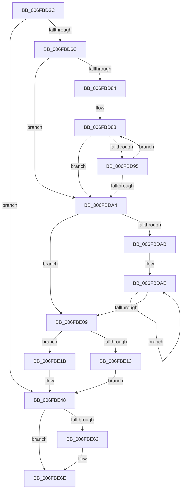

# sub_006FBD3C

- RVA: `0x006FBD3C`–`0x006FBE7B` (길이 `319` bytes)
- VA: `0x00000001406FBD3C`
- 실행 섹션: `.text`
- PDB 이름 있음: `아니요`; PDB Function 태그: `아니요`
- unwind 정보 RVA: `0x000BABAC`
- 디코드: `81`개 명령, `319/319` bytes 표시
- 미해석 바이트: `0` (있으면 어셈블리에 `.byte`로 보존)

> 이 문서는 커널 이미지의 기계어와 PDB 기호를 분석해 생성했습니다. 4번과 5번은 함수 원형과 자료형을 바이너리 사용 방식에서 추정한 C 해석이며 원본 소스 복구 결과는 아닙니다.

## 1. Dependencies

- 직접 호출 지점: **6**; 고유 호출 대상: **6**
- 직접 호출자로 확인된 함수: **0**
- RIP 상대 이미지 참조: **9**

### Outgoing calls
- `0x006FBD43` → [ExAcquireSpinLockExclusiveAtDpcLevel](../24/ExAcquireSpinLockExclusiveAtDpcLevel_function_00248E80.md) (function, `0x00248E80`)
- `0x006FBD4D` → [MiCompactDebuggerPatchTable](../68/MiCompactDebuggerPatchTable_function_006844C0.md) (function, `0x006844C0`)
- `0x006FBD5F` → [MiFindFirstDebuggerPatch](../68/MiFindFirstDebuggerPatch_function_00685FA0.md) (function, `0x00685FA0`)
- `0x006FBE3B` → [memcpy](../6C/memcpy_function_006C6840.md) (function, `0x006C6840`)
- `0x006FBE54` → [ExReleaseSpinLockExclusiveFromDpcLevel](../24/ExReleaseSpinLockExclusiveFromDpcLevel_function_002497E0.md) (function, `0x002497E0`)
- `0x006FBE69` → [KiLowerIrqlProcessIrqlFlags](../4F/KiLowerIrqlProcessIrqlFlags_function_004F5698.md) (function, `0x004F5698`)

### Direct callers
- 이 함수 시작 RVA로 연결되는 직접 call은 확인되지 않았습니다. 간접 호출은 완전히 역산할 수 없습니다.

### Static image references
- `0x006FBD3C` → RVA `0x00E35BF0` (`.data`; read)
- `0x006FBD70` → RVA `0x00E2CB40` (`.data`; read)
- `0x006FBD77` → RVA `0x00E35BF8` (`.data`; read)
- `0x006FBDCB` → RVA `0x00E35BF4` (`.data`; read)
- `0x006FBDD6` → RVA `0x00E31BF0` (`.data`; read)
- `0x006FBDFE` → RVA `0x00E35BF4` (`.data`; write)
- `0x006FBE13` → RVA `0x00E35BF8` (`.data`; write)
- `0x006FBE42` → RVA `0x00E35BF8` (`.data`; read/write)
- `0x006FBE59` → RVA `0x00FC6D20` (`ALMOSTRO`; read)

## 2. Other-region calls and transfers

- 다른 실행 섹션으로 향하는 call: **0**
- call이 아닌 외부 분기/꼬리 이동: **1**
  - `0x006FBE76` → [MiDeleteDebuggerPatches + 0x21](../4B/MiDeleteDebuggerPatches_function_004B7EAC.md) (`tail-transfer`)

## 3. Assembly (complete function range)

```asm
006FBD3C  48 8D 0D AD 9E 73 00            lea rcx, [rip + 0x739ead]
006FBD43  E8 38 D1 B4 FF                  call 0x140248e80
006FBD48  B9 01 00 00 00                  mov ecx, 1
006FBD4D  E8 6E 87 F8 FF                  call 0x1406844c0
006FBD52  4C 8D 4C 24 30                  lea r9, [rsp + 0x30]
006FBD57  45 33 C0                        xor r8d, r8d
006FBD5A  33 D2                           xor edx, edx
006FBD5C  48 8B CF                        mov rcx, rdi
006FBD5F  E8 3C A2 F8 FF                  call 0x140685fa0
006FBD64  85 C0                           test eax, eax
006FBD66  0F 84 DC 00 00 00               je 0x1406fbe48
006FBD6C  8B 5C 24 30                     mov ebx, dword ptr [rsp + 0x30]
006FBD70  4C 8D 15 C9 0D 73 00            lea r10, [rip + 0x730dc9]
006FBD77  8B 0D 7B 9E 73 00               mov ecx, dword ptr [rip + 0x739e7b]
006FBD7D  44 8B C3                        mov r8d, ebx
006FBD80  3B D9                           cmp ebx, ecx
006FBD82  73 20                           jae 0x1406fbda4
006FBD84  8B C3                           mov eax, ebx
006FBD86  8B D3                           mov edx, ebx
006FBD88  49 8B 84 C2 B0 80 00 00         mov rax, qword ptr [r10 + rax*8 + 0x80b0]
006FBD90  48 39 38                        cmp qword ptr [rax], rdi
006FBD93  75 0F                           jne 0x1406fbda4
006FBD95  44 8D 42 01                     lea r8d, [rdx + 1]
006FBD99  41 8B C0                        mov eax, r8d
006FBD9C  41 8B D0                        mov edx, r8d
006FBD9F  44 3B C1                        cmp r8d, ecx
006FBDA2  72 E4                           jb 0x1406fbd88
006FBDA4  8B F3                           mov esi, ebx
006FBDA6  41 3B D8                        cmp ebx, r8d
006FBDA9  73 5E                           jae 0x1406fbe09
006FBDAB  44 8B CB                        mov r9d, ebx
006FBDAE  8B C6                           mov eax, esi
006FBDB0  41 8D 71 01                     lea esi, [r9 + 1]
006FBDB4  44 8B CE                        mov r9d, esi
006FBDB7  49 8B 94 C2 B0 80 00 00         mov rdx, qword ptr [r10 + rax*8 + 0x80b0]
006FBDBF  8B 4A 08                        mov ecx, dword ptr [rdx + 8]
006FBDC2  83 C9 01                        or ecx, 1
006FBDC5  89 4A 08                        mov dword ptr [rdx + 8], ecx
006FBDC8  83 E1 03                        and ecx, 3
006FBDCB  8B 05 23 9E 73 00               mov eax, dword ptr [rip + 0x739e23]
006FBDD1  C1 E0 02                        shl eax, 2
006FBDD4  0B C8                           or ecx, eax
006FBDD6  48 8D 05 13 5E 73 00            lea rax, [rip + 0x735e13]
006FBDDD  89 4A 08                        mov dword ptr [rdx + 8], ecx
006FBDE0  48 2B D0                        sub rdx, rax
006FBDE3  48 B8 AB AA AA AA AA AA AA 2A   movabs rax, 0x2aaaaaaaaaaaaaab
006FBDED  48 F7 EA                        imul rdx
006FBDF0  48 C1 FA 02                     sar rdx, 2
006FBDF4  48 8B C2                        mov rax, rdx
006FBDF7  48 C1 E8 3F                     shr rax, 0x3f
006FBDFB  48 03 D0                        add rdx, rax
006FBDFE  89 15 F0 9D 73 00               mov dword ptr [rip + 0x739df0], edx
006FBE04  41 3B F0                        cmp esi, r8d
006FBE07  72 A5                           jb 0x1406fbdae
006FBE09  8B 05 E9 9D 73 00               mov eax, dword ptr [rip + 0x739de9]
006FBE0F  3B F0                           cmp esi, eax
006FBE11  75 08                           jne 0x1406fbe1b
006FBE13  89 1D DF 9D 73 00               mov dword ptr [rip + 0x739ddf], ebx
006FBE19  EB 2D                           jmp 0x1406fbe48
006FBE1B  2B C6                           sub eax, esi
006FBE1D  44 8B C0                        mov r8d, eax
006FBE20  8B C6                           mov eax, esi
006FBE22  48 05 16 10 00 00               add rax, 0x1016
006FBE28  49 C1 E0 03                     shl r8, 3
006FBE2C  49 8D 14 C2                     lea rdx, [r10 + rax*8]
006FBE30  49 81 C2 B0 80 00 00            add r10, 0x80b0
006FBE37  49 8D 0C DA                     lea rcx, [r10 + rbx*8]
006FBE3B  E8 00 AA FC FF                  call 0x1406c6840
006FBE40  2B DE                           sub ebx, esi
006FBE42  01 1D B0 9D 73 00               add dword ptr [rip + 0x739db0], ebx
006FBE48  F0 83 67 60 FE                  lock and dword ptr [rdi + 0x60], 0xfffffffe
006FBE4D  48 8D 0D 9C 9D 73 00            lea rcx, [rip + 0x739d9c]
006FBE54  E8 87 D9 B4 FF                  call 0x1402497e0
006FBE59  83 3D C0 AE 8C 00 00            cmp dword ptr [rip + 0x8caec0], 0
006FBE60  74 0C                           je 0x1406fbe6e
006FBE62  44 0F 20 C1                     mov rcx, cr8
006FBE66  40 8A D5                        mov dl, bpl
006FBE69  E8 2A 98 DF FF                  call 0x1404f5698
006FBE6E  40 0F B6 C5                     movzx eax, bpl
006FBE72  44 0F 22 C0                     mov cr8, rax
006FBE76  E9 52 C0 DB FF                  jmp 0x1404b7ecd
```

## 4. C-style interpretation (structured pseudocode)

```c
__int64 __fastcall sub_006FBD3C(__int64 a1, int a2, int a3, __int64 a4, __int64 a5, unsigned int a6)
{
    __int64 result;
    __int64 v_r10;
    __int64 v_rbx;

    result = ExAcquireSpinLockExclusiveAtDpcLevel(v_rip + 7577261, a2, a3, a4);
    result = MiCompactDebuggerPatchTable(1, a2, a3, a4);
    a3 = 0;
    a2 = 0;
    result = MiFindFirstDebuggerPatch(v_rdi, a2, a3, a6);
    if ((unsigned int)(result) == 0) goto loc_006FBE48;
    if (((unsigned int)((unsigned int)(a6))) >= ((unsigned int)((unsigned int)(*(unsigned int *)(v_rip + 7577211))))) goto loc_006FBDA4;
loc_006FBD88:
    if ((*(unsigned __int64 *)(*(unsigned __int64 *)(v_rip + 7540169 + (unsigned int)((unsigned int)((unsigned int)(a6))) * 8 + 32944))) != v_rdi) goto loc_006FBDA4;
    if (((unsigned int)((unsigned int)((unsigned int)((unsigned int)(a6))) + 1)) < ((unsigned int)((unsigned int)(*(unsigned int *)(v_rip + 7577211))))) goto loc_006FBD88;
loc_006FBDA4:
    if (((unsigned int)((unsigned int)(a6))) >= ((unsigned int)((unsigned int)((unsigned int)((unsigned int)(a6))) + 1))) goto loc_006FBE09;
loc_006FBDAE:
    a1 = (unsigned int)(((unsigned int)(*(unsigned int *)(*(unsigned __int64 *)(v_rip + 7540169 + (unsigned int)((unsigned int)((unsigned int)((unsigned int)((unsigned int)(a6))))) * 8 + 32944) + 8))) | (1));
    *(unsigned int *)(*(unsigned __int64 *)(v_rip + 7540169 + (unsigned int)((unsigned int)((unsigned int)((unsigned int)((unsigned int)(a6))))) * 8 + 32944) + 8) = (unsigned int)(a1);
    a1 = (unsigned int)((a1) & (3));
    result = (unsigned int)(((unsigned int)(*(unsigned int *)(v_rip + 7577123))) << (2));
    a1 = (unsigned int)((a1) | ((unsigned int)(result)));
    *(unsigned int *)(*(unsigned __int64 *)(v_rip + 7540169 + (unsigned int)((unsigned int)((unsigned int)((unsigned int)((unsigned int)(a6))))) * 8 + 32944) + 8) = (unsigned int)(a1);
    a2 = (*(unsigned __int64 *)(v_rip + 7540169 + (unsigned int)((unsigned int)((unsigned int)((unsigned int)((unsigned int)(a6))))) * 8 + 32944)) - (v_rip + 7560723);
    a2 = (a2) >> (2);
    result = (a2) >> (63);
    a2 = (a2) + (result);
    *(unsigned int *)(v_rip + 7577072) = a2;
    if (((unsigned int)((unsigned int)((unsigned int)((unsigned int)(a6))) + 1)) < ((unsigned int)((unsigned int)((unsigned int)((unsigned int)(a6))) + 1))) goto loc_006FBDAE;
loc_006FBE09:
    if (((unsigned int)((unsigned int)((unsigned int)((unsigned int)(a6))) + 1)) != ((unsigned int)((unsigned int)(*(unsigned int *)(v_rip + 7577065))))) goto loc_006FBE1B;
    *(unsigned int *)(v_rip + 7577055) = (unsigned int)((unsigned int)(a6));
    goto loc_006FBE48;
loc_006FBE1B:
    result = (unsigned int)(((unsigned int)(*(unsigned int *)(v_rip + 7577065))) - ((unsigned int)((unsigned int)((unsigned int)((unsigned int)(a6))) + 1)));
    result = ((unsigned int)((unsigned int)((unsigned int)((unsigned int)((unsigned int)(a6))) + 1))) + (0x1016ULL);
    a3 = ((unsigned int)((unsigned int)(result))) << (3);
    v_r10 = (v_rip + 7540169) + (0x80B0ULL);
    result = memcpy(v_r10 + (unsigned int)(a6) * 8, v_rip + 7540169 + result * 8, a3, (unsigned int)((unsigned int)((unsigned int)((unsigned int)((unsigned int)(a6))) + 1)));
    v_rbx = (unsigned int)(((unsigned int)(a6)) - ((unsigned int)((unsigned int)((unsigned int)((unsigned int)(a6))) + 1)));
loc_006FBE48:
    result = ExReleaseSpinLockExclusiveFromDpcLevel(v_rip + 7576988, v_rip + 7540169 + result * 8, a3, (unsigned int)((unsigned int)((unsigned int)((unsigned int)((unsigned int)(a6))) + 1)));
    if ((*(unsigned int *)(v_rip + 9219776)) != 0) {
        a1 = v_cr8;
        a2 = (unsigned __int8)(v_rbp);
        result = KiLowerIrqlProcessIrqlFlags(a1, a2, a3, (unsigned int)((unsigned int)((unsigned int)((unsigned int)((unsigned int)(a6))) + 1)));
    }
}
```

## 5. (Beta) C Style

```c
int64_t sub_006FBD3C(int64_t Arg1, int32_t Arg2, int32_t Arg3, int64_t Arg4, uint64_t Arg5, uint32_t Arg6)
{
    int64_t result;
    int64_t local_r10;
    int64_t local_rbx;

    result = ExAcquireSpinLockExclusiveAtDpcLevel(v_rip + 7577261, Arg2, Arg3, Arg4);
    result = MiCompactDebuggerPatchTable(1, Arg2, Arg3, Arg4);
    Arg3 = 0;
    Arg2 = 0;
    result = MiFindFirstDebuggerPatch(local_rdi, Arg2, Arg3, Arg6);
    if ((uint32_t)(result) == 0) goto loc_006FBE48;
    if (((uint32_t)((uint32_t)(Arg6))) >= ((uint32_t)((uint32_t)(*(uint32_t *)(v_rip + 0x739E7B))))) goto loc_006FBDA4;
loc_006FBD88:
    if ((*(uint64_t *)(*(uint64_t *)(v_rip + 0x730DC9 + (uint32_t)((uint32_t)((uint32_t)(Arg6))) * 8 + 0x80B0))) != local_rdi) goto loc_006FBDA4;
    if (((uint32_t)((uint32_t)((uint32_t)((uint32_t)(Arg6))) + 1)) < ((uint32_t)((uint32_t)(*(uint32_t *)(v_rip + 0x739E7B))))) goto loc_006FBD88;
loc_006FBDA4:
    if (((uint32_t)((uint32_t)(Arg6))) >= ((uint32_t)((uint32_t)((uint32_t)((uint32_t)(Arg6))) + 1))) goto loc_006FBE09;
loc_006FBDAE:
    Arg1 = (uint32_t)(((uint32_t)(*(uint32_t *)(*(uint64_t *)(v_rip + 0x730DC9 + (uint32_t)((uint32_t)((uint32_t)((uint32_t)((uint32_t)(Arg6))))) * 8 + 0x80B0) + 0x8))) | (1));
    *(uint32_t *)(*(uint64_t *)(v_rip + 0x730DC9 + (uint32_t)((uint32_t)((uint32_t)((uint32_t)((uint32_t)(Arg6))))) * 8 + 0x80B0) + 0x8) = (uint32_t)(Arg1);
    Arg1 = (uint32_t)((Arg1) & (3));
    result = (uint32_t)(((uint32_t)(*(uint32_t *)(v_rip + 0x739E23))) << (2));
    Arg1 = (uint32_t)((Arg1) | ((uint32_t)(result)));
    *(uint32_t *)(*(uint64_t *)(v_rip + 0x730DC9 + (uint32_t)((uint32_t)((uint32_t)((uint32_t)((uint32_t)(Arg6))))) * 8 + 0x80B0) + 0x8) = (uint32_t)(Arg1);
    Arg2 = (*(uint64_t *)(v_rip + 0x730DC9 + (uint32_t)((uint32_t)((uint32_t)((uint32_t)((uint32_t)(Arg6))))) * 8 + 0x80B0)) - (v_rip + 7560723);
    Arg2 = (Arg2) >> (2);
    result = (Arg2) >> (63);
    Arg2 = (Arg2) + (result);
    *(uint32_t *)(v_rip + 0x739DF0) = Arg2;
    if (((uint32_t)((uint32_t)((uint32_t)((uint32_t)(Arg6))) + 1)) < ((uint32_t)((uint32_t)((uint32_t)((uint32_t)(Arg6))) + 1))) goto loc_006FBDAE;
loc_006FBE09:
    if (((uint32_t)((uint32_t)((uint32_t)((uint32_t)(Arg6))) + 1)) != ((uint32_t)((uint32_t)(*(uint32_t *)(v_rip + 0x739DE9))))) goto loc_006FBE1B;
    *(uint32_t *)(v_rip + 0x739DDF) = (uint32_t)((uint32_t)(Arg6));
    goto loc_006FBE48;
loc_006FBE1B:
    result = (uint32_t)(((uint32_t)(*(uint32_t *)(v_rip + 0x739DE9))) - ((uint32_t)((uint32_t)((uint32_t)((uint32_t)(Arg6))) + 1)));
    result = ((uint32_t)((uint32_t)((uint32_t)((uint32_t)((uint32_t)(Arg6))) + 1))) + (0x1016ULL);
    Arg3 = ((uint32_t)((uint32_t)(result))) << (3);
    local_r10 = (v_rip + 7540169) + (0x80B0ULL);
    result = memcpy(local_r10 + (uint32_t)(Arg6) * 8, v_rip + 7540169 + result * 8, Arg3, (uint32_t)((uint32_t)((uint32_t)((uint32_t)((uint32_t)(Arg6))) + 1)));
    local_rbx = (uint32_t)(((uint32_t)(Arg6)) - ((uint32_t)((uint32_t)((uint32_t)((uint32_t)(Arg6))) + 1)));
loc_006FBE48:
    result = ExReleaseSpinLockExclusiveFromDpcLevel(v_rip + 7576988, v_rip + 7540169 + result * 8, Arg3, (uint32_t)((uint32_t)((uint32_t)((uint32_t)((uint32_t)(Arg6))) + 1)));
    if ((*(uint32_t *)(v_rip + 0x8CAEC0)) != 0) {
        Arg1 = v_cr8;
        Arg2 = (uint8_t)(local_rbp);
        result = KiLowerIrqlProcessIrqlFlags(Arg1, Arg2, Arg3, (uint32_t)((uint32_t)((uint32_t)((uint32_t)((uint32_t)(Arg6))) + 1)));
    }
}
```

## 6. Execution-region graph

[열기: 2D/3D 그래프와 함수 탐색 컨트롤 패널](../../../control-panel.html?section=text&rva=0x006FBD3C&view=graph)

- 2D 그래프는 위에서 아래로 흐르고, 3D 그래프는 빈 공간을 드래그해 회전합니다. Shift+드래그는 이동, 휠은 확대·축소, 함수 노드 선택은 대상 보고서 이동입니다.

### Static fallback


