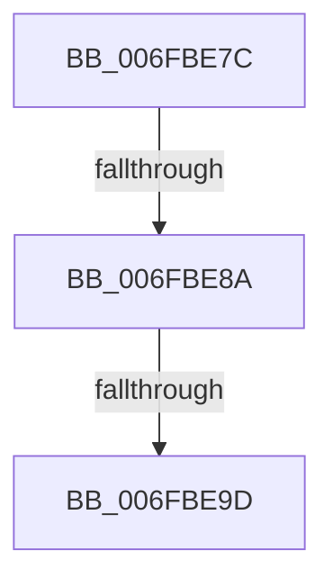

# sub_006FBE7C

- RVA: `0x006FBE7C`–`0x006FBECE` (길이 `82` bytes)
- VA: `0x00000001406FBE7C`
- 실행 섹션: `.text`
- PDB 이름 있음: `아니요`; PDB Function 태그: `아니요`
- unwind 정보 RVA: `0x000BAD34`
- 디코드: `19`개 명령, `82/82` bytes 표시
- 미해석 바이트: `0` (있으면 어셈블리에 `.byte`로 보존)

> 이 문서는 커널 이미지의 기계어와 PDB 기호를 분석해 생성했습니다. 4번과 5번은 함수 원형과 자료형을 바이너리 사용 방식에서 추정한 C 해석이며 원본 소스 복구 결과는 아닙니다.

## 1. Dependencies

- 직접 호출 지점: **2**; 고유 호출 대상: **2**
- 직접 호출자로 확인된 함수: **0**
- RIP 상대 이미지 참조: **1**

### Outgoing calls
- `0x006FBE8F` → [KeQueryActiveProcessorCountEx](../24/KeQueryActiveProcessorCountEx_function_00249EF0.md) (function, `0x00249EF0`)
- `0x006FBEC8` → [KeBugCheckEx](../4F/KeBugCheckEx_function_004FD660.md) (function, `0x004FD660`)

### Direct callers
- 이 함수 시작 RVA로 연결되는 직접 call은 확인되지 않았습니다. 간접 호출은 완전히 역산할 수 없습니다.

### Static image references
- `0x006FBE9D` → RVA `0x00FC2228` (`.data`; read)

## 2. Other-region calls and transfers

- 다른 실행 섹션으로 향하는 call: **0**
- call이 아닌 외부 분기/꼬리 이동: **2**
  - `0x006FBE84` → [HalpPowerStateCallback + 0x48](../4B/HalpPowerStateCallback_function_004B8150.md) (`tail-transfer`)
  - `0x006FBE97` → [HalpPowerStateCallback + 0x48](../4B/HalpPowerStateCallback_function_004B8150.md) (`tail-transfer`)

## 3. Assembly (complete function range)

```asm
006FBE7C  8B 83 B8 00 00 00               mov eax, dword ptr [rbx + 0xb8]
006FBE82  A8 20                           test al, 0x20
006FBE84  0F 85 0E C3 DB FF               jne 0x1404b8198
006FBE8A  B9 FF FF 00 00                  mov ecx, 0xffff
006FBE8F  E8 5C E0 B4 FF                  call 0x140249ef0
006FBE94  83 F8 01                        cmp eax, 1
006FBE97  0F 86 FB C2 DB FF               jbe 0x1404b8198
006FBE9D  48 8B 05 84 63 8C 00            mov rax, qword ptr [rip + 0x8c6384]
006FBEA4  B9 FF FF FF FF                  mov ecx, 0xffffffff
006FBEA9  48 3B C1                        cmp rax, rcx
006FBEAC  41 B9 2A 00 00 00               mov r9d, 0x2a
006FBEB2  4C 8B C3                        mov r8, rbx
006FBEB5  BA 10 01 00 00                  mov edx, 0x110
006FBEBA  0F 42 C8                        cmovb ecx, eax
006FBEBD  8B C1                           mov eax, ecx
006FBEBF  41 8D 49 32                     lea ecx, [r9 + 0x32]
006FBEC3  48 89 44 24 20                  mov qword ptr [rsp + 0x20], rax
006FBEC8  E8 93 17 E0 FF                  call 0x1404fd660
006FBECD  CC                              int3
```

## 4. C-style interpretation (structured pseudocode)

```c
__int64 __fastcall sub_006FBE7C(void)
{
    __int64 result;
    unsigned __int64 v_stack_p20;

    result = KeQueryActiveProcessorCountEx((unsigned int)(0xFFFFULL), a2, a3, a4);
    a1 = (unsigned int)(0xFFFFFFFFULL);
    if ((*(unsigned __int64 *)(v_rip + 9200516)) < ((unsigned int)(0xFFFFFFFFULL))) { a1 = (unsigned int)(*(unsigned __int64 *)(v_rip + 9200516)); }
    v_stack_p20 = (unsigned int)((unsigned int)(a1));
    result = KeBugCheckEx(42 + 50, 272, v_rbx, 42);
    return result;
}
```

## 5. (Beta) C Style

```c
void sub_006FBE7C(void)
{
    int64_t result;
    uint64_t v_stack_p20;

    result = KeQueryActiveProcessorCountEx((uint32_t)(0xFFFFULL), a2, a3, a4);
    a1 = (uint32_t)(0xFFFFFFFFULL);
    if ((*(uint64_t *)(v_rip + 0x8C6384)) < ((uint32_t)(0xFFFFFFFFULL))) { a1 = (uint32_t)(*(uint64_t *)(v_rip + 0x8C6384)); }
    v_stack_p20 = (uint32_t)((uint32_t)(a1));
    result = KeBugCheckEx(42 + 50, 272, local_rbx, 42);
    return result;
}
```

## 6. Execution-region graph

[열기: 2D/3D 그래프와 함수 탐색 컨트롤 패널](../../../control-panel.html?section=text&rva=0x006FBE7C&view=graph)

- 2D 그래프는 위에서 아래로 흐르고, 3D 그래프는 빈 공간을 드래그해 회전합니다. Shift+드래그는 이동, 휠은 확대·축소, 함수 노드 선택은 대상 보고서 이동입니다.

### Static fallback


