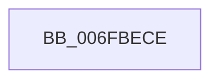

# sub_006FBECE

- RVA: `0x006FBECE`–`0x006FBF78` (길이 `170` bytes)
- VA: `0x00000001406FBECE`
- 실행 섹션: `.text`
- PDB 이름 있음: `아니요`; PDB Function 태그: `아니요`
- unwind 정보 RVA: `0x000BAD74`
- 디코드: `39`개 명령, `170/170` bytes 표시
- 미해석 바이트: `0` (있으면 어셈블리에 `.byte`로 보존)

> 이 문서는 커널 이미지의 기계어와 PDB 기호를 분석해 생성했습니다. 4번과 5번은 함수 원형과 자료형을 바이너리 사용 방식에서 추정한 C 해석이며 원본 소스 복구 결과는 아닙니다.

## 1. Dependencies

- 직접 호출 지점: **1**; 고유 호출 대상: **1**
- 직접 호출자로 확인된 함수: **0**
- RIP 상대 이미지 참조: **2**

### Outgoing calls
- `0x006FBF6D` → [tlgWriteEx_EtwWriteEx](../4A/tlgWriteEx_EtwWriteEx_function_004AA348.md) (function, `0x004AA348`)

### Direct callers
- 이 함수 시작 RVA로 연결되는 직접 call은 확인되지 않았습니다. 간접 호출은 완전히 역산할 수 없습니다.

### Static image references
- `0x006FBEDA` → RVA `0x0005069D` (`.rdata`; read)
- `0x006FBF54` → RVA `0x00E07748` (`.data`; read)

## 2. Other-region calls and transfers

- 다른 실행 섹션으로 향하는 call: **0**
- call이 아닌 외부 분기/꼬리 이동: **1**
  - `0x006FBF73` → [PopPlRegisterDevice + 0x3C](../4B/PopPlRegisterDevice_function_004B820C.md) (`tail-transfer`)

## 3. Assembly (complete function range)

```asm
006FBECE  83 65 03 00                     and dword ptr [rbp + 3], 0
006FBED2  48 8D 45 C7                     lea rax, [rbp - 0x39]
006FBED6  83 65 13 00                     and dword ptr [rbp + 0x13], 0
006FBEDA  48 8D 15 BC 47 95 FF            lea rdx, [rip - 0x6ab844]
006FBEE1  83 65 23 00                     and dword ptr [rbp + 0x23], 0
006FBEE5  41 B9 01 00 00 00               mov r9d, 1
006FBEEB  48 89 45 F7                     mov qword ptr [rbp - 9], rax
006FBEEF  48 8D 45 1F                     lea rax, [rbp + 0x1f]
006FBEF3  48 89 45 07                     mov qword ptr [rbp + 7], rax
006FBEF7  48 8B 83 E0 00 00 00            mov rax, qword ptr [rbx + 0xe0]
006FBEFE  48 89 45 17                     mov qword ptr [rbp + 0x17], rax
006FBF02  41 8D 49 01                     lea ecx, [r9 + 1]
006FBF06  0F B7 83 D8 00 00 00            movzx eax, word ptr [rbx + 0xd8]
006FBF0D  89 45 1F                        mov dword ptr [rbp + 0x1f], eax
006FBF10  33 C0                           xor eax, eax
006FBF12  48 39 83 C8 04 00 00            cmp qword ptr [rbx + 0x4c8], rax
006FBF19  89 4D FF                        mov dword ptr [rbp - 1], ecx
006FBF1C  0F 95 C0                        setne al
006FBF1F  89 4D 0F                        mov dword ptr [rbp + 0xf], ecx
006FBF22  83 65 33 00                     and dword ptr [rbp + 0x33], 0
006FBF26  41 8D 49 03                     lea ecx, [r9 + 3]
006FBF2A  83 65 43 00                     and dword ptr [rbp + 0x43], 0
006FBF2E  89 45 CB                        mov dword ptr [rbp - 0x35], eax
006FBF31  48 8D 45 CB                     lea rax, [rbp - 0x35]
006FBF35  48 89 45 27                     mov qword ptr [rbp + 0x27], rax
006FBF39  8B 83 64 03 00 00               mov eax, dword ptr [rbx + 0x364]
006FBF3F  89 45 CF                        mov dword ptr [rbp - 0x31], eax
006FBF42  48 8D 45 CF                     lea rax, [rbp - 0x31]
006FBF46  48 89 45 37                     mov qword ptr [rbp + 0x37], rax
006FBF4A  48 8D 45 D7                     lea rax, [rbp - 0x29]
006FBF4E  89 4D 2F                        mov dword ptr [rbp + 0x2f], ecx
006FBF51  89 4D 3F                        mov dword ptr [rbp + 0x3f], ecx
006FBF54  48 8D 0D ED B7 70 00            lea rcx, [rip + 0x70b7ed]
006FBF5B  48 89 44 24 38                  mov qword ptr [rsp + 0x38], rax
006FBF60  C7 44 24 30 07 00 00 00         mov dword ptr [rsp + 0x30], 7
006FBF68  66 44 89 4D C7                  mov word ptr [rbp - 0x39], r9w
006FBF6D  E8 D6 E3 DA FF                  call 0x1404aa348
006FBF72  90                              nop
006FBF73  E9 D0 C2 DB FF                  jmp 0x1404b8248
```

## 4. C-style interpretation (structured pseudocode)

```c
__int64 __fastcall sub_006FBECE(void)
{
    __int64 result;
    unsigned int v_stack_p30;
    unsigned __int64 v_stack_p38;

    *(unsigned __int64 *)(v_rbp - 9) = v_rbp - 57;
    *(unsigned __int64 *)(v_rbp + 7) = v_rbp + 31;
    *(unsigned __int64 *)(v_rbp + 23) = *(unsigned __int64 *)(v_rbx + 224);
    *(unsigned int *)(v_rbp + 31) = (unsigned int)(*(unsigned __int16 *)(v_rbx + 216));
    result = 0;
    *(unsigned int *)(v_rbp - 1) = (unsigned int)(1 + 1);
    result = ((*(unsigned __int64 *)(v_rbx + 1224)) != 0) ? 1 : 0;
    *(unsigned int *)(v_rbp + 15) = (unsigned int)(1 + 1);
    *(unsigned int *)(v_rbp - 53) = (unsigned int)(result);
    *(unsigned __int64 *)(v_rbp + 39) = v_rbp - 53;
    *(unsigned int *)(v_rbp - 49) = (unsigned int)((unsigned int)(*(unsigned int *)(v_rbx + 868)));
    *(unsigned __int64 *)(v_rbp + 55) = v_rbp - 49;
    *(unsigned int *)(v_rbp + 47) = (unsigned int)(1 + 3);
    *(unsigned int *)(v_rbp + 63) = (unsigned int)(1 + 3);
    v_stack_p38 = v_rbp - 41;
    v_stack_p30 = 7;
    *(unsigned __int16 *)(v_rbp - 57) = 1;
    result = tlgWriteEx_EtwWriteEx(v_rip + 7387117, v_rip - 6993988, a3, 1);
}
```

## 5. (Beta) C Style

```c
void sub_006FBECE(void)
{
    int64_t result;
    uint32_t v_stack_p30;
    uint64_t v_stack_p38;

    *(uint64_t *)(local_rbp - 0x9) = local_rbp - 57;
    *(uint64_t *)(local_rbp + 0x7) = local_rbp + 31;
    *(uint64_t *)(local_rbp + 0x17) = *(uint64_t *)(local_rbx + 0xE0);
    *(uint32_t *)(local_rbp + 0x1F) = (uint32_t)(*(uint16_t *)(local_rbx + 0xD8));
    result = 0;
    *(uint32_t *)(local_rbp - 0x1) = (uint32_t)(1 + 1);
    result = ((*(uint64_t *)(local_rbx + 0x4C8)) != 0) ? 1 : 0;
    *(uint32_t *)(local_rbp + 0xF) = (uint32_t)(1 + 1);
    *(uint32_t *)(local_rbp - 0x35) = (uint32_t)(result);
    *(uint64_t *)(local_rbp + 0x27) = local_rbp - 53;
    *(uint32_t *)(local_rbp - 0x31) = (uint32_t)((uint32_t)(*(uint32_t *)(local_rbx + 0x364)));
    *(uint64_t *)(local_rbp + 0x37) = local_rbp - 49;
    *(uint32_t *)(local_rbp + 0x2F) = (uint32_t)(1 + 3);
    *(uint32_t *)(local_rbp + 0x3F) = (uint32_t)(1 + 3);
    v_stack_p38 = local_rbp - 41;
    v_stack_p30 = 7;
    *(uint16_t *)(local_rbp - 0x39) = 1;
    result = tlgWriteEx_EtwWriteEx(v_rip + 7387117, v_rip - 6993988, a3, 1);
}
```

## 6. Execution-region graph

[열기: 2D/3D 그래프와 함수 탐색 컨트롤 패널](../../../control-panel.html?section=text&rva=0x006FBECE&view=graph)

- 2D 그래프는 위에서 아래로 흐르고, 3D 그래프는 빈 공간을 드래그해 회전합니다. Shift+드래그는 이동, 휠은 확대·축소, 함수 노드 선택은 대상 보고서 이동입니다.

### Static fallback


