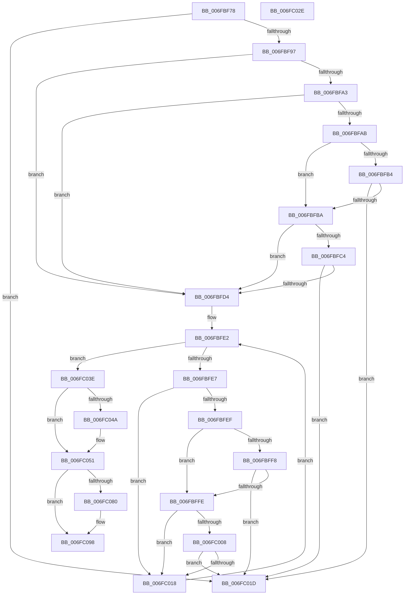

# sub_006FBF78

- RVA: `0x006FBF78`–`0x006FC0A9` (길이 `305` bytes)
- VA: `0x00000001406FBF78`
- 실행 섹션: `.text`
- PDB 이름 있음: `아니요`; PDB Function 태그: `아니요`
- unwind 정보 RVA: `0x000BAE00`
- 디코드: `82`개 명령, `305/305` bytes 표시
- 미해석 바이트: `0` (있으면 어셈블리에 `.byte`로 보존)

> 이 문서는 커널 이미지의 기계어와 PDB 기호를 분석해 생성했습니다. 4번과 5번은 함수 원형과 자료형을 바이너리 사용 방식에서 추정한 C 해석이며 원본 소스 복구 결과는 아닙니다.

## 1. Dependencies

- 직접 호출 지점: **8**; 고유 호출 대상: **6**
- 직접 호출자로 확인된 함수: **0**
- RIP 상대 이미지 참조: **10**

### Outgoing calls
- `0x006FBF82` → [KeAcquireSpinLockRaiseToDpc](../20/KeAcquireSpinLockRaiseToDpc_function_00208470.md) (function, `0x00208470`)
- `0x006FBFCB` → [memcmp](../6C/memcmp_function_006C6B10.md) (function, `0x006C6B10`)
- `0x006FC00F` → [memcmp](../6C/memcmp_function_006C6B10.md) (function, `0x006C6B10`)
- `0x006FC023` → [KeReleaseSpinLock](../39/KeReleaseSpinLock_function_00392BA0.md) (function, `0x00392BA0`)
- `0x006FC033` → [ExFreePoolWithTag](../../poolcode/B8/ExFreePoolWithTag_function_00B82870.md) (function, `0x00B82870`)
- `0x006FC072` → [KeReleaseSemaphore](../39/KeReleaseSemaphore_function_00397080.md) (function, `0x00397080`)
- `0x006FC093` → [ExQueueWorkItem](../2F/ExQueueWorkItem_function_002F9520.md) (function, `0x002F9520`)
- `0x006FC09E` → [KeReleaseSpinLock](../39/KeReleaseSpinLock_function_00392BA0.md) (function, `0x00392BA0`)

### Direct callers
- 이 함수 시작 RVA로 연결되는 직접 call은 확인되지 않았습니다. 간접 호출은 완전히 역산할 수 없습니다.

### Static image references
- `0x006FBF78` → RVA `0x00F8D7B0` (`.data`; read)
- `0x006FBF87` → RVA `0x00F8D7BC` (`.data`; read)
- `0x006FBF97` → RVA `0x00F8D1F8` (`.data`; read)
- `0x006FBFD4` → RVA `0x00F8D7A0` (`.data`; read)
- `0x006FC03E` → RVA `0x00F8D7A8` (`.data`; read)
- `0x006FC054` → RVA `0x00F8D7B8` (`.data`; read)
- `0x006FC067` → RVA `0x00F8D7A8` (`.data`; write)
- `0x006FC077` → RVA `0x00F8D7D8` (`.data`; read)
- `0x006FC085` → RVA `0x00F8D7D8` (`.data`; write)
- `0x006FC08C` → RVA `0x00F8D780` (`.data`; read)

## 2. Other-region calls and transfers

- 다른 실행 섹션으로 향하는 call: **1**
  - `0x006FC033` → [ExFreePoolWithTag](../../poolcode/B8/ExFreePoolWithTag_function_00B82870.md) (`.text` → `POOLCODE`)
- call이 아닌 외부 분기/꼬리 이동: **3**
  - `0x006FC029` → [IoRaiseInformationalHardError + 0x19E](../4B/IoRaiseInformationalHardError_function_004B82B0.md) (`tail-transfer`)
  - `0x006FC039` → [IoRaiseInformationalHardError + 0x88](../4B/IoRaiseInformationalHardError_function_004B82B0.md) (`tail-transfer`)
  - `0x006FC0A4` → [IoRaiseInformationalHardError + 0x11F](../4B/IoRaiseInformationalHardError_function_004B82B0.md) (`tail-transfer`)

## 3. Assembly (complete function range)

```asm
006FBF78  4C 8D 35 31 18 89 00            lea r14, [rip + 0x891831]
006FBF7F  49 8B CE                        mov rcx, r14
006FBF82  E8 E9 C4 B0 FF                  call 0x140208470
006FBF87  83 3D 2E 18 89 00 19            cmp dword ptr [rip + 0x89182e], 0x19
006FBF8E  40 8A F0                        mov sil, al
006FBF91  0F 8D 86 00 00 00               jge 0x1406fc01d
006FBF97  48 8B 15 5A 12 89 00            mov rdx, qword ptr [rip + 0x89125a]
006FBF9E  48 85 D2                        test rdx, rdx
006FBFA1  74 31                           je 0x1406fbfd4
006FBFA3  8B 42 10                        mov eax, dword ptr [rdx + 0x10]
006FBFA6  39 43 10                        cmp dword ptr [rbx + 0x10], eax
006FBFA9  75 29                           jne 0x1406fbfd4
006FBFAB  48 8B 4B 20                     mov rcx, qword ptr [rbx + 0x20]
006FBFAF  48 85 C9                        test rcx, rcx
006FBFB2  75 06                           jne 0x1406fbfba
006FBFB4  48 39 6A 20                     cmp qword ptr [rdx + 0x20], rbp
006FBFB8  74 63                           je 0x1406fc01d
006FBFBA  0F B7 43 18                     movzx eax, word ptr [rbx + 0x18]
006FBFBE  66 3B 42 18                     cmp ax, word ptr [rdx + 0x18]
006FBFC2  75 10                           jne 0x1406fbfd4
006FBFC4  48 8B 52 20                     mov rdx, qword ptr [rdx + 0x20]
006FBFC8  44 8B C0                        mov r8d, eax
006FBFCB  E8 40 AB FC FF                  call 0x1406c6b10
006FBFD0  85 C0                           test eax, eax
006FBFD2  74 49                           je 0x1406fc01d
006FBFD4  48 8B 3D C5 17 89 00            mov rdi, qword ptr [rip + 0x8917c5]
006FBFDB  4C 8D 3D BE 17 89 00            lea r15, [rip + 0x8917be]
006FBFE2  49 3B FF                        cmp rdi, r15
006FBFE5  74 57                           je 0x1406fc03e
006FBFE7  8B 47 10                        mov eax, dword ptr [rdi + 0x10]
006FBFEA  39 43 10                        cmp dword ptr [rbx + 0x10], eax
006FBFED  75 29                           jne 0x1406fc018
006FBFEF  48 8B 4B 20                     mov rcx, qword ptr [rbx + 0x20]
006FBFF3  48 85 C9                        test rcx, rcx
006FBFF6  75 06                           jne 0x1406fbffe
006FBFF8  48 39 6F 20                     cmp qword ptr [rdi + 0x20], rbp
006FBFFC  74 1F                           je 0x1406fc01d
006FBFFE  0F B7 43 18                     movzx eax, word ptr [rbx + 0x18]
006FC002  66 3B 47 18                     cmp ax, word ptr [rdi + 0x18]
006FC006  75 10                           jne 0x1406fc018
006FC008  48 8B 57 20                     mov rdx, qword ptr [rdi + 0x20]
006FC00C  44 8B C0                        mov r8d, eax
006FC00F  E8 FC AA FC FF                  call 0x1406c6b10
006FC014  85 C0                           test eax, eax
006FC016  74 05                           je 0x1406fc01d
006FC018  48 8B 3F                        mov rdi, qword ptr [rdi]
006FC01B  EB C5                           jmp 0x1406fbfe2
006FC01D  40 8A D6                        mov dl, sil
006FC020  49 8B CE                        mov rcx, r14
006FC023  E8 78 6B C9 FF                  call 0x140392ba0
006FC028  90                              nop
006FC029  E9 20 C4 DB FF                  jmp 0x1404b844e
006FC02E  33 D2                           xor edx, edx
006FC030  48 8B CB                        mov rcx, rbx
006FC033  E8 38 68 48 00                  call 0x140b82870
006FC038  90                              nop
006FC039  E9 FA C2 DB FF                  jmp 0x1404b8338
006FC03E  48 8B 05 63 17 89 00            mov rax, qword ptr [rip + 0x891763]
006FC045  4C 39 38                        cmp qword ptr [rax], r15
006FC048  74 07                           je 0x1406fc051
006FC04A  B9 03 00 00 00                  mov ecx, 3
006FC04F  CD 29                           int 0x29
006FC051  4C 89 3B                        mov qword ptr [rbx], r15
006FC054  48 8D 0D 5D 17 89 00            lea rcx, [rip + 0x89175d]
006FC05B  48 89 43 08                     mov qword ptr [rbx + 8], rax
006FC05F  45 33 C9                        xor r9d, r9d
006FC062  48 89 18                        mov qword ptr [rax], rbx
006FC065  33 D2                           xor edx, edx
006FC067  48 89 1D 3A 17 89 00            mov qword ptr [rip + 0x89173a], rbx
006FC06E  45 8D 41 01                     lea r8d, [r9 + 1]
006FC072  E8 09 B0 C9 FF                  call 0x140397080
006FC077  40 38 2D 5A 17 89 00            cmp byte ptr [rip + 0x89175a], bpl
006FC07E  75 18                           jne 0x1406fc098
006FC080  BA 01 00 00 00                  mov edx, 1
006FC085  C6 05 4C 17 89 00 01            mov byte ptr [rip + 0x89174c], 1
006FC08C  48 8D 0D ED 16 89 00            lea rcx, [rip + 0x8916ed]
006FC093  E8 88 D4 BF FF                  call 0x1402f9520
006FC098  40 8A D6                        mov dl, sil
006FC09B  49 8B CE                        mov rcx, r14
006FC09E  E8 FD 6A C9 FF                  call 0x140392ba0
006FC0A3  90                              nop
006FC0A4  E9 26 C3 DB FF                  jmp 0x1404b83cf
```

## 4. C-style interpretation (structured pseudocode)

```c
__int64 __fastcall sub_006FBF78(__int64 a1, __int64 a2, __int64 a3, int a4)
{
    __int64 result;

    result = KeAcquireSpinLockRaiseToDpc(v_rip + 8984625, a2, a3, a4);
    if ((*(unsigned int *)(v_rip + 8984622)) >= 25) goto loc_006FC01D;
    if (*(unsigned __int64 *)(v_rip + 8983130) == 0) goto loc_006FBFD4;
    if ((*(unsigned int *)(v_rbx + 16)) != ((unsigned int)((unsigned int)(*(unsigned int *)(*(unsigned __int64 *)(v_rip + 8983130) + 16))))) goto loc_006FBFD4;
    if (*(unsigned __int64 *)(v_rbx + 32) != 0) goto loc_006FBFBA;
    if ((*(unsigned __int64 *)(*(unsigned __int64 *)(v_rip + 8983130) + 32)) == v_rbp) goto loc_006FC01D;
loc_006FBFBA:
    if (((unsigned __int16)(*(unsigned __int16 *)(v_rbx + 24))) != (*(unsigned __int16 *)(*(unsigned __int64 *)(v_rip + 8983130) + 24))) goto loc_006FBFD4;
    result = memcmp(*(unsigned __int64 *)(v_rbx + 32), *(unsigned __int64 *)(*(unsigned __int64 *)(v_rip + 8983130) + 32), (unsigned int)((unsigned int)(*(unsigned __int16 *)(v_rbx + 24))), a4);
    if ((unsigned int)(result) == 0) goto loc_006FC01D;
loc_006FBFD4:
loc_006FBFE2:
    if ((*(unsigned __int64 *)(v_rip + 8984517)) == (v_rip + 8984510)) goto loc_006FC03E;
    if ((*(unsigned int *)(v_rbx + 16)) != ((unsigned int)((unsigned int)(*(unsigned int *)(*(unsigned __int64 *)(v_rip + 8984517) + 16))))) goto loc_006FC018;
    if (*(unsigned __int64 *)(v_rbx + 32) != 0) goto loc_006FBFFE;
    if ((*(unsigned __int64 *)(*(unsigned __int64 *)(v_rip + 8984517) + 32)) == v_rbp) goto loc_006FC01D;
loc_006FBFFE:
    if (((unsigned __int16)(*(unsigned __int16 *)(v_rbx + 24))) != (*(unsigned __int16 *)(*(unsigned __int64 *)(v_rip + 8984517) + 24))) goto loc_006FC018;
    result = memcmp(*(unsigned __int64 *)(v_rbx + 32), *(unsigned __int64 *)(*(unsigned __int64 *)(v_rip + 8984517) + 32), (unsigned int)((unsigned int)(*(unsigned __int16 *)(v_rbx + 24))), a4);
    if ((unsigned int)(result) == 0) goto loc_006FC01D;
loc_006FC018:
    goto loc_006FBFE2;
loc_006FC01D:
    result = KeReleaseSpinLock(v_rip + 8984625, (unsigned __int8)((unsigned __int8)(result)), (unsigned int)((unsigned int)(*(unsigned __int16 *)(v_rbx + 24))), a4);
loc_006FC03E:
    if ((*(unsigned __int64 *)(*(unsigned __int64 *)(v_rip + 8984419))) != (v_rip + 8984510)) {
        a1 = 3;
    }
    *(unsigned __int64 *)(v_rbx) = v_rip + 8984510;
    *(unsigned __int64 *)(v_rbx + 8) = *(unsigned __int64 *)(v_rip + 8984419);
    a4 = 0;
    *(unsigned __int64 *)(*(unsigned __int64 *)(v_rip + 8984419)) = v_rbx;
    a2 = 0;
    *(unsigned __int64 *)(v_rip + 8984378) = v_rbx;
    result = KeReleaseSemaphore(v_rip + 8984413, a2, a4 + 1, a4);
    if ((*(unsigned __int8 *)(v_rip + 8984410)) == ((unsigned __int8)(v_rbp))) {
        a2 = 1;
        *(unsigned __int8 *)(v_rip + 8984396) = 1;
        a1 = v_rip + 8984301;
        result = ExQueueWorkItem(a1, a2, a4 + 1, a4);
    }
    result = KeReleaseSpinLock(v_rip + 8984625, (unsigned __int8)((unsigned __int8)(result)), a4 + 1, a4);
}
```

## 5. (Beta) C Style

```c
int64_t sub_006FBF78(int64_t Arg1, int64_t Arg2, int64_t Arg3, int32_t Arg4)
{
    int64_t result;

    result = KeAcquireSpinLockRaiseToDpc(v_rip + 8984625, Arg2, Arg3, Arg4);
    if ((*(uint32_t *)(v_rip + 0x89182E)) >= 25) goto loc_006FC01D;
    if (*(uint64_t *)(v_rip + 0x89125A) == 0) goto loc_006FBFD4;
    if ((*(uint32_t *)(local_rbx + 0x10)) != ((uint32_t)((uint32_t)(*(uint32_t *)(*(uint64_t *)(v_rip + 0x89125A) + 0x10))))) goto loc_006FBFD4;
    if (*(uint64_t *)(local_rbx + 0x20) != 0) goto loc_006FBFBA;
    if ((*(uint64_t *)(*(uint64_t *)(v_rip + 0x89125A) + 0x20)) == local_rbp) goto loc_006FC01D;
loc_006FBFBA:
    if (((uint16_t)(*(uint16_t *)(local_rbx + 0x18))) != (*(uint16_t *)(*(uint64_t *)(v_rip + 0x89125A) + 0x18))) goto loc_006FBFD4;
    result = memcmp(*(uint64_t *)(local_rbx + 0x20), *(uint64_t *)(*(uint64_t *)(v_rip + 0x89125A) + 0x20), (uint32_t)((uint32_t)(*(uint16_t *)(local_rbx + 0x18))), Arg4);
    if ((uint32_t)(result) == 0) goto loc_006FC01D;
loc_006FBFD4:
loc_006FBFE2:
    if ((*(uint64_t *)(v_rip + 0x8917C5)) == (v_rip + 8984510)) goto loc_006FC03E;
    if ((*(uint32_t *)(local_rbx + 0x10)) != ((uint32_t)((uint32_t)(*(uint32_t *)(*(uint64_t *)(v_rip + 0x8917C5) + 0x10))))) goto loc_006FC018;
    if (*(uint64_t *)(local_rbx + 0x20) != 0) goto loc_006FBFFE;
    if ((*(uint64_t *)(*(uint64_t *)(v_rip + 0x8917C5) + 0x20)) == local_rbp) goto loc_006FC01D;
loc_006FBFFE:
    if (((uint16_t)(*(uint16_t *)(local_rbx + 0x18))) != (*(uint16_t *)(*(uint64_t *)(v_rip + 0x8917C5) + 0x18))) goto loc_006FC018;
    result = memcmp(*(uint64_t *)(local_rbx + 0x20), *(uint64_t *)(*(uint64_t *)(v_rip + 0x8917C5) + 0x20), (uint32_t)((uint32_t)(*(uint16_t *)(local_rbx + 0x18))), Arg4);
    if ((uint32_t)(result) == 0) goto loc_006FC01D;
loc_006FC018:
    goto loc_006FBFE2;
loc_006FC01D:
    result = KeReleaseSpinLock(v_rip + 8984625, (uint8_t)((uint8_t)(result)), (uint32_t)((uint32_t)(*(uint16_t *)(local_rbx + 0x18))), Arg4);
loc_006FC03E:
    if ((*(uint64_t *)(*(uint64_t *)(v_rip + 0x891763))) != (v_rip + 8984510)) {
        Arg1 = 3;
    }
    *(uint64_t *)(local_rbx) = v_rip + 8984510;
    *(uint64_t *)(local_rbx + 0x8) = *(uint64_t *)(v_rip + 0x891763);
    Arg4 = 0;
    *(uint64_t *)(*(uint64_t *)(v_rip + 0x891763)) = local_rbx;
    Arg2 = 0;
    *(uint64_t *)(v_rip + 0x89173A) = local_rbx;
    result = KeReleaseSemaphore(v_rip + 8984413, Arg2, Arg4 + 1, Arg4);
    if ((*(uint8_t *)(v_rip + 0x89175A)) == ((uint8_t)(local_rbp))) {
        Arg2 = 1;
        *(uint8_t *)(v_rip + 0x89174C) = 1;
        Arg1 = v_rip + 8984301;
        result = ExQueueWorkItem(Arg1, Arg2, Arg4 + 1, Arg4);
    }
    result = KeReleaseSpinLock(v_rip + 8984625, (uint8_t)((uint8_t)(result)), Arg4 + 1, Arg4);
}
```

## 6. Execution-region graph

[열기: 2D/3D 그래프와 함수 탐색 컨트롤 패널](../../../control-panel.html?section=text&rva=0x006FBF78&view=graph)

- 2D 그래프는 위에서 아래로 흐르고, 3D 그래프는 빈 공간을 드래그해 회전합니다. Shift+드래그는 이동, 휠은 확대·축소, 함수 노드 선택은 대상 보고서 이동입니다.

### Static fallback


