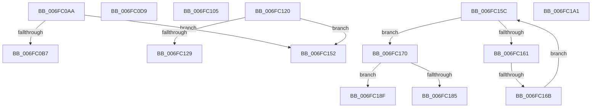

# sub_006FC0AA

- RVA: `0x006FC0AA`–`0x006FC1AB` (길이 `257` bytes)
- VA: `0x00000001406FC0AA`
- 실행 섹션: `.text`
- PDB 이름 있음: `아니요`; PDB Function 태그: `아니요`
- unwind 정보 RVA: `0x000BAE2C`
- 디코드: `55`개 명령, `257/257` bytes 표시
- 미해석 바이트: `0` (있으면 어셈블리에 `.byte`로 보존)

> 이 문서는 커널 이미지의 기계어와 PDB 기호를 분석해 생성했습니다. 4번과 5번은 함수 원형과 자료형을 바이너리 사용 방식에서 추정한 C 해석이며 원본 소스 복구 결과는 아닙니다.

## 1. Dependencies

- 직접 호출 지점: **3**; 고유 호출 대상: **3**
- 직접 호출자로 확인된 함수: **0**
- RIP 상대 이미지 참조: **10**

### Outgoing calls
- `0x006FC0AA` → [HalpHvIsFrequencyAvailable](../54/HalpHvIsFrequencyAvailable_function_0054C2B4.md) (function, `0x0054C2B4`)
- `0x006FC120` → [HalpTimerIsHypervisorReferenceAvailable](../56/HalpTimerIsHypervisorReferenceAvailable_function_00562CDC.md) (function, `0x00562CDC`)
- `0x006FC178` → [HalpMmAllocateMemoryInternal](../54/HalpMmAllocateMemoryInternal_function_00544990.md) (function, `0x00544990`)

### Direct callers
- 이 함수 시작 RVA로 연결되는 직접 call은 확인되지 않았습니다. 간접 호출은 완전히 역산할 수 없습니다.

### Static image references
- `0x006FC0B7` → RVA `0x0054C140` (`HalpHvGetTscFrequency`; read)
- `0x006FC0C8` → RVA `0x0054C110` (`HalpHvGetApicFrequency`; read)
- `0x006FC0D9` → RVA `0x00FC1C68` (`.data`; read)
- `0x006FC0EA` → RVA `0x00E11780` (`.data`; read)
- `0x006FC0F1` → RVA `0x00FC1C70` (`.data`; read)
- `0x006FC105` → RVA `0x00562CA0` (`HalpSocApiAllocatePhysicalMemory`; read)
- `0x006FC129` → RVA `0x00FC1C88` (`.data`; read)
- `0x006FC130` → RVA `0x00E11788` (`.data`; read)
- `0x006FC137` → RVA `0x00E11788` (`.data`; write)
- `0x006FC13E` → RVA `0x00E11778` (`.data`; read)

## 2. Other-region calls and transfers

- 다른 실행 섹션으로 향하는 call: **0**
- call이 아닌 외부 분기/꼬리 이동: **9**
  - `0x006FC0D4` → [HalSocRequestApi + 0x46](../4B/HalSocRequestApi_function_004B848C.md) (`tail-transfer`)
  - `0x006FC100` → [HalSocRequestApi + 0x46](../4B/HalSocRequestApi_function_004B848C.md) (`tail-transfer`)
  - `0x006FC11B` → [HalSocRequestApi + 0x4B](../4B/HalSocRequestApi_function_004B848C.md) (`tail-transfer`)
  - `0x006FC14D` → [HalSocRequestApi + 0x4B](../4B/HalSocRequestApi_function_004B848C.md) (`tail-transfer`)
  - `0x006FC157` → [HalSocRequestApi + 0x7C](../4B/HalSocRequestApi_function_004B848C.md) (`tail-transfer`)
  - `0x006FC165` → [HalSocRequestApi + 0x69](../4B/HalSocRequestApi_function_004B848C.md) (`tail-transfer`)
  - `0x006FC18A` → [HalSocRequestApi + 0x7C](../4B/HalSocRequestApi_function_004B848C.md) (`tail-transfer`)
  - `0x006FC19C` → [HalSocRequestApi + 0x69](../4B/HalSocRequestApi_function_004B848C.md) (`tail-transfer`)
  - `0x006FC1A6` → [HalSocRequestApi + 0x7C](../4B/HalSocRequestApi_function_004B848C.md) (`tail-transfer`)

## 3. Assembly (complete function range)

```asm
006FC0AA  E8 05 02 E5 FF                  call 0x14054c2b4
006FC0AF  84 C0                           test al, al
006FC0B1  0F 84 9B 00 00 00               je 0x1406fc152
006FC0B7  48 8D 05 82 00 E5 FF            lea rax, [rip - 0x1aff7e]
006FC0BE  48 89 44 24 28                  mov qword ptr [rsp + 0x28], rax
006FC0C3  48 8D 74 24 28                  lea rsi, [rsp + 0x28]
006FC0C8  48 8D 05 41 00 E5 FF            lea rax, [rip - 0x1affbf]
006FC0CF  48 89 44 24 30                  mov qword ptr [rsp + 0x30], rax
006FC0D4  E9 F9 C3 DB FF                  jmp 0x1404b84d2
006FC0D9  48 8B 05 88 5B 8C 00            mov rax, qword ptr [rip + 0x8c5b88]
006FC0E0  48 8D 74 24 38                  lea rsi, [rsp + 0x38]
006FC0E5  48 89 44 24 38                  mov qword ptr [rsp + 0x38], rax
006FC0EA  4C 8D 35 8F 56 71 00            lea r14, [rip + 0x71568f]
006FC0F1  48 8B 05 78 5B 8C 00            mov rax, qword ptr [rip + 0x8c5b78]
006FC0F8  41 B2 01                        mov r10b, 1
006FC0FB  48 89 44 24 40                  mov qword ptr [rsp + 0x40], rax
006FC100  E9 CD C3 DB FF                  jmp 0x1404b84d2
006FC105  48 8D 05 94 6B E6 FF            lea rax, [rip - 0x19946c]
006FC10C  BF 08 00 00 00                  mov edi, 8
006FC111  48 89 44 24 20                  mov qword ptr [rsp + 0x20], rax
006FC116  48 8D 74 24 20                  lea rsi, [rsp + 0x20]
006FC11B  E9 B7 C3 DB FF                  jmp 0x1404b84d7
006FC120  E8 B7 6B E6 FF                  call 0x140562cdc
006FC125  84 C0                           test al, al
006FC127  74 29                           je 0x1406fc152
006FC129  48 8B 05 58 5B 8C 00            mov rax, qword ptr [rip + 0x8c5b58]
006FC130  48 8D 35 51 56 71 00            lea rsi, [rip + 0x715651]
006FC137  48 89 05 4A 56 71 00            mov qword ptr [rip + 0x71564a], rax
006FC13E  4C 8D 35 33 56 71 00            lea r14, [rip + 0x715633]
006FC145  BF 08 00 00 00                  mov edi, 8
006FC14A  41 B2 01                        mov r10b, 1
006FC14D  E9 85 C3 DB FF                  jmp 0x1404b84d7
006FC152  BB BB 00 00 C0                  mov ebx, 0xc00000bb
006FC157  E9 AC C3 DB FF                  jmp 0x1404b8508
006FC15C  48 85 C0                        test rax, rax
006FC15F  74 0F                           je 0x1406fc170
006FC161  48 39 68 08                     cmp qword ptr [rax + 8], rbp
006FC165  0F 84 8A C3 DB FF               je 0x1404b84f5
006FC16B  48 8B 00                        mov rax, qword ptr [rax]
006FC16E  EB EC                           jmp 0x1406fc15c
006FC170  BA 01 00 00 00                  mov edx, 1
006FC175  8D 4A 0F                        lea ecx, [rdx + 0xf]
006FC178  E8 13 88 E4 FF                  call 0x140544990
006FC17D  48 8B C8                        mov rcx, rax
006FC180  48 85 C0                        test rax, rax
006FC183  75 0A                           jne 0x1406fc18f
006FC185  BB 17 00 00 C0                  mov ebx, 0xc0000017
006FC18A  E9 79 C3 DB FF                  jmp 0x1404b8508
006FC18F  48 89 68 08                     mov qword ptr [rax + 8], rbp
006FC193  49 8B 06                        mov rax, qword ptr [r14]
006FC196  48 89 01                        mov qword ptr [rcx], rax
006FC199  49 89 0E                        mov qword ptr [r14], rcx
006FC19C  E9 54 C3 DB FF                  jmp 0x1404b84f5
006FC1A1  BB 0D 00 00 C0                  mov ebx, 0xc000000d
006FC1A6  E9 5D C3 DB FF                  jmp 0x1404b8508
```

## 4. C-style interpretation (structured pseudocode)

```c
__int64 __fastcall sub_006FC0AA(__int64 a1, __int64 a2, __int64 a3, __int64 a4, __int64 a5)
{
    __int64 result;
    unsigned __int64 v_stack_p20;
    unsigned __int64 v_stack_p28;
    unsigned __int64 v_stack_p30;
    unsigned __int64 v_stack_p38;
    unsigned __int64 v_stack_p40;

    result = HalpHvIsFrequencyAvailable(a1, a2, a3, a4);
    if ((unsigned __int8)(result) == 0) goto loc_006FC152;
    v_stack_p28 = v_rip - 1769342;
    v_stack_p30 = v_rip - 1769407;
loc_006FC152:
}
```

## 5. (Beta) C Style

```c
int64_t sub_006FC0AA(int64_t Arg1, int64_t Arg2, int64_t Arg3, int64_t Arg4, int64_t Arg5)
{
    int64_t result;
    uint64_t v_stack_p20;
    uint64_t v_stack_p28;
    uint64_t v_stack_p30;
    uint64_t v_stack_p38;
    uint64_t v_stack_p40;

    result = HalpHvIsFrequencyAvailable(Arg1, Arg2, Arg3, Arg4);
    if ((uint8_t)(result) == 0) goto loc_006FC152;
    v_stack_p28 = v_rip - 1769342;
    v_stack_p30 = v_rip - 1769407;
loc_006FC152:
}
```

## 6. Execution-region graph

[열기: 2D/3D 그래프와 함수 탐색 컨트롤 패널](../../../control-panel.html?section=text&rva=0x006FC0AA&view=graph)

- 2D 그래프는 위에서 아래로 흐르고, 3D 그래프는 빈 공간을 드래그해 회전합니다. Shift+드래그는 이동, 휠은 확대·축소, 함수 노드 선택은 대상 보고서 이동입니다.

### Static fallback


