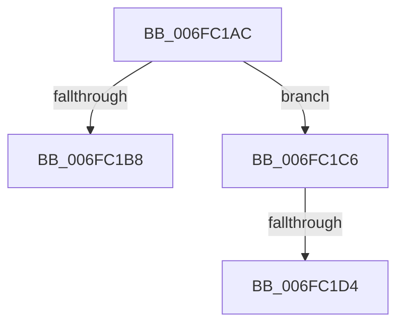

# sub_006FC1AC

- RVA: `0x006FC1AC`–`0x006FC1E4` (길이 `56` bytes)
- VA: `0x00000001406FC1AC`
- 실행 섹션: `.text`
- PDB 이름 있음: `아니요`; PDB Function 태그: `아니요`
- unwind 정보 RVA: `0x000BAE70`
- 디코드: `13`개 명령, `56/56` bytes 표시
- 미해석 바이트: `0` (있으면 어셈블리에 `.byte`로 보존)

> 이 문서는 커널 이미지의 기계어와 PDB 기호를 분석해 생성했습니다. 4번과 5번은 함수 원형과 자료형을 바이너리 사용 방식에서 추정한 C 해석이며 원본 소스 복구 결과는 아닙니다.

## 1. Dependencies

- 직접 호출 지점: **2**; 고유 호출 대상: **2**
- 직접 호출자로 확인된 함수: **0**
- RIP 상대 이미지 참조: **1**

### Outgoing calls
- `0x006FC1BB` → [MmIsDriverVerifying](../4A/MmIsDriverVerifying_function_004A8770.md) (function, `0x004A8770`)
- `0x006FC1D7` → [PpvUtilIsHardwareBeingVerified](../../pagevrfy/B9/PpvUtilIsHardwareBeingVerified_function_00B92C48.md) (function, `0x00B92C48`)

### Direct callers
- 이 함수 시작 RVA로 연결되는 직접 call은 확인되지 않았습니다. 간접 호출은 완전히 역산할 수 없습니다.

### Static image references
- `0x006FC1AC` → RVA `0x00F04A20` (`.data`; read)

## 2. Other-region calls and transfers

- 다른 실행 섹션으로 향하는 call: **1**
  - `0x006FC1D7` → [PpvUtilIsHardwareBeingVerified](../../pagevrfy/B9/PpvUtilIsHardwareBeingVerified_function_00B92C48.md) (`.text` → `PAGEVRFY`)
- call이 아닌 외부 분기/꼬리 이동: **3**
  - `0x006FC1C1` → [VfIsVerificationEnabled + 0xF](../4B/VfIsVerificationEnabled_function_004B8810.md) (`tail-transfer`)
  - `0x006FC1CE` → [VfIsVerificationEnabled + 0xD](../4B/VfIsVerificationEnabled_function_004B8810.md) (`tail-transfer`)
  - `0x006FC1DF` → [VfIsVerificationEnabled + 0xF](../4B/VfIsVerificationEnabled_function_004B8810.md) (`tail-transfer`)

## 3. Assembly (complete function range)

```asm
006FC1AC  F7 05 6A 88 80 00 00 08 00 00   test dword ptr [rip + 0x80886a], 0x800
006FC1B6  74 0E                           je 0x1406fc1c6
006FC1B8  48 8B CA                        mov rcx, rdx
006FC1BB  E8 B0 C5 DA FF                  call 0x1404a8770
006FC1C0  90                              nop
006FC1C1  E9 59 C6 DB FF                  jmp 0x1404b881f
006FC1C6  8B 05 54 88 80 00               mov eax, dword ptr [rip + 0x808854]
006FC1CC  85 C0                           test eax, eax
006FC1CE  0F 88 49 C6 DB FF               js 0x1404b881d
006FC1D4  48 8B CA                        mov rcx, rdx
006FC1D7  E8 6C 6A 49 00                  call 0x140b92c48
006FC1DC  0F B6 C0                        movzx eax, al
006FC1DF  E9 3B C6 DB FF                  jmp 0x1404b881f
```

## 4. C-style interpretation (structured pseudocode)

```c
__int64 __fastcall sub_006FC1AC(__int64 a1, __int64 a2)
{
    __int64 result;

    if (((*(unsigned int *)(v_rip + 8423530)) & (0x800ULL)) == 0) goto loc_006FC1C6;
    result = MmIsDriverVerifying(a2, a2, a3, a4);
loc_006FC1C6:
    result = PpvUtilIsHardwareBeingVerified(a2, a2, a3, a4);
}
```

## 5. (Beta) C Style

```c
int64_t sub_006FC1AC(int64_t Arg1, int64_t Arg2)
{
    int64_t result;

    if (((*(uint32_t *)(v_rip + 0x80886A)) & (0x800ULL)) == 0) goto loc_006FC1C6;
    result = MmIsDriverVerifying(Arg2, Arg2, a3, a4);
loc_006FC1C6:
    result = PpvUtilIsHardwareBeingVerified(Arg2, Arg2, a3, a4);
}
```

## 6. Execution-region graph

[열기: 2D/3D 그래프와 함수 탐색 컨트롤 패널](../../../control-panel.html?section=text&rva=0x006FC1AC&view=graph)

- 2D 그래프는 위에서 아래로 흐르고, 3D 그래프는 빈 공간을 드래그해 회전합니다. Shift+드래그는 이동, 휠은 확대·축소, 함수 노드 선택은 대상 보고서 이동입니다.

### Static fallback


