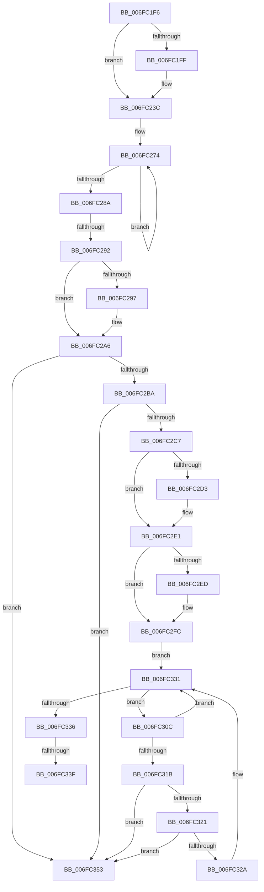

# sub_006FC1F6

- RVA: `0x006FC1F6`–`0x006FC35A` (길이 `356` bytes)
- VA: `0x00000001406FC1F6`
- 실행 섹션: `.text`
- PDB 이름 있음: `아니요`; PDB Function 태그: `아니요`
- unwind 정보 RVA: `0x000BB09C`
- 디코드: `84`개 명령, `356/356` bytes 표시
- 미해석 바이트: `0` (있으면 어셈블리에 `.byte`로 보존)

> 이 문서는 커널 이미지의 기계어와 PDB 기호를 분석해 생성했습니다. 4번과 5번은 함수 원형과 자료형을 바이너리 사용 방식에서 추정한 C 해석이며 원본 소스 복구 결과는 아닙니다.

## 1. Dependencies

- 직접 호출 지점: **7**; 고유 호출 대상: **4**
- 직접 호출자로 확인된 함수: **0**
- RIP 상대 이미지 참조: **4**

### Outgoing calls
- `0x006FC21C` → [guard_dispatch_icall](../6B/guard_dispatch_icall_function_006BAAD0.md) (function, `0x006BAAD0`)
- `0x006FC233` → [guard_dispatch_icall](../6B/guard_dispatch_icall_function_006BAAD0.md) (function, `0x006BAAD0`)
- `0x006FC24F` → [HalpDmaFreeMapRegisters](../3D/HalpDmaFreeMapRegisters_function_003DF5F4.md) (function, `0x003DF5F4`)
- `0x006FC29E` → [KeAcquireSpinLockRaiseToDpc](../20/KeAcquireSpinLockRaiseToDpc_function_00208470.md) (function, `0x00208470`)
- `0x006FC2DC` → [KeReleaseSpinLock](../39/KeReleaseSpinLock_function_00392BA0.md) (function, `0x00392BA0`)
- `0x006FC2F4` → [KeAcquireSpinLockRaiseToDpc](../20/KeAcquireSpinLockRaiseToDpc_function_00208470.md) (function, `0x00208470`)
- `0x006FC348` → [KeReleaseSpinLock](../39/KeReleaseSpinLock_function_00392BA0.md) (function, `0x00392BA0`)

### Direct callers
- 이 함수 시작 RVA로 연결되는 직접 call은 확인되지 않았습니다. 간접 호출은 완전히 역산할 수 없습니다.

### Static image references
- `0x006FC20A` → RVA `0x00FC1778` (`.data`; read)
- `0x006FC297` → RVA `0x00FC3E80` (`.data`; read)
- `0x006FC2ED` → RVA `0x00FC3EC8` (`.data`; read)
- `0x006FC2FC` → RVA `0x00FC3EB0` (`.data`; read)

## 2. Other-region calls and transfers

- 다른 실행 섹션으로 향하는 call: **0**
- call이 아닌 외부 분기/꼬리 이동: **3**
  - `0x006FC28C` → [HalpDmaFreeCrashdumpRegistersInternal + 0x45](../4B/HalpDmaFreeCrashdumpRegistersInternal_function_004B8D04.md) (`tail-transfer`)
  - `0x006FC339` → [HalpDmaFreeCrashdumpRegistersInternal + 0x45](../4B/HalpDmaFreeCrashdumpRegistersInternal_function_004B8D04.md) (`tail-transfer`)
  - `0x006FC34E` → [HalpDmaFreeCrashdumpRegistersInternal + 0x45](../4B/HalpDmaFreeCrashdumpRegistersInternal_function_004B8D04.md) (`tail-transfer`)

## 3. Assembly (complete function range)

```asm
006FC1F6  83 B9 08 02 00 00 03            cmp dword ptr [rcx + 0x208], 3
006FC1FD  75 3D                           jne 0x1406fc23c
006FC1FF  0F AE E8                        lfence
006FC202  48 8B BC E9 00 01 00 00         mov rdi, qword ptr [rcx + rbp*8 + 0x100]
006FC20A  48 8B 05 67 55 8C 00            mov rax, qword ptr [rip + 0x8c5567]
006FC211  48 8D 4F 18                     lea rcx, [rdi + 0x18]
006FC215  48 8B 80 98 00 00 00            mov rax, qword ptr [rax + 0x98]
006FC21C  E8 AF E8 FB FF                  call 0x1406baad0
006FC221  48 8B 05 50 55 8C 00            mov rax, qword ptr [rip + 0x8c5550]
006FC228  48 8B 4F 18                     mov rcx, qword ptr [rdi + 0x18]
006FC22C  48 8B 80 88 00 00 00            mov rax, qword ptr [rax + 0x88]
006FC233  E8 98 E8 FB FF                  call 0x1406baad0
006FC238  C6 47 40 00                     mov byte ptr [rdi + 0x40], 0
006FC23C  44 8B 84 AE 10 01 00 00         mov r8d, dword ptr [rsi + rbp*4 + 0x110]
006FC244  48 8B CE                        mov rcx, rsi
006FC247  48 8B 94 EE 00 01 00 00         mov rdx, qword ptr [rsi + rbp*8 + 0x100]
006FC24F  E8 A0 33 CE FF                  call 0x1403df5f4
006FC254  48 83 A4 EE 00 01 00 00 00      and qword ptr [rsi + rbp*8 + 0x100], 0
006FC25D  83 A4 AE 10 01 00 00 00         and dword ptr [rsi + rbp*4 + 0x110], 0
006FC265  B0 01                           mov al, 1
006FC267  48 8D 96 18 01 00 00            lea rdx, [rsi + 0x118]
006FC26E  41 B8 02 00 00 00               mov r8d, 2
006FC274  33 C9                           xor ecx, ecx
006FC276  0F B6 C0                        movzx eax, al
006FC279  39 0A                           cmp dword ptr [rdx], ecx
006FC27B  48 8D 52 04                     lea rdx, [rdx + 4]
006FC27F  0F 46 C8                        cmovbe ecx, eax
006FC282  8A C1                           mov al, cl
006FC284  49 83 E8 01                     sub r8, 1
006FC288  75 EA                           jne 0x1406fc274
006FC28A  84 C0                           test al, al
006FC28C  0F 84 B7 CA DB FF               je 0x1404b8d49
006FC292  45 84 F6                        test r14b, r14b
006FC295  75 0F                           jne 0x1406fc2a6
006FC297  48 8D 0D E2 7B 8C 00            lea rcx, [rip + 0x8c7be2]
006FC29E  E8 CD C1 B0 FF                  call 0x140208470
006FC2A3  44 8A F0                        mov r14b, al
006FC2A6  48 8D 9E 20 01 00 00            lea rbx, [rsi + 0x120]
006FC2AD  48 8B 03                        mov rax, qword ptr [rbx]
006FC2B0  48 39 58 08                     cmp qword ptr [rax + 8], rbx
006FC2B4  0F 85 99 00 00 00               jne 0x1406fc353
006FC2BA  48 8B 53 08                     mov rdx, qword ptr [rbx + 8]
006FC2BE  48 39 1A                        cmp qword ptr [rdx], rbx
006FC2C1  0F 85 8C 00 00 00               jne 0x1406fc353
006FC2C7  48 89 02                        mov qword ptr [rdx], rax
006FC2CA  48 89 50 08                     mov qword ptr [rax + 8], rdx
006FC2CE  45 84 F6                        test r14b, r14b
006FC2D1  75 0E                           jne 0x1406fc2e1
006FC2D3  33 D2                           xor edx, edx
006FC2D5  48 8D 0D A4 7B 8C 00            lea rcx, [rip + 0x8c7ba4]
006FC2DC  E8 BF 68 C9 FF                  call 0x140392ba0
006FC2E1  48 89 5B 08                     mov qword ptr [rbx + 8], rbx
006FC2E5  48 89 1B                        mov qword ptr [rbx], rbx
006FC2E8  45 84 F6                        test r14b, r14b
006FC2EB  75 0F                           jne 0x1406fc2fc
006FC2ED  48 8D 0D D4 7B 8C 00            lea rcx, [rip + 0x8c7bd4]
006FC2F4  E8 77 C1 B0 FF                  call 0x140208470
006FC2F9  44 8A F0                        mov r14b, al
006FC2FC  48 8B 15 AD 7B 8C 00            mov rdx, qword ptr [rip + 0x8c7bad]
006FC303  4C 8D 05 A6 7B 8C 00            lea r8, [rip + 0x8c7ba6]
006FC30A  EB 25                           jmp 0x1406fc331
006FC30C  48 8B C2                        mov rax, rdx
006FC30F  48 8B CA                        mov rcx, rdx
006FC312  48 8B 12                        mov rdx, qword ptr [rdx]
006FC315  48 39 70 F8                     cmp qword ptr [rax - 8], rsi
006FC319  75 16                           jne 0x1406fc331
006FC31B  48 39 42 08                     cmp qword ptr [rdx + 8], rax
006FC31F  75 32                           jne 0x1406fc353
006FC321  48 8B 40 08                     mov rax, qword ptr [rax + 8]
006FC325  48 39 08                        cmp qword ptr [rax], rcx
006FC328  75 29                           jne 0x1406fc353
006FC32A  48 89 10                        mov qword ptr [rax], rdx
006FC32D  48 89 42 08                     mov qword ptr [rdx + 8], rax
006FC331  49 3B D0                        cmp rdx, r8
006FC334  75 D6                           jne 0x1406fc30c
006FC336  45 84 F6                        test r14b, r14b
006FC339  0F 85 0A CA DB FF               jne 0x1404b8d49
006FC33F  33 D2                           xor edx, edx
006FC341  48 8D 0D 80 7B 8C 00            lea rcx, [rip + 0x8c7b80]
006FC348  E8 53 68 C9 FF                  call 0x140392ba0
006FC34D  90                              nop
006FC34E  E9 F6 C9 DB FF                  jmp 0x1404b8d49
006FC353  B9 03 00 00 00                  mov ecx, 3
006FC358  CD 29                           int 0x29
```

## 4. C-style interpretation (structured pseudocode)

```c
__int64 __fastcall sub_006FC1F6(__int64 a1)
{
    __int64 result;
    __int64 v_r14;
    __int64 v_rdi;

    if ((*(unsigned int *)(a1 + 520)) == 3) {
        v_rdi = *(unsigned __int64 *)(a1 + v_rbp * 8 + 256);
        result = *(unsigned __int64 *)(v_rip + 9196903);
        a1 = v_rdi + 24;
        result = *(unsigned __int64 *)(result + 152);
        result = guard_dispatch_icall(a1, a2, a3, a4);
        result = *(unsigned __int64 *)(v_rip + 9196880);
        a1 = *(unsigned __int64 *)(v_rdi + 24);
        result = *(unsigned __int64 *)(result + 136);
        result = guard_dispatch_icall(a1, a2, a3, a4);
        *(unsigned __int8 *)(v_rdi + 64) = 0;
    }
    result = HalpDmaFreeMapRegisters(v_rsi, *(unsigned __int64 *)(v_rsi + v_rbp * 8 + 256), (unsigned int)(*(unsigned int *)(v_rsi + v_rbp * 4 + 272)), a4);
loc_006FC274:
    a1 = 0;
    if ((*(unsigned int *)(v_rsi + 280)) <= 0) { a1 = 1; }
    a3 = (2) - (1);
    if (condition_is_not_equal) goto loc_006FC274;
    result = (unsigned __int8)(a1);
    if ((unsigned __int8)(v_r14) == 0) {
        a1 = v_rip + 9206754;
        result = KeAcquireSpinLockRaiseToDpc(a1, v_rsi + 280 + 4, a3, a4);
        v_r14 = (unsigned __int8)(result);
    }
    if ((*(unsigned __int64 *)(*(unsigned __int64 *)(v_rsi + 288) + 8)) != (v_rsi + 288)) goto loc_006FC353;
    if ((*(unsigned __int64 *)(*(unsigned __int64 *)(v_rsi + 288 + 8))) != (v_rsi + 288)) goto loc_006FC353;
    *(unsigned __int64 *)(*(unsigned __int64 *)(v_rsi + 288 + 8)) = *(unsigned __int64 *)(v_rsi + 288);
    *(unsigned __int64 *)(*(unsigned __int64 *)(v_rsi + 288) + 8) = *(unsigned __int64 *)(v_rsi + 288 + 8);
    result = *(unsigned __int64 *)(v_rsi + 288);
    if ((unsigned __int8)(v_r14) == 0) {
        a2 = 0;
        a1 = v_rip + 9206692;
        result = KeReleaseSpinLock(a1, a2, a3, a4);
    }
    *(unsigned __int64 *)(v_rsi + 288 + 8) = v_rsi + 288;
    *(unsigned __int64 *)(v_rsi + 288) = v_rsi + 288;
    if ((unsigned __int8)(v_r14) == 0) {
        a1 = v_rip + 9206740;
        result = KeAcquireSpinLockRaiseToDpc(a1, a2, a3, a4);
        v_r14 = (unsigned __int8)(result);
    }
    goto loc_006FC331;
loc_006FC30C:
    if ((*(unsigned __int64 *)(*(unsigned __int64 *)(v_rip + 9206701) - 8)) != v_rsi) goto loc_006FC331;
    if ((*(unsigned __int64 *)(*(unsigned __int64 *)(*(unsigned __int64 *)(v_rip + 9206701)) + 8)) != (*(unsigned __int64 *)(v_rip + 9206701))) goto loc_006FC353;
    if ((*(unsigned __int64 *)(*(unsigned __int64 *)(*(unsigned __int64 *)(v_rip + 9206701) + 8))) != (*(unsigned __int64 *)(v_rip + 9206701))) goto loc_006FC353;
    *(unsigned __int64 *)(*(unsigned __int64 *)(*(unsigned __int64 *)(v_rip + 9206701) + 8)) = *(unsigned __int64 *)(*(unsigned __int64 *)(v_rip + 9206701));
    *(unsigned __int64 *)(*(unsigned __int64 *)(*(unsigned __int64 *)(v_rip + 9206701)) + 8) = *(unsigned __int64 *)(*(unsigned __int64 *)(v_rip + 9206701) + 8);
loc_006FC331:
    if ((*(unsigned __int64 *)(*(unsigned __int64 *)(v_rip + 9206701))) != (v_rip + 9206694)) goto loc_006FC30C;
    a2 = 0;
    result = KeReleaseSpinLock(v_rip + 9206656, a2, v_rip + 9206694, a4);
loc_006FC353:
    return result;
}
```

## 5. (Beta) C Style

```c
int64_t sub_006FC1F6(void *Arg1)
{
    uint8_t *arg1 = (uint8_t *)Arg1;

    int64_t result;
    int64_t local_r14;
    int64_t local_rdi;

    if ((*(uint32_t *)(arg1 + 0x208)) == 3) {
        local_rdi = *(uint64_t *)(arg1 + local_rbp * 8 + 0x100);
        result = *(uint64_t *)(v_rip + 0x8C5567);
        Arg1 = local_rdi + 24;
        result = *(uint64_t *)(result + 0x98);
        result = guard_dispatch_icall(Arg1, a2, a3, a4);
        result = *(uint64_t *)(v_rip + 0x8C5550);
        Arg1 = *(uint64_t *)(local_rdi + 0x18);
        result = *(uint64_t *)(result + 0x88);
        result = guard_dispatch_icall(Arg1, a2, a3, a4);
        *(uint8_t *)(local_rdi + 0x40) = 0;
    }
    result = HalpDmaFreeMapRegisters(local_rsi, *(uint64_t *)(local_rsi + local_rbp * 8 + 0x100), (uint32_t)(*(uint32_t *)(local_rsi + local_rbp * 4 + 0x110)), a4);
loc_006FC274:
    Arg1 = 0;
    if ((*(uint32_t *)(local_rsi + 0x118)) <= 0) { Arg1 = 1; }
    a3 = (2) - (1);
    if (condition_is_not_equal) goto loc_006FC274;
    result = (uint8_t)(Arg1);
    if ((uint8_t)(local_r14) == 0) {
        Arg1 = v_rip + 9206754;
        result = KeAcquireSpinLockRaiseToDpc(Arg1, local_rsi + 280 + 4, a3, a4);
        local_r14 = (uint8_t)(result);
    }
    if ((*(uint64_t *)(*(uint64_t *)(local_rsi + 0x120) + 0x8)) != (local_rsi + 288)) goto loc_006FC353;
    if ((*(uint64_t *)(*(uint64_t *)(local_rsi + 0x120 + 0x8))) != (local_rsi + 288)) goto loc_006FC353;
    *(uint64_t *)(*(uint64_t *)(local_rsi + 0x120 + 0x8)) = *(uint64_t *)(local_rsi + 0x120);
    *(uint64_t *)(*(uint64_t *)(local_rsi + 0x120) + 0x8) = *(uint64_t *)(local_rsi + 0x120 + 0x8);
    result = *(uint64_t *)(local_rsi + 0x120);
    if ((uint8_t)(local_r14) == 0) {
        a2 = 0;
        Arg1 = v_rip + 9206692;
        result = KeReleaseSpinLock(Arg1, a2, a3, a4);
    }
    *(uint64_t *)(local_rsi + 0x120 + 0x8) = local_rsi + 288;
    *(uint64_t *)(local_rsi + 0x120) = local_rsi + 288;
    if ((uint8_t)(local_r14) == 0) {
        Arg1 = v_rip + 9206740;
        result = KeAcquireSpinLockRaiseToDpc(Arg1, a2, a3, a4);
        local_r14 = (uint8_t)(result);
    }
    goto loc_006FC331;
loc_006FC30C:
    if ((*(uint64_t *)(*(uint64_t *)(v_rip + 0x8C7BAD) - 0x8)) != local_rsi) goto loc_006FC331;
    if ((*(uint64_t *)(*(uint64_t *)(*(uint64_t *)(v_rip + 0x8C7BAD)) + 0x8)) != (*(uint64_t *)(v_rip + 0x8C7BAD))) goto loc_006FC353;
    if ((*(uint64_t *)(*(uint64_t *)(*(uint64_t *)(v_rip + 0x8C7BAD) + 0x8))) != (*(uint64_t *)(v_rip + 0x8C7BAD))) goto loc_006FC353;
    *(uint64_t *)(*(uint64_t *)(*(uint64_t *)(v_rip + 0x8C7BAD) + 0x8)) = *(uint64_t *)(*(uint64_t *)(v_rip + 0x8C7BAD));
    *(uint64_t *)(*(uint64_t *)(*(uint64_t *)(v_rip + 0x8C7BAD)) + 0x8) = *(uint64_t *)(*(uint64_t *)(v_rip + 0x8C7BAD) + 0x8);
loc_006FC331:
    if ((*(uint64_t *)(*(uint64_t *)(v_rip + 0x8C7BAD))) != (v_rip + 9206694)) goto loc_006FC30C;
    a2 = 0;
    result = KeReleaseSpinLock(v_rip + 9206656, a2, v_rip + 9206694, a4);
loc_006FC353:
    return result;
}
```

### 관측된 메모리 오프셋

구조체 형식이 확인되지 않은 접근은 인자 기준의 오프셋으로만 기록했습니다.

| 기준 인자 | 오프셋 표현 | 폭 (bit) | 접근 |
|---|---:|---:|---|
| `Arg1` | `+ 0x100 + rbp*8` | `64` | `R` |
| `Arg1` | `+ 0x208` | `32` | `R` |

## 6. Execution-region graph

[열기: 2D/3D 그래프와 함수 탐색 컨트롤 패널](../../../control-panel.html?section=text&rva=0x006FC1F6&view=graph)

- 2D 그래프는 위에서 아래로 흐르고, 3D 그래프는 빈 공간을 드래그해 회전합니다. Shift+드래그는 이동, 휠은 확대·축소, 함수 노드 선택은 대상 보고서 이동입니다.

### Static fallback


