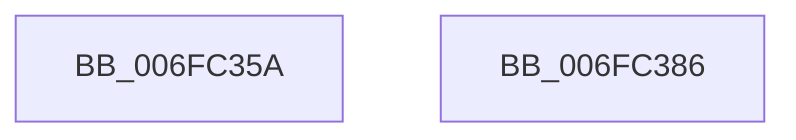

# sub_006FC35A

- RVA: `0x006FC35A`–`0x006FC387` (길이 `45` bytes)
- VA: `0x00000001406FC35A`
- 실행 섹션: `.text`
- PDB 이름 있음: `아니요`; PDB Function 태그: `아니요`
- unwind 정보 RVA: `0x000BB17C`
- 디코드: `14`개 명령, `45/45` bytes 표시
- 미해석 바이트: `0` (있으면 어셈블리에 `.byte`로 보존)

> 이 문서는 커널 이미지의 기계어와 PDB 기호를 분석해 생성했습니다. 4번과 5번은 함수 원형과 자료형을 바이너리 사용 방식에서 추정한 C 해석이며 원본 소스 복구 결과는 아닙니다.

## 1. Dependencies

- 직접 호출 지점: **2**; 고유 호출 대상: **1**
- 직접 호출자로 확인된 함수: **0**
- RIP 상대 이미지 참조: **0**

### Outgoing calls
- `0x006FC360` → [ExFreePoolWithTag](../../poolcode/B8/ExFreePoolWithTag_function_00B82870.md) (function, `0x00B82870`)
- `0x006FC36A` → [ExFreePoolWithTag](../../poolcode/B8/ExFreePoolWithTag_function_00B82870.md) (function, `0x00B82870`)

### Direct callers
- 이 함수 시작 RVA로 연결되는 직접 call은 확인되지 않았습니다. 간접 호출은 완전히 역산할 수 없습니다.

### Static image references
- 디코드된 RIP-relative 메모리 참조가 없습니다.

## 2. Other-region calls and transfers

- 다른 실행 섹션으로 향하는 call: **2**
  - `0x006FC360` → [ExFreePoolWithTag](../../poolcode/B8/ExFreePoolWithTag_function_00B82870.md) (`.text` → `POOLCODE`)
  - `0x006FC36A` → [ExFreePoolWithTag](../../poolcode/B8/ExFreePoolWithTag_function_00B82870.md) (`.text` → `POOLCODE`)
- 별도 외부 분기/꼬리 이동을 확인하지 못했습니다.

## 3. Assembly (complete function range)

```asm
006FC35A  48 8B 4F 28                     mov rcx, qword ptr [rdi + 0x28]
006FC35E  33 D2                           xor edx, edx
006FC360  E8 0B 65 48 00                  call 0x140b82870
006FC365  33 D2                           xor edx, edx
006FC367  48 8B CF                        mov rcx, rdi
006FC36A  E8 01 65 48 00                  call 0x140b82870
006FC36F  48 8B 5C 24 40                  mov rbx, qword ptr [rsp + 0x40]
006FC374  33 C0                           xor eax, eax
006FC376  48 8B 6C 24 48                  mov rbp, qword ptr [rsp + 0x48]
006FC37B  48 8B 74 24 50                  mov rsi, qword ptr [rsp + 0x50]
006FC380  48 83 C4 30                     add rsp, 0x30
006FC384  5F                              pop rdi
006FC385  C3                              ret
006FC386  CC                              int3
```

## 4. C-style interpretation (structured pseudocode)

```c
__int64 __fastcall sub_006FC35A(__int64 a1, int a2, __int64 a3, __int64 a4, __int64 a5, __int64 a6, __int64 a7, __int64 a8, __int64 a9, __int64 a10)
{
    __int64 result;
    __int64 v_rsp;

    a2 = 0;
    result = ExFreePoolWithTag(*(unsigned __int64 *)(v_rdi + 40), a2, a3, a4);
    a2 = 0;
    result = ExFreePoolWithTag(v_rdi, a2, a3, a4);
    result = 0;
    v_rsp = (v_rsp) + (48);
    return result;
}
```

## 5. (Beta) C Style

```c
int64_t sub_006FC35A(int64_t Arg1, int32_t Arg2, int64_t Arg3, int64_t Arg4, uint64_t Arg5, uint64_t Arg6, uint64_t Arg7, int64_t Arg8, int64_t Arg9, int64_t Arg10)
{
    int64_t result;
    int64_t local_rsp;

    Arg2 = 0;
    result = ExFreePoolWithTag(*(uint64_t *)(local_rdi + 0x28), Arg2, Arg3, Arg4);
    Arg2 = 0;
    result = ExFreePoolWithTag(local_rdi, Arg2, Arg3, Arg4);
    result = 0;
    local_rsp = (local_rsp) + (48);
    return result;
}
```

## 6. Execution-region graph

[열기: 2D/3D 그래프와 함수 탐색 컨트롤 패널](../../../control-panel.html?section=text&rva=0x006FC35A&view=graph)

- 2D 그래프는 위에서 아래로 흐르고, 3D 그래프는 빈 공간을 드래그해 회전합니다. Shift+드래그는 이동, 휠은 확대·축소, 함수 노드 선택은 대상 보고서 이동입니다.

### Static fallback


