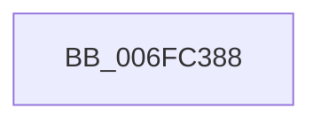

# sub_006FC388

- RVA: `0x006FC388`–`0x006FC405` (길이 `125` bytes)
- VA: `0x00000001406FC388`
- 실행 섹션: `.text`
- PDB 이름 있음: `아니요`; PDB Function 태그: `아니요`
- unwind 정보 RVA: `0x000BB29C`
- 디코드: `29`개 명령, `125/125` bytes 표시
- 미해석 바이트: `0` (있으면 어셈블리에 `.byte`로 보존)

> 이 문서는 커널 이미지의 기계어와 PDB 기호를 분석해 생성했습니다. 4번과 5번은 함수 원형과 자료형을 바이너리 사용 방식에서 추정한 C 해석이며 원본 소스 복구 결과는 아닙니다.

## 1. Dependencies

- 직접 호출 지점: **2**; 고유 호출 대상: **2**
- 직접 호출자로 확인된 함수: **0**
- RIP 상대 이미지 참조: **1**

### Outgoing calls
- `0x006FC3AB` → [tlgCreate1Sz_char](../42/tlgCreate1Sz_char_function_00427304.md) (function, `0x00427304`)
- `0x006FC3FA` → [tlgWriteEx_EtwWriteEx](../4A/tlgWriteEx_EtwWriteEx_function_004AA348.md) (function, `0x004AA348`)

### Direct callers
- 이 함수 시작 RVA로 연결되는 직접 call은 확인되지 않았습니다. 간접 호출은 완전히 역산할 수 없습니다.

### Static image references
- `0x006FC3BC` → RVA `0x00059501` (`.rdata`; read)

## 2. Other-region calls and transfers

- 다른 실행 섹션으로 향하는 call: **0**
- call이 아닌 외부 분기/꼬리 이동: **1**
  - `0x006FC400` → [MiLogWsEmptyControl + 0x51](../4B/MiLogWsEmptyControl_function_004B96C0.md) (`tail-transfer`)

## 3. Assembly (complete function range)

```asm
006FC388  41 8B 81 B8 00 00 00            mov eax, dword ptr [r9 + 0xb8]
006FC38F  48 8D 4D 17                     lea rcx, [rbp + 0x17]
006FC393  83 65 13 00                     and dword ptr [rbp + 0x13], 0
006FC397  24 0F                           and al, 0xf
006FC399  88 45 D7                        mov byte ptr [rbp - 0x29], al
006FC39C  48 8D 45 D7                     lea rax, [rbp - 0x29]
006FC3A0  48 89 45 07                     mov qword ptr [rbp + 7], rax
006FC3A4  C7 45 0F 01 00 00 00            mov dword ptr [rbp + 0xf], 1
006FC3AB  E8 54 AF D2 FF                  call 0x140427304
006FC3B0  83 65 33 00                     and dword ptr [rbp + 0x33], 0
006FC3B4  48 8D 45 DB                     lea rax, [rbp - 0x25]
006FC3B8  83 65 43 00                     and dword ptr [rbp + 0x43], 0
006FC3BC  48 8D 15 3E D1 95 FF            lea rdx, [rip - 0x6a2ec2]
006FC3C3  B9 04 00 00 00                  mov ecx, 4
006FC3C8  48 89 45 27                     mov qword ptr [rbp + 0x27], rax
006FC3CC  48 8D 45 DF                     lea rax, [rbp - 0x21]
006FC3D0  89 4D 2F                        mov dword ptr [rbp + 0x2f], ecx
006FC3D3  48 89 45 37                     mov qword ptr [rbp + 0x37], rax
006FC3D7  48 8D 45 E7                     lea rax, [rbp - 0x19]
006FC3DB  89 4D 3F                        mov dword ptr [rbp + 0x3f], ecx
006FC3DE  44 8D 49 FD                     lea r9d, [rcx - 3]
006FC3E2  48 89 44 24 38                  mov qword ptr [rsp + 0x38], rax
006FC3E7  49 8B C8                        mov rcx, r8
006FC3EA  C7 44 24 30 06 00 00 00         mov dword ptr [rsp + 0x30], 6
006FC3F2  44 89 55 DB                     mov dword ptr [rbp - 0x25], r10d
006FC3F6  44 89 5D DF                     mov dword ptr [rbp - 0x21], r11d
006FC3FA  E8 49 DF DA FF                  call 0x1404aa348
006FC3FF  90                              nop
006FC400  E9 0C D3 DB FF                  jmp 0x1404b9711
```

## 4. C-style interpretation (structured pseudocode)

```c
__int64 __fastcall sub_006FC388(__int64 a1, __int64 a2, __int64 a3, __int64 a4)
{
    __int64 result;
    unsigned int v_stack_p30;
    unsigned __int64 v_stack_p38;

    result = (unsigned __int8)(((unsigned int)(*(unsigned int *)(a4 + 184))) & (15));
    *(unsigned __int8 *)(v_rbp - 41) = (unsigned __int8)(result);
    *(unsigned __int64 *)(v_rbp + 7) = v_rbp - 41;
    *(unsigned int *)(v_rbp + 15) = 1;
    result = tlgCreate1Sz_char(v_rbp + 23, a2, a3, a4);
    *(unsigned __int64 *)(v_rbp + 39) = v_rbp - 37;
    *(unsigned int *)(v_rbp + 47) = 4;
    *(unsigned __int64 *)(v_rbp + 55) = v_rbp - 33;
    *(unsigned int *)(v_rbp + 63) = 4;
    v_stack_p38 = v_rbp - 25;
    v_stack_p30 = 6;
    *(unsigned int *)(v_rbp - 37) = (unsigned int)(v_r10);
    *(unsigned int *)(v_rbp - 33) = (unsigned int)(v_r11);
    result = tlgWriteEx_EtwWriteEx(a3, v_rip - 6958786, a3, 4 - 3);
}
```

## 5. (Beta) C Style

```c
int64_t sub_006FC388(int64_t Arg1, int64_t Arg2, int64_t Arg3, void *Arg4)
{
    uint8_t *arg4 = (uint8_t *)Arg4;

    int64_t result;
    uint32_t v_stack_p30;
    uint64_t v_stack_p38;

    result = (uint8_t)(((uint32_t)(*(uint32_t *)(arg4 + 0xB8))) & (15));
    *(uint8_t *)(local_rbp - 0x29) = (uint8_t)(result);
    *(uint64_t *)(local_rbp + 0x7) = local_rbp - 41;
    *(uint32_t *)(local_rbp + 0xF) = 1;
    result = tlgCreate1Sz_char(local_rbp + 23, Arg2, Arg3, Arg4);
    *(uint64_t *)(local_rbp + 0x27) = local_rbp - 37;
    *(uint32_t *)(local_rbp + 0x2F) = 4;
    *(uint64_t *)(local_rbp + 0x37) = local_rbp - 33;
    *(uint32_t *)(local_rbp + 0x3F) = 4;
    v_stack_p38 = local_rbp - 25;
    v_stack_p30 = 6;
    *(uint32_t *)(local_rbp - 0x25) = (uint32_t)(local_r10);
    *(uint32_t *)(local_rbp - 0x21) = (uint32_t)(local_r11);
    result = tlgWriteEx_EtwWriteEx(Arg3, v_rip - 6958786, Arg3, 4 - 3);
}
```

### 관측된 메모리 오프셋

구조체 형식이 확인되지 않은 접근은 인자 기준의 오프셋으로만 기록했습니다.

| 기준 인자 | 오프셋 표현 | 폭 (bit) | 접근 |
|---|---:|---:|---|
| `Arg4` | `+ 0xB8` | `32` | `R` |

## 6. Execution-region graph

[열기: 2D/3D 그래프와 함수 탐색 컨트롤 패널](../../../control-panel.html?section=text&rva=0x006FC388&view=graph)

- 2D 그래프는 위에서 아래로 흐르고, 3D 그래프는 빈 공간을 드래그해 회전합니다. Shift+드래그는 이동, 휠은 확대·축소, 함수 노드 선택은 대상 보고서 이동입니다.

### Static fallback


