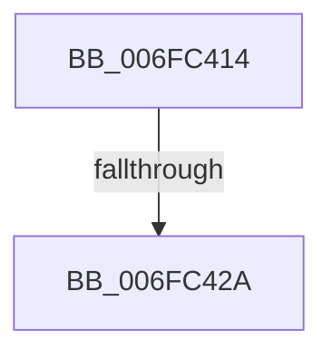

# sub_006FC414

- RVA: `0x006FC414`–`0x006FC492` (길이 `126` bytes)
- VA: `0x00000001406FC414`
- 실행 섹션: `.text`
- PDB 이름 있음: `아니요`; PDB Function 태그: `아니요`
- unwind 정보 RVA: `0x000BB2E8`
- 디코드: `28`개 명령, `126/126` bytes 표시
- 미해석 바이트: `0` (있으면 어셈블리에 `.byte`로 보존)

> 이 문서는 커널 이미지의 기계어와 PDB 기호를 분석해 생성했습니다. 4번과 5번은 함수 원형과 자료형을 바이너리 사용 방식에서 추정한 C 해석이며 원본 소스 복구 결과는 아닙니다.

## 1. Dependencies

- 직접 호출 지점: **1**; 고유 호출 대상: **1**
- 직접 호출자로 확인된 함수: **0**
- RIP 상대 이미지 참조: **1**

### Outgoing calls
- `0x006FC487` → [EtwTraceKernelEvent](../23/EtwTraceKernelEvent_function_00235350.md) (function, `0x00235350`)

### Direct callers
- 이 함수 시작 RVA로 연결되는 직접 call은 확인되지 않았습니다. 간접 호출은 완전히 역산할 수 없습니다.

### Static image references
- `0x006FC41C` → RVA `0x00E0EB14` (`.data`; read)

## 2. Other-region calls and transfers

- 다른 실행 섹션으로 향하는 call: **0**
- call이 아닌 외부 분기/꼬리 이동: **2**
  - `0x006FC424` → [PerfLogExecutiveResourceWait + 0xAD](../4B/PerfLogExecutiveResourceWait_function_004B9E90.md) (`tail-transfer`)
  - `0x006FC48D` → [PerfLogExecutiveResourceWait + 0xAD](../4B/PerfLogExecutiveResourceWait_function_004B9E90.md) (`tail-transfer`)

## 3. Assembly (complete function range)

```asm
006FC414  49 8B D9                        mov rbx, r9
006FC417  33 D2                           xor edx, edx
006FC419  41 8B C6                        mov eax, r14d
006FC41C  F7 35 F2 26 71 00               div dword ptr [rip + 0x7126f2]
006FC422  85 D2                           test edx, edx
006FC424  0F 85 13 DB DB FF               jne 0x1404b9f3d
006FC42A  4C 89 4D B8                     mov qword ptr [rbp - 0x48], r9
006FC42E  BA 01 00 00 00                  mov edx, 1
006FC433  89 75 E0                        mov dword ptr [rbp - 0x20], esi
006FC436  4C 89 6D D8                     mov qword ptr [rbp - 0x28], r13
006FC43A  44 89 75 D0                     mov dword ptr [rbp - 0x30], r14d
006FC43E  48 89 5D C0                     mov qword ptr [rbp - 0x40], rbx
006FC442  49 8B 00                        mov rax, qword ptr [r8]
006FC445  41 B8 00 00 02 20               mov r8d, 0x20020000
006FC44B  48 89 45 C8                     mov qword ptr [rbp - 0x38], rax
006FC44F  44 89 4D E4                     mov dword ptr [rbp - 0x1c], r9d
006FC453  41 B9 2B 05 00 00               mov r9d, 0x52b
006FC459  65 48 8B 04 25 88 01 00 00      mov rax, qword ptr gs:[0x188]
006FC462  48 C7 45 F0 30 00 00 00         mov qword ptr [rbp - 0x10], 0x30
006FC46A  C7 44 24 20 02 18 60 01         mov dword ptr [rsp + 0x20], 0x1601802
006FC472  8B 88 10 05 00 00               mov ecx, dword ptr [rax + 0x510]
006FC478  48 8D 45 B8                     lea rax, [rbp - 0x48]
006FC47C  89 4D D4                        mov dword ptr [rbp - 0x2c], ecx
006FC47F  48 8D 4D E8                     lea rcx, [rbp - 0x18]
006FC483  48 89 45 E8                     mov qword ptr [rbp - 0x18], rax
006FC487  E8 C4 8E B3 FF                  call 0x140235350
006FC48C  90                              nop
006FC48D  E9 AB DA DB FF                  jmp 0x1404b9f3d
```

## 4. C-style interpretation (structured pseudocode)

```c
__int64 __fastcall sub_006FC414(__int64 a1, int a2, __int64 a3, __int64 a4)
{
    __int64 result;
    unsigned int v_stack_p20;

    a2 = 0;
    *(unsigned __int64 *)(v_rbp - 72) = a4;
    *(unsigned int *)(v_rbp - 32) = (unsigned int)(v_rsi);
    *(unsigned __int64 *)(v_rbp - 40) = v_r13;
    *(unsigned int *)(v_rbp - 48) = (unsigned int)(v_r14);
    *(unsigned __int64 *)(v_rbp - 64) = a4;
    *(unsigned __int64 *)(v_rbp - 56) = *(unsigned __int64 *)(a3);
    *(unsigned int *)(v_rbp - 28) = (unsigned int)(a4);
    *(unsigned __int64 *)(v_rbp - 16) = 48;
    v_stack_p20 = 0x1601802ULL;
    *(unsigned int *)(v_rbp - 44) = (unsigned int)((unsigned int)(*(unsigned int *)(*(unsigned __int64 *)(gs_base + (0 + 392)) + 1296)));
    *(unsigned __int64 *)(v_rbp - 24) = v_rbp - 72;
    result = EtwTraceKernelEvent(v_rbp - 24, 1, (unsigned int)(0x20020000ULL), (unsigned int)(0x52BULL));
}
```

## 5. (Beta) C Style

```c
int64_t sub_006FC414(int64_t Arg1, int32_t Arg2, void *Arg3, int64_t Arg4)
{
    uint8_t *arg3 = (uint8_t *)Arg3;

    int64_t result;
    uint32_t v_stack_p20;

    Arg2 = 0;
    *(uint64_t *)(local_rbp - 0x48) = Arg4;
    *(uint32_t *)(local_rbp - 0x20) = (uint32_t)(local_rsi);
    *(uint64_t *)(local_rbp - 0x28) = local_r13;
    *(uint32_t *)(local_rbp - 0x30) = (uint32_t)(local_r14);
    *(uint64_t *)(local_rbp - 0x40) = Arg4;
    *(uint64_t *)(local_rbp - 0x38) = *(uint64_t *)(arg3);
    *(uint32_t *)(local_rbp - 0x1C) = (uint32_t)(Arg4);
    *(uint64_t *)(local_rbp - 0x10) = 48;
    v_stack_p20 = 0x1601802ULL;
    *(uint32_t *)(local_rbp - 0x2C) = (uint32_t)((uint32_t)(*(uint32_t *)(*(uint64_t *)(gs_base + (0 + 0x188)) + 0x510)));
    *(uint64_t *)(local_rbp - 0x18) = local_rbp - 72;
    result = EtwTraceKernelEvent(local_rbp - 24, 1, (uint32_t)(0x20020000ULL), (uint32_t)(0x52BULL));
}
```

### 관측된 메모리 오프셋

구조체 형식이 확인되지 않은 접근은 인자 기준의 오프셋으로만 기록했습니다.

| 기준 인자 | 오프셋 표현 | 폭 (bit) | 접근 |
|---|---:|---:|---|
| `Arg3` | `+ 0x0` | `64` | `R` |

## 6. Execution-region graph

[열기: 2D/3D 그래프와 함수 탐색 컨트롤 패널](../../../control-panel.html?section=text&rva=0x006FC414&view=graph)

- 2D 그래프는 위에서 아래로 흐르고, 3D 그래프는 빈 공간을 드래그해 회전합니다. Shift+드래그는 이동, 휠은 확대·축소, 함수 노드 선택은 대상 보고서 이동입니다.

### Static fallback


