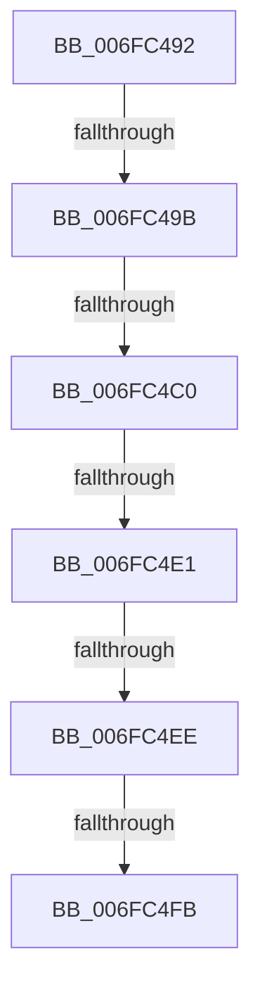

# sub_006FC492

- RVA: `0x006FC492`–`0x006FC519` (길이 `135` bytes)
- VA: `0x00000001406FC492`
- 실행 섹션: `.text`
- PDB 이름 있음: `아니요`; PDB Function 태그: `아니요`
- unwind 정보 RVA: `0x000BB370`
- 디코드: `31`개 명령, `135/135` bytes 표시
- 미해석 바이트: `0` (있으면 어셈블리에 `.byte`로 보존)

> 이 문서는 커널 이미지의 기계어와 PDB 기호를 분석해 생성했습니다. 4번과 5번은 함수 원형과 자료형을 바이너리 사용 방식에서 추정한 C 해석이며 원본 소스 복구 결과는 아닙니다.

## 1. Dependencies

- 직접 호출 지점: **2**; 고유 호출 대상: **2**
- 직접 호출자로 확인된 함수: **0**
- RIP 상대 이미지 참조: **0**

### Outgoing calls
- `0x006FC4A7` → [KeAcquireInStackQueuedSpinLock](../27/KeAcquireInStackQueuedSpinLock_function_002757A0.md) (function, `0x002757A0`)
- `0x006FC50E` → [CcReferencePartitionAndPrivateVolumeCacheMap](../38/CcReferencePartitionAndPrivateVolumeCacheMap_function_0038B9E0.md) (function, `0x0038B9E0`)

### Direct callers
- 이 함수 시작 RVA로 연결되는 직접 call은 확인되지 않았습니다. 간접 호출은 완전히 역산할 수 없습니다.

### Static image references
- 디코드된 RIP-relative 메모리 참조가 없습니다.

## 2. Other-region calls and transfers

- 다른 실행 섹션으로 향하는 call: **0**
- call이 아닌 외부 분기/꼬리 이동: **6**
  - `0x006FC495` → [CcPostWorkQueueAsyncLazywrite + 0x62](../4B/CcPostWorkQueueAsyncLazywrite_function_004BA17C.md) (`tail-transfer`)
  - `0x006FC4BA` → [CcPostWorkQueueAsyncLazywrite + 0x7C](../4B/CcPostWorkQueueAsyncLazywrite_function_004BA17C.md) (`tail-transfer`)
  - `0x006FC4DB` → [CcPostWorkQueueAsyncLazywrite + 0xE3](../4B/CcPostWorkQueueAsyncLazywrite_function_004BA17C.md) (`tail-transfer`)
  - `0x006FC4E8` → [CcPostWorkQueueAsyncLazywrite + 0x7C](../4B/CcPostWorkQueueAsyncLazywrite_function_004BA17C.md) (`tail-transfer`)
  - `0x006FC4F5` → [CcPostWorkQueueAsyncLazywrite + 0x7C](../4B/CcPostWorkQueueAsyncLazywrite_function_004BA17C.md) (`tail-transfer`)
  - `0x006FC514` → [CcPostWorkQueueAsyncLazywrite + 0xE3](../4B/CcPostWorkQueueAsyncLazywrite_function_004BA17C.md) (`tail-transfer`)

## 3. Assembly (complete function range)

```asm
006FC492  83 F8 04                        cmp eax, 4
006FC495  0F 84 43 DD DB FF               je 0x1404ba1de
006FC49B  49 8D 8E 40 03 00 00            lea rcx, [r14 + 0x340]
006FC4A2  48 8D 54 24 20                  lea rdx, [rsp + 0x20]
006FC4A7  E8 F4 92 B7 FF                  call 0x1402757a0
006FC4AC  48 8D 86 80 01 00 00            lea rax, [rsi + 0x180]
006FC4B3  48 8B 48 08                     mov rcx, qword ptr [rax + 8]
006FC4B7  48 39 01                        cmp qword ptr [rcx], rax
006FC4BA  0F 85 38 DD DB FF               jne 0x1404ba1f8
006FC4C0  48 89 07                        mov qword ptr [rdi], rax
006FC4C3  48 89 4F 08                     mov qword ptr [rdi + 8], rcx
006FC4C7  48 89 39                        mov qword ptr [rcx], rdi
006FC4CA  48 89 78 08                     mov qword ptr [rax + 8], rdi
006FC4CE  48 8D 86 68 01 00 00            lea rax, [rsi + 0x168]
006FC4D5  48 8B 08                        mov rcx, qword ptr [rax]
006FC4D8  48 3B C8                        cmp rcx, rax
006FC4DB  0F 84 7E DD DB FF               je 0x1404ba25f
006FC4E1  48 8B D9                        mov rbx, rcx
006FC4E4  48 39 41 08                     cmp qword ptr [rcx + 8], rax
006FC4E8  0F 85 0A DD DB FF               jne 0x1404ba1f8
006FC4EE  48 8B 09                        mov rcx, qword ptr [rcx]
006FC4F1  48 39 59 08                     cmp qword ptr [rcx + 8], rbx
006FC4F5  0F 85 FD DC DB FF               jne 0x1404ba1f8
006FC4FB  48 89 08                        mov qword ptr [rax], rcx
006FC4FE  49 8B D7                        mov rdx, r15
006FC501  48 89 41 08                     mov qword ptr [rcx + 8], rax
006FC505  49 8B CE                        mov rcx, r14
006FC508  FF 86 78 01 00 00               inc dword ptr [rsi + 0x178]
006FC50E  E8 CD F4 C8 FF                  call 0x14038b9e0
006FC513  90                              nop
006FC514  E9 46 DD DB FF                  jmp 0x1404ba25f
```

## 4. C-style interpretation (structured pseudocode)

```c
__int64 __fastcall sub_006FC492(void)
{
    __int64 result;
    unsigned __int64 v_stack_p20;

    result = KeAcquireInStackQueuedSpinLock(v_r14 + 832, v_stack_p20, a3, a4);
    *(unsigned __int64 *)(v_rdi) = v_rsi + 384;
    *(unsigned __int64 *)(v_rdi + 8) = *(unsigned __int64 *)(v_rsi + 384 + 8);
    *(unsigned __int64 *)(*(unsigned __int64 *)(v_rsi + 384 + 8)) = v_rdi;
    *(unsigned __int64 *)(v_rsi + 384 + 8) = v_rdi;
    *(unsigned __int64 *)(v_rsi + 360) = *(unsigned __int64 *)(*(unsigned __int64 *)(v_rsi + 360));
    *(unsigned __int64 *)(*(unsigned __int64 *)(*(unsigned __int64 *)(v_rsi + 360)) + 8) = v_rsi + 360;
    result = CcReferencePartitionAndPrivateVolumeCacheMap(v_r14, v_r15, a3, a4);
}
```

## 5. (Beta) C Style

```c
void sub_006FC492(void)
{
    int64_t result;
    uint64_t v_stack_p20;

    result = KeAcquireInStackQueuedSpinLock(local_r14 + 832, v_stack_p20, a3, a4);
    *(uint64_t *)(local_rdi) = local_rsi + 384;
    *(uint64_t *)(local_rdi + 0x8) = *(uint64_t *)(local_rsi + 0x180 + 0x8);
    *(uint64_t *)(*(uint64_t *)(local_rsi + 0x180 + 0x8)) = local_rdi;
    *(uint64_t *)(local_rsi + 0x180 + 0x8) = local_rdi;
    *(uint64_t *)(local_rsi + 0x168) = *(uint64_t *)(*(uint64_t *)(local_rsi + 0x168));
    *(uint64_t *)(*(uint64_t *)(*(uint64_t *)(local_rsi + 0x168)) + 0x8) = local_rsi + 360;
    result = CcReferencePartitionAndPrivateVolumeCacheMap(local_r14, local_r15, a3, a4);
}
```

## 6. Execution-region graph

[열기: 2D/3D 그래프와 함수 탐색 컨트롤 패널](../../../control-panel.html?section=text&rva=0x006FC492&view=graph)

- 2D 그래프는 위에서 아래로 흐르고, 3D 그래프는 빈 공간을 드래그해 회전합니다. Shift+드래그는 이동, 휠은 확대·축소, 함수 노드 선택은 대상 보고서 이동입니다.

### Static fallback


