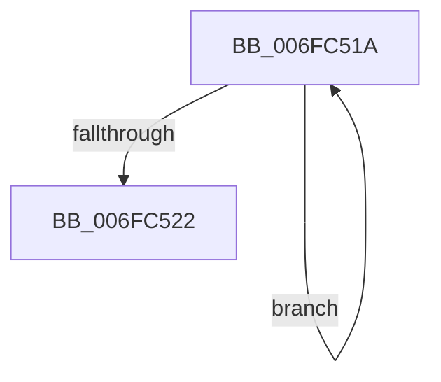

# sub_006FC51A

- RVA: `0x006FC51A`–`0x006FC550` (길이 `54` bytes)
- VA: `0x00000001406FC51A`
- 실행 섹션: `.text`
- PDB 이름 있음: `아니요`; PDB Function 태그: `아니요`
- unwind 정보 RVA: `0x000BB448`
- 디코드: `14`개 명령, `54/54` bytes 표시
- 미해석 바이트: `0` (있으면 어셈블리에 `.byte`로 보존)

> 이 문서는 커널 이미지의 기계어와 PDB 기호를 분석해 생성했습니다. 4번과 5번은 함수 원형과 자료형을 바이너리 사용 방식에서 추정한 C 해석이며 원본 소스 복구 결과는 아닙니다.

## 1. Dependencies

- 직접 호출 지점: **3**; 고유 호출 대상: **3**
- 직접 호출자로 확인된 함수: **0**
- RIP 상대 이미지 참조: **1**

### Outgoing calls
- `0x006FC529` → [KdEnterDebugger](../../pagekd/B8/KdEnterDebugger_function_00B8A96C.md) (function, `0x00B8A96C`)
- `0x006FC536` → [KdpPrintString](../../pagekd/B8/KdpPrintString_function_00B89CE8.md) (function, `0x00B89CE8`)
- `0x006FC544` → [KdExitDebugger](../../pagekd/B8/KdExitDebugger_function_00B85008.md) (function, `0x00B85008`)

### Direct callers
- 이 함수 시작 RVA로 연결되는 직접 call은 확인되지 않았습니다. 간접 호출은 완전히 역산할 수 없습니다.

### Static image references
- `0x006FC53B` → RVA `0x00F475DC` (`.data`; read)

## 2. Other-region calls and transfers

- 다른 실행 섹션으로 향하는 call: **3**
  - `0x006FC529` → [KdEnterDebugger](../../pagekd/B8/KdEnterDebugger_function_00B8A96C.md) (`.text` → `PAGEKD`)
  - `0x006FC536` → [KdpPrintString](../../pagekd/B8/KdpPrintString_function_00B89CE8.md) (`.text` → `PAGEKD`)
  - `0x006FC544` → [KdExitDebugger](../../pagekd/B8/KdExitDebugger_function_00B85008.md) (`.text` → `PAGEKD`)
- call이 아닌 외부 분기/꼬리 이동: **1**
  - `0x006FC54B` → [KdRefreshDebuggerNotPresent + 0x1E](../4B/KdRefreshDebuggerNotPresent_function_004BA420.md) (`tail-transfer`)

## 3. Assembly (complete function range)

```asm
006FC51A  48 FF C0                        inc rax
006FC51D  38 0C 02                        cmp byte ptr [rdx + rax], cl
006FC520  75 F8                           jne 0x1406fc51a
006FC522  33 D2                           xor edx, edx
006FC524  66 89 44 24 20                  mov word ptr [rsp + 0x20], ax
006FC529  E8 3E E4 48 00                  call 0x140b8a96c
006FC52E  48 8D 4C 24 20                  lea rcx, [rsp + 0x20]
006FC533  40 8A F8                        mov dil, al
006FC536  E8 AD D7 48 00                  call 0x140b89ce8
006FC53B  8A 1D 9B B0 84 00               mov bl, byte ptr [rip + 0x84b09b]
006FC541  40 8A CF                        mov cl, dil
006FC544  E8 BF 8A 48 00                  call 0x140b85008
006FC549  8A C3                           mov al, bl
006FC54B  E9 EE DE DB FF                  jmp 0x1404ba43e
```

## 4. C-style interpretation (structured pseudocode)

```c
__int64 __fastcall sub_006FC51A(unsigned __int8 a1, __int64 a2)
{
    __int64 result;
    unsigned __int16 v_stack_p20;

    result = (result) + 1;
    if ((*(unsigned __int8 *)(a2 + result * 1)) != a1) goto loc_006FC51A;
    a2 = 0;
    v_stack_p20 = (unsigned __int16)(result);
    result = KdEnterDebugger(a1, a2, a3, a4);
    result = KdpPrintString(v_stack_p20, a2, a3, a4);
    result = KdExitDebugger((unsigned __int8)((unsigned __int8)(result)), a2, a3, a4);
}
```

## 5. (Beta) C Style

```c
int64_t sub_006FC51A(uint8_t Arg1, void *Arg2)
{
    uint8_t *arg2 = (uint8_t *)Arg2;

    int64_t result;
    uint16_t v_stack_p20;

    result = (result) + 1;
    if ((*(uint8_t *)(arg2 + result * 1)) != Arg1) goto loc_006FC51A;
    Arg2 = 0;
    v_stack_p20 = (uint16_t)(result);
    result = KdEnterDebugger(Arg1, Arg2, a3, a4);
    result = KdpPrintString(v_stack_p20, Arg2, a3, a4);
    result = KdExitDebugger((uint8_t)((uint8_t)(result)), Arg2, a3, a4);
}
```

### 관측된 메모리 오프셋

구조체 형식이 확인되지 않은 접근은 인자 기준의 오프셋으로만 기록했습니다.

| 기준 인자 | 오프셋 표현 | 폭 (bit) | 접근 |
|---|---:|---:|---|
| `Arg2` | `+ 0x0 + rax*1` | `8` | `R` |

## 6. Execution-region graph

[열기: 2D/3D 그래프와 함수 탐색 컨트롤 패널](../../../control-panel.html?section=text&rva=0x006FC51A&view=graph)

- 2D 그래프는 위에서 아래로 흐르고, 3D 그래프는 빈 공간을 드래그해 회전합니다. Shift+드래그는 이동, 휠은 확대·축소, 함수 노드 선택은 대상 보고서 이동입니다.

### Static fallback


