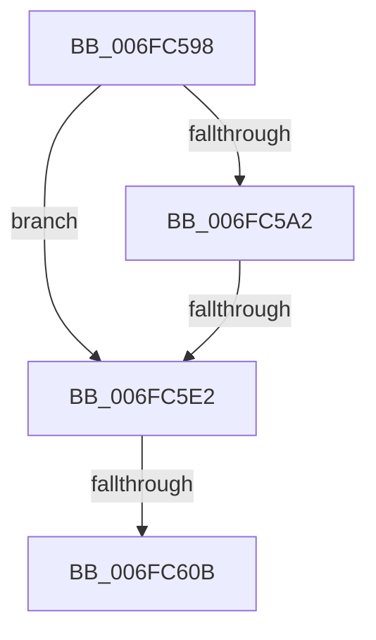

# sub_006FC598

- RVA: `0x006FC598`–`0x006FC62D` (길이 `149` bytes)
- VA: `0x00000001406FC598`
- 실행 섹션: `.text`
- PDB 이름 있음: `아니요`; PDB Function 태그: `아니요`
- unwind 정보 RVA: `0x000BB5BC`
- 디코드: `39`개 명령, `149/149` bytes 표시
- 미해석 바이트: `0` (있으면 어셈블리에 `.byte`로 보존)

> 이 문서는 커널 이미지의 기계어와 PDB 기호를 분석해 생성했습니다. 4번과 5번은 함수 원형과 자료형을 바이너리 사용 방식에서 추정한 C 해석이며 원본 소스 복구 결과는 아닙니다.

## 1. Dependencies

- 직접 호출 지점: **3**; 고유 호출 대상: **1**
- 직접 호출자로 확인된 함수: **0**
- RIP 상대 이미지 참조: **0**

### Outgoing calls
- `0x006FC5D3` → [WdipSemEnableDisableTrace](../../page/A5/WdipSemEnableDisableTrace_function_00A5C7F8.md) (function, `0x00A5C7F8`)
- `0x006FC5FB` → [WdipSemEnableDisableTrace](../../page/A5/WdipSemEnableDisableTrace_function_00A5C7F8.md) (function, `0x00A5C7F8`)
- `0x006FC621` → [WdipSemEnableDisableTrace](../../page/A5/WdipSemEnableDisableTrace_function_00A5C7F8.md) (function, `0x00A5C7F8`)

### Direct callers
- 이 함수 시작 RVA로 연결되는 직접 call은 확인되지 않았습니다. 간접 호출은 완전히 역산할 수 없습니다.

### Static image references
- 디코드된 RIP-relative 메모리 참조가 없습니다.

## 2. Other-region calls and transfers

- 다른 실행 섹션으로 향하는 call: **3**
  - `0x006FC5D3` → [WdipSemEnableDisableTrace](../../page/A5/WdipSemEnableDisableTrace_function_00A5C7F8.md) (`.text` → `PAGE`)
  - `0x006FC5FB` → [WdipSemEnableDisableTrace](../../page/A5/WdipSemEnableDisableTrace_function_00A5C7F8.md) (`.text` → `PAGE`)
  - `0x006FC621` → [WdipSemEnableDisableTrace](../../page/A5/WdipSemEnableDisableTrace_function_00A5C7F8.md) (`.text` → `PAGE`)
- call이 아닌 외부 분기/꼬리 이동: **3**
  - `0x006FC5DC` → [WdipSemCaptureState + 0x33](../4B/WdipSemCaptureState_function_004BA9A4.md) (`tail-transfer`)
  - `0x006FC605` → [WdipSemCaptureState + 0x33](../4B/WdipSemCaptureState_function_004BA9A4.md) (`tail-transfer`)
  - `0x006FC628` → [WdipSemCaptureState + 0x33](../4B/WdipSemCaptureState_function_004BA9A4.md) (`tail-transfer`)

## 3. Assembly (complete function range)

```asm
006FC598  48 8B 4B 28                     mov rcx, qword ptr [rbx + 0x28]
006FC59C  40 38 71 45                     cmp byte ptr [rcx + 0x45], sil
006FC5A0  75 40                           jne 0x1406fc5e2
006FC5A2  0F B6 51 30                     movzx edx, byte ptr [rcx + 0x30]
006FC5A6  BE 01 00 00 00                  mov esi, 1
006FC5AB  4C 8B 49 38                     mov r9, qword ptr [rcx + 0x38]
006FC5AF  8B 49 40                        mov ecx, dword ptr [rcx + 0x40]
006FC5B2  0B 4B 24                        or ecx, dword ptr [rbx + 0x24]
006FC5B5  44 0F B6 43 12                  movzx r8d, byte ptr [rbx + 0x12]
006FC5BA  4C 0B 4B 18                     or r9, qword ptr [rbx + 0x18]
006FC5BE  44 3A C2                        cmp r8b, dl
006FC5C1  89 74 24 28                     mov dword ptr [rsp + 0x28], esi
006FC5C5  89 4C 24 20                     mov dword ptr [rsp + 0x20], ecx
006FC5C9  0F B7 CF                        movzx ecx, di
006FC5CC  44 0F 46 C2                     cmovbe r8d, edx
006FC5D0  48 8B D3                        mov rdx, rbx
006FC5D3  E8 20 02 36 00                  call 0x140a5c7f8
006FC5D8  8B C8                           mov ecx, eax
006FC5DA  85 C0                           test eax, eax
006FC5DC  0F 88 F5 E3 DB FF               js 0x1404ba9d7
006FC5E2  C7 44 24 28 02 00 00 00         mov dword ptr [rsp + 0x28], 2
006FC5EA  45 33 C9                        xor r9d, r9d
006FC5ED  83 64 24 20 00                  and dword ptr [rsp + 0x20], 0
006FC5F2  45 33 C0                        xor r8d, r8d
006FC5F5  48 8B D3                        mov rdx, rbx
006FC5F8  0F B7 CF                        movzx ecx, di
006FC5FB  E8 F8 01 36 00                  call 0x140a5c7f8
006FC600  8B C8                           mov ecx, eax
006FC602  40 84 F6                        test sil, sil
006FC605  0F 84 CC E3 DB FF               je 0x1404ba9d7
006FC60B  83 64 24 28 00                  and dword ptr [rsp + 0x28], 0
006FC610  83 64 24 20 00                  and dword ptr [rsp + 0x20], 0
006FC615  45 33 C9                        xor r9d, r9d
006FC618  45 33 C0                        xor r8d, r8d
006FC61B  48 8B D3                        mov rdx, rbx
006FC61E  0F B7 CF                        movzx ecx, di
006FC621  E8 D2 01 36 00                  call 0x140a5c7f8
006FC626  8B C8                           mov ecx, eax
006FC628  E9 AA E3 DB FF                  jmp 0x1404ba9d7
```

## 4. C-style interpretation (structured pseudocode)

```c
__int64 __fastcall sub_006FC598(__int64 a1, __int64 a2, __int64 a3, __int64 a4, unsigned int a5)
{
    __int64 result;
    unsigned int v_stack_p20;
    unsigned int v_stack_p28;

    if ((*(unsigned __int8 *)(*(unsigned __int64 *)(v_rbx + 40) + 69)) != ((unsigned __int8)(v_rsi))) goto loc_006FC5E2;
    a1 = (unsigned int)(((unsigned int)(*(unsigned int *)(*(unsigned __int64 *)(v_rbx + 40) + 64))) | (*(unsigned int *)(v_rbx + 36)));
    a4 = (*(unsigned __int64 *)(*(unsigned __int64 *)(v_rbx + 40) + 56)) | (*(unsigned __int64 *)(v_rbx + 24));
    v_stack_p28 = 1;
    v_stack_p20 = (unsigned int)(a1);
    a3 = *(unsigned __int8 *)(v_rbx + 18);
    if (((unsigned __int8)(*(unsigned __int8 *)(v_rbx + 18))) <= ((unsigned __int8)(*(unsigned __int8 *)(*(unsigned __int64 *)(v_rbx + 40) + 48)))) { a3 = (unsigned int)(*(unsigned __int8 *)(*(unsigned __int64 *)(v_rbx + 40) + 48)); }
    result = WdipSemEnableDisableTrace((unsigned __int16)(v_rdi), v_rbx, a3, a4);
loc_006FC5E2:
    v_stack_p28 = 2;
    a4 = 0;
    a3 = 0;
    result = WdipSemEnableDisableTrace((unsigned __int16)(v_rdi), v_rbx, a3, a4);
    a4 = 0;
    a3 = 0;
    result = WdipSemEnableDisableTrace((unsigned __int16)(v_rdi), v_rbx, a3, a4);
}
```

## 5. (Beta) C Style

```c
int64_t sub_006FC598(int64_t Arg1, int64_t Arg2, int64_t Arg3, int64_t Arg4, uint32_t Arg5)
{
    int64_t result;
    uint32_t v_stack_p20;
    uint32_t v_stack_p28;

    if ((*(uint8_t *)(*(uint64_t *)(local_rbx + 0x28) + 0x45)) != ((uint8_t)(local_rsi))) goto loc_006FC5E2;
    Arg1 = (uint32_t)(((uint32_t)(*(uint32_t *)(*(uint64_t *)(local_rbx + 0x28) + 0x40))) | (*(uint32_t *)(local_rbx + 0x24)));
    Arg4 = (*(uint64_t *)(*(uint64_t *)(local_rbx + 0x28) + 0x38)) | (*(uint64_t *)(local_rbx + 0x18));
    v_stack_p28 = 1;
    v_stack_p20 = (uint32_t)(Arg1);
    Arg3 = *(uint8_t *)(local_rbx + 0x12);
    if (((uint8_t)(*(uint8_t *)(local_rbx + 0x12))) <= ((uint8_t)(*(uint8_t *)(*(uint64_t *)(local_rbx + 0x28) + 0x30)))) { Arg3 = (uint32_t)(*(uint8_t *)(*(uint64_t *)(local_rbx + 0x28) + 0x30)); }
    result = WdipSemEnableDisableTrace((uint16_t)(local_rdi), local_rbx, Arg3, Arg4);
loc_006FC5E2:
    v_stack_p28 = 2;
    Arg4 = 0;
    Arg3 = 0;
    result = WdipSemEnableDisableTrace((uint16_t)(local_rdi), local_rbx, Arg3, Arg4);
    Arg4 = 0;
    Arg3 = 0;
    result = WdipSemEnableDisableTrace((uint16_t)(local_rdi), local_rbx, Arg3, Arg4);
}
```

## 6. Execution-region graph

[열기: 2D/3D 그래프와 함수 탐색 컨트롤 패널](../../../control-panel.html?section=text&rva=0x006FC598&view=graph)

- 2D 그래프는 위에서 아래로 흐르고, 3D 그래프는 빈 공간을 드래그해 회전합니다. Shift+드래그는 이동, 휠은 확대·축소, 함수 노드 선택은 대상 보고서 이동입니다.

### Static fallback


