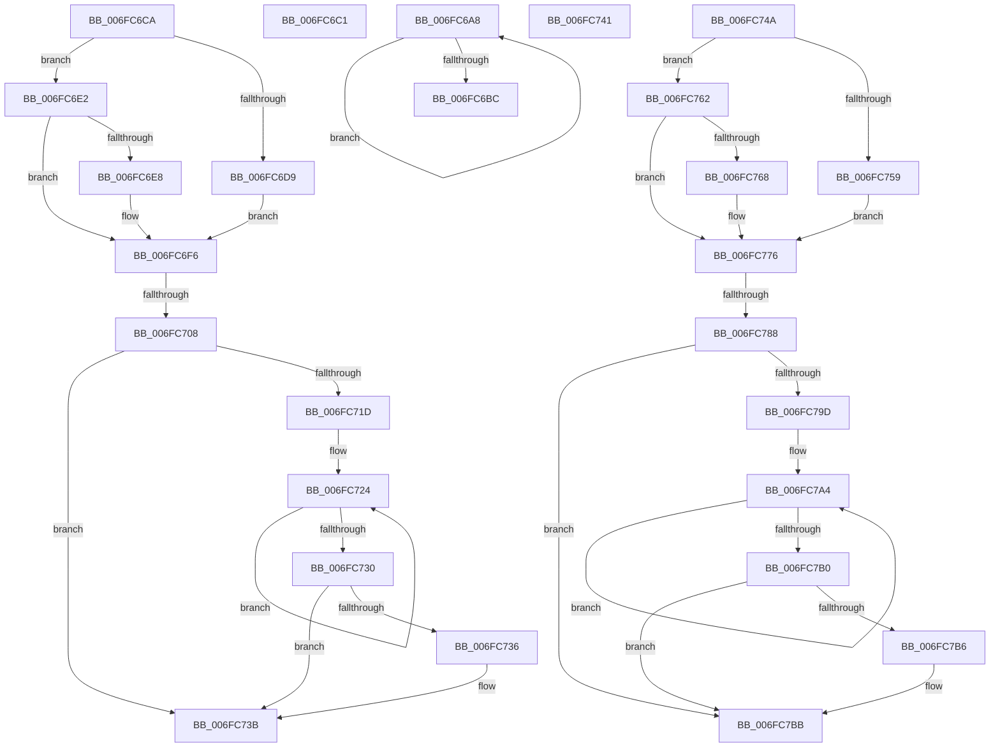

# sub_006FC6A8

- RVA: `0x006FC6A8`–`0x006FC7C1` (길이 `281` bytes)
- VA: `0x00000001406FC6A8`
- 실행 섹션: `.text`
- PDB 이름 있음: `아니요`; PDB Function 태그: `아니요`
- unwind 정보 RVA: `0x000BB918`
- 디코드: `67`개 명령, `281/281` bytes 표시
- 미해석 바이트: `0` (있으면 어셈블리에 `.byte`로 보존)

> 이 문서는 커널 이미지의 기계어와 PDB 기호를 분석해 생성했습니다. 4번과 5번은 함수 원형과 자료형을 바이너리 사용 방식에서 추정한 C 해석이며 원본 소스 복구 결과는 아닙니다.

## 1. Dependencies

- 직접 호출 지점: **2**; 고유 호출 대상: **1**
- 직접 호출자로 확인된 함수: **0**
- RIP 상대 이미지 참조: **0**

### Outgoing calls
- `0x006FC736` → [KiRemoveSystemWorkPriorityKick](../26/KiRemoveSystemWorkPriorityKick_function_002631D0.md) (function, `0x002631D0`)
- `0x006FC7B6` → [KiRemoveSystemWorkPriorityKick](../26/KiRemoveSystemWorkPriorityKick_function_002631D0.md) (function, `0x002631D0`)

### Direct callers
- 이 함수 시작 RVA로 연결되는 직접 call은 확인되지 않았습니다. 간접 호출은 완전히 역산할 수 없습니다.

### Static image references
- 디코드된 RIP-relative 메모리 참조가 없습니다.

## 2. Other-region calls and transfers

- 다른 실행 섹션으로 향하는 call: **0**
- call이 아닌 외부 분기/꼬리 이동: **7**
  - `0x006FC6BC` → [HvlLpReadMultipleMsr + 0x179](../4B/HvlLpReadMultipleMsr_function_004BC3B0.md) (`tail-transfer`)
  - `0x006FC6C5` → [HvlLpReadMultipleMsr + 0x1A6](../4B/HvlLpReadMultipleMsr_function_004BC3B0.md) (`tail-transfer`)
  - `0x006FC702` → [HvlLpReadMultipleMsr + 0x1A6](../4B/HvlLpReadMultipleMsr_function_004BC3B0.md) (`tail-transfer`)
  - `0x006FC73C` → [HvlLpReadMultipleMsr + 0x1A6](../4B/HvlLpReadMultipleMsr_function_004BC3B0.md) (`tail-transfer`)
  - `0x006FC745` → [HvlLpReadMultipleMsr + 0x1CF](../4B/HvlLpReadMultipleMsr_function_004BC3B0.md) (`tail-transfer`)
  - `0x006FC782` → [HvlLpReadMultipleMsr + 0x1CF](../4B/HvlLpReadMultipleMsr_function_004BC3B0.md) (`tail-transfer`)
  - `0x006FC7BC` → [HvlLpReadMultipleMsr + 0x1CF](../4B/HvlLpReadMultipleMsr_function_004BC3B0.md) (`tail-transfer`)

## 3. Assembly (complete function range)

```asm
006FC6A8  48 8B 03                        mov rax, qword ptr [rbx]
006FC6AB  48 8D 5B 10                     lea rbx, [rbx + 0x10]
006FC6AF  48 89 01                        mov qword ptr [rcx], rax
006FC6B2  48 8D 49 08                     lea rcx, [rcx + 8]
006FC6B6  49 83 EC 01                     sub r12, 1
006FC6BA  75 EC                           jne 0x1406fc6a8
006FC6BC  E9 68 FE DB FF                  jmp 0x1404bc529
006FC6C1  44 0F 22 C3                     mov cr8, rbx
006FC6C5  E9 8C FE DB FF                  jmp 0x1404bc556
006FC6CA  65 48 8B 04 25 20 00 00 00      mov rax, qword ptr gs:[0x20]
006FC6D3  F6 45 E4 01                     test byte ptr [rbp - 0x1c], 1
006FC6D7  74 09                           je 0x1406fc6e2
006FC6D9  48 8B 88 00 8C 00 00            mov rcx, qword ptr [rax + 0x8c00]
006FC6E0  EB 14                           jmp 0x1406fc6f6
006FC6E2  F6 45 E4 02                     test byte ptr [rbp - 0x1c], 2
006FC6E6  74 0E                           je 0x1406fc6f6
006FC6E8  48 8B 88 00 8C 00 00            mov rcx, qword ptr [rax + 0x8c00]
006FC6EF  48 81 C1 00 10 00 00            add rcx, 0x1000
006FC6F6  48 8B 45 F0                     mov rax, qword ptr [rbp - 0x10]
006FC6FA  48 89 41 10                     mov qword ptr [rcx + 0x10], rax
006FC6FE  44 38 65 E0                     cmp byte ptr [rbp - 0x20], r12b
006FC702  0F 84 4E FE DB FF               je 0x1404bc556
006FC708  65 48 8B 0C 25 20 00 00 00      mov rcx, qword ptr gs:[0x20]
006FC711  4C 8B 81 B8 8E 00 00            mov r8, qword ptr [rcx + 0x8eb8]
006FC718  4D 85 C0                        test r8, r8
006FC71B  74 1E                           je 0x1406fc73b
006FC71D  41 0F 0D 08                     prefetchw byte ptr [r8]
006FC721  41 8B 00                        mov eax, dword ptr [r8]
006FC724  8B D0                           mov edx, eax
006FC726  41 23 D5                        and edx, r13d
006FC729  F0 41 0F B1 10                  lock cmpxchg dword ptr [r8], edx
006FC72E  75 F4                           jne 0x1406fc724
006FC730  0F BA E0 15                     bt eax, 0x15
006FC734  73 05                           jae 0x1406fc73b
006FC736  E8 95 6A B6 FF                  call 0x1402631d0
006FC73B  FB                              sti
006FC73C  E9 15 FE DB FF                  jmp 0x1404bc556
006FC741  44 0F 22 C3                     mov cr8, rbx
006FC745  E9 35 FE DB FF                  jmp 0x1404bc57f
006FC74A  65 48 8B 04 25 20 00 00 00      mov rax, qword ptr gs:[0x20]
006FC753  F6 45 C4 01                     test byte ptr [rbp - 0x3c], 1
006FC757  74 09                           je 0x1406fc762
006FC759  48 8B 88 00 8C 00 00            mov rcx, qword ptr [rax + 0x8c00]
006FC760  EB 14                           jmp 0x1406fc776
006FC762  F6 45 C4 02                     test byte ptr [rbp - 0x3c], 2
006FC766  74 0E                           je 0x1406fc776
006FC768  48 8B 88 00 8C 00 00            mov rcx, qword ptr [rax + 0x8c00]
006FC76F  48 81 C1 00 10 00 00            add rcx, 0x1000
006FC776  48 8B 45 D0                     mov rax, qword ptr [rbp - 0x30]
006FC77A  48 89 41 10                     mov qword ptr [rcx + 0x10], rax
006FC77E  44 38 65 C0                     cmp byte ptr [rbp - 0x40], r12b
006FC782  0F 84 F7 FD DB FF               je 0x1404bc57f
006FC788  65 48 8B 0C 25 20 00 00 00      mov rcx, qword ptr gs:[0x20]
006FC791  4C 8B 81 B8 8E 00 00            mov r8, qword ptr [rcx + 0x8eb8]
006FC798  4D 85 C0                        test r8, r8
006FC79B  74 1E                           je 0x1406fc7bb
006FC79D  41 0F 0D 08                     prefetchw byte ptr [r8]
006FC7A1  41 8B 00                        mov eax, dword ptr [r8]
006FC7A4  8B D0                           mov edx, eax
006FC7A6  41 23 D5                        and edx, r13d
006FC7A9  F0 41 0F B1 10                  lock cmpxchg dword ptr [r8], edx
006FC7AE  75 F4                           jne 0x1406fc7a4
006FC7B0  0F BA E0 15                     bt eax, 0x15
006FC7B4  73 05                           jae 0x1406fc7bb
006FC7B6  E8 15 6A B6 FF                  call 0x1402631d0
006FC7BB  FB                              sti
006FC7BC  E9 BE FD DB FF                  jmp 0x1404bc57f
```

## 4. C-style interpretation (structured pseudocode)

```c
__int64 __fastcall sub_006FC6A8(__int64 a1)
{
    __int64 v_r12;

    *(unsigned __int64 *)(a1) = *(unsigned __int64 *)(v_rbx);
    v_r12 = (v_r12) - (1);
    if (condition_is_not_equal) goto loc_006FC6A8;
}
```

## 5. (Beta) C Style

```c
int64_t sub_006FC6A8(void *Arg1)
{
    uint8_t *arg1 = (uint8_t *)Arg1;

    int64_t local_r12;

    *(uint64_t *)(arg1) = *(uint64_t *)(local_rbx);
    local_r12 = (local_r12) - (1);
    if (condition_is_not_equal) goto loc_006FC6A8;
}
```

### 관측된 메모리 오프셋

구조체 형식이 확인되지 않은 접근은 인자 기준의 오프셋으로만 기록했습니다.

| 기준 인자 | 오프셋 표현 | 폭 (bit) | 접근 |
|---|---:|---:|---|
| `Arg1` | `+ 0x0` | `64` | `W` |
| `Arg1` | `+ 0x8` | `64` | `R` |

## 6. Execution-region graph

[열기: 2D/3D 그래프와 함수 탐색 컨트롤 패널](../../../control-panel.html?section=text&rva=0x006FC6A8&view=graph)

- 2D 그래프는 위에서 아래로 흐르고, 3D 그래프는 빈 공간을 드래그해 회전합니다. Shift+드래그는 이동, 휠은 확대·축소, 함수 노드 선택은 대상 보고서 이동입니다.

### Static fallback


