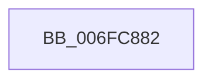

# sub_006FC882

- RVA: `0x006FC882`–`0x006FC89F` (길이 `29` bytes)
- VA: `0x00000001406FC882`
- 실행 섹션: `.text`
- PDB 이름 있음: `아니요`; PDB Function 태그: `아니요`
- unwind 정보 RVA: `0x000BBBD4`
- 디코드: `6`개 명령, `29/29` bytes 표시
- 미해석 바이트: `0` (있으면 어셈블리에 `.byte`로 보존)

> 이 문서는 커널 이미지의 기계어와 PDB 기호를 분석해 생성했습니다. 4번과 5번은 함수 원형과 자료형을 바이너리 사용 방식에서 추정한 C 해석이며 원본 소스 복구 결과는 아닙니다.

## 1. Dependencies

- 직접 호출 지점: **1**; 고유 호출 대상: **1**
- 직접 호출자로 확인된 함수: **0**
- RIP 상대 이미지 참조: **0**

### Outgoing calls
- `0x006FC88B` → [ExFreePoolWithTag](../../poolcode/B8/ExFreePoolWithTag_function_00B82870.md) (function, `0x00B82870`)

### Direct callers
- 이 함수 시작 RVA로 연결되는 직접 call은 확인되지 않았습니다. 간접 호출은 완전히 역산할 수 없습니다.

### Static image references
- 디코드된 RIP-relative 메모리 참조가 없습니다.

## 2. Other-region calls and transfers

- 다른 실행 섹션으로 향하는 call: **1**
  - `0x006FC88B` → [ExFreePoolWithTag](../../poolcode/B8/ExFreePoolWithTag_function_00B82870.md) (`.text` → `POOLCODE`)
- call이 아닌 외부 분기/꼬리 이동: **1**
  - `0x006FC89A` → [IopReplaceCompletionPort + 0x57](../4B/IopReplaceCompletionPort_function_004BCA58.md) (`tail-transfer`)

## 3. Assembly (complete function range)

```asm
006FC882  48 8B 8B B0 00 00 00            mov rcx, qword ptr [rbx + 0xb0]
006FC889  33 D2                           xor edx, edx
006FC88B  E8 E0 5F 48 00                  call 0x140b82870
006FC890  48 83 A3 B0 00 00 00 00         and qword ptr [rbx + 0xb0], 0
006FC898  33 FF                           xor edi, edi
006FC89A  E9 10 02 DC FF                  jmp 0x1404bcaaf
```

## 4. C-style interpretation (structured pseudocode)

```c
__int64 __fastcall sub_006FC882(__int64 a1, int a2)
{
    __int64 result;
    __int64 v_rdi;

    a2 = 0;
    result = ExFreePoolWithTag(*(unsigned __int64 *)(v_rbx + 176), a2, a3, a4);
    v_rdi = 0;
}
```

## 5. (Beta) C Style

```c
int64_t sub_006FC882(int64_t Arg1, int32_t Arg2)
{
    int64_t result;
    int64_t local_rdi;

    Arg2 = 0;
    result = ExFreePoolWithTag(*(uint64_t *)(local_rbx + 0xB0), Arg2, a3, a4);
    local_rdi = 0;
}
```

## 6. Execution-region graph

[열기: 2D/3D 그래프와 함수 탐색 컨트롤 패널](../../../control-panel.html?section=text&rva=0x006FC882&view=graph)

- 2D 그래프는 위에서 아래로 흐르고, 3D 그래프는 빈 공간을 드래그해 회전합니다. Shift+드래그는 이동, 휠은 확대·축소, 함수 노드 선택은 대상 보고서 이동입니다.

### Static fallback


