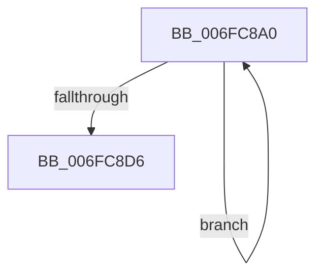

# sub_006FC8A0

- RVA: `0x006FC8A0`–`0x006FC8DB` (길이 `59` bytes)
- VA: `0x00000001406FC8A0`
- 실행 섹션: `.text`
- PDB 이름 있음: `아니요`; PDB Function 태그: `아니요`
- unwind 정보 RVA: `0x000BBCC4`
- 디코드: `13`개 명령, `59/59` bytes 표시
- 미해석 바이트: `0` (있으면 어셈블리에 `.byte`로 보존)

> 이 문서는 커널 이미지의 기계어와 PDB 기호를 분석해 생성했습니다. 4번과 5번은 함수 원형과 자료형을 바이너리 사용 방식에서 추정한 C 해석이며 원본 소스 복구 결과는 아닙니다.

## 1. Dependencies

- 직접 호출 지점: **0**; 고유 호출 대상: **0**
- 직접 호출자로 확인된 함수: **0**
- RIP 상대 이미지 참조: **0**

### Outgoing calls
- 직접 디코드된 call 명령이 없습니다.

### Direct callers
- 이 함수 시작 RVA로 연결되는 직접 call은 확인되지 않았습니다. 간접 호출은 완전히 역산할 수 없습니다.

### Static image references
- 디코드된 RIP-relative 메모리 참조가 없습니다.

## 2. Other-region calls and transfers

- 다른 실행 섹션으로 향하는 call: **0**
- call이 아닌 외부 분기/꼬리 이동: **1**
  - `0x006FC8D6` → [PopDiagTraceDeepSleepConstraintRundown + 0xBF](../4B/PopDiagTraceDeepSleepConstraintRundown_function_004BCDDC.md) (`tail-transfer`)

## 3. Assembly (complete function range)

```asm
006FC8A0  48 03 C9                        add rcx, rcx
006FC8A3  41 8D 40 FF                     lea eax, [r8 - 1]
006FC8A7  66 41 03 DA                     add bx, r10w
006FC8AB  44 23 C0                        and r8d, eax
006FC8AE  41 0F BC C0                     bsf eax, r8d
006FC8B2  48 89 94 CC 90 00 00 00         mov qword ptr [rsp + rcx*8 + 0x90], rdx
006FC8BA  48 8D 54 24 48                  lea rdx, [rsp + 0x48]
006FC8BF  48 C7 84 CC 98 00 00 00 04 00 00 00  mov qword ptr [rsp + rcx*8 + 0x98], 4
006FC8CB  0F B7 CB                        movzx ecx, bx
006FC8CE  48 8D 14 8A                     lea rdx, [rdx + rcx*4]
006FC8D2  89 02                           mov dword ptr [rdx], eax
006FC8D4  75 CA                           jne 0x1406fc8a0
006FC8D6  E9 C0 05 DC FF                  jmp 0x1404bce9b
```

## 4. C-style interpretation (structured pseudocode)

```c
__int64 __fastcall sub_006FC8A0(__int64 a1, __int64 a2, __int64 a3, __int64 a4, __int64 a5, __int64 a6, __int64 a7, __int64 a8, __int64 a9)
{
    __int64 v_rbx;

    a1 = (a1) + (a1);
    v_rbx = (unsigned __int16)((v_rbx) + ((unsigned __int16)(v_r10)));
    a3 = (unsigned int)((a3) & ((unsigned int)(a3 - 1)));
    *(unsigned __int64 *)(v_rsp + a1 * 8 + 144) = a2;
    *(unsigned __int64 *)(v_rsp + a1 * 8 + 152) = 4;
    *(unsigned int *)(a9 + (unsigned __int16)(v_rbx) * 4) = (unsigned int)(a3 - 1);
    if (condition_is_not_equal) goto loc_006FC8A0;
}
```

## 5. (Beta) C Style

```c
int64_t sub_006FC8A0(int64_t Arg1, int64_t Arg2, void *Arg3, int64_t Arg4, uint64_t Arg5, uint64_t Arg6, uint64_t Arg7, uint64_t Arg8, int64_t Arg9)
{
    uint8_t *arg3 = (uint8_t *)Arg3;

    int64_t local_rbx;

    Arg1 = (Arg1) + (Arg1);
    local_rbx = (uint16_t)((local_rbx) + ((uint16_t)(local_r10)));
    Arg3 = (uint32_t)((Arg3) & ((uint32_t)(Arg3 - 1)));
    *(uint64_t *)(local_rsp + Arg1 * 8 + 0x90) = Arg2;
    *(uint64_t *)(local_rsp + Arg1 * 8 + 0x98) = 4;
    *(uint32_t *)(Arg9 + (uint16_t)(local_rbx) * 4) = (uint32_t)(Arg3 - 1);
    if (condition_is_not_equal) goto loc_006FC8A0;
}
```

### 관측된 메모리 오프셋

구조체 형식이 확인되지 않은 접근은 인자 기준의 오프셋으로만 기록했습니다.

| 기준 인자 | 오프셋 표현 | 폭 (bit) | 접근 |
|---|---:|---:|---|
| `Arg3` | `- 0x1` | `32` | `R` |

## 6. Execution-region graph

[열기: 2D/3D 그래프와 함수 탐색 컨트롤 패널](../../../control-panel.html?section=text&rva=0x006FC8A0&view=graph)

- 2D 그래프는 위에서 아래로 흐르고, 3D 그래프는 빈 공간을 드래그해 회전합니다. Shift+드래그는 이동, 휠은 확대·축소, 함수 노드 선택은 대상 보고서 이동입니다.

### Static fallback


