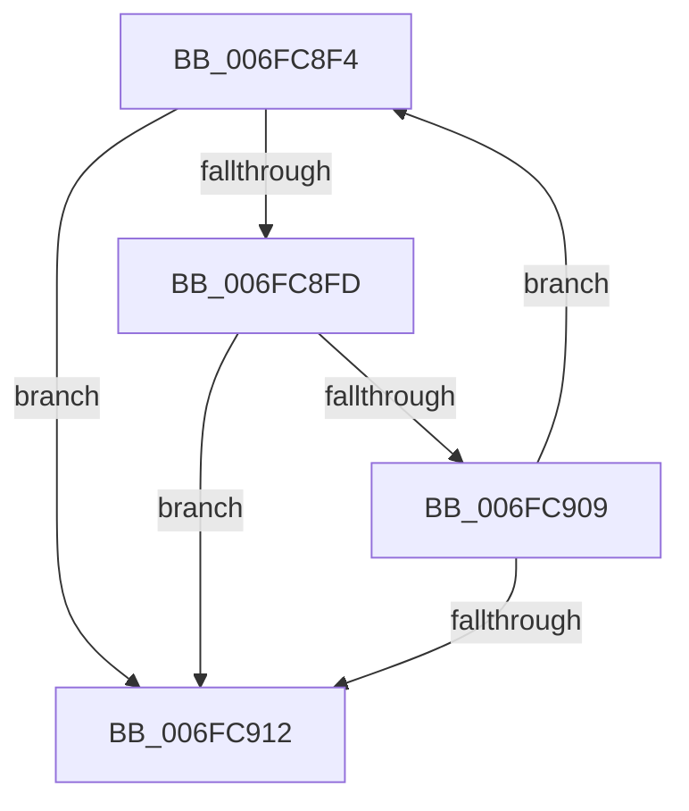

# sub_006FC8F4

- RVA: `0x006FC8F4`–`0x006FC922` (길이 `46` bytes)
- VA: `0x00000001406FC8F4`
- 실행 섹션: `.text`
- PDB 이름 있음: `아니요`; PDB Function 태그: `아니요`
- unwind 정보 RVA: `0x000BC054`
- 디코드: `12`개 명령, `46/46` bytes 표시
- 미해석 바이트: `0` (있으면 어셈블리에 `.byte`로 보존)

> 이 문서는 커널 이미지의 기계어와 PDB 기호를 분석해 생성했습니다. 4번과 5번은 함수 원형과 자료형을 바이너리 사용 방식에서 추정한 C 해석이며 원본 소스 복구 결과는 아닙니다.

## 1. Dependencies

- 직접 호출 지점: **1**; 고유 호출 대상: **1**
- 직접 호출자로 확인된 함수: **0**
- RIP 상대 이미지 참조: **0**

### Outgoing calls
- `0x006FC917` → [KeReleaseQueuedSpinLock](../27/KeReleaseQueuedSpinLock_function_00272540.md) (function, `0x00272540`)

### Direct callers
- 이 함수 시작 RVA로 연결되는 직접 call은 확인되지 않았습니다. 간접 호출은 완전히 역산할 수 없습니다.

### Static image references
- 디코드된 RIP-relative 메모리 참조가 없습니다.

## 2. Other-region calls and transfers

- 다른 실행 섹션으로 향하는 call: **0**
- call이 아닌 외부 분기/꼬리 이동: **1**
  - `0x006FC91D` → [IopCheckStackForTransactionSupport + 0x12](../4B/IopCheckStackForTransactionSupport_function_004BD59C.md) (`tail-transfer`)

## 3. Assembly (complete function range)

```asm
006FC8F4  F7 43 30 00 00 04 00            test dword ptr [rbx + 0x30], 0x40000
006FC8FB  75 15                           jne 0x1406fc912
006FC8FD  48 8B 9B 38 01 00 00            mov rbx, qword ptr [rbx + 0x138]
006FC904  48 85 DB                        test rbx, rbx
006FC907  74 09                           je 0x1406fc912
006FC909  48 8B 5B 30                     mov rbx, qword ptr [rbx + 0x30]
006FC90D  48 85 DB                        test rbx, rbx
006FC910  75 E2                           jne 0x1406fc8f4
006FC912  B9 0A 00 00 00                  mov ecx, 0xa
006FC917  E8 24 5C B7 FF                  call 0x140272540
006FC91C  90                              nop
006FC91D  E9 8C 0C DC FF                  jmp 0x1404bd5ae
```

## 4. C-style interpretation (structured pseudocode)

```c
__int64 __fastcall sub_006FC8F4(void)
{
    __int64 result;

    if (((*(unsigned int *)(v_rbx + 48)) & (0x40000ULL)) != 0) goto loc_006FC912;
    if (*(unsigned __int64 *)(v_rbx + 312) == 0) goto loc_006FC912;
    if (*(unsigned __int64 *)(*(unsigned __int64 *)(v_rbx + 312) + 48) != 0) goto loc_006FC8F4;
loc_006FC912:
    result = KeReleaseQueuedSpinLock(10, a2, a3, a4);
}
```

## 5. (Beta) C Style

```c
void sub_006FC8F4(void)
{
    int64_t result;

    if (((*(uint32_t *)(local_rbx + 0x30)) & (0x40000ULL)) != 0) goto loc_006FC912;
    if (*(uint64_t *)(local_rbx + 0x138) == 0) goto loc_006FC912;
    if (*(uint64_t *)(*(uint64_t *)(local_rbx + 0x138) + 0x30) != 0) goto loc_006FC8F4;
loc_006FC912:
    result = KeReleaseQueuedSpinLock(10, a2, a3, a4);
}
```

## 6. Execution-region graph

[열기: 2D/3D 그래프와 함수 탐색 컨트롤 패널](../../../control-panel.html?section=text&rva=0x006FC8F4&view=graph)

- 2D 그래프는 위에서 아래로 흐르고, 3D 그래프는 빈 공간을 드래그해 회전합니다. Shift+드래그는 이동, 휠은 확대·축소, 함수 노드 선택은 대상 보고서 이동입니다.

### Static fallback


