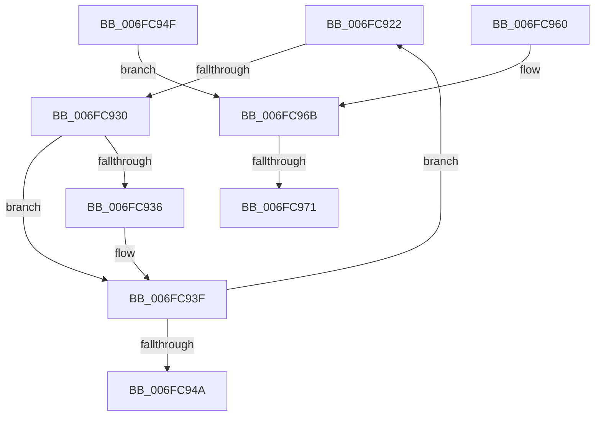

# sub_006FC922

- RVA: `0x006FC922`–`0x006FC98E` (길이 `108` bytes)
- VA: `0x00000001406FC922`
- 실행 섹션: `.text`
- PDB 이름 있음: `아니요`; PDB Function 태그: `아니요`
- unwind 정보 RVA: `0x000BC080`
- 디코드: `30`개 명령, `108/108` bytes 표시
- 미해석 바이트: `0` (있으면 어셈블리에 `.byte`로 보존)

> 이 문서는 커널 이미지의 기계어와 PDB 기호를 분석해 생성했습니다. 4번과 5번은 함수 원형과 자료형을 바이너리 사용 방식에서 추정한 C 해석이며 원본 소스 복구 결과는 아닙니다.

## 1. Dependencies

- 직접 호출 지점: **1**; 고유 호출 대상: **1**
- 직접 호출자로 확인된 함수: **0**
- RIP 상대 이미지 참조: **0**

### Outgoing calls
- `0x006FC983` → [AuthzBasepSetAccessReasons](../42/AuthzBasepSetAccessReasons_function_0042F980.md) (function, `0x0042F980`)

### Direct callers
- 이 함수 시작 RVA로 연결되는 직접 call은 확인되지 않았습니다. 간접 호출은 완전히 역산할 수 없습니다.

### Static image references
- 디코드된 RIP-relative 메모리 참조가 없습니다.

## 2. Other-region calls and transfers

- 다른 실행 섹션으로 향하는 call: **0**
- call이 아닌 외부 분기/꼬리 이동: **4**
  - `0x006FC92A` → [AuthzBasepUpdateParentTypeList + 0x5A](../4B/AuthzBasepUpdateParentTypeList_function_004BD6E4.md) (`tail-transfer`)
  - `0x006FC94A` → [AuthzBasepUpdateParentTypeList + 0x5A](../4B/AuthzBasepUpdateParentTypeList_function_004BD6E4.md) (`tail-transfer`)
  - `0x006FC96B` → [AuthzBasepUpdateParentTypeList + 0x24](../4B/AuthzBasepUpdateParentTypeList_function_004BD6E4.md) (`tail-transfer`)
  - `0x006FC989` → [AuthzBasepUpdateParentTypeList + 0x24](../4B/AuthzBasepUpdateParentTypeList_function_004BD6E4.md) (`tail-transfer`)

## 3. Assembly (complete function range)

```asm
006FC922  0F B7 48 E4                     movzx ecx, word ptr [rax - 0x1c]
006FC926  66 41 3B C8                     cmp cx, r8w
006FC92A  0F 86 0E 0E DC FF               jbe 0x1404bd73e
006FC930  66 41 3B CE                     cmp cx, r14w
006FC934  75 09                           jne 0x1406fc93f
006FC936  0B 78 FC                        or edi, dword ptr [rax - 4]
006FC939  44 23 10                        and r10d, dword ptr [rax]
006FC93C  0B 58 04                        or ebx, dword ptr [rax + 4]
006FC93F  FF C2                           inc edx
006FC941  48 83 C0 30                     add rax, 0x30
006FC945  41 3B D7                        cmp edx, r15d
006FC948  72 D8                           jb 0x1406fc922
006FC94A  E9 EF 0D DC FF                  jmp 0x1404bd73e
006FC94F  43 8B 4C CB 1C                  mov ecx, dword ptr [r11 + r9*8 + 0x1c]
006FC954  F7 D1                           not ecx
006FC956  47 89 54 CB 1C                  mov dword ptr [r11 + r9*8 + 0x1c], r10d
006FC95B  41 23 CA                        and ecx, r10d
006FC95E  EB 0B                           jmp 0x1406fc96b
006FC960  8B CF                           mov ecx, edi
006FC962  43 89 7C CB 18                  mov dword ptr [r11 + r9*8 + 0x18], edi
006FC967  F7 D1                           not ecx
006FC969  23 CA                           and ecx, edx
006FC96B  0F 84 97 0D DC FF               je 0x1404bd708
006FC971  BA 00 00 01 00                  mov edx, 0x10000
006FC976  4F 8B 4C CB 28                  mov r9, qword ptr [r11 + r9*8 + 0x28]
006FC97B  44 8B C6                        mov r8d, esi
006FC97E  C6 44 24 20 00                  mov byte ptr [rsp + 0x20], 0
006FC983  E8 F8 2F D3 FF                  call 0x14042f980
006FC988  90                              nop
006FC989  E9 7A 0D DC FF                  jmp 0x1404bd708
```

## 4. C-style interpretation (structured pseudocode)

```c
__int64 __fastcall sub_006FC922(__int64 a1, int a2, unsigned __int16 a3, __int64 a4)
{
    __int64 result;
    __int64 v_r10;
    __int64 v_rbx;
    __int64 v_rdi;
    unsigned __int8 v_stack_p20;

    if (((unsigned __int16)(*(unsigned __int16 *)(result - 28))) == ((unsigned __int16)(v_r14))) {
        v_rdi = (unsigned int)((v_rdi) | (*(unsigned int *)(result - 4)));
        v_r10 = (unsigned int)((v_r10) & (*(unsigned int *)(result)));
        v_rbx = (unsigned int)((v_rbx) | (*(unsigned int *)(result + 4)));
    }
    a2 = (unsigned int)((a2) + 1);
    result = (result) + (48);
    if (a2 < ((unsigned int)(v_r15))) goto loc_006FC922;
}
```

## 5. (Beta) C Style

```c
int64_t sub_006FC922(int64_t Arg1, int32_t Arg2, uint16_t Arg3, int64_t Arg4)
{
    int64_t result;
    int64_t local_r10;
    int64_t local_rbx;
    int64_t local_rdi;
    uint8_t v_stack_p20;

    if (((uint16_t)(*(uint16_t *)(result - 0x1C))) == ((uint16_t)(local_r14))) {
        local_rdi = (uint32_t)((local_rdi) | (*(uint32_t *)(result - 0x4)));
        local_r10 = (uint32_t)((local_r10) & (*(uint32_t *)(result)));
        local_rbx = (uint32_t)((local_rbx) | (*(uint32_t *)(result + 0x4)));
    }
    Arg2 = (uint32_t)((Arg2) + 1);
    result = (result) + (48);
    if (Arg2 < ((uint32_t)(local_r15))) goto loc_006FC922;
}
```

## 6. Execution-region graph

[열기: 2D/3D 그래프와 함수 탐색 컨트롤 패널](../../../control-panel.html?section=text&rva=0x006FC922&view=graph)

- 2D 그래프는 위에서 아래로 흐르고, 3D 그래프는 빈 공간을 드래그해 회전합니다. Shift+드래그는 이동, 휠은 확대·축소, 함수 노드 선택은 대상 보고서 이동입니다.

### Static fallback


