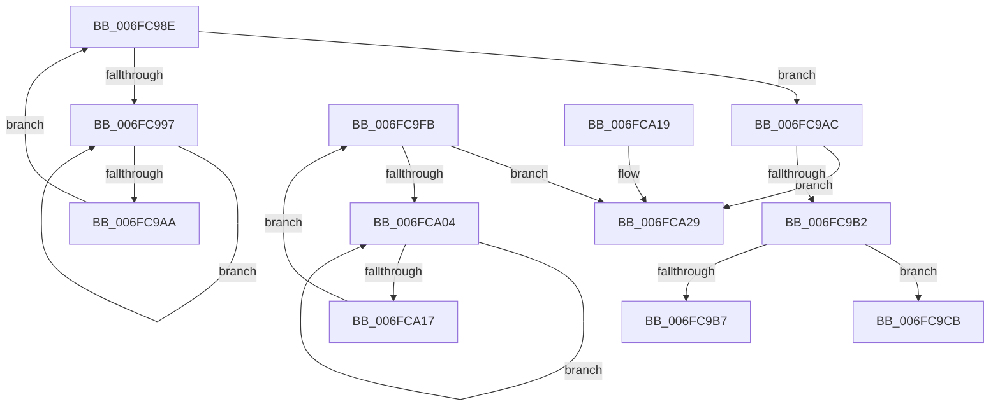

# sub_006FC98E

- RVA: `0x006FC98E`–`0x006FCA30` (길이 `162` bytes)
- VA: `0x00000001406FC98E`
- 실행 섹션: `.text`
- PDB 이름 있음: `아니요`; PDB Function 태그: `아니요`
- unwind 정보 RVA: `0x000BC14C`
- 디코드: `41`개 명령, `162/162` bytes 표시
- 미해석 바이트: `0` (있으면 어셈블리에 `.byte`로 보존)

> 이 문서는 커널 이미지의 기계어와 PDB 기호를 분석해 생성했습니다. 4번과 5번은 함수 원형과 자료형을 바이너리 사용 방식에서 추정한 C 해석이며 원본 소스 복구 결과는 아닙니다.

## 1. Dependencies

- 직접 호출 지점: **3**; 고유 호출 대상: **2**
- 직접 호출자로 확인된 함수: **0**
- RIP 상대 이미지 참조: **2**

### Outgoing calls
- `0x006FC99C` → [KeYieldProcessorEx](../3F/KeYieldProcessorEx_function_003FBD00.md) (function, `0x003FBD00`)
- `0x006FCA09` → [KeYieldProcessorEx](../3F/KeYieldProcessorEx_function_003FBD00.md) (function, `0x003FBD00`)
- `0x006FCA24` → [MiLockHugePfnInternal](../3F/MiLockHugePfnInternal_function_003FBC80.md) (function, `0x003FBC80`)

### Direct callers
- 이 함수 시작 RVA로 연결되는 직접 call은 확인되지 않았습니다. 간접 호출은 완전히 역산할 수 없습니다.

### Static image references
- `0x006FC9CB` → RVA `0x00E300C0` (`.data`; read)
- `0x006FC9D2` → RVA `0x00E300C8` (`.data`; read)

## 2. Other-region calls and transfers

- 다른 실행 섹션으로 향하는 call: **0**
- call이 아닌 외부 분기/꼬리 이동: **3**
  - `0x006FC9C6` → [MiValidateAndLockAweMapCountPage + 0x52](../4B/MiValidateAndLockAweMapCountPage_function_004BD8F4.md) (`tail-transfer`)
  - `0x006FC9F6` → [MiValidateAndLockAweMapCountPage + 0x52](../4B/MiValidateAndLockAweMapCountPage_function_004BD8F4.md) (`tail-transfer`)
  - `0x006FCA2B` → [MiValidateAndLockAweMapCountPage + 0x54](../4B/MiValidateAndLockAweMapCountPage_function_004BD8F4.md) (`tail-transfer`)

## 3. Assembly (complete function range)

```asm
006FC98E  F0 48 0F BA 6B 18 3F            lock bts qword ptr [rbx + 0x18], 0x3f
006FC995  73 15                           jae 0x1406fc9ac
006FC997  48 8D 4C 24 60                  lea rcx, [rsp + 0x60]
006FC99C  E8 5F F3 CF FF                  call 0x1403fbd00
006FC9A1  48 8B 43 18                     mov rax, qword ptr [rbx + 0x18]
006FC9A5  48 85 C0                        test rax, rax
006FC9A8  78 ED                           js 0x1406fc997
006FC9AA  EB E2                           jmp 0x1406fc98e
006FC9AC  49 0F A3 2E                     bt qword ptr [r14], rbp
006FC9B0  72 77                           jb 0x1406fca29
006FC9B2  48 85 DB                        test rbx, rbx
006FC9B5  74 14                           je 0x1406fc9cb
006FC9B7  48 B8 FF FF FF FF FF FF FF 7F   movabs rax, 0x7fffffffffffffff
006FC9C1  F0 48 21 43 18                  lock and qword ptr [rbx + 0x18], rax
006FC9C6  E9 7B 0F DC FF                  jmp 0x1404bd946
006FC9CB  48 2B 3D EE 36 73 00            sub rdi, qword ptr [rip + 0x7336ee]
006FC9D2  48 8B 05 EF 36 73 00            mov rax, qword ptr [rip + 0x7336ef]
006FC9D9  48 C1 FF 03                     sar rdi, 3
006FC9DD  81 E7 FF FF 3F 00               and edi, 0x3fffff
006FC9E3  8B CF                           mov ecx, edi
006FC9E5  83 E1 1F                        and ecx, 0x1f
006FC9E8  D3 E6                           shl esi, cl
006FC9EA  8B CF                           mov ecx, edi
006FC9EC  F7 D6                           not esi
006FC9EE  48 C1 E9 05                     shr rcx, 5
006FC9F2  F0 21 34 88                     lock and dword ptr [rax + rcx*4], esi
006FC9F6  E9 4B 0F DC FF                  jmp 0x1404bd946
006FC9FB  F0 48 0F BA 6B 18 3F            lock bts qword ptr [rbx + 0x18], 0x3f
006FCA02  73 25                           jae 0x1406fca29
006FCA04  48 8D 4C 24 68                  lea rcx, [rsp + 0x68]
006FCA09  E8 F2 F2 CF FF                  call 0x1403fbd00
006FCA0E  48 8B 43 18                     mov rax, qword ptr [rbx + 0x18]
006FCA12  48 85 C0                        test rax, rax
006FCA15  78 ED                           js 0x1406fca04
006FCA17  EB E2                           jmp 0x1406fc9fb
006FCA19  41 83 61 08 00                  and dword ptr [r9 + 8], 0
006FCA1E  48 8B CF                        mov rcx, rdi
006FCA21  49 89 39                        mov qword ptr [r9], rdi
006FCA24  E8 57 F2 CF FF                  call 0x1403fbc80
006FCA29  8B C6                           mov eax, esi
006FCA2B  E9 18 0F DC FF                  jmp 0x1404bd948
```

## 4. C-style interpretation (structured pseudocode)

```c
__int64 __fastcall sub_006FC98E(__int64 a1, __int64 a2, __int64 a3, __int64 a4, __int64 a5, __int64 a6, __int64 a7, __int64 a8, __int64 a9, __int64 a10, __int64 a11, __int64 a12)
{
    __int64 result;
    __int64 v_rdi;
    __int64 v_rsi;
    unsigned __int64 v_stack_p68;

    if (condition_is_above_or_equal) goto loc_006FC9AC;
loc_006FC997:
    result = KeYieldProcessorEx(a12, a2, a3, a4);
    if (sign_flag) goto loc_006FC997;
    goto loc_006FC98E;
loc_006FC9AC:
    if (condition_is_below) goto loc_006FCA29;
    if (v_rbx == 0) goto loc_006FC9CB;
loc_006FC9CB:
    v_rdi = (v_rdi) - (*(unsigned __int64 *)(v_rip + 7550702));
    v_rdi = (v_rdi) >> (3);
    v_rdi = (unsigned int)((v_rdi) & (0x3FFFFFULL));
    a1 = (unsigned int)(((unsigned int)((unsigned int)(v_rdi))) & (31));
    v_rsi = (unsigned int)((v_rsi) << ((unsigned __int8)(a1)));
    v_rsi = (unsigned int)(~(v_rsi));
    a1 = ((unsigned int)((unsigned int)(v_rdi))) >> (5);
loc_006FCA29:
}
```

## 5. (Beta) C Style

```c
int64_t sub_006FC98E(int64_t Arg1, int64_t Arg2, int64_t Arg3, int64_t Arg4, uint64_t Arg5, uint64_t Arg6, uint64_t Arg7, uint64_t Arg8, uint64_t Arg9, uint64_t Arg10, uint64_t Arg11, int64_t Arg12)
{
    int64_t result;
    int64_t local_rdi;
    int64_t local_rsi;
    uint64_t v_stack_p68;

    if (condition_is_above_or_equal) goto loc_006FC9AC;
loc_006FC997:
    result = KeYieldProcessorEx(Arg12, Arg2, Arg3, Arg4);
    if (sign_flag) goto loc_006FC997;
    goto loc_006FC98E;
loc_006FC9AC:
    if (condition_is_below) goto loc_006FCA29;
    if (local_rbx == 0) goto loc_006FC9CB;
loc_006FC9CB:
    local_rdi = (local_rdi) - (*(uint64_t *)(v_rip + 0x7336EE));
    local_rdi = (local_rdi) >> (3);
    local_rdi = (uint32_t)((local_rdi) & (0x3FFFFFULL));
    Arg1 = (uint32_t)(((uint32_t)((uint32_t)(local_rdi))) & (31));
    local_rsi = (uint32_t)((local_rsi) << ((uint8_t)(Arg1)));
    local_rsi = (uint32_t)(~(local_rsi));
    Arg1 = ((uint32_t)((uint32_t)(local_rdi))) >> (5);
loc_006FCA29:
}
```

## 6. Execution-region graph

[열기: 2D/3D 그래프와 함수 탐색 컨트롤 패널](../../../control-panel.html?section=text&rva=0x006FC98E&view=graph)

- 2D 그래프는 위에서 아래로 흐르고, 3D 그래프는 빈 공간을 드래그해 회전합니다. Shift+드래그는 이동, 휠은 확대·축소, 함수 노드 선택은 대상 보고서 이동입니다.

### Static fallback


