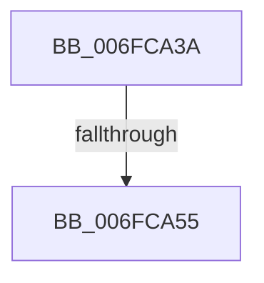

# sub_006FCA3A

- RVA: `0x006FCA3A`–`0x006FCAE5` (길이 `171` bytes)
- VA: `0x00000001406FCA3A`
- 실행 섹션: `.text`
- PDB 이름 있음: `아니요`; PDB Function 태그: `아니요`
- unwind 정보 RVA: `0x000BC1E4`
- 디코드: `38`개 명령, `171/171` bytes 표시
- 미해석 바이트: `0` (있으면 어셈블리에 `.byte`로 보존)

> 이 문서는 커널 이미지의 기계어와 PDB 기호를 분석해 생성했습니다. 4번과 5번은 함수 원형과 자료형을 바이너리 사용 방식에서 추정한 C 해석이며 원본 소스 복구 결과는 아닙니다.

## 1. Dependencies

- 직접 호출 지점: **2**; 고유 호출 대상: **2**
- 직접 호출자로 확인된 함수: **0**
- RIP 상대 이미지 참조: **2**

### Outgoing calls
- `0x006FCA48` → [EtwEventEnabled](../39/EtwEventEnabled_function_00392450.md) (function, `0x00392450`)
- `0x006FCADA` → [EtwWriteEx](../25/EtwWriteEx_function_0025F0D0.md) (function, `0x0025F0D0`)

### Direct callers
- 이 함수 시작 RVA로 연결되는 직접 call은 확인되지 않았습니다. 간접 호출은 완전히 역산할 수 없습니다.

### Static image references
- `0x006FCA3A` → RVA `0x00F0B408` (`.data`; read)
- `0x006FCA41` → RVA `0x00022E90` (`.rdata`; read)

## 2. Other-region calls and transfers

- 다른 실행 섹션으로 향하는 call: **0**
- call이 아닌 외부 분기/꼬리 이동: **2**
  - `0x006FCA4F` → [PopDiagTraceDiskIdleCheck + 0x38](../4B/PopDiagTraceDiskIdleCheck_function_004BDE08.md) (`tail-transfer`)
  - `0x006FCAE0` → [PopDiagTraceDiskIdleCheck + 0x38](../4B/PopDiagTraceDiskIdleCheck_function_004BDE08.md) (`tail-transfer`)

## 3. Assembly (complete function range)

```asm
006FCA3A  48 8B 0D C7 E9 80 00            mov rcx, qword ptr [rip + 0x80e9c7]
006FCA41  48 8D 15 48 64 92 FF            lea rdx, [rip - 0x6d9bb8]
006FCA48  E8 03 5A C9 FF                  call 0x140392450
006FCA4D  84 C0                           test al, al
006FCA4F  0F 84 EB 13 DC FF               je 0x1404bde40
006FCA55  83 65 03 00                     and dword ptr [rbp + 3], 0
006FCA59  48 8D 43 18                     lea rax, [rbx + 0x18]
006FCA5D  83 65 13 00                     and dword ptr [rbp + 0x13], 0
006FCA61  48 8D 15 28 64 92 FF            lea rdx, [rip - 0x6d9bd8]
006FCA68  83 65 23 00                     and dword ptr [rbp + 0x23], 0
006FCA6C  B9 04 00 00 00                  mov ecx, 4
006FCA71  83 65 33 00                     and dword ptr [rbp + 0x33], 0
006FCA75  45 33 C9                        xor r9d, r9d
006FCA78  83 65 43 00                     and dword ptr [rbp + 0x43], 0
006FCA7C  45 33 C0                        xor r8d, r8d
006FCA7F  48 89 45 F7                     mov qword ptr [rbp - 9], rax
006FCA83  48 8D 45 6F                     lea rax, [rbp + 0x6f]
006FCA87  48 89 45 07                     mov qword ptr [rbp + 7], rax
006FCA8B  48 8D 45 77                     lea rax, [rbp + 0x77]
006FCA8F  48 89 45 17                     mov qword ptr [rbp + 0x17], rax
006FCA93  48 8D 43 60                     lea rax, [rbx + 0x60]
006FCA97  48 89 45 27                     mov qword ptr [rbp + 0x27], rax
006FCA9B  48 8D 43 64                     lea rax, [rbx + 0x64]
006FCA9F  48 89 45 37                     mov qword ptr [rbp + 0x37], rax
006FCAA3  48 8D 45 F7                     lea rax, [rbp - 9]
006FCAA7  48 89 44 24 38                  mov qword ptr [rsp + 0x38], rax
006FCAAC  C7 44 24 30 05 00 00 00         mov dword ptr [rsp + 0x30], 5
006FCAB4  48 83 64 24 28 00               and qword ptr [rsp + 0x28], 0
006FCABA  48 83 64 24 20 00               and qword ptr [rsp + 0x20], 0
006FCAC0  89 4D 0F                        mov dword ptr [rbp + 0xf], ecx
006FCAC3  89 4D 1F                        mov dword ptr [rbp + 0x1f], ecx
006FCAC6  89 4D 2F                        mov dword ptr [rbp + 0x2f], ecx
006FCAC9  89 4D 3F                        mov dword ptr [rbp + 0x3f], ecx
006FCACC  48 8B 0D 35 E9 80 00            mov rcx, qword ptr [rip + 0x80e935]
006FCAD3  C7 45 FF 08 00 00 00            mov dword ptr [rbp - 1], 8
006FCADA  E8 F1 25 B6 FF                  call 0x14025f0d0
006FCADF  90                              nop
006FCAE0  E9 5B 13 DC FF                  jmp 0x1404bde40
```

## 4. C-style interpretation (structured pseudocode)

```c
__int64 __fastcall sub_006FCA3A(__int64 a1, __int64 a2, int a3, int a4, __int64 a5)
{
    __int64 result;
    unsigned __int64 v_stack_p20;
    unsigned int v_stack_p30;
    unsigned __int64 v_stack_p38;

    result = EtwEventEnabled(*(unsigned __int64 *)(v_rip + 8448455), v_rip - 7183288, a3, a4);
    a4 = 0;
    a3 = 0;
    *(unsigned __int64 *)(v_rbp - 9) = v_rbx + 24;
    *(unsigned __int64 *)(v_rbp + 7) = v_rbp + 111;
    *(unsigned __int64 *)(v_rbp + 23) = v_rbp + 119;
    *(unsigned __int64 *)(v_rbp + 39) = v_rbx + 96;
    *(unsigned __int64 *)(v_rbp + 55) = v_rbx + 100;
    v_stack_p38 = v_rbp - 9;
    v_stack_p30 = 5;
    *(unsigned int *)(v_rbp + 15) = 4;
    *(unsigned int *)(v_rbp + 31) = 4;
    *(unsigned int *)(v_rbp + 47) = 4;
    *(unsigned int *)(v_rbp + 63) = 4;
    *(unsigned int *)(v_rbp - 1) = 8;
    result = EtwWriteEx(*(unsigned __int64 *)(v_rip + 8448309), v_rip - 7183320, a3, a4);
}
```

## 5. (Beta) C Style

```c
int64_t sub_006FCA3A(int64_t Arg1, int64_t Arg2, int32_t Arg3, int32_t Arg4, int64_t Arg5)
{
    int64_t result;
    uint64_t v_stack_p20;
    uint32_t v_stack_p30;
    uint64_t v_stack_p38;

    result = EtwEventEnabled(*(uint64_t *)(v_rip + 0x80E9C7), v_rip - 7183288, Arg3, Arg4);
    Arg4 = 0;
    Arg3 = 0;
    *(uint64_t *)(local_rbp - 0x9) = local_rbx + 24;
    *(uint64_t *)(local_rbp + 0x7) = local_rbp + 111;
    *(uint64_t *)(local_rbp + 0x17) = local_rbp + 119;
    *(uint64_t *)(local_rbp + 0x27) = local_rbx + 96;
    *(uint64_t *)(local_rbp + 0x37) = local_rbx + 100;
    v_stack_p38 = local_rbp - 9;
    v_stack_p30 = 5;
    *(uint32_t *)(local_rbp + 0xF) = 4;
    *(uint32_t *)(local_rbp + 0x1F) = 4;
    *(uint32_t *)(local_rbp + 0x2F) = 4;
    *(uint32_t *)(local_rbp + 0x3F) = 4;
    *(uint32_t *)(local_rbp - 0x1) = 8;
    result = EtwWriteEx(*(uint64_t *)(v_rip + 0x80E935), v_rip - 7183320, Arg3, Arg4);
}
```

## 6. Execution-region graph

[열기: 2D/3D 그래프와 함수 탐색 컨트롤 패널](../../../control-panel.html?section=text&rva=0x006FCA3A&view=graph)

- 2D 그래프는 위에서 아래로 흐르고, 3D 그래프는 빈 공간을 드래그해 회전합니다. Shift+드래그는 이동, 휠은 확대·축소, 함수 노드 선택은 대상 보고서 이동입니다.

### Static fallback


