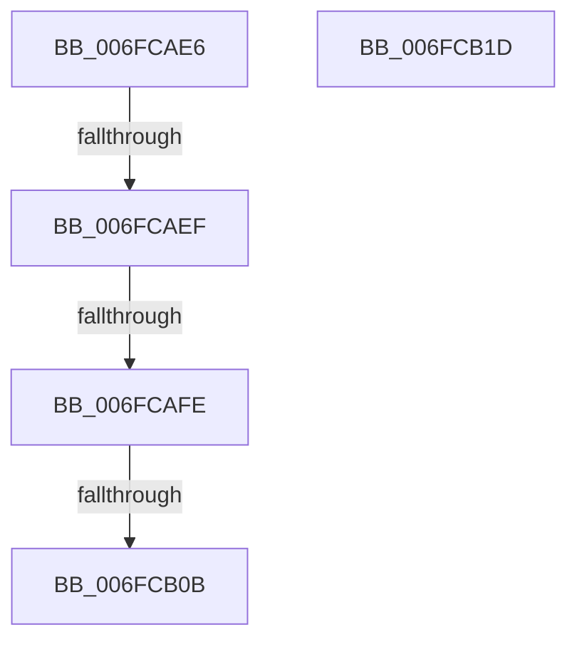

# sub_006FCAE6

- RVA: `0x006FCAE6`–`0x006FCB31` (길이 `75` bytes)
- VA: `0x00000001406FCAE6`
- 실행 섹션: `.text`
- PDB 이름 있음: `아니요`; PDB Function 태그: `아니요`
- unwind 정보 RVA: `0x000BC2C8`
- 디코드: `17`개 명령, `75/75` bytes 표시
- 미해석 바이트: `0` (있으면 어셈블리에 `.byte`로 보존)

> 이 문서는 커널 이미지의 기계어와 PDB 기호를 분석해 생성했습니다. 4번과 5번은 함수 원형과 자료형을 바이너리 사용 방식에서 추정한 C 해석이며 원본 소스 복구 결과는 아닙니다.

## 1. Dependencies

- 직접 호출 지점: **2**; 고유 호출 대상: **2**
- 직접 호출자로 확인된 함수: **0**
- RIP 상대 이미지 참조: **3**

### Outgoing calls
- `0x006FCB12` → [PopNetSetResiliencyPhaseBias](../../page/AB/PopNetSetResiliencyPhaseBias_function_00ABD9F0.md) (function, `0x00ABD9F0`)
- `0x006FCB26` → [KeReleaseSpinLock](../39/KeReleaseSpinLock_function_00392BA0.md) (function, `0x00392BA0`)

### Direct callers
- 이 함수 시작 RVA로 연결되는 직접 call은 확인되지 않았습니다. 간접 호출은 완전히 역산할 수 없습니다.

### Static image references
- `0x006FCAF2` → RVA `0x00F0887C` (`.data`; read)
- `0x006FCAFE` → RVA `0x00E677C0` (`.data`; read)
- `0x006FCB1F` → RVA `0x00F0CA58` (`.data`; read)

## 2. Other-region calls and transfers

- 다른 실행 섹션으로 향하는 call: **1**
  - `0x006FCB12` → [PopNetSetResiliencyPhaseBias](../../page/AB/PopNetSetResiliencyPhaseBias_function_00ABD9F0.md) (`.text` → `PAGE`)
- call이 아닌 외부 분기/꼬리 이동: **5**
  - `0x006FCAE9` → [PopNetEvaluationWorkerCallback + 0x56](../4B/PopNetEvaluationWorkerCallback_function_004BE0B0.md) (`tail-transfer`)
  - `0x006FCAF8` → [PopNetEvaluationWorkerCallback + 0x56](../4B/PopNetEvaluationWorkerCallback_function_004BE0B0.md) (`tail-transfer`)
  - `0x006FCB05` → [PopNetEvaluationWorkerCallback + 0x56](../4B/PopNetEvaluationWorkerCallback_function_004BE0B0.md) (`tail-transfer`)
  - `0x006FCB18` → [PopNetEvaluationWorkerCallback + 0x56](../4B/PopNetEvaluationWorkerCallback_function_004BE0B0.md) (`tail-transfer`)
  - `0x006FCB2C` → [PopNetEvaluationWorkerCallback + 0x5F](../4B/PopNetEvaluationWorkerCallback_function_004BE0B0.md) (`tail-transfer`)

## 3. Assembly (complete function range)

```asm
006FCAE6  83 FE 02                        cmp esi, 2
006FCAE9  0F 85 17 16 DC FF               jne 0x1404be106
006FCAEF  40 B5 01                        mov bpl, 1
006FCAF2  38 1D 84 BD 80 00               cmp byte ptr [rip + 0x80bd84], bl
006FCAF8  0F 84 08 16 DC FF               je 0x1404be106
006FCAFE  48 39 1D BB AC 76 00            cmp qword ptr [rip + 0x76acbb], rbx
006FCB05  0F 84 FB 15 DC FF               je 0x1404be106
006FCB0B  B1 01                           mov cl, 1
006FCB0D  C6 44 24 68 01                  mov byte ptr [rsp + 0x68], 1
006FCB12  E8 D9 0E 3C 00                  call 0x140abd9f0
006FCB17  90                              nop
006FCB18  E9 E9 15 DC FF                  jmp 0x1404be106
006FCB1D  8A D0                           mov dl, al
006FCB1F  48 8D 0D 32 FF 80 00            lea rcx, [rip + 0x80ff32]
006FCB26  E8 75 60 C9 FF                  call 0x140392ba0
006FCB2B  90                              nop
006FCB2C  E9 DE 15 DC FF                  jmp 0x1404be10f
```

## 4. C-style interpretation (structured pseudocode)

```c
__int64 __fastcall sub_006FCAE6(void)
{
    __int64 result;
    unsigned __int8 v_stack_p68;

    v_stack_p68 = 1;
    result = PopNetSetResiliencyPhaseBias(1, a2, a3, a4);
}
```

## 5. (Beta) C Style

```c
void sub_006FCAE6(void)
{
    int64_t result;
    uint8_t v_stack_p68;

    v_stack_p68 = 1;
    result = PopNetSetResiliencyPhaseBias(1, a2, a3, a4);
}
```

## 6. Execution-region graph

[열기: 2D/3D 그래프와 함수 탐색 컨트롤 패널](../../../control-panel.html?section=text&rva=0x006FCAE6&view=graph)

- 2D 그래프는 위에서 아래로 흐르고, 3D 그래프는 빈 공간을 드래그해 회전합니다. Shift+드래그는 이동, 휠은 확대·축소, 함수 노드 선택은 대상 보고서 이동입니다.

### Static fallback


