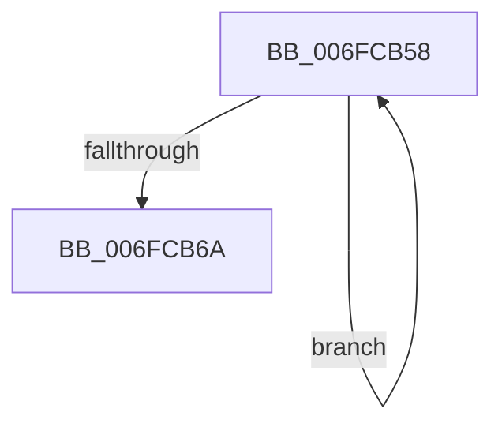

# sub_006FCB58

- RVA: `0x006FCB58`–`0x006FCB7E` (길이 `38` bytes)
- VA: `0x00000001406FCB58`
- 실행 섹션: `.text`
- PDB 이름 있음: `아니요`; PDB Function 태그: `아니요`
- unwind 정보 RVA: `0x000BC520`
- 디코드: `11`개 명령, `38/38` bytes 표시
- 미해석 바이트: `0` (있으면 어셈블리에 `.byte`로 보존)

> 이 문서는 커널 이미지의 기계어와 PDB 기호를 분석해 생성했습니다. 4번과 5번은 함수 원형과 자료형을 바이너리 사용 방식에서 추정한 C 해석이며 원본 소스 복구 결과는 아닙니다.

## 1. Dependencies

- 직접 호출 지점: **2**; 고유 호출 대상: **2**
- 직접 호출자로 확인된 함수: **0**
- RIP 상대 이미지 참조: **1**

### Outgoing calls
- `0x006FCB5D` → [PopPowerRequestEvaluatePendingRequestStatus](../47/PopPowerRequestEvaluatePendingRequestStatus_function_00477914.md) (function, `0x00477914`)
- `0x006FCB73` → [PopQueueWorkItem](../4A/PopQueueWorkItem_function_004A20F8.md) (function, `0x004A20F8`)

### Direct callers
- 이 함수 시작 RVA로 연결되는 직접 call은 확인되지 않았습니다. 간접 호출은 완전히 역산할 수 없습니다.

### Static image references
- `0x006FCB6C` → RVA `0x00F0ED80` (`.data`; read)

## 2. Other-region calls and transfers

- 다른 실행 섹션으로 향하는 call: **0**
- call이 아닌 외부 분기/꼬리 이동: **1**
  - `0x006FCB79` → [PopPowerRequestUnrevokeRequests + 0x36](../4B/PopPowerRequestUnrevokeRequests_function_004BF3D0.md) (`tail-transfer`)

## 3. Assembly (complete function range)

```asm
006FCB58  33 D2                           xor edx, edx
006FCB5A  48 8B CB                        mov rcx, rbx
006FCB5D  E8 B2 AD D7 FF                  call 0x140477914
006FCB62  48 8B 1B                        mov rbx, qword ptr [rbx]
006FCB65  48 3B DF                        cmp rbx, rdi
006FCB68  75 EE                           jne 0x1406fcb58
006FCB6A  33 D2                           xor edx, edx
006FCB6C  48 8D 0D 0D 22 81 00            lea rcx, [rip + 0x81220d]
006FCB73  E8 80 55 DA FF                  call 0x1404a20f8
006FCB78  90                              nop
006FCB79  E9 88 28 DC FF                  jmp 0x1404bf406
```

## 4. C-style interpretation (structured pseudocode)

```c
__int64 __fastcall sub_006FCB58(__int64 a1, int a2)
{
    __int64 result;

    a2 = 0;
    result = PopPowerRequestEvaluatePendingRequestStatus(v_rbx, a2, a3, a4);
    if ((*(unsigned __int64 *)(v_rbx)) != v_rdi) goto loc_006FCB58;
    a2 = 0;
    result = PopQueueWorkItem(v_rip + 8462861, a2, a3, a4);
}
```

## 5. (Beta) C Style

```c
int64_t sub_006FCB58(int64_t Arg1, int32_t Arg2)
{
    int64_t result;

    Arg2 = 0;
    result = PopPowerRequestEvaluatePendingRequestStatus(local_rbx, Arg2, a3, a4);
    if ((*(uint64_t *)(local_rbx)) != local_rdi) goto loc_006FCB58;
    Arg2 = 0;
    result = PopQueueWorkItem(v_rip + 8462861, Arg2, a3, a4);
}
```

## 6. Execution-region graph

[열기: 2D/3D 그래프와 함수 탐색 컨트롤 패널](../../../control-panel.html?section=text&rva=0x006FCB58&view=graph)

- 2D 그래프는 위에서 아래로 흐르고, 3D 그래프는 빈 공간을 드래그해 회전합니다. Shift+드래그는 이동, 휠은 확대·축소, 함수 노드 선택은 대상 보고서 이동입니다.

### Static fallback


