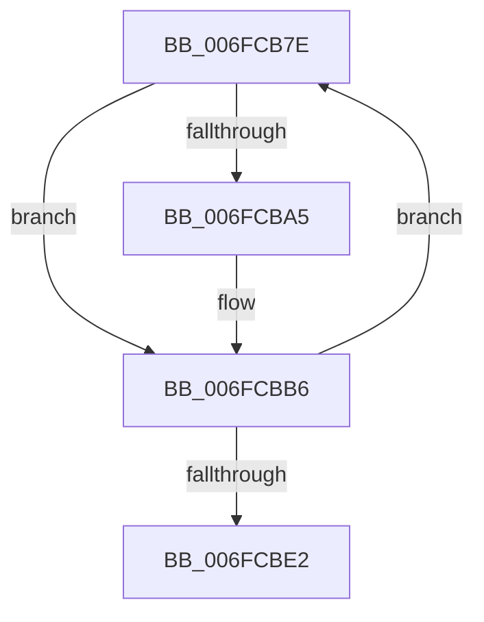

# sub_006FCB7E

- RVA: `0x006FCB7E`–`0x006FCBE7` (길이 `105` bytes)
- VA: `0x00000001406FCB7E`
- 실행 섹션: `.text`
- PDB 이름 있음: `아니요`; PDB Function 태그: `아니요`
- unwind 정보 RVA: `0x000BC5A0`
- 디코드: `28`개 명령, `105/105` bytes 표시
- 미해석 바이트: `0` (있으면 어셈블리에 `.byte`로 보존)

> 이 문서는 커널 이미지의 기계어와 PDB 기호를 분석해 생성했습니다. 4번과 5번은 함수 원형과 자료형을 바이너리 사용 방식에서 추정한 C 해석이며 원본 소스 복구 결과는 아닙니다.

## 1. Dependencies

- 직접 호출 지점: **4**; 고유 호출 대상: **4**
- 직접 호출자로 확인된 함수: **0**
- RIP 상대 이미지 참조: **0**

### Outgoing calls
- `0x006FCB99` → [KeAcquireInStackQueuedSpinLock](../27/KeAcquireInStackQueuedSpinLock_function_002757A0.md) (function, `0x002757A0`)
- `0x006FCBB1` → [CcScheduleLazyWriteScan](../3C/CcScheduleLazyWriteScan_function_003CBD20.md) (function, `0x003CBD20`)
- `0x006FCBCE` → [CcChargeDirtyPagesInternal](../3C/CcChargeDirtyPagesInternal_function_003CDE10.md) (function, `0x003CDE10`)
- `0x006FCBD8` → [KeReleaseInStackQueuedSpinLock](../34/KeReleaseInStackQueuedSpinLock_function_00342CE0.md) (function, `0x00342CE0`)

### Direct callers
- 이 함수 시작 RVA로 연결되는 직접 call은 확인되지 않았습니다. 간접 호출은 완전히 역산할 수 없습니다.

### Static image references
- 디코드된 RIP-relative 메모리 참조가 없습니다.

## 2. Other-region calls and transfers

- 다른 실행 섹션으로 향하는 call: **0**
- call이 아닌 외부 분기/꼬리 이동: **1**
  - `0x006FCBE2` → [CcAddDirtyPagesToExternalCache + 0x44](../4B/CcAddDirtyPagesToExternalCache_function_004BF620.md) (`tail-transfer`)

## 3. Assembly (complete function range)

```asm
006FCB7E  49 3B DD                        cmp rbx, r13
006FCB81  48 8D 54 24 30                  lea rdx, [rsp + 0x30]
006FCB86  8B EB                           mov ebp, ebx
006FCB88  48 8D 8E 00 03 00 00            lea rcx, [rsi + 0x300]
006FCB8F  41 0F 47 ED                     cmova ebp, r13d
006FCB93  44 8B FD                        mov r15d, ebp
006FCB96  49 2B DF                        sub rbx, r15
006FCB99  E8 02 8C B7 FF                  call 0x1402757a0
006FCB9E  48 83 7F 08 00                  cmp qword ptr [rdi + 8], 0
006FCBA3  75 11                           jne 0x1406fcbb6
006FCBA5  45 33 C9                        xor r9d, r9d
006FCBA8  45 33 C0                        xor r8d, r8d
006FCBAB  49 8B D6                        mov rdx, r14
006FCBAE  48 8B CE                        mov rcx, rsi
006FCBB1  E8 6A F1 CC FF                  call 0x1403cbd20
006FCBB6  4C 01 7F 08                     add qword ptr [rdi + 8], r15
006FCBBA  44 8B CD                        mov r9d, ebp
006FCBBD  4C 89 74 24 28                  mov qword ptr [rsp + 0x28], r14
006FCBC2  45 33 C0                        xor r8d, r8d
006FCBC5  33 D2                           xor edx, edx
006FCBC7  48 89 74 24 20                  mov qword ptr [rsp + 0x20], rsi
006FCBCC  33 C9                           xor ecx, ecx
006FCBCE  E8 3D 12 CD FF                  call 0x1403cde10
006FCBD3  48 8D 4C 24 30                  lea rcx, [rsp + 0x30]
006FCBD8  E8 03 61 C4 FF                  call 0x140342ce0
006FCBDD  48 85 DB                        test rbx, rbx
006FCBE0  75 9C                           jne 0x1406fcb7e
006FCBE2  E9 7D 2A DC FF                  jmp 0x1404bf664
```

## 4. C-style interpretation (structured pseudocode)

```c
__int64 __fastcall sub_006FCB7E(__int64 a1, __int64 a2, int a3, int a4, __int64 a5, __int64 a6)
{
    __int64 result;
    __int64 v_rbp;
    __int64 v_rbx;
    unsigned __int64 v_stack_p20;
    unsigned __int64 v_stack_p28;

    v_rbp = (unsigned int)((unsigned int)(v_rbx));
    if (v_rbx > v_r13) { v_rbp = (unsigned int)(v_r13); }
    v_rbx = (v_rbx) - ((unsigned int)((unsigned int)(v_rbp)));
    result = KeAcquireInStackQueuedSpinLock(v_rsi + 768, a6, a3, a4);
    if ((*(unsigned __int64 *)(v_rdi + 8)) == 0) {
        a4 = 0;
        a3 = 0;
        a2 = v_r14;
        a1 = v_rsi;
        result = CcScheduleLazyWriteScan(a1, a2, a3, a4);
    }
    v_stack_p28 = v_r14;
    a3 = 0;
    a2 = 0;
    v_stack_p20 = v_rsi;
    a1 = 0;
    result = CcChargeDirtyPagesInternal(a1, a2, a3, (unsigned int)((unsigned int)(v_rbp)));
    result = KeReleaseInStackQueuedSpinLock(a6, a2, a3, (unsigned int)((unsigned int)(v_rbp)));
    if (v_rbx != 0) goto loc_006FCB7E;
}
```

## 5. (Beta) C Style

```c
int64_t sub_006FCB7E(int64_t Arg1, int64_t Arg2, int32_t Arg3, int32_t Arg4, uint64_t Arg5, int64_t Arg6)
{
    int64_t result;
    int64_t local_rbp;
    int64_t local_rbx;
    uint64_t v_stack_p20;
    uint64_t v_stack_p28;

    local_rbp = (uint32_t)((uint32_t)(local_rbx));
    if (local_rbx > local_r13) { local_rbp = (uint32_t)(local_r13); }
    local_rbx = (local_rbx) - ((uint32_t)((uint32_t)(local_rbp)));
    result = KeAcquireInStackQueuedSpinLock(local_rsi + 768, Arg6, Arg3, Arg4);
    if ((*(uint64_t *)(local_rdi + 0x8)) == 0) {
        Arg4 = 0;
        Arg3 = 0;
        Arg2 = local_r14;
        Arg1 = local_rsi;
        result = CcScheduleLazyWriteScan(Arg1, Arg2, Arg3, Arg4);
    }
    v_stack_p28 = local_r14;
    Arg3 = 0;
    Arg2 = 0;
    v_stack_p20 = local_rsi;
    Arg1 = 0;
    result = CcChargeDirtyPagesInternal(Arg1, Arg2, Arg3, (uint32_t)((uint32_t)(local_rbp)));
    result = KeReleaseInStackQueuedSpinLock(Arg6, Arg2, Arg3, (uint32_t)((uint32_t)(local_rbp)));
    if (local_rbx != 0) goto loc_006FCB7E;
}
```

## 6. Execution-region graph

[열기: 2D/3D 그래프와 함수 탐색 컨트롤 패널](../../../control-panel.html?section=text&rva=0x006FCB7E&view=graph)

- 2D 그래프는 위에서 아래로 흐르고, 3D 그래프는 빈 공간을 드래그해 회전합니다. Shift+드래그는 이동, 휠은 확대·축소, 함수 노드 선택은 대상 보고서 이동입니다.

### Static fallback


