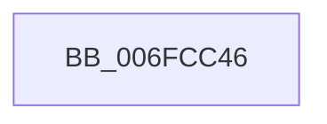

# sub_006FCC46

- RVA: `0x006FCC46`–`0x006FCC61` (길이 `27` bytes)
- VA: `0x00000001406FCC46`
- 실행 섹션: `.text`
- PDB 이름 있음: `아니요`; PDB Function 태그: `아니요`
- unwind 정보 RVA: `0x000BCFBC`
- 디코드: `7`개 명령, `27/27` bytes 표시
- 미해석 바이트: `0` (있으면 어셈블리에 `.byte`로 보존)

> 이 문서는 커널 이미지의 기계어와 PDB 기호를 분석해 생성했습니다. 4번과 5번은 함수 원형과 자료형을 바이너리 사용 방식에서 추정한 C 해석이며 원본 소스 복구 결과는 아닙니다.

## 1. Dependencies

- 직접 호출 지점: **1**; 고유 호출 대상: **1**
- 직접 호출자로 확인된 함수: **0**
- RIP 상대 이미지 참조: **0**

### Outgoing calls
- `0x006FCC56` → [guard_dispatch_icall](../6B/guard_dispatch_icall_function_006BAAD0.md) (function, `0x006BAAD0`)

### Direct callers
- 이 함수 시작 RVA로 연결되는 직접 call은 확인되지 않았습니다. 간접 호출은 완전히 역산할 수 없습니다.

### Static image references
- 디코드된 RIP-relative 메모리 참조가 없습니다.

## 2. Other-region calls and transfers

- 다른 실행 섹션으로 향하는 call: **0**
- call이 아닌 외부 분기/꼬리 이동: **1**
  - `0x006FCC5C` → [SMKM_STORE_MGR<SM_TRAITS>::SmHighMemPriorityWatchdogTimerCallback + 0x38](../4C/SMKM_STORE_MGR_SM_TRAITS_SmHighMemPriorityWatchdogTimerCallback_function_004C6560.md) (`tail-transfer`)

## 3. Assembly (complete function range)

```asm
006FCC46  48 8B 87 D8 07 00 00            mov rax, qword ptr [rdi + 0x7d8]
006FCC4D  33 D2                           xor edx, edx
006FCC4F  48 8B CF                        mov rcx, rdi
006FCC52  44 8D 42 09                     lea r8d, [rdx + 9]
006FCC56  E8 75 DE FB FF                  call 0x1406baad0
006FCC5B  90                              nop
006FCC5C  E9 37 99 DC FF                  jmp 0x1404c6598
```

## 4. C-style interpretation (structured pseudocode)

```c
__int64 __fastcall sub_006FCC46(__int64 a1, int a2)
{
    __int64 result;

    a2 = 0;
    result = guard_dispatch_icall(v_rdi, a2, a2 + 9, a4);
}
```

## 5. (Beta) C Style

```c
int64_t sub_006FCC46(int64_t Arg1, int32_t Arg2)
{
    int64_t result;

    Arg2 = 0;
    result = guard_dispatch_icall(local_rdi, Arg2, Arg2 + 9, a4);
}
```

## 6. Execution-region graph

[열기: 2D/3D 그래프와 함수 탐색 컨트롤 패널](../../../control-panel.html?section=text&rva=0x006FCC46&view=graph)

- 2D 그래프는 위에서 아래로 흐르고, 3D 그래프는 빈 공간을 드래그해 회전합니다. Shift+드래그는 이동, 휠은 확대·축소, 함수 노드 선택은 대상 보고서 이동입니다.

### Static fallback


