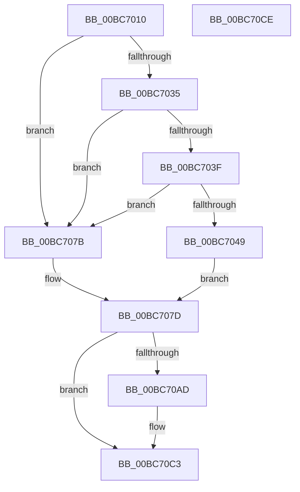

# KiTpCompletion

- RVA: `0x00BC7010`–`0x00BC70CF` (길이 `191` bytes)
- VA: `0x0000000140BC7010`
- 실행 섹션: `TRACESUP`
- PDB 이름 있음: `예`; PDB Function 태그: `아니요`
- unwind 정보 RVA: `0x00065960`
- 디코드: `48`개 명령, `191/191` bytes 표시
- 미해석 바이트: `0` (있으면 어셈블리에 `.byte`로 보존)

> 이 문서는 커널 이미지의 기계어와 PDB 기호를 분석해 생성했습니다. 4번과 5번은 함수 원형과 자료형을 바이너리 사용 방식에서 추정한 C 해석이며 원본 소스 복구 결과는 아닙니다.

## 1. Dependencies

- 직접 호출 지점: **1**; 고유 호출 대상: **1**
- 직접 호출자로 확인된 함수: **1**
- RIP 상대 이미지 참조: **1**

### Outgoing calls
- `0x00BC70A3` → [RtlpIcEmulateInstruction](RtlpIcEmulateInstruction_function_00BC7A08.md) (function, `0x00BC7A08`)

### Direct callers
- [KiTpHandleTrap](../../text/4F/KiTpHandleTrap_function_004F86B0.md) at `0x004F8798`
- [KiTpHandleTrap](../../text/4F/KiTpHandleTrap_function_004F86B0.md) at `0x004F87F9`
- [KiTpHandleTrap](../../text/4F/KiTpHandleTrap_function_004F86B0.md) at `0x004F883D`
- [KiTpHandleTrap](../../text/4F/KiTpHandleTrap_function_004F86B0.md) at `0x004F8890`

### Static image references
- `0x00BC703F` → RVA `0x00F4754C` (`.data`; read)

## 2. Other-region calls and transfers

- 다른 실행 섹션으로 향하는 call: **0**
- 별도 외부 분기/꼬리 이동을 확인하지 못했습니다.

## 3. Assembly (complete function range)

```asm
00BC7010  48 89 5C 24 08                  mov qword ptr [rsp + 8], rbx
00BC7015  57                              push rdi
00BC7016  48 83 EC 40                     sub rsp, 0x40
00BC701A  65 48 8B 04 25 20 00 00 00      mov rax, qword ptr gs:[0x20]
00BC7023  49 8B F8                        mov rdi, r8
00BC7026  4C 8B D1                        mov r10, rcx
00BC7029  4C 8B 80 98 00 00 00            mov r8, qword ptr [rax + 0x98]
00BC7030  4D 85 C0                        test r8, r8
00BC7033  74 46                           je 0x140bc707b
00BC7035  8B 80 88 2D 00 00               mov eax, dword ptr [rax + 0x2d88]
00BC703B  85 C0                           test eax, eax
00BC703D  75 3C                           jne 0x140bc707b
00BC703F  8B 05 07 05 38 00               mov eax, dword ptr [rip + 0x380507]
00BC7045  A8 03                           test al, 3
00BC7047  75 32                           jne 0x140bc707b
00BC7049  41 8B 88 00 20 00 00            mov ecx, dword ptr [r8 + 0x2000]
00BC7050  0F B6 D9                        movzx ebx, cl
00BC7053  48 C1 E3 05                     shl rbx, 5
00BC7057  49 03 D8                        add rbx, r8
00BC705A  8D 41 01                        lea eax, [rcx + 1]
00BC705D  41 89 80 00 20 00 00            mov dword ptr [r8 + 0x2000], eax
00BC7064  48 8B 87 F8 00 00 00            mov rax, qword ptr [rdi + 0xf8]
00BC706B  48 89 03                        mov qword ptr [rbx], rax
00BC706E  48 8B 87 98 00 00 00            mov rax, qword ptr [rdi + 0x98]
00BC7075  48 89 43 08                     mov qword ptr [rbx + 8], rax
00BC7079  EB 02                           jmp 0x140bc707d
00BC707B  33 DB                           xor ebx, ebx
00BC707D  0F 57 C0                        xorps xmm0, xmm0
00BC7080  33 C0                           xor eax, eax
00BC7082  0F 11 44 24 20                  movups xmmword ptr [rsp + 0x20], xmm0
00BC7087  48 89 54 24 20                  mov qword ptr [rsp + 0x20], rdx
00BC708C  49 8B CA                        mov rcx, r10
00BC708F  48 89 44 24 30                  mov qword ptr [rsp + 0x30], rax
00BC7094  48 8D 54 24 20                  lea rdx, [rsp + 0x20]
00BC7099  48 89 7C 24 28                  mov qword ptr [rsp + 0x28], rdi
00BC709E  44 88 4C 24 30                  mov byte ptr [rsp + 0x30], r9b
00BC70A3  E8 60 09 00 00                  call 0x140bc7a08
00BC70A8  48 85 DB                        test rbx, rbx
00BC70AB  74 16                           je 0x140bc70c3
00BC70AD  48 8B 8F F8 00 00 00            mov rcx, qword ptr [rdi + 0xf8]
00BC70B4  48 89 4B 10                     mov qword ptr [rbx + 0x10], rcx
00BC70B8  48 8B 8F 98 00 00 00            mov rcx, qword ptr [rdi + 0x98]
00BC70BF  48 89 4B 18                     mov qword ptr [rbx + 0x18], rcx
00BC70C3  48 8B 5C 24 50                  mov rbx, qword ptr [rsp + 0x50]
00BC70C8  48 83 C4 40                     add rsp, 0x40
00BC70CC  5F                              pop rdi
00BC70CD  C3                              ret
00BC70CE  CC                              int3
```

## 4. C-style interpretation (structured pseudocode)

```c
__int64 __fastcall KiTpCompletion(__int64 a1, __int64 a2, __int64 a3, unsigned __int8 a4)
{
    __int64 result;
    __int64 v_rbx;
    __int64 v_rsp;
    unsigned __int64 v_stack_m18;
    unsigned __int64 v_stack_m20;
    unsigned __int64 v_stack_m28;
    unsigned __int64 v_stack_p8;

    v_stack_p8 = v_rbx;
    v_rsp = (v_rsp) - (64);
    if (*(unsigned __int64 *)(*(unsigned __int64 *)(gs_base + (0 + 32)) + 152) == 0) goto loc_00BC707B;
    if ((unsigned int)((unsigned int)(*(unsigned int *)(*(unsigned __int64 *)(gs_base + (0 + 32)) + 11656))) != 0) goto loc_00BC707B;
    if ((((unsigned __int8)((unsigned int)(*(unsigned int *)(v_rip + 3671303)))) & (3)) != 0) goto loc_00BC707B;
    v_rbx = ((unsigned __int8)((unsigned int)(*(unsigned int *)(*(unsigned __int64 *)(*(unsigned __int64 *)(gs_base + (0 + 32)) + 152) + 8192)))) << (5);
    v_rbx = (v_rbx) + (*(unsigned __int64 *)(*(unsigned __int64 *)(gs_base + (0 + 32)) + 152));
    *(unsigned int *)(*(unsigned __int64 *)(*(unsigned __int64 *)(gs_base + (0 + 32)) + 152) + 8192) = (unsigned int)((unsigned int)(*(unsigned int *)(*(unsigned __int64 *)(*(unsigned __int64 *)(gs_base + (0 + 32)) + 152) + 8192)) + 1);
    *(unsigned __int64 *)(v_rbx) = *(unsigned __int64 *)(a3 + 248);
    *(unsigned __int64 *)(v_rbx + 8) = *(unsigned __int64 *)(a3 + 152);
    goto loc_00BC707D;
loc_00BC707B:
    v_rbx = 0;
loc_00BC707D:
    result = 0;
    v_stack_m28 = v_xmm0;
    v_stack_m28 = a2;
    v_stack_m18 = 0;
    v_stack_m20 = a3;
    v_stack_m18 = a4;
    result = RtlpIcEmulateInstruction(a1, v_stack_m28, *(unsigned __int64 *)(*(unsigned __int64 *)(gs_base + (0 + 32)) + 152), a4);
    if (0 != 0) {
        a1 = *(unsigned __int64 *)(a3 + 248);
        *(unsigned __int64 *)(v_rbx + 16) = a1;
        a1 = *(unsigned __int64 *)(a3 + 152);
        *(unsigned __int64 *)(v_rbx + 24) = a1;
    }
    v_rsp = (v_rsp) + (64);
    return result;
}
```

## 5. (Beta) C Style

```c
int64_t KiTpCompletion(int64_t Arg1, int64_t Arg2, void *Arg3, uint8_t Arg4)
{
    uint8_t *arg3 = (uint8_t *)Arg3;

    int64_t result;
    int64_t local_rbx;
    int64_t local_rsp;
    uint64_t v_stack_m18;
    uint64_t v_stack_m20;
    uint64_t v_stack_m28;
    uint64_t v_stack_p8;

    v_stack_p8 = local_rbx;
    local_rsp = (local_rsp) - (64);
    if (*(uint64_t *)(*(uint64_t *)(gs_base + (0 + 0x20)) + 0x98) == 0) goto loc_00BC707B;
    if ((uint32_t)((uint32_t)(*(uint32_t *)(*(uint64_t *)(gs_base + (0 + 0x20)) + 0x2D88))) != 0) goto loc_00BC707B;
    if ((((uint8_t)((uint32_t)(*(uint32_t *)(v_rip + 0x380507)))) & (3)) != 0) goto loc_00BC707B;
    local_rbx = ((uint8_t)((uint32_t)(*(uint32_t *)(*(uint64_t *)(*(uint64_t *)(gs_base + (0 + 0x20)) + 0x98) + 0x2000)))) << (5);
    local_rbx = (local_rbx) + (*(uint64_t *)(*(uint64_t *)(gs_base + (0 + 0x20)) + 0x98));
    *(uint32_t *)(*(uint64_t *)(*(uint64_t *)(gs_base + (0 + 0x20)) + 0x98) + 0x2000) = (uint32_t)((uint32_t)(*(uint32_t *)(*(uint64_t *)(*(uint64_t *)(gs_base + (0 + 0x20)) + 0x98) + 0x2000)) + 1);
    *(uint64_t *)(local_rbx) = *(uint64_t *)(arg3 + 0xF8);
    *(uint64_t *)(local_rbx + 0x8) = *(uint64_t *)(arg3 + 0x98);
    goto loc_00BC707D;
loc_00BC707B:
    local_rbx = 0;
loc_00BC707D:
    result = 0;
    v_stack_m28 = v_xmm0;
    v_stack_m28 = Arg2;
    v_stack_m18 = 0;
    v_stack_m20 = Arg3;
    v_stack_m18 = Arg4;
    result = RtlpIcEmulateInstruction(Arg1, v_stack_m28, *(uint64_t *)(*(uint64_t *)(gs_base + (0 + 0x20)) + 0x98), Arg4);
    if (0 != 0) {
        Arg1 = *(uint64_t *)(arg3 + 0xF8);
        *(uint64_t *)(local_rbx + 0x10) = Arg1;
        Arg1 = *(uint64_t *)(arg3 + 0x98);
        *(uint64_t *)(local_rbx + 0x18) = Arg1;
    }
    local_rsp = (local_rsp) + (64);
    return result;
}
```

### 관측된 메모리 오프셋

구조체 형식이 확인되지 않은 접근은 인자 기준의 오프셋으로만 기록했습니다.

| 기준 인자 | 오프셋 표현 | 폭 (bit) | 접근 |
|---|---:|---:|---|
| `Arg3` | `+ 0x98` | `64` | `R` |
| `Arg3` | `+ 0xF8` | `64` | `R` |

## 6. Execution-region graph

[열기: 2D/3D 그래프와 함수 탐색 컨트롤 패널](../../../control-panel.html?section=tracesup&rva=0x00BC7010&view=graph)

- 2D 그래프는 위에서 아래로 흐르고, 3D 그래프는 빈 공간을 드래그해 회전합니다. Shift+드래그는 이동, 휠은 확대·축소, 함수 노드 선택은 대상 보고서 이동입니다.

### Static fallback


