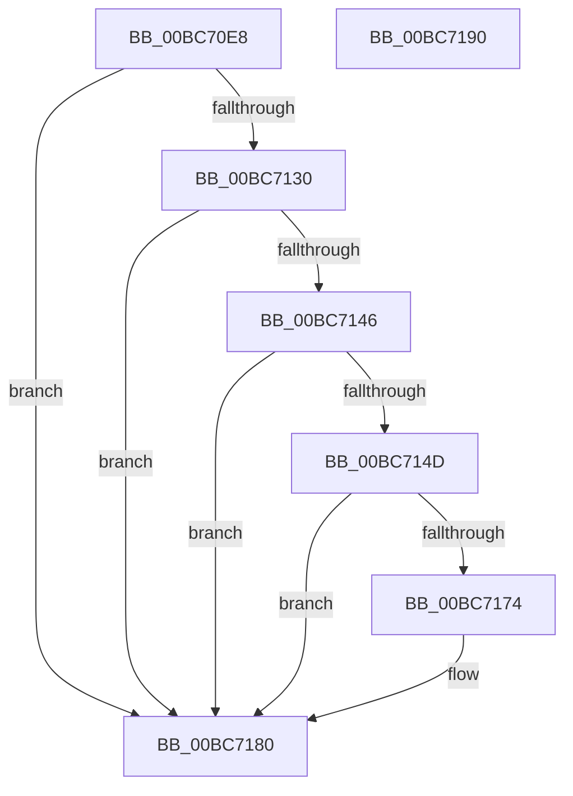

# RtlIcParseInstruction

- RVA: `0x00BC70E8`–`0x00BC7191` (길이 `169` bytes)
- VA: `0x0000000140BC70E8`
- 실행 섹션: `TRACESUP`
- PDB 이름 있음: `예`; PDB Function 태그: `아니요`
- unwind 정보 RVA: `0x000ADC24`
- 디코드: `50`개 명령, `169/169` bytes 표시
- 미해석 바이트: `0` (있으면 어셈블리에 `.byte`로 보존)

> 이 문서는 커널 이미지의 기계어와 PDB 기호를 분석해 생성했습니다. 4번과 5번은 함수 원형과 자료형을 바이너리 사용 방식에서 추정한 C 해석이며 원본 소스 복구 결과는 아닙니다.

## 1. Dependencies

- 직접 호출 지점: **4**; 고유 호출 대상: **2**
- 직접 호출자로 확인된 함수: **1**
- RIP 상대 이미지 참조: **0**

### Outgoing calls
- `0x00BC7127` → [KiTpReadImageData](../../page/74/KiTpReadImageData_function_007489B4.md) (function, `0x007489B4`)
- `0x00BC713A` → [RtlpIcParseInstruction](RtlpIcParseInstruction_function_00BC84F0.md) (function, `0x00BC84F0`)
- `0x00BC716B` → [KiTpReadImageData](../../page/74/KiTpReadImageData_function_007489B4.md) (function, `0x007489B4`)
- `0x00BC717B` → [RtlpIcParseInstruction](RtlpIcParseInstruction_function_00BC84F0.md) (function, `0x00BC84F0`)

### Direct callers
- [KiTpSetupCompletion](../../page/74/KiTpSetupCompletion_function_00748AC4.md) at `0x00748B05`

### Static image references
- 디코드된 RIP-relative 메모리 참조가 없습니다.

## 2. Other-region calls and transfers

- 다른 실행 섹션으로 향하는 call: **2**
  - `0x00BC7127` → [KiTpReadImageData](../../page/74/KiTpReadImageData_function_007489B4.md) (`TRACESUP` → `PAGE`)
  - `0x00BC716B` → [KiTpReadImageData](../../page/74/KiTpReadImageData_function_007489B4.md) (`TRACESUP` → `PAGE`)
- 별도 외부 분기/꼬리 이동을 확인하지 못했습니다.

## 3. Assembly (complete function range)

```asm
00BC70E8  4C 8B DC                        mov r11, rsp
00BC70EB  49 89 5B 08                     mov qword ptr [r11 + 8], rbx
00BC70EF  49 89 73 10                     mov qword ptr [r11 + 0x10], rsi
00BC70F3  45 88 43 18                     mov byte ptr [r11 + 0x18], r8b
00BC70F7  57                              push rdi
00BC70F8  48 83 EC 20                     sub rsp, 0x20
00BC70FC  33 C0                           xor eax, eax
00BC70FE  49 8B D9                        mov rbx, r9
00BC7101  21 44 24 40                     and dword ptr [rsp + 0x40], eax
00BC7105  0F 57 C0                        xorps xmm0, xmm0
00BC7108  41 0F 11 01                     movups xmmword ptr [r9], xmm0
00BC710C  48 8B FA                        mov rdi, rdx
00BC710F  41 0F 11 41 10                  movups xmmword ptr [r9 + 0x10], xmm0
00BC7114  49 89 41 20                     mov qword ptr [r9 + 0x20], rax
00BC7118  44 8D 40 0F                     lea r8d, [rax + 0xf]
00BC711C  4D 8D 4B 18                     lea r9, [r11 + 0x18]
00BC7120  48 8B CF                        mov rcx, rdi
00BC7123  48 8D 53 06                     lea rdx, [rbx + 6]
00BC7127  E8 88 18 B8 FF                  call 0x1407489b4
00BC712C  85 C0                           test eax, eax
00BC712E  78 50                           js 0x140bc7180
00BC7130  8A 44 24 40                     mov al, byte ptr [rsp + 0x40]
00BC7134  48 8B CB                        mov rcx, rbx
00BC7137  88 43 05                        mov byte ptr [rbx + 5], al
00BC713A  E8 B1 13 00 00                  call 0x140bc84f0
00BC713F  3D 06 02 00 C0                  cmp eax, 0xc0000206
00BC7144  75 3A                           jne 0x140bc7180
00BC7146  83 7C 24 40 0F                  cmp dword ptr [rsp + 0x40], 0xf
00BC714B  73 33                           jae 0x140bc7180
00BC714D  33 C0                           xor eax, eax
00BC714F  48 8D 53 06                     lea rdx, [rbx + 6]
00BC7153  0F 57 C0                        xorps xmm0, xmm0
00BC7156  45 33 C9                        xor r9d, r9d
00BC7159  0F 11 03                        movups xmmword ptr [rbx], xmm0
00BC715C  48 8B CF                        mov rcx, rdi
00BC715F  0F 11 43 10                     movups xmmword ptr [rbx + 0x10], xmm0
00BC7163  44 8D 40 0F                     lea r8d, [rax + 0xf]
00BC7167  48 89 43 20                     mov qword ptr [rbx + 0x20], rax
00BC716B  E8 44 18 B8 FF                  call 0x1407489b4
00BC7170  85 C0                           test eax, eax
00BC7172  78 0C                           js 0x140bc7180
00BC7174  48 8B CB                        mov rcx, rbx
00BC7177  C6 43 05 0F                     mov byte ptr [rbx + 5], 0xf
00BC717B  E8 70 13 00 00                  call 0x140bc84f0
00BC7180  48 8B 5C 24 30                  mov rbx, qword ptr [rsp + 0x30]
00BC7185  48 8B 74 24 38                  mov rsi, qword ptr [rsp + 0x38]
00BC718A  48 83 C4 20                     add rsp, 0x20
00BC718E  5F                              pop rdi
00BC718F  C3                              ret
00BC7190  CC                              int3
```

## 4. C-style interpretation (structured pseudocode)

```c
__int64 __fastcall RtlIcParseInstruction(__int64 a1, __int64 a2, unsigned __int8 a3, __int64 a4)
{
    __int64 result;
    __int64 v_rsp;
    unsigned __int64 v_stack_p10;
    unsigned int v_stack_p18;
    unsigned __int64 v_stack_p8;

    *(unsigned __int64 *)(v_rsp + 8) = v_rbx;
    *(unsigned __int64 *)(v_rsp + 16) = v_rsi;
    *(unsigned __int8 *)(v_rsp + 24) = a3;
    v_rsp = (v_rsp) - (32);
    result = 0;
    *(unsigned __int64 *)(a4) = v_xmm0;
    *(unsigned __int64 *)(a4 + 16) = v_xmm0;
    *(unsigned __int64 *)(a4 + 32) = 0;
    result = KiTpReadImageData(a2, a4 + 6, result + 15, v_rsp + 24);
    if (sign_flag) goto loc_00BC7180;
    *(unsigned __int8 *)(a4 + 5) = (unsigned __int8)(v_stack_p18);
    result = RtlpIcParseInstruction(a4, a4 + 6, result + 15, v_rsp + 24);
    if (((unsigned int)(result)) != 0xC0000206ULL) goto loc_00BC7180;
    if (v_stack_p18 >= 15) goto loc_00BC7180;
    result = 0;
    a4 = 0;
    *(unsigned __int64 *)(a4) = v_xmm0;
    *(unsigned __int64 *)(a4 + 16) = v_xmm0;
    *(unsigned __int64 *)(a4 + 32) = 0;
    result = KiTpReadImageData(a2, a4 + 6, result + 15, a4);
    if (!(sign_flag)) {
        a1 = 0;
        *(unsigned __int8 *)(a4 + 5) = 15;
        result = RtlpIcParseInstruction(a1, a4 + 6, result + 15, a4);
    }
    v_rsp = (v_rsp) + (32);
    return result;
}
```

## 5. (Beta) C Style

```c
int64_t RtlIcParseInstruction(int64_t Arg1, int64_t Arg2, uint8_t Arg3, void *Arg4)
{
    uint8_t *arg4 = (uint8_t *)Arg4;

    int64_t result;
    int64_t local_rsp;
    uint64_t v_stack_p10;
    uint32_t v_stack_p18;
    uint64_t v_stack_p8;

    *(uint64_t *)(local_rsp + 0x8) = local_rbx;
    *(uint64_t *)(local_rsp + 0x10) = local_rsi;
    *(uint8_t *)(local_rsp + 0x18) = Arg3;
    local_rsp = (local_rsp) - (32);
    result = 0;
    *(uint64_t *)(arg4) = v_xmm0;
    *(uint64_t *)(arg4 + 0x10) = v_xmm0;
    *(uint64_t *)(arg4 + 0x20) = 0;
    result = KiTpReadImageData(Arg2, Arg4 + 6, result + 15, local_rsp + 24);
    if (sign_flag) goto loc_00BC7180;
    *(uint8_t *)(arg4 + 0x5) = (uint8_t)(v_stack_p18);
    result = RtlpIcParseInstruction(Arg4, Arg4 + 6, result + 15, local_rsp + 24);
    if (((uint32_t)(result)) != 0xC0000206ULL) goto loc_00BC7180;
    if (v_stack_p18 >= 15) goto loc_00BC7180;
    result = 0;
    Arg4 = 0;
    *(uint64_t *)(arg4) = v_xmm0;
    *(uint64_t *)(arg4 + 0x10) = v_xmm0;
    *(uint64_t *)(arg4 + 0x20) = 0;
    result = KiTpReadImageData(Arg2, Arg4 + 6, result + 15, Arg4);
    if (!(sign_flag)) {
        Arg1 = 0;
        *(uint8_t *)(arg4 + 0x5) = 15;
        result = RtlpIcParseInstruction(Arg1, Arg4 + 6, result + 15, Arg4);
    }
    local_rsp = (local_rsp) + (32);
    return result;
}
```

### 관측된 메모리 오프셋

구조체 형식이 확인되지 않은 접근은 인자 기준의 오프셋으로만 기록했습니다.

| 기준 인자 | 오프셋 표현 | 폭 (bit) | 접근 |
|---|---:|---:|---|
| `Arg4` | `+ 0x0` | `128` | `R` |
| `Arg4` | `+ 0x5` | `8` | `W` |
| `Arg4` | `+ 0x6` | `64` | `R` |
| `Arg4` | `+ 0x10` | `128` | `R` |
| `Arg4` | `+ 0x20` | `64` | `W` |

## 6. Execution-region graph

[열기: 2D/3D 그래프와 함수 탐색 컨트롤 패널](../../../control-panel.html?section=tracesup&rva=0x00BC70E8&view=graph)

- 2D 그래프는 위에서 아래로 흐르고, 3D 그래프는 빈 공간을 드래그해 회전합니다. Shift+드래그는 이동, 휠은 확대·축소, 함수 노드 선택은 대상 보고서 이동입니다.

### Static fallback


